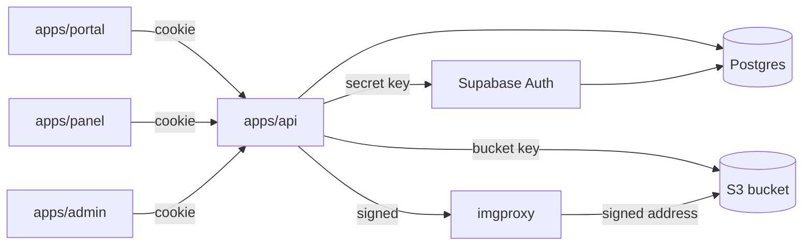

# OPOS — architecture

The rules of the code that no single file shows. How a part works is in its code and tests; product
intent and business rules are in [PRODUCT.md](PRODUCT.md); why a rule is so, and what is decided but
not built, in the [decision records](adr/README.md) and the [specs](specs/README.md); how to work
here in [AGENTS.md](../AGENTS.md).

## Applications and packages

| Part                | Role                                                                                                                                                                                                                                                                                                                                                |
| ------------------- | --------------------------------------------------------------------------------------------------------------------------------------------------------------------------------------------------------------------------------------------------------------------------------------------------------------------------------------------------- |
| `apps/api`          | NestJS, Drizzle ([0005](adr/0005-build-the-api-with-nestjs-and-drizzle.md)), oRPC ([0006](adr/0006-define-the-api-in-an-orpc-contract.md)): the only backend, and the only holder of a Supabase address or key                                                                                                                                      |
| `apps/panel`        | the organizers' SPA, desktop-first; later also the scanner under `/scanner`                                                                                                                                                                                                                                                                         |
| `apps/portal`       | the attendees' SPA, mobile-first: home page with the list of editions, account, convention and edition pages, likes, schedule                                                                                                                                                                                                                       |
| `apps/admin`        | the admins' SPA: the conventions with their suspension and deletion, the reset of an account's two-factor authentication, the log ([0029](adr/0029-ship-four-web-applications.md))                                                                                                                                                                  |
| `packages/contract` | the oRPC contract with zod schemas, the single source of the API's shape                                                                                                                                                                                                                                                                            |
| `packages/db`       | schema, migrations, database roles, seed, verification, the scripts that grant the admin role and take it away                                                                                                                                                                                                                                      |
| `packages/i18n`     | locales, detection, formatters and the shared catalog                                                                                                                                                                                                                                                                                               |
| Supabase            | a hosted project per environment, in the EU: Postgres and Supabase Auth only, the Data API off ([0003](adr/0003-use-hosted-supabase-for-postgres-and-auth-only.md))                                                                                                                                                                                 |
| S3 bucket           | the uploaded files, one private bucket per environment, in the EU and encrypted at rest; the API holds its key, which opens it alone ([0041](adr/0041-keep-uploaded-files-in-an-s3-bucket-behind-the-api.md)), and so does the seed, on `local` and `dev`, for its demo files ([0045](adr/0045-let-the-seed-put-its-demo-files-into-the-bucket.md)) |
| imgproxy            | makes an image's master and its variants, reached by the API alone with signed requests, reading one object at an address the API signed for a minute ([0042](adr/0042-keep-a-cleaned-master-of-an-image-and-make-its-variants-in-imgproxy.md))                                                                                                     |

- The packages have no build step; only the translation catalogs compile.
- **The BFF boundary**
  ([0004](adr/0004-make-the-api-the-only-backend-with-the-session-in-cookies.md)). The panel, the
  portal and the admin application talk to the API alone: no `@supabase/*` package, Supabase
  address or key, or `VITE_*` variable naming Supabase in their sources or bundles. The `react`
  ESLint preset refuses the import, [bff-boundary.mjs](../scripts/bff-boundary.mjs) the rest (a
  hook, `pre-commit`, and CI over the built bundles), and every e2e scenario a request that leaves
  the API and the page's own origin.
- **Files** are uploaded and read through the API alone: no browser reaches the bucket or
  imgproxy. The storage in `apps/api/src/modules/files` knows a file's owner, an account, a
  convention or an edition, and nothing of what it is for; a feature declares its kinds of file,
  with the variants of a kind of images, and its own routes take and serve them under its own
  requirement. A file never changes, keeps only the inert types PDF, JPEG, PNG and WebP, each
  checked against its content, and an image is kept as a cleaned master, decoded only by imgproxy.
- **The admin** works in the admin application, through the admin routes of the API
  ([0029](adr/0029-ship-four-web-applications.md)). Only granting the admin role and taking it
  away are scripts, run on the server as `postgres` (`pnpm db:admin:grant`,
  `pnpm db:admin:revoke`): no route and no screen does either.

Dev's deployment is described in [infra](../infra/README.md) but not running yet
([0033](adr/0033-host-dev-on-the-teams-coolify-server-and-leave-productions-hosting-open.md)); a
deployed environment reaches its database directly, with TLS verified against Supabase's CA
([0039](adr/0039-verify-postgres-tls-against-the-supabase-ca-trusted-by-node.md)). The backups are
decided but not built ([0014](adr/0014-back-up-production-beyond-supabase.md)), nor is a deployed
environment's bucket of uploaded files with its imgproxy, which the API needs to start; the modules
[waiting for their domain owner](#modules-waiting-for-their-domain-owner) have only their rules.

## Tenant isolation

Row-level multitenancy under RLS, not only a `where` in code
([0002](adr/0002-isolate-tenants-by-row-under-postgres-rls.md)). A tenant table carries its own
`tenant_id` (never only an `edition_id`), a composite foreign key to its parent's `(id, tenant_id)`
and an index starting with `tenant_id`.

| Role                                    | May                                                                                                                               | Used by                                                                                                         |
| --------------------------------------- | --------------------------------------------------------------------------------------------------------------------------------- | --------------------------------------------------------------------------------------------------------------- |
| `postgres`                              | owns the OPOS tables; `BYPASSRLS`, not a superuser                                                                                | migrations, `db:*` scripts, the seed, the backup; never the running API                                         |
| `opos_app`                              | `select`; `insert`, `delete` and per-column `update` only where the API writes; bypasses nothing, owns nothing, member of no role | the API                                                                                                         |
| `opos_app_global`                       | `BYPASSRLS`; `select` on the columns the cross-tenant queries read, nothing else                                                  | `GlobalDbService` alone                                                                                         |
| `opos_admin`                            | `BYPASSRLS`; only what the admin routes read and write, its reads by column                                                       | `AdminDbService` alone ([0030](adr/0030-guard-admin-access-with-its-own-role-application-and-second-factor.md)) |
| `anon`, `authenticated`, `service_role` | nothing in `public`                                                                                                               | nobody                                                                                                          |

`pnpm db:roles` ([roles.ts](../packages/db/src/roles.ts)) sets the runtime roles up with their
timeouts and strips Supabase's default grants; it runs on every new database, after a change to it
and after every restore.

- **Policy.** A covered table has RLS enabled and forced, and one permissive policy
  `tenant_isolation` with `USING` and `WITH CHECK` both
  `tenant_id = (select current_setting('app.tenant_id')::uuid)` (`id` on `tenants`), without
  `missing_ok`, so a missing context raises. No other permissive policy may exist.
- **Context.** A tenant request is one transaction on `opos_app`:
  [setTenantContext](../packages/db/src/rls.ts) sets `set_config('app.tenant_id', $1, true)` and
  refuses any other role, and repositories take it from `TenantContextService.tx()`, which throws
  outside one. Without the tenant header, `withTenant` opens it from a cross-tenant lookup or a
  verified token. The queries that decide access filter on the tenant themselves too. No tenant
  transaction goes on for a suspended tenant: the check sits where the transaction opens, so it
  holds for every way in (`403` `tenant.suspended`;
  [0031](adr/0031-suspend-a-tenant-before-deleting-it.md)).
- **Global tables.** `accounts`, `account_recovery_codes` and `account_files` have no RLS: column
  privileges limit them, and the API reaches there only the account a verified token, a fresh
  session or a signed hook names; the sweep alone removes an account's file nothing points at.
  Another account is read only in a tenant transaction, through a tenant table, by a confirmed
  email behind a write permission and a rate limit of the tenant, or by the confirmed email of
  an order as it is paid or written to, which answers nothing to the buyer; or behind
  `@RequireAdmin`, as a tenant's head, as an account an entry of the log names, or by its email
  address for a new tenant's first head and for a reset of two-factor authentication.
  The admin's tables are global too, and `opos_app` and `opos_app_global` hold nothing on them:
  `admins` is written by `postgres` alone, each grant bound to the one verified factor its account
  holds; `admin_actions` only grows, each entry dated by the database, a grant and a withdrawal
  of the role recorded by a script alone; and `retired_tenant_slugs` is out of every runtime
  role's reach, written and read by triggers of `tenants`.

**Cross-tenant queries** run only in
[GlobalDbService](../apps/api/src/common/database/global-db.service.ts):

| Query                               | Bound                                                                                                                                            |
| ----------------------------------- | ------------------------------------------------------------------------------------------------------------------------------------------------ |
| a tenant by slug                    | its public columns, and whether it is suspended: a public route answers a suspended one as an unknown address                                    |
| `GET /me/memberships`               | the session's account; expired memberships left out, and the editions of a suspended tenant                                                      |
| `GET /me/schedule`                  | the session's own likes; published editions only, of tenants not suspended                                                                       |
| `GET /public/editions`              | publication: the published editions of tenants not suspended, with the columns anyone reads of each one convention at a time                     |
| `DELETE /me`                        | the session's account; answers only whether it is a tenant's last head                                                                           |
| the sweep of files                  | the API's own job; the identifiers, owners and kinds of files, and whether a feature's row points at one                                         |
| a payment attempt by its identifier | the address of a provider's notification; it answers the tenant and the provider alone, and nothing counts before the provider's signature holds |
| the orders whose hold ended         | the API's own job; identifiers alone, of tenants not suspended                                                                                   |
| the emails of orders that are due   | the API's own job; identifiers alone, of tenants not suspended                                                                                   |

A new one is bound by the session's account or its confirmed email address, a secret the caller
proved (a signature, a link or device token), the API's own job, or publication, for what anyone
already reads one convention at a time
([0043](adr/0043-list-every-published-edition-on-the-portals-home-page.md)); it joins this table
and puts its columns into `globalReads` of [verify.ts](../packages/db/src/verify.ts). What a query
bound by publication answers is the schema of its route: a field added there is public at once,
for every convention.

**The admin routes** read and write across tenants on `opos_admin`, only in
[AdminDbService](../apps/api/src/modules/admin/admin-db.service.ts) and only behind
`@RequireAdmin`: their bound is the admin role of the session's account. They never open a tenant
transaction, read nothing of a tenant's team but its heads and nothing of its editions or
programme, and write each change with its entry of the log in one transaction; what the role may
reach is in `adminReads`, `adminWrites`, `adminInserts` and `adminUpdates` of verify.ts.

**Migrations.** RLS, grants and triggers are hand-written in the PR of their table; a merged
migration never changes. `opos_app` never updates `id`, `tenant_id` or a column pointing at an
account or another row. `tenants` rows are inserted, deleted, suspended and given a new slug only by
`opos_admin`, behind the admin routes, and by the seed; `opos_app` updates `name`, `default_locale`
and `timezone` alone. Nothing is written into `auth`; OPOS's triggers on `auth.users` and
`auth.mfa_factors` are listed in verify.ts. A `security definer` function pins `search_path = ''`
and no runtime role may execute it; constraints have explicit names, since errors map to codes by
them. `pnpm db:verify` checks the policies, grants, roles, functions and triggers, each check with a
case in [verify.test.ts](../packages/db/test/verify.test.ts);
[check-migrations.mjs](../scripts/check-migrations.mjs) refuses a change to a merged migration.

## Invariants

| #   | Invariant                                                                                                                   | Enforced by                                                                                                                                                                                  |
| --- | --------------------------------------------------------------------------------------------------------------------------- | -------------------------------------------------------------------------------------------------------------------------------------------------------------------------------------------- |
| 1   | At most one active edition per tenant                                                                                       | a partial unique index; activation locks the tenant row                                                                                                                                      |
| 2   | At least one `head` per tenant, also against deleting the last head's account                                               | constraint triggers deferred to commit, locking the tenant row                                                                                                                               |
| 3   | An edition membership stays in the tenant of its membership and edition                                                     | composite foreign keys                                                                                                                                                                       |
| 4   | A tenant write carries the tenant of the context                                                                            | `TenantContextService.tx()`; `WITH CHECK`                                                                                                                                                    |
| 5   | Every `auth.users` row has exactly one `accounts` row                                                                       | an insert trigger, a cascading foreign key                                                                                                                                                   |
| 6   | A `head` never expires and holds no tenant-level permission                                                                 | check constraints                                                                                                                                                                            |
| 7   | An attendee registration stays in its edition's tenant and goes with its account                                            | a composite foreign key, a cascade                                                                                                                                                           |
| 8   | Speakers, likes and reviews stay in the tenant of their programme item                                                      | composite foreign keys                                                                                                                                                                       |
| 9   | A limit on what is sold holds under concurrent sales and changes of the limit                                               | a sale, and a change of a capacity or a stock, lock the rows carrying the limit in one fixed order before counting ([0053](adr/0053-lock-the-rows-that-carry-a-limit-in-one-fixed-order.md)) |
| 10  | Two scans of one ticket never act on the same state                                                                         | a conditional update or a row lock, never a read first                                                                                                                                       |
| 11  | A scanner works only inside its tenant and edition                                                                          | its tenant's context; every query filters on its edition                                                                                                                                     |
| 12  | `accounts.mfaEnabledAt` is set exactly while a verified factor exists                                                       | the trigger on `auth.mfa_factors`, locking the account row                                                                                                                                   |
| 13  | A tenant is deleted only while suspended                                                                                    | the statement that deletes it judges the suspension itself                                                                                                                                   |
| 14  | The slug of a deleted tenant is never a tenant's again; the seed alone frees the slugs of its demo tenants                  | triggers of `tenants`: one retires the slug with the tenant, one refuses it after the unique index, and any slug above READ COMMITTED, where it could not see one retired since              |
| 15  | An order holds at most one ticket                                                                                           | a partial unique index                                                                                                                                                                       |
| 16  | What an order names is never deleted from under it: its edition, what it sold, what its ticket holder answered and accepted | foreign keys that do not cascade ([0048](adr/0048-keep-what-an-order-names-with-foreign-keys-that-do-not-cascade.md))                                                                        |

Invariants 7, 10 and 11 belong to [modules not built yet](#modules-waiting-for-their-domain-owner);
[invariants.test.ts](../packages/db/test/invariants.test.ts),
[tenants.test.ts](../packages/db/test/tenants.test.ts) and
[accounts.test.ts](../packages/db/test/accounts.test.ts) cover the database-side ones.

## Permissions

The model is in [PRODUCT.md](PRODUCT.md#5-roles-and-permissions), the decision in
[permissions.ts](../apps/api/src/common/permissions/permissions.ts).

- `none < read < write`. A `head` passes every check; an expired membership counts as none, its
  expiry measured when the read runs (`statement_timestamp()`), not when the transaction began.
- Tenant-level permissions (`settings`, `branding`, `shop`) never grant edition-level ones
  (`program`, `websiteContent`, `tickets`).
- A non-member gets `403` before any edition is looked up. For a member, a row of another tenant or
  of another parent than the path names, and an identifier that is not a uuid, are `404`; so is a
  row of another parent that a body names.
- A tenant route takes exactly one of `@RequireTenant`, `@RequireEdition` or, as the exception,
  `@InTenant`: no membership, so the handler's filters are its only guard, and no write lock, so it
  lowers nobody's access. Each applies `JwtAuthGuard`.
- An admin route takes `@RequireAdmin` and nothing else: `JwtAuthGuard`, then the admin
  application's `Origin` (`403` `request.origin-denied`), the role (`403` `permission.denied`),
  two-factor authentication on (`403` `admin.mfa-not-enabled`) with the factor of the grant (`403`
  `admin.grant-outdated`), and a recent sign-in. No route grants the role or takes it away
  ([0030](adr/0030-guard-admin-access-with-its-own-role-application-and-second-factor.md)).
- A route at `write` checks, waits in its tenant's queue in the API process, takes the tenant's
  advisory lock and checks again (`503` `request.busy` past the limit;
  [0008](adr/0008-serialize-the-writes-of-a-tenant.md)). Every route that lowers a member's access
  is a write route, except `DELETE /me`, which lowers only the account's own; reads neither queue
  nor lock.
- Anti-escalation is set in PRODUCT.md and enforced by the API on locked memberships. An invitation
  stands only while its sender could still send it.

## Sessions and sign-in

- The API keeps the session Supabase Auth issues in `HttpOnly`, `SameSite=Strict` cookies on its own
  host, `Secure` beyond local `http`, a pair per application chosen by the request's `Origin`. No
  response carries a token
  ([0004](adr/0004-make-the-api-the-only-backend-with-the-session-in-cookies.md)).
- Only the API calls Supabase Auth, with the secret key and the visitor's address in
  `Sb-Forwarded-For`; a refusal reaches the browser as a code `auth.<error_code>`, never as its
  text. Its emails go through a signed hook to the API, which renders them.
- `JwtAuthGuard` accepts ES256 alone, against the project's JWKS, with `aud = authenticated`,
  `iss = <SUPABASE_URL>/auth/v1`, `exp`, a uuid `sub`, no `is_anonymous` and an `accounts` row. The
  session travels only in the cookies: a token in `Authorization` is no session. Keys out of reach
  answer `503`, never `401`: an outage signs nobody out.
- A request that changes state with a session cookie needs the `Origin` of an application (`403`
  `request.origin-denied`) and a JSON body (`415`): with `SameSite=Strict`, the CSRF protection.
  CORS names the applications, never `*`.
- **The admin application** has an origin and a cookie pair of its own, its refresh cookie kept for
  30 minutes. Its origin reaches only the admin routes, sign-in, refresh, sign-out, the code of
  two-factor authentication and the account's own name, language and theme; anything else answers
  `403` `request.origin-denied`, so a flaw in it cannot change an admin's credentials
  ([0030](adr/0030-guard-admin-access-with-its-own-role-application-and-second-factor.md)). An API
  process without the admin application's address and the connection of `opos_admin` serves none.
- **The password comes after the confirmation**: a sign-up takes none, and the button of a link
  that confirms the address, never its opening, replaces any password set before. **An email address
  leads to an account only once confirmed**, in every lookup by email; sign-up, resending and
  password reset answer alike for any address.
- `DELETE /me`, `PUT /auth/password`, `POST /auth/mfa/enroll` and `DELETE /auth/mfa` need a
  sign-in younger than 5 minutes (`session.reauthentication-required`); a recovery code needs none,
  it is the proof. A new password and a factor the account removes itself end the account's other
  sessions; a reset of two-factor authentication by an admin ends none, since Supabase Auth's
  admin API ends a session only with that session's own token. Every admin route needs a sign-in
  younger than 30 minutes, and deleting a tenant and resetting an account's two-factor
  authentication one younger than 5.
- **Two-factor authentication.** With a verified factor, a session below `aal2` reaches only the
  code routes, refresh and sign-out; every other route answers `401` `session.mfa-required` before
  any permission check, by invariant 12, so an older token loses access at once.
- A redirect, Google sign-in's included, leads only to a path of the application that started it.
- The cookies are safe only while no subdomain serves content a tenant controls: the feature that
  first does moves them to `__Host-` names. The API serves the files a tenant or an account
  uploaded from its own origin, but only inert types, under their stored type with `nosniff`, a
  content security policy that allows nothing and sandboxes them, a resource policy of the same
  site, and a PDF as a download. Dev's hosts sit under `opos.land` too, so they move
  before production is deployed
  ([0034](adr/0034-address-dev-under-dev-opos-land-in-a-dns-zone-of-its-own.md)).

## API conventions

- The contract is the single source of the API: a route starts from `publicRoute`, `accountRoute`,
  `tenantRoute` or `adminRoute` of [common.ts](../packages/contract/src/common.ts)
  ([0006](adr/0006-define-the-api-in-an-orpc-contract.md)). An admin route lives under `/admin/`,
  and nothing else does.
- An error is `{ code, params?, message }`, its code in
  [errors.ts](../packages/contract/src/errors.ts). The UI shows the code through the catalog, never
  the English `message`.
- A tenant request is one transaction: an exception or a status of `300` or more rolls it back, and
  the response waits for the commit
  ([0007](adr/0007-run-each-tenant-request-in-one-transaction.md)).
- Outbound I/O never runs inside a transaction. Started by a tenant request, it waits for the
  commit (`afterCommit`), and its failure is logged while the response stands; a send the business
  cannot lose keeps an outbox. A call to Supabase Auth outside a transaction answers with its own
  failure.
- **A route that takes a file** (`takesFile` in the contract, `@TakesFile` in the API) is a write:
  its requirement is judged, then the file in its JSON body, up to 21 MB, is received outside every
  transaction, then its one transaction keeps it; every other route keeps the default body limit.
  **A route that serves a file** (`servesFile`, `@ServesFile`) is judged in a short transaction and
  reads the bucket outside every transaction. A public route serves only a file that is for
  everyone, after its own check in a short transaction of the tenant its address names, and never
  takes one. The routes that take a file share one rate limit per
  account. The bucket or imgproxy out of reach stops nothing else of the API.
- **A route that asks outside before it writes** (`@Prepares`), as connecting a payment provider
  account does, is a write: its requirement is judged, then the call out runs outside every
  transaction, then its one transaction judges the actor again and acts on the answer. An answer
  for an actor refused meanwhile is stored nowhere. A route that asks no membership may prepare
  too, as placing an account's order does for its bot check, and one that asks outside between
  its writes (`@CallsOut`), as the start of a payment attempt does, runs its handler outside
  every transaction and opens its tenant's own.
- **The API's own jobs** run in each process, each safe with several: the sweep of files daily
  behind an advisory lock, so one process sweeps at a time, removing, once older than 24 hours,
  a file's row nothing points at and an object no row explains; the expiry of orders every
  minute and the outbox of their emails every quarter of a minute, each claiming a row under a
  lock another process skips. A job finds its rows across tenants by identifiers alone, passes a
  suspended tenant's by, and acts on each in its own tenant's transaction.
- Every route has a default rate limit per account, or per address without a session; a route open
  to abuse adds its own in code
  ([route-rate-limit.ts](../apps/api/src/common/rate-limit/route-rate-limit.ts)).
- A log line written on purpose names no token, password or email address; an unexpected error is
  logged whole, never sent in the body.

| Status | Meaning                                                                                                            | Default code                                                 |
| ------ | ------------------------------------------------------------------------------------------------------------------ | ------------------------------------------------------------ |
| `400`  | validation; `params.field` names the field                                                                         | `request.invalid`                                            |
| `401`  | no valid session; a stale sign-in, `aal1` and Supabase Auth's refusals have their own                              | `session.invalid`                                            |
| `403`  | insufficient permission; anti-escalation, `Origin` and a suspended tenant have their own                           | `permission.denied`                                          |
| `404`  | absent or of another tenant                                                                                        | `request.not-found`                                          |
| `409`  | an invariant or unique constraint, by constraint name; an owner's files over its limit                             | always specific                                              |
| `410`  | an invitation expired or revoked                                                                                   | `invitation.expired`, `invitation.revoked`                   |
| `413`  | a file over its kind's limit, or an image over 50 megapixels                                                       | `file.too-large`                                             |
| `415`  | a body that is not JSON                                                                                            | `request.invalid`                                            |
| `422`  | a file whose content is not what its type says, or not of its kind's types; credentials a payment provider refuses | `file.type-refused`, `provider.credentials-refused`          |
| `429`  | rate limit, with `Retry-After`                                                                                     | `request.rate-limited`                                       |
| `500`  | unexpected; no details in the body                                                                                 | `server.error`                                               |
| `503`  | a write waiting too long; Supabase Auth, the bucket, imgproxy or a payment provider out of reach                   | `request.busy`, `server.unavailable`, `provider.unavailable` |

## Frontends

- **Feature based.** `src/app` (router, providers), `src/features/<feature>`, whose `index.ts` is all
  others may import, and `src/shared`, which imports no feature; the `react` ESLint preset
  ([react.js](../packages/eslint-config/react.js)) enforces it. Routes stay thin; network traffic
  goes only through a feature's `api/`.
- Every page calls `usePageTitle` before its first `return`, naming the page, then its edition or
  convention, as the tab title and the panel's breadcrumb show them; `src/app/pages.test.ts`
  enforces it.
- Screens are built from shadcn/ui components on Base UI, which the CLI of each application adds to
  its `shared/ui` as it writes them, but for formatting, lint fixes and their own texts moved into
  Lingui macros; an application's own compositions of them sit beside them. They are styled only
  through the tokens of `src/styles.css`, which carry shadcn/ui's names and its default theme until
  the designer's ([0020](adr/0020-build-the-frontends-from-shadcn-ui-with-its-default-look.md));
  `src/styles.test.ts` fails on a class Tailwind cannot build. No AI-generated graphics
  ([PRODUCT.md](PRODUCT.md#8-design-and-public-image)).
- The portal is mobile-first: 360 px first, one column, no horizontal scrolling.
- A picture someone uploaded comes from the API's own address, in a variant its kind declares, and
  takes its width and height from the API, so that the page keeps its place before it loads. A
  deployed application's content security policy allows pictures from the API alone beside its own.
- The browser holds no session state: no token, no cookie read, the account from `GET /me`. A `401`
  brings one refresh shared by the tabs; only a refresh answered `401` signs out, `unavailable` never
  does, and `mfa-required` shows no account data.
- Nothing of one account outlives it: a sign-out or another account clears caches and permissions in
  every tab, each tenant has its own API client, and a page to return to belongs to the account that
  left it.
- The theme of a signed-in account is its own from `GET /me`, or the system's when it has none; the
  browser keeps only the one a visitor with no account signed in chose, and never an account's
  ([0025](adr/0025-keep-the-theme-on-the-account-and-a-visitors-in-the-browser.md)).
- The API stays the authority: the panel only hides and disables what a member cannot do, and the
  admin application shows an account the admin routes refuse one screen that says why.
- The admin application signs in by email, password and the code alone, and calls nothing the API
  refuses its origin. A call that finds the admin's sign-in too old, 30 minutes, or 5 for the two
  actions that cannot be undone, leads back to sign-in, and the screen opens again afterwards. The
  deletion of a convention is the one modal that asks for more than a press: the convention's
  address typed in ([0031](adr/0031-suspend-a-tenant-before-deleting-it.md)).
- A write tells its outcome in a notification: a success, a warning for a refusal the member can act
  on, an error for a failure of the service or the network, the last two kept until closed. The
  query client of each application notifies every mutation; beside a form stays only the
  validation of its fields. A plain `403` in the panel ends on the "no permissions" screen, and the
  sign-in flows show their outcome as their next screen
  ([0022](adr/0022-tell-the-outcome-of-every-write-in-a-notification.md)).
- The panel shows a suspended convention as suspended where it lists the member's conventions, and
  inside it only the message that it is suspended, asking the API nothing; a `403`
  `tenant.suspended` under an open page has the memberships read again, so the page gives way to
  that message.
- An action no screen can undo, such as a deletion, a removal from the team or turning two-factor
  authentication off, asks first in a modal that names what goes, says what goes with it and that
  it cannot be undone; only the modal's own button acts. A change the same screen reverses asks
  nothing ([0023](adr/0023-ask-in-a-modal-before-an-action-that-cannot-be-undone.md)).
- A tracker, anything the portal does not strictly need (analytics, a pixel, an embed, a script,
  stylesheet or font from another origin, its cookies), is an entry of the consent feature's
  `TRACKERS`, started by that feature alone after the visitor allowed its category. Only it creates
  a script or an iframe; no `index.html` or stylesheet loads anything from another origin, and the
  panel and the admin application hold no tracker; `src/app/third-party.test.ts` of each
  application enforces it
  ([0026](adr/0026-run-a-tracker-only-with-consent-and-none-in-the-panel.md)).

## Localization

- Lingui, English source messages as their own identifiers; `en` and `pl`, `pl` the default, English
  the fallback; a new locale needs no migration
  ([0011](adr/0011-localize-with-lingui-and-return-codes-from-the-api.md)).
- Every user-facing string sits in a macro, plurals in `plural`, its `pl` translation in the same
  commit; `pnpm i18n:check` fails on drift or a missing one.
- Every [glossary](PRODUCT.md#3-glossary) term has one rendering per locale:
  [glossary.ts](../packages/i18n/src/glossary.ts) declares it with the context `glossary`, the `pl`
  catalog of `packages/i18n` holds its Polish rendering, and every message reuses it. A new term
  enters glossary.ts before its first use in the interface.
- The API returns codes, never sentences, and renders emails in the recipient's language. The one
  sentence it passes on is a payment provider's own, as its module gives it in each language it
  has: the wording of the provider's consent, and where the money of a payment is.
- Dates go through `Intl` with an explicit time zone: a tenant's dates, programme times included,
  in the tenant's `timezone`, never the browser's; a date with no tenant, such as an invitation's
  expiry, in the browser's. Numbers go through `Intl.NumberFormat`, money in minor units with its
  currency.
- Tenant content is single-language data outside Lingui.

## Environments

|             | Local                   | Dev                                       | Production                         |
| ----------- | ----------------------- | ----------------------------------------- | ---------------------------------- |
| `OPOS_ENV`  | `local`                 | `dev`                                     | `production`                       |
| Supabase    | the CLI's local stack   | a Free project of its own                 | the Pro project, `eu-central-1`    |
| Addresses   | `*.opos.localhost`      | `dev.opos.land`, in a DNS zone of its own | `opos.land`                        |
| Hosting     | the developer's machine | a shared Coolify server                   | not decided                        |
| Deployed by | the developer           | a push to `develop`                       | a push to `main`, after a reviewer |

- `OPOS_ENV` is the one switch between environments; a fake payment provider serves `local` and
  `dev`. Each environment has a bucket of its own, Dev's holding demo files; the local stack and
  CI run Versity Gateway as the bucket and imgproxy in containers beside Supabase's, which
  `pnpm infra:init` and `pnpm infra:up` start ([compose.yaml](../infra/local/compose.yaml)). Mailpit takes the mail of `local` and `dev`, so neither sends to anyone; production sends
  through Scaleway's Transactional Email, from its own domain
  ([0036](adr/0036-keep-every-secret-in-scaleway-secret-manager-and-give-ci-only-the-values-it-uses.md)).
- Dev and production are not deployed yet. Dev runs in a project of its own on a shared Coolify
  server, made by the server's owner; the deployment makes only environments inside it. Production
  never shares a server with Dev
  ([0033](adr/0033-host-dev-on-the-teams-coolify-server-and-leave-productions-hosting-open.md)).
- Dev's addresses sit in a zone delegated from `opos.land`: no credential that changes Dev's
  records reaches production's
  ([0034](adr/0034-address-dev-under-dev-opos-land-in-a-dns-zone-of-its-own.md)).
- A working checkout never points at Dev or production: no `supabase link`, remote URL, project
  reference or token in a `.env` or `mise.local.toml`. The `db:*` scripts, the seed and the schema
  tests refuse a remote host unless `OPOS_ENV` names its environment
  ([migration-url.ts](../packages/db/src/migration-url.ts)).
- The infrastructure of Dev and production changes only through the `deploy:*` commands, which
  apply the OpenTofu units from an operator's machine, under their own identity; no workflow runs
  them, and an agent never runs one that applies, destroys or sets a secret
  ([0035](adr/0035-describe-the-infrastructure-in-opentofu-units-run-by-terragrunt.md)).
- A release comes from CI: once the checks of a push to `develop` passed, Dev deploys the head of
  `develop`, through a token that can deploy and never choose a commit
  ([0038](adr/0038-release-dev-from-ci-and-change-its-infrastructure-from-an-operators-machine.md)).
- Secrets belong to one environment each and are never committed. A deployed environment keeps each
  in the Secret Manager of its own Scaleway project. An operator signs in with a key of their own
  that expires the same day; CI never reaches Scaleway, and OpenTofu copies what it uses into
  GitHub, a value only some branches may use into an environment that admits those branches alone
  ([0036](adr/0036-keep-every-secret-in-scaleway-secret-manager-and-give-ci-only-the-values-it-uses.md)).
- The seed refuses production, and production data never leaves it
  ([PRODUCT.md](PRODUCT.md#10-personal-data-and-privacy)).
- Supabase Auth settings live in [config.toml](../supabase/config.toml) for the local stack and in
  [infra/modules/supabase](../infra/modules/supabase) for a deployed project, never in a dashboard
  alone; [supabase-auth.test.mjs](../scripts/supabase-auth.test.mjs) keeps the two equal. A deployed
  project is made by hand; OpenTofu changes only what is inside it.

## Tooling and versions

- [mise.toml](../mise.toml) pins Node, the Supabase CLI and the tools of the deploy commands:
  OpenTofu, Terragrunt and the CLIs of Scaleway and GitHub. `packageManager` pins pnpm, `engines`
  repeats Node and pnpm, and a mismatch aborts the install.
- A root script is the command, and it runs as `pnpm <name>` without mise. A mise task of the same
  name in [mise-tasks.toml](../mise-tasks.toml) runs it and says what it does, so `mise tasks` lists
  the commands; turbo stays the runner and mise caches nothing. The tasks stay out of `mise.toml`,
  which turbo hashes, and [mise-tasks.test.mjs](../scripts/mise-tasks.test.mjs) keeps both lists
  equal ([0024](adr/0024-list-the-root-commands-as-mise-tasks-that-run-the-pnpm-scripts.md)). The
  `deploy:*` commands alone are mise tasks with no root script: their tools come from mise.
- The infrastructure lives in [infra](../infra/README.md): an environment is one directory with
  one `env.yaml`, its plain settings and the names of its secrets, and nothing else configures it.
  Every provider is pinned to an exact version with its lock file committed, at least 7 days old
  like a dependency; `mise run deploy:check` validates every unit without a sign-in.
- `minimumReleaseAge` refuses a version younger than 7 days; an urgent fix is a deliberate
  `minimumReleaseAgeExclude`, a transitive one a scoped `overrides` entry naming the advisory
  ([0015](adr/0015-run-a-pnpm-turborepo-monorepo-with-pinned-tools.md)).
- The shadcn/ui CLI and its agent skill run the version an application pins, as
  `pnpm --dir apps/<app> exec shadcn`, never `npx shadcn@latest` or `pnpm dlx`, which pass
  `minimumReleaseAge` by; the CLI's MCP server is not used
  ([0021](adr/0021-run-the-shadcn-skill-through-the-pinned-cli.md)).
- turbo ([turbo.json](../turbo.json)) declares only what a rule needs: catalogs compile before `local`,
  `build` and `test`; side effects such as `db:*` are never cached; runtime variables stay out of
  the hash; the schema and API suites never share the stack at once.
- No `.env` at the root: each application, `packages/db` and `supabase/` keep their own beside a
  committed `.env.example` naming every variable, secrets empty; `pnpm infra:init` fills them, and
  the API validates its own on start ([env.ts](../apps/api/src/config/env.ts)).
- The local stack publishes its ports on every interface: bind the container engine to `127.0.0.1`.

## Tests

Where a test sits is in [AGENTS.md](../AGENTS.md#tests-first), and why it comes first in
[0018](adr/0018-start-every-change-of-code-with-its-test.md). Integration tests run on the local
stack and mock neither the database nor Supabase Auth. They cover the permission matrix (every
contract route against every actor, an unlisted route failing the suite; every admin route against
every way of not being an admin); RLS on every covered
table, the covered tables equal to the catalog's, and each `db:verify` rule broken once; the
invariants under concurrency; anti-escalation and every write route judging its actor again under
the lock; sessions (refused tokens, cookies, `Origin`, the password after confirmation, `aal2` on
every route); the public routes, rate limits, CORS and catalogs. In e2e the main flows run through
the three frontends, the portal's on a mobile viewport, each scenario checking the BFF boundary.

The seed follows the schema and is idempotent: [seed.test.ts](../packages/db/test/seed.test.ts)
fails when a second run changes a row count. Tests share no data: an e2e scenario makes its own
tenant and accounts and only reads the seed.

## CI

[ci.yml](../.github/workflows/ci.yml) runs on every PR and every push to `develop` and `main`, in
three jobs: `check` (format, typecheck, lint, the tests, the tests-first, migration, database and
catalog checks, the BFF boundary over the built bundles), `e2e`, and `secrets` (gitleaks over the
whole history, `pnpm audit` on high advisories).

- PRs target `develop`, where CI blocks nothing. `main` changes only through a PR from `develop`
  with the three jobs green ([protect-main.json](../.github/rulesets/protect-main.json);
  [0017](adr/0017-integrate-on-develop-and-release-through-main.md)).
- A workflow reads the repository only, pins every action by a full commit hash, and passes
  `${{ github.* }}` to a `run` step only through `env`
  ([ci-shape.test.mjs](../scripts/ci-shape.test.mjs)). No workflow signs in to a cloud: the
  secrets it reads are those OpenTofu writes into GitHub
  ([0036](adr/0036-keep-every-secret-in-scaleway-secret-manager-and-give-ci-only-the-values-it-uses.md)).
- turbo's remote cache is written only by a run on a push to `develop` or `main`; any other run of
  the repository reads it, and a run without its secrets, such as a fork's, works without it.
  GitHub admits only those two branches to the environment that holds the writing token, the
  artifacts are signed with a key the cache server never holds, and no failure of the cache fails
  a job
  ([0037](adr/0037-share-a-turborepo-remote-cache-that-only-develop-and-main-write.md)).

## Modules waiting for their domain owner

Reviews and attendee registrations get no code until their domain owner sets their rules in the
module's [spec](specs/README.md)
([PRODUCT.md](PRODUCT.md#7-modules), [0019](adr/0019-documents-hold-rules-the-code-holds-the-rest.md));
the lasting ones land here. The tickets module has its owner's rules and is built one spec at a
time, the [shop's setup](specs/0002-shop-setup.md), the [catalog](specs/0003-catalog.md) and
[checkout and orders](specs/0004-checkout-and-orders.md) so far: what no spec has built yet
keeps the rules below. Any shape keeps tenant tables under RLS, a read across tenants as a new
[cross-tenant query](#tenant-isolation), organizer routes behind the module's permission and the
steps of [adding a feature](#adding-a-feature).

| Module                 | Rules any shape keeps                                                                           |
| ---------------------- | ----------------------------------------------------------------------------------------------- |
| reviews                | invariant 8; deleted with the item or the author's account; organizer routes need `program`     |
| tickets                | invariants 9, 10, 15 and 16; organizer routes need `tickets`, the provider configuration `shop` |
| scanner                | invariants 10 and 11                                                                            |
| attendee registrations | invariant 7                                                                                     |

- **Payments.** The money goes to the convention's own provider account
  ([0010](adr/0010-send-ticket-payments-to-the-conventions-own-account.md)). Of a payment OPOS
  keeps what the provider's module gives for the orgs, the amount, the time and the provider's
  number of the transaction, and nothing of a card or a bank account; provider credentials are
  sealed with a key of the API's environment for their tenant and provider, never returned,
  logged or read by a route outside the shop permission
  ([0044](adr/0044-seal-payment-provider-credentials-with-a-key-of-the-apis-environment.md)). A
  provider is asked through one port, [payments](../apps/api/src/modules/payments), outside every
  transaction. A notification names its attempt alone and counts once its signature holds: one
  whose signature does not hold answers as an unknown address. A confirmation is taken in three
  steps, a transaction that locks the order and decides, the module's call, a transaction that
  writes the outcome, and the order is paid only in the last
  ([0047](adr/0047-take-a-payment-in-three-steps-around-the-providers-call.md)); a repeat changes
  nothing, and another amount than the total never pays the order. Only `local` and `dev` load a
  fake provider.
- **The shop's setup.** What opening a shop asks of the convention, an edition-level route answers
  as a yes or a no alone: the provider account and the seller's details stay behind `shop`. The
  conditions are read under the tenant's write lock, and every write that would take one away
  from an open shop is refused under the same lock. A published version of a legal document is a
  file for everyone, served by the version's own identifier and bound to the tenant its address
  names; it is not bound by its edition's publication, since a buyer reads what they accepted.
- **The catalog.** What an edition sells lies in edition tables behind `tickets`. A list a row
  carries, such as a ticket type's price tiers or an item's option axes, travels with its row as
  a whole. A ticket type has one price at a moment or none: an exclusion constraint keeps its
  tiers apart, and the API refuses them first by a code of its own
  ([0046](adr/0046-keep-the-price-tiers-of-a-ticket-type-apart-with-an-exclusion-constraint.md)).
  A statement by identifier names the parent it acts within, whoever calls it. A picture or a
  size chart of a merchandise item is a file for everyone once its item is not hidden and its
  edition is published, served under the convention's address by the identifier its row holds;
  before that the edition's orgs read it through a route of their own.
- **Checkout and orders.** A buyer needs no membership: a visitor's routes open the tenant from
  its address, an account's are tenant routes behind `@InTenant`, and both answer an unpublished
  edition and a suspended tenant as an unknown address. A cart is priced by one function of the
  contract, which the portal runs for the running total and the API for the order
  ([0050](adr/0050-price-a-cart-with-one-function-of-the-contract.md)); an order is placed at
  the total the buyer saw or not at all. The routes that open an order without a sign-in take
  its result token in a header, for 24 hours from its placing; the token and an order link are
  stored as hashes, the QR code of a paid order sealed for its own row
  ([0051](adr/0051-keep-an-orders-secrets-as-hashes-and-its-qr-code-sealed.md)). The bot check
  is verified before the order's transaction, by a stand-in on `local` and `dev` and by nothing
  that passes on production
  ([0052](adr/0052-stand-in-for-the-bot-check-until-the-portal-has-one.md)). An email of an order
  is queued in the transaction of its cause and sent by the outbox
  ([0049](adr/0049-send-the-emails-of-an-order-from-an-outbox-in-the-database.md)). The
  credentials of a provider account stay as they are while an order awaits payment: an order
  being placed and a change of them share one lock of the tenant's account. `opos_app` never
  updates an order's number, prices or lines.
- **Links and devices.** A link opening an order or a ticket without a sign-in, and a scanner
  device's `Authorization: Bearer` token, carry at least 128 random bits, stored as a hash; their
  lookup returns only the ids that open the tenant context. A device's access ends no later than
  that of the org who enabled it.

## Adding a feature

A feature starts from its accepted [spec](specs/README.md), and a decision it makes gets a
[record](adr/README.md). Then the order of work for a tenant table, a route and a screen; skip what
a feature does not need. The `program` slice is the reference, from its
[privileges migration](../packages/db/drizzle/0017_program_items_privileges.sql) to its
[panel feature](../apps/panel/src/features/program). **Test first** is the test to change before
the code ([AGENTS.md](../AGENTS.md#tests-first)); **Enforced by** is what refuses a skipped step,
"nothing" meaning the author and the reviewer alone.

| Order | Step                                                                                                                                                                                                                                                                                                                                                                                                                                                                                                                                                                                                                                                                                       | Test first                                                                                                           | Enforced by                                                                                                                                                                                                            |
| ----- | ------------------------------------------------------------------------------------------------------------------------------------------------------------------------------------------------------------------------------------------------------------------------------------------------------------------------------------------------------------------------------------------------------------------------------------------------------------------------------------------------------------------------------------------------------------------------------------------------------------------------------------------------------------------------------------------ | -------------------------------------------------------------------------------------------------------------------- | ---------------------------------------------------------------------------------------------------------------------------------------------------------------------------------------------------------------------- |
| 1     | Table in `packages/db/src/schema/<table>.ts` with the columns of `packages/db/src/schema/columns.ts`, exported from `packages/db/src/schema/index.ts`: its own `tenant_id`, a composite foreign key, an index starting with `tenant_id`                                                                                                                                                                                                                                                                                                                                                                                                                                                    | `packages/db/test/rls.test.ts`: `covered`, `populated()`; a foreign parent in `packages/db/test/invariants.test.ts`  | `rls.test.ts` on a table missing from `covered` or its index; the foreign key: `tenant-isolation-reviewer`                                                                                                             |
| 2     | `pnpm --filter @opos/db db:generate --name=<table>`                                                                                                                                                                                                                                                                                                                                                                                                                                                                                                                                                                                                                                        | step 1's                                                                                                             | `scripts/check-migrations.mjs` in `pre-push` and CI ([conflicts](#a-migration-applied-or-in-conflict))                                                                                                                 |
| 3     | `db:generate --custom --name=<table>_privileges`, written by hand before it is applied: forced RLS, `tenant_isolation`, revokes, narrowest grants, `<table>_set_updated_at`                                                                                                                                                                                                                                                                                                                                                                                                                                                                                                                | step 1's                                                                                                             | `pnpm db:verify` in CI; `.claude/hooks/migration-reminder.mjs` reminds; the trigger: nothing                                                                                                                           |
| 4     | New privileges in `appWrites`, `appUpdates` or `globalReads` of `packages/db/src/verify.ts`; `pnpm db:migrate`, `pnpm db:verify`                                                                                                                                                                                                                                                                                                                                                                                                                                                                                                                                                           | `rls.test.ts`: each write, `rejects an insert with another tenant id`                                                | `pnpm db:verify`; `rls.test.ts` for `globalReads`                                                                                                                                                                      |
| 5     | Route in `packages/contract/src/<module>.ts` from `packages/contract/src/common.ts`, exported in `packages/contract/src/index.ts`; an error code in `packages/contract/src/errors.ts`, its message in `packages/i18n/src/errors.ts`                                                                                                                                                                                                                                                                                                                                                                                                                                                        | `apps/api/test/<module>.test.ts` (`apps/api/test/route-needs.ts` is no test); `packages/contract/src/errors.test.ts` | `packages/contract/src/errors.test.ts` on a code without a message; `apps/api/test/tenant-routes.test.ts`, `apps/api/test/route-requirements.test.ts` on a route not served                                            |
| 6     | The route's need in `tenantRequirements` of `apps/api/test/route-needs.ts` or `publicRoutes` of `route-requirements.test.ts`; a write route in `writes` of `apps/api/test/tenants-editions.test.ts`, its table in `tenantState` of `apps/api/test/tenants.ts`                                                                                                                                                                                                                                                                                                                                                                                                                              | the lists are the test                                                                                               | `route-requirements.test.ts` until listed, then every actor; `tenants-editions.test.ts` for `writes`; `tenantState`: nothing                                                                                           |
| 7     | Module in `apps/api/src/modules/<name>`, registered in `apps/api/src/app.module.ts`: an `@Implement` method per route with `@RequireTenant`, `@RequireEdition` or `@InTenant`, which bring `JwtAuthGuard` (`401` `session.invalid`, `session.mfa-required`) and at `write` the queue and lock; an account route `@UseGuards(JwtAuthGuard)`; a repository on `TenantContextService.tx()`, rows found inside the path's parent; a kind of file in `FILE_KINDS` of `apps/api/src/modules/files/kinds.ts`, with its variants for images, its pointing column in `globalReads` and granted to `opos_app_global` in the feature's migration, and its routes marked `@TakesFile` or `@ServesFile` | `apps/api/test/<module>.test.ts`, with another tenant's and edition's identifiers                                    | `tenant-routes.test.ts`, `route-requirements.test.ts`, `apps/api/test/mfa-guard.test.ts`; `apps/api/test/tenant-filters.test.ts` for a repository that decides access; a forgotten parent: `tenant-isolation-reviewer` |
| 8     | Rows in `packages/db/src/seed.ts`, then `pnpm db:seed` twice                                                                                                                                                                                                                                                                                                                                                                                                                                                                                                                                                                                                                               | any test of `packages/db`                                                                                            | `packages/db/test/seed.test.ts`; a missing seed: nothing                                                                                                                                                               |
| 9     | Feature in `apps/panel/src/features` or `apps/portal/src/features` with `api/`, `pages/`, `index.ts`, routed in `apps/panel/src/app/router.tsx` or `apps/portal/src/app/router.tsx`; a panel page uses `useCurrentTenant()` and `NoPermissionView`; every page `usePageTitle`; a page needing a session inside `RequireSession`, which answers `mfa-required` and `unavailable`; a new top-level panel path joins `RESERVED_TENANT_SLUGS` of `packages/db/src/schema/tenants.ts`, a migration                                                                                                                                                                                              | `apps/panel/src/features/program/pages/program-page.test.tsx` shows the shape                                        | ESLint; `src/app/pages.test.ts`; `scripts/bff-boundary.mjs`; `RequireSession` and reserved paths: nothing                                                                                                              |
| 10    | Strings in Lingui macros, `pnpm i18n:extract`, `pl` in the application's `src/locales/pl.po` (`apps/panel`, `apps/portal`, `apps/admin`); a new term first in `packages/i18n/src/glossary.ts`                                                                                                                                                                                                                                                                                                                                                                                                                                                                                              | a `packages/i18n` test for the glossary; none for a catalog                                                          | `pnpm i18n:check`; a bare literal: `i18n-reviewer`                                                                                                                                                                     |
| 11    | A scenario in `e2e/specs` for a new flow, on its own rows through `e2e/fixtures/index.ts`                                                                                                                                                                                                                                                                                                                                                                                                                                                                                                                                                                                                  | the scenario                                                                                                         | the `e2e` job; none written: nothing                                                                                                                                                                                   |
| 12    | The documents, through `docs-sync`, where a rule changed; a record in `docs/adr` for each decision the feature made; the spec marked `Implemented`                                                                                                                                                                                                                                                                                                                                                                                                                                                                                                                                         | none                                                                                                                 | `.claude/skills/docs-sync/scripts/check-doc-links.mjs`; `.claude/agent-docs.test.mjs` for the shape of records and specs; the truth of the text: nothing                                                               |
| 13    | `pnpm typecheck`, `pnpm lint`, `pnpm test`, `pnpm test:scripts`, `pnpm db:verify`, `pnpm i18n:check`, `pnpm format:check`; for the UI `pnpm test:e2e` and a click-through, the portal on a phone viewport; `tenant-isolation-reviewer` and `i18n-reviewer` where they apply                                                                                                                                                                                                                                                                                                                                                                                                                | none                                                                                                                 | the `check` and `e2e` jobs; the agents and the click-through: nothing                                                                                                                                                  |

### A migration applied or in conflict

Drizzle applies a migration only when its journal timestamp is newer than the last applied and
compares no text: an edit of an applied migration, before it is merged, takes `pnpm infra:reset`,
`pnpm db:migrate` and `pnpm db:seed`. On a conflict in `packages/db/drizzle/meta/_journal.json`,
take `origin/develop`'s `packages/db/drizzle/meta`, generate yours again under the same names with
the hand-written SQL restored, and run `node scripts/check-migrations.mjs --base origin/develop`.
