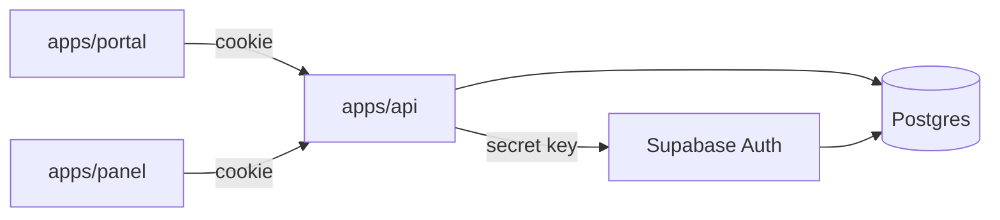

# OPOS — architecture

The rules of the code that no single file shows. How a part works is in its code and tests; product
intent and business rules are in [PRODUCT.md](PRODUCT.md); why a rule is so, and what is decided but
not built, in the [decision records](adr/README.md) and the [specs](specs/README.md); how to work
here in [AGENTS.md](../AGENTS.md).

## Applications and packages

| Part | Role |
|---|---|
| `apps/api` | NestJS, Drizzle ([0005](adr/0005-build-the-api-with-nestjs-and-drizzle.md)), oRPC ([0006](adr/0006-define-the-api-in-an-orpc-contract.md)): the only backend, and the only holder of a Supabase address or key |
| `apps/panel` | the organizers' SPA, desktop-first; later also the scanner under `/scanner` |
| `apps/portal` | the attendees' SPA, mobile-first: landing page, account, convention pages, likes, schedule |
| `packages/contract` | the oRPC contract with zod schemas, the single source of the API's shape |
| `packages/db` | schema, migrations, database roles, seed, verification, the admin's scripts |
| `packages/i18n` | locales, detection, formatters and the shared catalog |
| Supabase | a hosted project per environment, in the EU: Postgres and Supabase Auth only, the Data API off ([0003](adr/0003-use-hosted-supabase-for-postgres-and-auth-only.md)) |

- The packages have no build step; only the translation catalogs compile.
- **The BFF boundary**
  ([0004](adr/0004-make-the-api-the-only-backend-with-the-session-in-cookies.md)). The panel and
  the portal talk to the API alone: no `@supabase/*` package, Supabase address or key, or `VITE_*`
  variable naming Supabase in their sources or bundles. The `react` ESLint preset refuses the
  import, [bff-boundary.mjs](../scripts/bff-boundary.mjs) the rest (a hook, `pre-commit`, and CI
  over the built bundles), and every e2e scenario a request that leaves the API and the page's own
  origin.
- **The admin** works through scripts run on the server as `postgres`: creating a tenant, changing
  its slug and resetting two-factor authentication. The admin application, `apps/admin`, is decided
  but not built ([0029](adr/0029-ship-four-web-applications.md)); until it is, there is no admin
  endpoint or screen.

Deployment is decided but not built
([0012](adr/0012-host-each-environment-on-a-vps-with-compose-and-traefik.md),
[0013](adr/0013-connect-to-postgres-directly-with-verified-tls.md),
[0014](adr/0014-back-up-production-beyond-supabase.md)); the modules
[waiting for their domain owner](#modules-waiting-for-their-domain-owner) have only their rules.

## Tenant isolation

Row-level multitenancy under RLS, not only a `where` in code
([0002](adr/0002-isolate-tenants-by-row-under-postgres-rls.md)). A tenant table carries its own
`tenant_id` (never only an `edition_id`), a composite foreign key to its parent's `(id, tenant_id)`
and an index starting with `tenant_id`.

| Role | May | Used by |
|---|---|---|
| `postgres` | owns the OPOS tables; `BYPASSRLS`, not a superuser | migrations, `db:*` scripts, the seed, the backup; never the running API |
| `opos_app` | `select`; `insert`, `delete` and per-column `update` only where the API writes; bypasses nothing, owns nothing, member of no role | the API |
| `opos_app_global` | `BYPASSRLS`; `select` on the columns the cross-tenant queries read, nothing else | `GlobalDbService` alone |
| `opos_admin` | `BYPASSRLS`; only what the admin routes read and write, its reads by column | the admin routes' own service, not built yet ([0030](adr/0030-guard-admin-access-with-its-own-role-application-and-second-factor.md)) |
| `anon`, `authenticated`, `service_role` | nothing in `public` | nobody |

`pnpm db:roles` ([roles.ts](../packages/db/src/roles.ts)) sets the runtime roles up with their
timeouts and strips Supabase's default grants; it runs on every new database, after a change to it
and after every restore.

- **Policy.** A covered table has RLS enabled and forced, and one permissive policy
  `tenant_isolation` with `USING` and `WITH CHECK` both
  `tenant_id = (select current_setting('app.tenant_id')::uuid)` (`id` on `tenants`), without
  `missing_ok`, so a missing context raises. No other permissive policy may exist.
- **Context.** A tenant request is one transaction on `opos_app`:
  [setTenantContext](../packages/db/src/rls.ts) sets `set_config('app.tenant_id', $1, true)` and
  refuses any other role, and repositories take it from `TenantContextService.tx()`, which throws
  outside one. Without the tenant header, `withTenant` opens it from a cross-tenant lookup or a
  verified token. The queries that decide access filter on the tenant themselves too.
- **Global tables.** `accounts` and `account_recovery_codes` have no RLS: column privileges limit
  them, and the API reaches there only the account a verified token, a fresh session or a signed
  hook names. Another account is read only in a tenant transaction, through a tenant table or by a
  confirmed email behind a write permission and a rate limit of the tenant.
  The admin's tables are global too, and `opos_app` and `opos_app_global` hold nothing on them:
  `admins` is written by `postgres` alone, `admin_actions` only grows, each entry dated by the
  database, and `retired_tenant_slugs` is out of every runtime role's reach, written and read by
  triggers of `tenants`.

**Cross-tenant queries** run only in
[GlobalDbService](../apps/api/src/common/database/global-db.service.ts):

| Query | Bound |
|---|---|
| a tenant by slug | its public columns |
| `GET /me/memberships` | the session's account; expired memberships left out |
| `GET /me/schedule` | the session's own likes; published editions only |
| `DELETE /me` | the session's account; answers only whether it is a tenant's last head |

A new one is bound by the session's account or its confirmed email address, a secret the caller
proved (a signature, a link or device token) or the API's own job; it joins this table and puts its
columns into `globalReads` of [verify.ts](../packages/db/src/verify.ts).

**Migrations.** RLS, grants and triggers are hand-written in the PR of their table; a merged
migration never changes. `opos_app` never updates `id`, `tenant_id` or a column pointing at an
account or another row. `tenants` rows are inserted, deleted, suspended and given a new slug only
by `opos_admin` and the admin's scripts; `opos_app` updates `name`, `default_locale` and `timezone`
alone. Nothing is written into `auth`; OPOS's triggers on `auth.users` and `auth.mfa_factors` are
listed in verify.ts. A `security definer` function pins `search_path = ''` and no runtime role may
execute it; constraints have explicit names, since errors map to codes by them. `pnpm db:verify`
checks the policies, grants, roles, functions and triggers, each check with a case in
[verify.test.ts](../packages/db/test/verify.test.ts);
[check-migrations.mjs](../scripts/check-migrations.mjs) refuses a change to a merged migration.

## Invariants

| # | Invariant | Enforced by |
|---|---|---|
| 1 | At most one active edition per tenant | a partial unique index; activation locks the tenant row |
| 2 | At least one `head` per tenant, also against deleting the last head's account | constraint triggers deferred to commit, locking the tenant row |
| 3 | An edition membership stays in the tenant of its membership and edition | composite foreign keys |
| 4 | A tenant write carries the tenant of the context | `TenantContextService.tx()`; `WITH CHECK` |
| 5 | Every `auth.users` row has exactly one `accounts` row | an insert trigger, a cascading foreign key |
| 6 | A `head` never expires and holds no tenant-level permission | check constraints |
| 7 | An attendee registration stays in its edition's tenant and goes with its account | a composite foreign key, a cascade |
| 8 | Speakers, likes and reviews stay in the tenant of their programme item | composite foreign keys |
| 9 | A limit on what is sold holds under concurrent sales | a sale locks the rows carrying the limit before counting |
| 10 | Two scans of one ticket never act on the same state | a conditional update or a row lock, never a read first |
| 11 | A scanner works only inside its tenant and edition | its tenant's context; every query filters on its edition |
| 12 | `accounts.mfaEnabledAt` is set exactly while a verified factor exists | the trigger on `auth.mfa_factors`, locking the account row |
| 13 | A tenant is deleted only while suspended | the statement that deletes it judges the suspension itself |
| 14 | The slug of a deleted tenant is never a tenant's again | triggers of `tenants`: one retires the slug with the tenant, one refuses it after the unique index |

Invariants 7 and 9–11 belong to [modules not built yet](#modules-waiting-for-their-domain-owner);
[invariants.test.ts](../packages/db/test/invariants.test.ts),
[tenants.test.ts](../packages/db/test/tenants.test.ts) and
[accounts.test.ts](../packages/db/test/accounts.test.ts) cover the database-side ones.

## Permissions

The model is in [PRODUCT.md](PRODUCT.md#5-roles-and-permissions), the decision in
[permissions.ts](../apps/api/src/common/permissions/permissions.ts).

- `none < read < write`. A `head` passes every check; an expired membership counts as none, its
  expiry measured when the read runs (`statement_timestamp()`), not when the transaction began.
- Tenant-level permissions (`settings`, `branding`, `shop`) never grant edition-level ones
  (`program`, `websiteContent`, `tickets`).
- A non-member gets `403` before any edition is looked up. For a member, a row of another tenant or
  of another parent than the path names, and an identifier that is not a uuid, are `404`.
- A tenant route takes exactly one of `@RequireTenant`, `@RequireEdition` or, as the exception,
  `@InTenant`: no membership, so the handler's filters are its only guard, and no write lock, so it
  lowers nobody's access. Each applies `JwtAuthGuard`.
- A route at `write` checks, waits in its tenant's queue in the API process, takes the tenant's
  advisory lock and checks again (`503` `request.busy` past the limit;
  [0008](adr/0008-serialize-the-writes-of-a-tenant.md)). Every route that lowers a member's access
  is a write route, except `DELETE /me`, which lowers only the account's own; reads neither queue
  nor lock.
- Anti-escalation is set in PRODUCT.md and enforced by the API on locked memberships. An invitation
  stands only while its sender could still send it.

## Sessions and sign-in

- The API keeps the session Supabase Auth issues in `HttpOnly`, `SameSite=Strict` cookies on its own
  host, `Secure` beyond local `http`, a pair per application chosen by the request's `Origin`. No
  response carries a token
  ([0004](adr/0004-make-the-api-the-only-backend-with-the-session-in-cookies.md)).
- Only the API calls Supabase Auth, with the secret key and the visitor's address in
  `Sb-Forwarded-For`; a refusal reaches the browser as a code `auth.<error_code>`, never as its
  text. Its emails go through a signed hook to the API, which renders them.
- `JwtAuthGuard` accepts ES256 alone, against the project's JWKS, with `aud = authenticated`,
  `iss = <SUPABASE_URL>/auth/v1`, `exp`, a uuid `sub`, no `is_anonymous` and an `accounts` row. The
  session travels only in the cookies: a token in `Authorization` is no session. Keys out of reach
  answer `503`, never `401`: an outage signs nobody out.
- A request that changes state with a session cookie needs the `Origin` of an application (`403`
  `request.origin-denied`) and a JSON body (`415`): with `SameSite=Strict`, the CSRF protection.
  CORS names the two applications, never `*`.
- **The password comes after the confirmation**: a sign-up takes none, and the button of a link
  that confirms the address, never its opening, replaces any password set before. **An email address
  leads to an account only once confirmed**, in every lookup by email; sign-up, resending and
  password reset answer alike for any address.
- `DELETE /me`, `PUT /auth/password`, `POST /auth/mfa/enroll` and `DELETE /auth/mfa` need a
  sign-in younger than 5 minutes (`session.reauthentication-required`); a recovery code needs none,
  it is the proof. A new password and a removed factor end the account's other sessions.
- **Two-factor authentication.** With a verified factor, a session below `aal2` reaches only the
  code routes, refresh and sign-out; every other route answers `401` `session.mfa-required` before
  any permission check, by invariant 12, so an older token loses access at once.
- A redirect, Google sign-in's included, leads only to a path of the application that started it.
- The cookies are safe only while no subdomain serves content a tenant controls: the feature that
  first does moves them to `__Host-` names.

## API conventions

- The contract is the single source of the API: a route starts from `publicRoute`, `accountRoute` or
  `tenantRoute` of [common.ts](../packages/contract/src/common.ts)
  ([0006](adr/0006-define-the-api-in-an-orpc-contract.md)).
- An error is `{ code, params?, message }`, its code in
  [errors.ts](../packages/contract/src/errors.ts). The UI shows the code through the catalog, never
  the English `message`.
- A tenant request is one transaction: an exception or a status of `300` or more rolls it back, and
  the response waits for the commit
  ([0007](adr/0007-run-each-tenant-request-in-one-transaction.md)).
- Outbound I/O never runs inside a transaction. Started by a tenant request, it waits for the
  commit (`afterCommit`), and its failure is logged while the response stands; a send the business
  cannot lose keeps an outbox. A call to Supabase Auth outside a transaction answers with its own
  failure.
- Every route has a default rate limit per account, or per address without a session; a route open
  to abuse adds its own in code
  ([route-rate-limit.ts](../apps/api/src/common/rate-limit/route-rate-limit.ts)).
- A log line written on purpose names no token, password or email address; an unexpected error is
  logged whole, never sent in the body.

| Status | Meaning | Default code |
|---|---|---|
| `400` | validation; `params.field` names the field | `request.invalid` |
| `401` | no valid session; a stale sign-in, `aal1` and Supabase Auth's refusals have their own | `session.invalid` |
| `403` | insufficient permission; anti-escalation and `Origin` have their own | `permission.denied` |
| `404` | absent or of another tenant | `request.not-found` |
| `409` | an invariant or unique constraint, by constraint name | always specific |
| `410` | an invitation expired or revoked | `invitation.expired`, `invitation.revoked` |
| `415` | a body that is not JSON | `request.invalid` |
| `429` | rate limit, with `Retry-After` | `request.rate-limited` |
| `500` | unexpected; no details in the body | `server.error` |
| `503` | a write waiting too long; Supabase Auth out of reach | `request.busy`, `server.unavailable` |

## Frontends

- **Feature based.** `src/app` (router, providers), `src/features/<feature>`, whose `index.ts` is all
  others may import, and `src/shared`, which imports no feature; the `react` ESLint preset
  ([react.js](../packages/eslint-config/react.js)) enforces it. Routes stay thin; network traffic
  goes only through a feature's `api/`.
- Every page calls `usePageTitle` before its first `return`, naming the page, then its edition or
  convention, as the tab title and the panel's breadcrumb show them; `src/app/pages.test.ts`
  enforces it.
- Screens are built from shadcn/ui components on Base UI, which the CLI of each application adds to
  its `shared/ui` as it writes them, but for formatting, lint fixes and their own texts moved into
  Lingui macros; an application's own compositions of them sit beside them. They are styled only
  through the tokens of `src/styles.css`, which carry shadcn/ui's names and its default theme until
  the designer's ([0020](adr/0020-build-the-frontends-from-shadcn-ui-with-its-default-look.md));
  `src/styles.test.ts` fails on a class Tailwind cannot build. No AI-generated graphics
  ([PRODUCT.md](PRODUCT.md#8-design-and-public-image)).
- The portal is mobile-first: 360 px first, one column, no horizontal scrolling.
- The browser holds no session state: no token, no cookie read, the account from `GET /me`. A `401`
  brings one refresh shared by the tabs; only a refresh answered `401` signs out, `unavailable` never
  does, and `mfa-required` shows no account data.
- Nothing of one account outlives it: a sign-out or another account clears caches and permissions in
  every tab, each tenant has its own API client, and a page to return to belongs to the account that
  left it.
- The theme of a signed-in account is its own from `GET /me`, or the system's when it has none; the
  browser keeps only the one a visitor with no account signed in chose, and never an account's
  ([0025](adr/0025-keep-the-theme-on-the-account-and-a-visitors-in-the-browser.md)).
- The API stays the authority: the panel only hides and disables what a member cannot do.
- A write tells its outcome in a notification: a success, a warning for a refusal the member can act
  on, an error for a failure of the service or the network, the last two kept until closed. The
  query client of each application notifies every mutation; beside a form stays only the
  validation of its fields. A plain `403` in the panel ends on the "no permissions" screen, and the
  sign-in flows show their outcome as their next screen
  ([0022](adr/0022-tell-the-outcome-of-every-write-in-a-notification.md)).
- An action no screen can undo, such as a deletion, a removal from the team or turning two-factor
  authentication off, asks first in a modal that names what goes, says what goes with it and that
  it cannot be undone; only the modal's own button acts. A change the same screen reverses asks
  nothing ([0023](adr/0023-ask-in-a-modal-before-an-action-that-cannot-be-undone.md)).
- A tracker, anything the portal does not strictly need (analytics, a pixel, an embed, a script,
  stylesheet or font from another origin, its cookies), is an entry of the consent feature's
  `TRACKERS`, started by that feature alone after the visitor allowed its category. Only it creates
  a script or an iframe; no `index.html` or stylesheet loads anything from another origin, and the
  panel holds no tracker; `src/app/third-party.test.ts` of each application enforces it
  ([0026](adr/0026-run-a-tracker-only-with-consent-and-none-in-the-panel.md)).

## Localization

- Lingui, English source messages as their own identifiers; `en` and `pl`, `pl` the default, English
  the fallback; a new locale needs no migration
  ([0011](adr/0011-localize-with-lingui-and-return-codes-from-the-api.md)).
- Every user-facing string sits in a macro, plurals in `plural`, its `pl` translation in the same
  commit; `pnpm i18n:check` fails on drift or a missing one.
- Every [glossary](PRODUCT.md#3-glossary) term has one rendering per locale:
  [glossary.ts](../packages/i18n/src/glossary.ts) declares it with the context `glossary`, the `pl`
  catalog of `packages/i18n` holds its Polish rendering, and every message reuses it. A new term
  enters glossary.ts before its first use in the interface.
- The API returns codes, never sentences, and renders emails in the recipient's language.
- Dates go through `Intl` with an explicit time zone: a tenant's dates, programme times included,
  in the tenant's `timezone`, never the browser's; a date with no tenant, such as an invitation's
  expiry, in the browser's. Numbers go through `Intl.NumberFormat`, money in minor units with its
  currency.
- Tenant content is single-language data outside Lingui.

## Environments

| | Local | Dev | Production |
|---|---|---|---|
| `OPOS_ENV` | `local` | `dev` | `production` |
| Supabase | the CLI's local stack | a Free project of its own | the Pro project, `eu-central-1` |
| Addresses | `*.opos.localhost` | a domain of its own, never under `opos.land` | `opos.land` |
| Deployed by | the developer | a push to `develop` | a push to `main`, after a reviewer |

- `OPOS_ENV` is the one switch between environments; Mailpit and a fake payment provider serve
  `local` and `dev`.
- Dev and production are not deployed yet; their hosting is decided in
  [0012](adr/0012-host-each-environment-on-a-vps-with-compose-and-traefik.md).
- A working checkout never points at Dev or production: no `supabase link`, remote URL, project
  reference or token in a `.env` or `mise.local.toml`. The `db:*` scripts, the seed and the schema
  tests refuse a remote host unless `OPOS_ENV` names its environment
  ([migration-url.ts](../packages/db/src/migration-url.ts)).
- Secrets belong to one environment each and are never committed.
- The seed refuses production, and production data never leaves it
  ([PRODUCT.md](PRODUCT.md#10-personal-data-and-privacy)).
- Supabase Auth settings live in [config.toml](../supabase/config.toml), never in a dashboard alone.

## Tooling and versions

- [mise.toml](../mise.toml) pins Node and the Supabase CLI, `packageManager` pnpm; `engines` repeats
  both, and a mismatch aborts the install.
- A root script is the command, and it runs as `pnpm <name>` without mise. A mise task of the same
  name in [mise-tasks.toml](../mise-tasks.toml) runs it and says what it does, so `mise tasks` lists
  the commands; turbo stays the runner and mise caches nothing. The tasks stay out of `mise.toml`,
  which turbo hashes, and [mise-tasks.test.mjs](../scripts/mise-tasks.test.mjs) keeps both lists
  equal ([0024](adr/0024-list-the-root-commands-as-mise-tasks-that-run-the-pnpm-scripts.md)).
- `minimumReleaseAge` refuses a version younger than 7 days; an urgent fix is a deliberate
  `minimumReleaseAgeExclude`, a transitive one a scoped `overrides` entry naming the advisory
  ([0015](adr/0015-run-a-pnpm-turborepo-monorepo-with-pinned-tools.md)).
- The shadcn/ui CLI and its agent skill run the version an application pins, as
  `pnpm --dir apps/<app> exec shadcn`, never `npx shadcn@latest` or `pnpm dlx`, which pass
  `minimumReleaseAge` by; the CLI's MCP server is not used
  ([0021](adr/0021-run-the-shadcn-skill-through-the-pinned-cli.md)).
- turbo ([turbo.json](../turbo.json)) declares only what a rule needs: catalogs compile before `dev`,
  `build` and `test`; side effects such as `db:*` are never cached; runtime variables stay out of
  the hash; the schema and API suites never share the stack at once.
- No `.env` at the root: each application, `packages/db` and `supabase/` keep their own beside a
  committed `.env.example` naming every variable, secrets empty; `pnpm infra:init` fills them, and
  the API validates its own on start ([env.ts](../apps/api/src/config/env.ts)).
- The local stack publishes its ports on every interface: bind the container engine to `127.0.0.1`.

## Tests

Where a test sits is in [AGENTS.md](../AGENTS.md#tests-first), and why it comes first in
[0018](adr/0018-start-every-change-of-code-with-its-test.md). Integration tests run on the local
stack and mock neither the database nor Supabase Auth. They cover the permission matrix (every
contract route against every actor, an unlisted route failing the suite); RLS on every covered
table, the covered tables equal to the catalog's, and each `db:verify` rule broken once; the
invariants under concurrency; anti-escalation and every write route judging its actor again under
the lock; sessions (refused tokens, cookies, `Origin`, the password after confirmation, `aal2` on
every route); the public routes, rate limits, CORS and catalogs. In e2e the main flows run through
both frontends, the portal's on a mobile viewport, each scenario checking the BFF boundary.

The seed follows the schema and is idempotent: [seed.test.ts](../packages/db/test/seed.test.ts)
fails when a second run changes a row count. Tests share no data: an e2e scenario makes its own
tenant and accounts and only reads the seed.

## CI

[ci.yml](../.github/workflows/ci.yml) runs on every PR and every push to `develop` and `main`, in
three jobs: `check` (format, typecheck, lint, the tests, the tests-first, migration, database and
catalog checks, the BFF boundary over the built bundles), `e2e`, and `secrets` (gitleaks over the
whole history, `pnpm audit` on high advisories).

- PRs target `develop`, where CI blocks nothing. `main` changes only through a PR from `develop`
  with the three jobs green ([protect-main.json](../.github/rulesets/protect-main.json);
  [0017](adr/0017-integrate-on-develop-and-release-through-main.md)).
- A workflow reads the repository only, pins every action by a full commit hash, and passes
  `${{ github.* }}` to a `run` step only through `env`
  ([ci-shape.test.mjs](../scripts/ci-shape.test.mjs)).

## Modules waiting for their domain owner

Reviews, tickets with payments and the scanner, and attendee registrations get no code until their
domain owner sets their rules in the module's [spec](specs/README.md)
([PRODUCT.md](PRODUCT.md#7-modules), [0019](adr/0019-documents-hold-rules-the-code-holds-the-rest.md));
the lasting ones land here. Any shape keeps tenant tables under RLS, a read across tenants as a new
[cross-tenant query](#tenant-isolation), organizer routes behind the module's permission and the
steps of [adding a feature](#adding-a-feature).

| Module | Rules any shape keeps |
|---|---|
| reviews | invariant 8; deleted with the item or the author's account; organizer routes need `program` |
| tickets | invariants 9 and 10; organizer routes need `tickets`, the provider configuration `shop` |
| scanner | invariants 10 and 11 |
| attendee registrations | invariant 7 |

- **Payments.** The money goes to the convention's own provider account
  ([0010](adr/0010-send-ticket-payments-to-the-conventions-own-account.md)); OPOS keeps only the
  payment reference, and provider credentials encrypted with a key the API alone holds, never
  returned. A notification counts once its signature or the provider confirms it; a repeat, or a
  different amount, changes nothing. Only `local` and `dev` load a fake provider.
- **Links and devices.** A link opening an order or a ticket without a sign-in, and a scanner
  device's `Authorization: Bearer` token, carry at least 128 random bits, stored as a hash; their
  lookup returns only the ids that open the tenant context. A device's access ends no later than
  that of the org who enabled it.

## Adding a feature

A feature starts from its accepted [spec](specs/README.md), and a decision it makes gets a
[record](adr/README.md). Then the order of work for a tenant table, a route and a screen; skip what
a feature does not need. The `program` slice is the reference, from its
[privileges migration](../packages/db/drizzle/0017_program_items_privileges.sql) to its
[panel feature](../apps/panel/src/features/program). **Test first** is the test to change before
the code ([AGENTS.md](../AGENTS.md#tests-first)); **Enforced by** is what refuses a skipped step,
"nothing" meaning the author and the reviewer alone.

| Order | Step | Test first | Enforced by |
|---|---|---|---|
| 1 | Table in `packages/db/src/schema/<table>.ts` with the columns of `packages/db/src/schema/columns.ts`, exported from `packages/db/src/schema/index.ts`: its own `tenant_id`, a composite foreign key, an index starting with `tenant_id` | `packages/db/test/rls.test.ts`: `covered`, `populated()`; a foreign parent in `packages/db/test/invariants.test.ts` | `rls.test.ts` on a table missing from `covered` or its index; the foreign key: `tenant-isolation-reviewer` |
| 2 | `pnpm --filter @opos/db db:generate --name=<table>` | step 1's | `scripts/check-migrations.mjs` in `pre-push` and CI ([conflicts](#a-migration-applied-or-in-conflict)) |
| 3 | `db:generate --custom --name=<table>_privileges`, written by hand before it is applied: forced RLS, `tenant_isolation`, revokes, narrowest grants, `<table>_set_updated_at` | step 1's | `pnpm db:verify` in CI; `.claude/hooks/migration-reminder.mjs` reminds; the trigger: nothing |
| 4 | New privileges in `appWrites`, `appUpdates` or `globalReads` of `packages/db/src/verify.ts`; `pnpm db:migrate`, `pnpm db:verify` | `rls.test.ts`: each write, `rejects an insert with another tenant id` | `pnpm db:verify`; `rls.test.ts` for `globalReads` |
| 5 | Route in `packages/contract/src/<module>.ts` from `packages/contract/src/common.ts`, exported in `packages/contract/src/index.ts`; an error code in `packages/contract/src/errors.ts`, its message in `packages/i18n/src/errors.ts` | `apps/api/test/<module>.test.ts` (`apps/api/test/route-needs.ts` is no test); `packages/contract/src/errors.test.ts` | `packages/contract/src/errors.test.ts` on a code without a message; `apps/api/test/tenant-routes.test.ts`, `apps/api/test/route-requirements.test.ts` on a route not served |
| 6 | The route's need in `tenantRequirements` of `apps/api/test/route-needs.ts` or `publicRoutes` of `route-requirements.test.ts`; a write route in `writes` of `apps/api/test/tenants-editions.test.ts`, its table in `tenantState` of `apps/api/test/tenants.ts` | the lists are the test | `route-requirements.test.ts` until listed, then every actor; `tenants-editions.test.ts` for `writes`; `tenantState`: nothing |
| 7 | Module in `apps/api/src/modules/<name>`, registered in `apps/api/src/app.module.ts`: an `@Implement` method per route with `@RequireTenant`, `@RequireEdition` or `@InTenant`, which bring `JwtAuthGuard` (`401` `session.invalid`, `session.mfa-required`) and at `write` the queue and lock; an account route `@UseGuards(JwtAuthGuard)`; a repository on `TenantContextService.tx()`, rows found inside the path's parent | `apps/api/test/<module>.test.ts`, with another tenant's and edition's identifiers | `tenant-routes.test.ts`, `route-requirements.test.ts`, `apps/api/test/mfa-guard.test.ts`; `apps/api/test/tenant-filters.test.ts` for a repository that decides access; a forgotten parent: `tenant-isolation-reviewer` |
| 8 | Rows in `packages/db/src/seed.ts`, then `pnpm db:seed` twice | any test of `packages/db` | `packages/db/test/seed.test.ts`; a missing seed: nothing |
| 9 | Feature in `apps/panel/src/features` or `apps/portal/src/features` with `api/`, `pages/`, `index.ts`, routed in `apps/panel/src/app/router.tsx` or `apps/portal/src/app/router.tsx`; a panel page uses `useCurrentTenant()` and `NoPermissionView`; every page `usePageTitle`; a page needing a session inside `RequireSession`, which answers `mfa-required` and `unavailable`; a new top-level panel path joins `RESERVED_TENANT_SLUGS` of `packages/db/src/schema/tenants.ts`, a migration | `apps/panel/src/features/program/pages/program-page.test.tsx` shows the shape | ESLint; `src/app/pages.test.ts`; `scripts/bff-boundary.mjs`; `RequireSession` and reserved paths: nothing |
| 10 | Strings in Lingui macros, `pnpm i18n:extract`, `pl` in `apps/panel/src/locales/pl.po` or `apps/portal/src/locales/pl.po`; a new term first in `packages/i18n/src/glossary.ts` | a `packages/i18n` test for the glossary; none for a catalog | `pnpm i18n:check`; a bare literal: `i18n-reviewer` |
| 11 | A scenario in `e2e/specs` for a new flow, on its own rows through `e2e/fixtures/index.ts` | the scenario | the `e2e` job; none written: nothing |
| 12 | The documents, through `docs-sync`, where a rule changed; a record in `docs/adr` for each decision the feature made; the spec marked `Implemented` | none | `.claude/skills/docs-sync/scripts/check-doc-links.mjs`; `.claude/agent-docs.test.mjs` for the shape of records and specs; the truth of the text: nothing |
| 13 | `pnpm typecheck`, `pnpm lint`, `pnpm test`, `pnpm test:scripts`, `pnpm db:verify`, `pnpm i18n:check`, `pnpm format:check`; for the UI `pnpm test:e2e` and a click-through, the portal on a phone viewport; `tenant-isolation-reviewer` and `i18n-reviewer` where they apply | none | the `check` and `e2e` jobs; the agents and the click-through: nothing |

### A migration applied or in conflict

Drizzle applies a migration only when its journal timestamp is newer than the last applied and
compares no text: an edit of an applied migration, before it is merged, takes `pnpm infra:reset`,
`pnpm db:migrate` and `pnpm db:seed`. On a conflict in `packages/db/drizzle/meta/_journal.json`,
take `origin/develop`'s `packages/db/drizzle/meta`, generate yours again under the same names with
the hand-written SQL restored, and run `node scripts/check-migrations.mjs --base origin/develop`.
