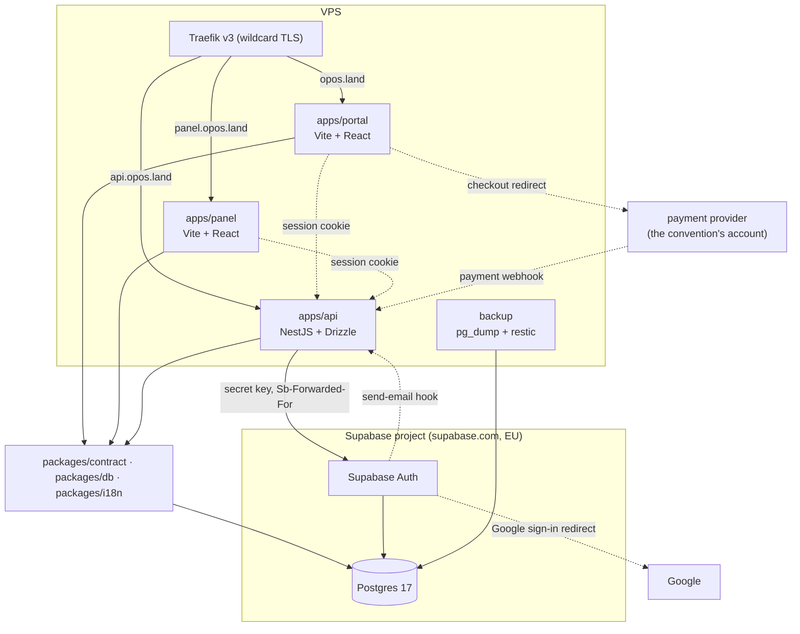

# OPOS — MVP implementation plan

How we build what [PRODUCT.md](PRODUCT.md) describes. The domain model, roles, MVP scope and
product decisions live there — this document is implementation only.

A part still to be built is specified here in full. A built part keeps only its architecture,
invariants, security rules and conventions; its details live in the code this document links to
([AGENTS.md](../AGENTS.md#planmd-shrinks-as-the-code-grows)).

## Table of contents

1. [Architecture](#1-architecture)
2. [Technology stack](#2-technology-stack)
3. [Monorepo structure](#3-monorepo-structure)
4. [Database schema](#4-database-schema)
5. [API contract](#5-api-contract)
6. [Localization](#6-localization)
7. [apps/api](#7-appsapi)
8. [apps/panel](#8-appspanel)
9. [apps/portal](#9-appsportal)
10. [Supabase](#10-supabase)
11. [Environment variables](#11-environment-variables)
12. [Local development](#12-local-development)
13. [Deployment](#13-deployment)
14. [Demo data (seed)](#14-demo-data-seed)
15. [Tests](#15-tests)
16. [Smoke test](#16-smoke-test)
17. [Execution rules](#17-execution-rules)

---

## 1. Architecture

Three applications, three shared packages and one backend on our VPS, and a hosted Supabase
project on supabase.com for the database and authentication. The API is the frontends' only
backend (BFF): the panel and the portal never talk to Supabase, load no Supabase SDK and know no
Supabase address or key ([7.4](#74-authorization)).



| App | Stack | Role | Host |
|---|---|---|---|
| `apps/api` | NestJS + Drizzle + oRPC | the only application backend and the frontends' only way to Supabase: sign-in, sessions in cookies, everything else | `api.opos.land` |
| `apps/panel` | Vite + React + Tailwind | organizer panel (SPA) and the ticket scanner under `/scanner` | `panel.opos.land` |
| `apps/portal` | Vite + React + Tailwind | landing page, registration, convention pages with the programme, likes, personal schedule, reviews, ticket checkout, "my tickets", "my conventions" (SPA, mobile-first) | `opos.land` |
| Supabase Auth | the Supabase project | identities, passwords, sessions, password reset, Google OAuth; called by the API alone | `<ref>.supabase.co/auth/v1`, never named to a browser except in the Google redirect |
| Postgres | the Supabase project, PostgreSQL 17 | the only database: `public` (OPOS tables) and `auth` (Supabase Auth) | the project's direct connection, reached by the API and the backup service |

**`packages/contract`** — an oRPC contract with zod schemas, the single source of truth for the
API. No build step, apps infer types from the TS source.

**`packages/db`** — Drizzle ORM: the `public` schema, migrations, connection factories. Row-level
multi-tenancy through `tenantId` + `editionId` columns, enforced by RLS
([4.6](#46-tenant-isolation--rls-in-postgres)).

**`packages/i18n`** — Lingui configuration, the list of supported locales, locale detection, `Intl`
formatters and message descriptors for API error codes, the Supabase Auth refusals the API passes
on included. Application catalogs live next to the applications ([6](#6-localization)).

---

## 2. Technology stack

**Monorepo:** turborepo, pnpm workspaces with a `catalog:` for versions shared by more than one
package, TypeScript 6 strict, shared `packages/tsconfig` and `packages/eslint-config` (flat config
with typed `typescript-eslint` rules; for the frontends also `eslint-plugin-react`,
`eslint-plugin-react-hooks`, `eslint-plugin-jsx-a11y` and the feature boundary rules from
`eslint-plugin-import-x`, [3.2](#32-frontend-application-layout)).

**Pinned versions:** Node, pnpm and the age of dependencies, as in
[12](#versions-and-dependencies).

**Repository tooling:** mise (tool versions), lefthook (git hooks), commitlint with
`config-conventional`, prettier.

**Backend:** NestJS 11, Drizzle ORM + postgres-js, oRPC (`@orpc/nest`, `@orpc/server`) with zod 4,
tsdown (bundles `src/main.ts` together with the workspace packages into `dist/main.js`),
`@orpc/openapi` + `@orpc/zod` + `@nestjs/swagger` (OpenAPI document generated from the contract,
Swagger UI), `jose` (Supabase access tokens verified against the project's JWKS),
`standardwebhooks` (send-email hook signatures), `@supabase/auth-js` (the API's Supabase Auth
client, its only consumer in the repository), `cookie-parser` (session cookies), nodemailer,
`@nestjs/throttler`, `@nestjs/schedule` (expiring unpaid orders), `qrcode` (ticket QR codes in
emails).

**Authentication:** Supabase Auth of the hosted Supabase project ([10](#10-supabase)), called only
by the API, which keeps the session in httpOnly cookies ([7.4](#74-authorization)). The frontends
call the API's `auth` endpoints ([5.1](#51-auth--sign-in-through-the-api)).

**Frontend SPA:** Vite + React + TypeScript, Tailwind CSS (shadcn/ui components where a screen
needs a widget native HTML lacks, [3.2](#32-frontend-application-layout)), `@orpc/client` +
`@orpc/tanstack-query`, react-router, react-hook-form + zod, zustand, `@lingui/react`; in the
scanner the `BarcodeDetector` API with the `barcode-detector` polyfill. No Supabase package.

**i18n:** Lingui 6 — `@lingui/core`, `@lingui/react`, the `@lingui/core/macro` and
`@lingui/react/macro` macros, `@lingui/cli`.
`Intl` for dates, numbers and currencies.

**Tests:** vitest + supertest (integration), vitest + Testing Library on jsdom (frontend unit
tests), Playwright (web e2e, desktop and mobile viewports).

**Infrastructure:** a Supabase project on supabase.com per deployed environment — production on
the Pro plan, Dev in a Free organization, both in the EU — for PostgreSQL 17 and Supabase Auth; on
each environment's VPS Docker Compose, Traefik v3 (wildcard TLS via DNS-01), and in production a
backup service with `pg_dump` and restic; locally the Supabase CLI's stack (Postgres, Auth, Studio,
Mailpit); GitHub Actions deploying Dev and production ([13](#13-deployment)).

**Design principles:**

- oRPC contracts with no build step.
- Supabase Auth owns identities and sessions; the API owns everything else.
- The browser talks to the API only. Supabase is an implementation detail of the API: no frontend
  holds its SDK, address or key, so the API can move to another server without the frontends
  noticing.
- Clients never reach the database: the project's Data API (PostgREST) is off, and Realtime and
  Storage are never used.
- OPOS never holds attendee money: payments go to the convention's own provider account, and the
  API keeps only the provider's payment reference.
- Row-level multi-tenancy, not schema-per-tenant.
- Isolation enforced by RLS, not only by a `where` clause in code.
- AsyncLocalStorage carries the `tenantContext`.
- Fail fast on a missing `tenantId` — both in ALS and in the RLS policies.

---

## 3. Monorepo structure

The tree lists what is still to be built, file by file. A directory marked *built* has its files in
the repository; their purpose is stated in the files themselves, not here.

```
opos/
  package.json, pnpm-workspace.yaml, turbo.json, mise.toml, lefthook.yml,
  commitlint.config.mjs, .prettierrc, .github/   # built: root tooling (3.1, 12, 15.3)
  .claude/                    # built: docs-sync skill, tenant isolation and i18n reviewers, the
                              #   tests-first hooks in settings.json (AGENTS.md); still to come: the
                              #   BFF boundary hook (3.2)
  scripts/                    # built: tests-first.mjs, the RLS and RBAC test-first check, and its
                              #   test; still to come: bff-boundary.mjs, infra-init.mjs (12),
                              #   supabase-push.mjs and the remote block check (10), their tests
  .github/workflows/deploy.yml  # the deployment to Dev and production (13)
  docker-compose.deploy.yml   # traefik, api, panel, portal, tools; backup (production), mailpit (Dev) (13)
  docs/
    PRODUCT.md
    PLAN.md
  supabase/              # the Supabase CLI project (10, 12)
    config.toml          # the local stack, and the hosted project's Auth settings ([remotes.production])
    .env.example         # the variables config.toml reads with env(), the template of supabase/.env
    .gitignore           # .temp, .branches, snippets, signing_keys.json
  infra/
    traefik/             # static configuration (13)
    backup/              # Dockerfile and script of the backup service (13)
  apps/
    api/                 # built: bootstrap, env, database providers, GlobalDbService, OpenAPI docs,
                         #   error filter, request store and tenant transaction, JwtAuthGuard,
                         #   rate limiting, permission decorators, MeModule (profile, memberships,
                         #   account deletion), TenantsModule (tenant, team, invitations),
                         #   EditionsModule, AuthModule (send-email hook, Supabase Auth admin
                         #   client), MailModule (Supabase Auth and invitation emails), tests;
                         #   still to come: the auth endpoints and session cookies (5.1, 7.4)
      src/
        common/
          guards/scanner-device.guard.ts
        modules/         # one directory per module (7.1)
      Dockerfile         # targets runtime and tools (13)
    panel/               # built: Vite and Lingui config, catalogs, app/ (router, providers, query
                         #   client), features auth, tenants, editions, team, account, shared/
                         #   (API link, auth client, session, i18n, UI), .env.example, tests (8);
                         #   the auth client gives way to the API's auth endpoints (5.1)
      Dockerfile
    portal/              # built: Vite and Lingui config, catalogs, app/ (router, layout, providers,
                         #   query client), features landing, auth, account, shared/ (API link,
                         #   auth client, session, i18n, UI), .env.example, tests (9); the auth
                         #   client gives way to the API's auth endpoints (5.1)
      src/features/      # still to come: attendances, conventions, schedule, speaking, tickets
      Dockerfile
  e2e/                   # built: Playwright config, fixtures (stack, Mailpit, admin API, tenants,
                         #   sign-in) with their unit tests, specs (15.2)
  packages/
    contract/            # built: common schemas, error codes, health, me (profile, memberships, deletion),
                         #   tenants (without payment config), editions, invitations
      src/
        program.ts
        engagement.ts
        shop.ts
        tickets.ts
        checkout.ts
        scanner.ts
        public.ts
    db/                  # built: clients, rls, core schema, migrations, createTenant, seed, scripts, tests
      .env.example       # the db:* scripts' variables (11)
      src/
        scripts/roles.ts # db:roles, the OPOS roles and their grants (4.6)
        schema/          # one file per table (4); still to come:
          program-items.ts
          program-item-speakers.ts
          program-item-likes.ts
          program-item-reviews.ts
          tenant-payment-configs.ts
          ticket-types.ts
          orders.ts
          tickets.ts
          scanner-devices.ts
          attendees.ts
    i18n/                # built: locales, detection, catalogs, formatters, glossary, error and email messages
    tsconfig/            # built: base.json, node.json, react.json
    eslint-config/       # built: base, node, nest and react presets, feature boundary rules, tests
```

### 3.1 Turbo tasks

Root scripts in `package.json` only delegate — `"build": "turbo run build"` — and task logic lives
in the packages' own scripts. The exceptions are `prepare` (lefthook), `format`/`format:check`
(prettier over the whole repository) and `infra:up`/`infra:down`/`infra:reset` (the Supabase CLI,
[12](#12-local-development)); those do not go through turbo.

`packages/contract`, `packages/db` and `packages/i18n` have no build step, so `^build` gives the
task graph no edges towards them. The `transit` task supplies those edges: declared only in
`turbo.json`, it matches no script in any package, and `typecheck`, `lint` and `test` depend on
it. A change in `packages/contract/src` then invalidates the cache of every consumer, and the
tasks still run in parallel.

The tasks with their `dependsOn`, `outputs`, cache and environment settings are in
[turbo.json](../turbo.json). The rules behind them:

- `build`, `dev` and `test` depend on `i18n:compile` (`test` also on `^i18n:compile`), so nothing
  runs with stale or missing catalogs.
- The files outside every package that shape the environment the tests run in — `supabase/config.toml`
  and `.github/workflows/` — are `globalDependencies`: a change to them misses every task's cache,
  and `--affected` counts every package as affected.
- A task with side effects is not cached: `test:e2e`, `i18n:extract` and every `db:*` task.
  Persistent tasks (`dev`, `db:studio`) set `persistent: true`.
- The `db:*` tasks exist only in `packages/db`, `test:e2e` only in `e2e`.
- Only `apps/*` have a `build` script. `apps/api` builds with tsdown, which inlines the
  `@opos/*` packages (their `src/index.ts`) into `dist/main.js` and keeps the rest of
  `node_modules` external.
- Frontend build-time variables (`VITE_*`) enter task hashes through turbo's framework inference.
  The API's variables are read at runtime and stay out of the hash
  ([11](#11-environment-variables)).
- turbo runs in strict environment mode and hands a task only the variables it lists. `test` and
  every `db:*` task pass the database variables through (`passThroughEnv`), `test` also the local
  Mailpit address, `db:seed` also `SUPABASE_URL`, `SUPABASE_SECRET_KEY` and `OPOS_ENV`
  ([11](#11-environment-variables)), and `dev` passes `OPOS_PANEL_PORT` and `OPOS_PORTAL_PORT` to
  the dev servers ([12](#ports)), so they reach the scripts and stay out of the hash.
- `test:e2e` depends on the panel's and the portal's `i18n:compile`, since Playwright starts their
  dev servers ([15.2](#152-e2e-tests)), and passes `CI`, the `OPOS_*_PORT` variables and the local
  Mailpit address through.
- The root scripts that take arguments, `db:seed`, `db:tenant:create` and `db:tenant:rename`, end
  with `--`, so pnpm hands the arguments through turbo to the package script.

### 3.2 Frontend application layout

The panel and the portal share one layout: **feature based**. No directory for a
technical layer (`components/`, `hooks/`) exists at application level — those directories live
inside a feature.

```
src/
  app/                  # bootstrap: router, providers, layout
  features/
    <feature>/
      api/              # oRPC query and mutation options, query keys
      components/       # components belonging to this feature only
      hooks/
      pages/            # views mounted into the router
      model/            # types, zod schemas, mappings
      index.ts          # the feature's public API — the only thing others can see
  shared/
    ui/                 # components with no domain knowledge
    lib/                # API client, i18n, formatters, storage
    config/
```

Import rules, enforced by `import-x/no-restricted-paths` in the `react` preset of
[packages/eslint-config/react.js](../packages/eslint-config/react.js):

| From | To | Allowed |
|---|---|---|
| `features/x` | `shared/`, `packages/*` | yes |
| `features/x` | `features/y/index.ts` | yes |
| `features/x` | the internals of `features/y` | **no** |
| `shared/` | `features/` | **no** |
| `app/` | anywhere | yes |
| `shared/`, `features/` | `app/` | **no** |

- An application's `eslint.config.js` passes its own directory to the preset
  (`react(import.meta.dirname)`); the features are the directories of `src/features` when ESLint
  starts, so a new feature is covered without a config change.
- Imports resolve through the application's `tsconfig.json`, so a path alias cannot slip past the
  rules; an import that does not resolve is not checked.
- [react.test.js](../packages/eslint-config/react.test.js) lints a fixture application and must
  show every row of the table, the React, hooks and accessibility rules included.

Routes stay thin: a route definition holds no logic, it only mounts a view from the right
feature.

A feature never reaches the database or `fetch` directly: all network traffic goes through that
feature's `api/`, built on the API client from `shared/lib`.

**The BFF boundary.** The panel and the portal talk to the API only ([7.4](#74-authorization)). In
`apps/panel` and `apps/portal` — sources, configuration, `package.json` and `.env.example` — and in
their production bundles nothing names Supabase:

| Refused | Why |
|---|---|
| a dependency or import of `@supabase/*` | the SDK talks to Supabase directly |
| an address on `supabase.co`, `supabase.in` or `supabase.com`, and the local stack's `:54321` | a request that bypasses the API |
| a `sb_publishable_` or `sb_secret_` key, a JWT, a `VITE_*` variable whose name contains `SUPABASE` | a key in a bundle is a key for everyone |

`scripts/bff-boundary.mjs` holds these rules and enforces them where
the tests-first check runs: a Claude Code hook after every `Edit`, `Write` and `Bash` that touches
the two applications ([.claude/settings.json](../.claude/settings.json)), lefthook `pre-commit` on the
staged files, and CI on every PR, where it also scans `dist/` of both builds. The `react` preset
adds the import rule as `no-restricted-imports`, so the editor shows it as well. The one place a
Supabase address reaches a browser is the redirect of Google sign-in, sent by the API
([7.5](#75-google-oauth)); it is never written in a frontend.

`shared/ui` holds components with no domain knowledge, built on native elements and styled only
through the tokens of the application's `src/styles.css` (colours, typography, spacing, radii),
which the designer's values replace ([styles.css](../apps/panel/src/styles.css)). A shadcn/ui
component joins when a screen needs a widget native HTML lacks, restyled to the same tokens. No
image or illustration in `shared/ui` or in a feature is AI-generated
([PRODUCT.md 8](PRODUCT.md#8-design-and-public-image)).

---

## 4. Database schema

PostgreSQL 17 of the Supabase project; locally and in CI the Supabase CLI's `supabase/postgres`
container of the same major version ([12](#12-local-development)). Every OPOS table lives in the
`public` schema and
has `id uuid primary key default gen_random_uuid()`, `createdAt timestamptz not null default
now()`, `updatedAt timestamptz not null default now()` — `accounts.id` being the one exception
([4.2](#42-global-tables)). `updatedAt` is kept by the database, not by Drizzle: every table has a
`before update` trigger `<table>_set_updated_at`, so raw SQL, scripts and the studio move it too.

The built tables are defined in [packages/db/src/schema](../packages/db/src/schema), their RLS,
grants and triggers in [packages/db/drizzle](../packages/db/drizzle). This chapter lists their
rules; the tables still to be built are specified in full.

Names in this chapter are the TypeScript ones. Drizzle maps them with `casing: 'snake_case'`, set in
both `drizzle.config.ts` and the client: `tenantId` is the column `tenant_id`. Constraints and
indexes carry explicit names, so Postgres never truncates them past 63 characters: unique
constraints and unique indexes `<table>_<purpose>_unique`, other indexes `<table>_<purpose>_idx`,
foreign keys `<table>_<target>_fk` (`tenant_memberships_tenant_fk`), checks and constraint
triggers `<table>_<rule>` (`editions_ends_after_start`). Foreign keys are declared with
`foreignKey({ name })`, never with `.references()`, which generates the name.

The `auth` schema belongs to Supabase Auth: it creates and migrates it on start. Our migrations
never write to it; `drizzle.config.ts` sets `schemaFilter: ['public']`, and `accounts` references
`auth.users` through `authUsers` from `drizzle-orm/supabase`.

The [glossary](PRODUCT.md#3-glossary) terms map onto tables as follows:

| Term | Carrier |
|---|---|
| admin | no table: works on the database directly, through `pnpm db:tenant:create` and `pnpm db:tenant:rename` |
| org, head | `tenant_memberships` (+ optionally `edition_memberships`) |
| user | `auth.users` + `accounts` + rows in `attendees` |
| tenant | `tenants` |
| edition | `editions` |
| programme item | `program_items` |
| speaker | `program_item_speakers` |
| like | `program_item_likes` |
| review | `program_item_reviews` |
| ticket type | `ticket_types` |
| order | `orders` |
| ticket | `tickets` |
| scanner | `scanner_devices` |
| attendee | `attendees` |

### 4.1 Enums

`permissionLevel` (`none`, `read`, `write`) and `tenantRole` (`head`, `org`) are built
([enums.ts](../packages/db/src/schema/enums.ts)). Still to come:

```ts
reviewVisibility = pgEnum('review_visibility', ['public', 'speakers'])
orderStatus      = pgEnum('order_status',      ['pending', 'paid', 'expired', 'cancelled'])
```

`locale` is not an enum — the list of supported languages is the `SUPPORTED_LOCALES` constant of
`packages/i18n`, validated by zod. Adding a language requires no migration.

### 4.2 Global tables

Identities, passwords, sessions, refresh tokens and confirmation and recovery tokens live in
Supabase Auth's tables (`auth.users`, `auth.identities`, `auth.sessions`, `auth.refresh_tokens`).
OPOS keeps the profile only.

**`accounts`** ([accounts.ts](../packages/db/src/schema/accounts.ts)) — `id` equals the JWT `sub`
and `auth.users.id`; `email` is unique and lowercase (check `accounts_email_lowercase`);
`emailConfirmedAt` is `auth.users.email_confirmed_at`, `null` until the address is confirmed;
`locale` is the user's choice, `null` means detect from `Accept-Language`.

Triggers on `auth.users`, `security definer` functions owned by `postgres`, keep it in step
with Supabase Auth: an insert creates the `accounts` row with `emailConfirmedAt`, and with
`firstName`, `lastName` and `locale` from `raw_user_meta_data` (written by the API's
`POST /auth/sign-up` from the form, [5.1](#51-auth--sign-in-through-the-api); for Google
`full_name` split on the first space); an email change updates `accounts.email`, and a
change of `email_confirmed_at` updates `emailConfirmedAt` (Supabase Auth confirms with an update,
also right after inserting a user created confirmed). For an account created before these triggers,
a one-time backfill
([0012_backfill_email_confirmed_at.sql](../packages/db/drizzle/0012_backfill_email_confirmed_at.sql))
copies `emailConfirmedAt` wherever the migration role reads `auth.users`. Every `auth.users` row has an email, because
only email and Google sign-in are enabled ([10](#10-supabase)). Deleting a user in Supabase Auth
removes `accounts`, and with it every row that references it.

**Matching an account by email counts only a confirmed one.** Wherever OPOS looks an account up by
an email address — `createTenant` ([14](#creating-a-tenant)), an invitation
([7.7](#77-organizer-invitations)), `GET /me/tickets` — an account whose `emailConfirmedAt` is
`null` counts as no account: Supabase Auth keeps the password of whoever registered an address
first, before its owner confirmed it.

`accounts` has no RLS, so its privileges are the database-side limit: `opos_app` may select every
column and update only `firstName`, `lastName` and `locale` — never `email` or `emailConfirmedAt`; `opos_app_global` has no access, as no
cross-tenant query ([4.6](#46-tenant-isolation--rls-in-postgres)) reads it. Rows are inserted and
deleted by the triggers and the cascade alone, both running as `postgres`.

### 4.3 Tenant-level tables

**`tenants`** ([tenants.ts](../packages/db/src/schema/tenants.ts)) — the `slug` is unique,
matches `^[a-z0-9-]{3,40}$`, is none of `RESERVED_TENANT_SLUGS` (the platform's subdomains,
[PRODUCT.md 6](PRODUCT.md#6-addresses-and-domains), and the panel's top-level paths, [8](#8-appspanel);
check `tenants_slug_not_reserved`) and changes only through the admin
([14](#changing-a-tenants-slug)); `defaultLocale` and the IANA `timezone` default to `pl` and
`Europe/Warsaw`.

**`tenant_memberships`** ([tenant-memberships.ts](../packages/db/src/schema/tenant-memberships.ts))
— one row per account and tenant, holding the `role` and the tenant-level permissions
(`settingsAccess`, `brandingAccess`, `shopConfigAccess`). Deleting the account or the tenant
removes it.

**`tenant_payment_configs`** — `tenantId` (FK cascade, unique), `provider` (text, the adapter
name), `accountRef` (text, the convention's account identifier at the provider),
`credentialsEncrypted` (bytea, nullable; AES-256-GCM with `PAYMENT_CONFIG_KEY`), `currency`
(char(3), default `PLN`). Credentials are write-only: no endpoint returns them.

A membership with `expiresAt <= now()` is **expired**: every read that grants access filters it
out, so the account behaves as if it were not in the team. The row stays until someone removes it
or extends it.

**`accepted_invitations`** ([accepted-invitations.ts](../packages/db/src/schema/accepted-invitations.ts))
— the `jti` of every organizer invitation accepted in the tenant, unique per tenant
(`accepted_invitations_tenant_jti_unique`), so an invitation works once, also after the membership
it created is removed ([7.7](#77-organizer-invitations)). Deleting the tenant removes it. It holds
no account and no email.

### 4.4 Edition-level tables

**`editions`** ([editions.ts](../packages/db/src/schema/editions.ts)) — the `slug` is unique within
the tenant and matches the contract's `editionSlug` pattern (check `editions_slug_format`), `endsAt`
is after `startsAt`, and `isActive` and `isPublished` start as `false`.

**`edition_memberships`** ([edition-memberships.ts](../packages/db/src/schema/edition-memberships.ts))
— the edition-level permissions (`programAccess`, `websiteContentAccess`, `ticketsAccess`) of one
`tenant_membership` in one edition.

**`program_items`** — `tenantId`, `editionId` (FK cascade), `title`, `description` (nullable),
`startsAt`, `endsAt`. Unique `(id, tenantId)`. Index `(tenantId, editionId, startsAt)`.

**`program_item_speakers`** — `tenantId`, `programItemId` (FK cascade), `accountId` (FK cascade).
Unique `(programItemId, accountId)`. Composite foreign key `(programItemId, tenantId)`. Index
`(accountId)`.

**`program_item_likes`** — `tenantId`, `programItemId` (FK cascade), `accountId` (FK cascade).
Unique `(programItemId, accountId)`. Composite foreign key `(programItemId, tenantId)`. Indexes
`(tenantId, programItemId)` and `(accountId)`.

**`program_item_reviews`** — `tenantId`, `programItemId` (FK cascade), `accountId` (FK cascade),
`rating` (smallint, check 1–5), `comment` (text, nullable, up to 2000 characters),
`isAnonymous` (default `false`), `visibility` (`review_visibility`, default `public`),
`hiddenAt` (timestamptz, nullable), `hiddenByAccountId` (nullable, FK set null).
Unique `(programItemId, accountId)`. Composite foreign key `(programItemId, tenantId)`. Indexes
`(tenantId, programItemId)` and `(accountId)`.

**`ticket_types`** — `tenantId`, `editionId` (FK cascade), `name`, `priceMinor` (integer, in the
tenant's currency), `quantity` (integer, nullable = no limit), `salesStartAt`, `salesEndAt`,
`isActive` (default `true`). Unique `(id, tenantId)`. Index `(tenantId, editionId)`.

**`orders`** — `tenantId`, `editionId` (FK restrict), `email` (lowercase), `firstName`, `lastName`,
`locale`, `status` (`order_status`, default `pending`), `totalMinor`, `currency`,
`holdExpiresAt`, `providerPaymentRef` (unique, nullable), `paidAt`, `cancelledAt`,
`ticketEmailSentAt` (nullable; set once the ticket email has gone out), `accessTokenHash` (sha256
of the token in the order link). Unique `(id, tenantId)`. Indexes `(tenantId, editionId, status)`
and `(email)`; partial index `(paidAt) where status = 'paid' and ticketEmailSentAt is null`.

**`tickets`** — `tenantId`, `orderId` (FK cascade), `ticketTypeId` (FK restrict), `code` (unique,
22 characters base62, 128 random bits), `redeemedAt` (nullable), `redeemedByDeviceId` (nullable).
Composite foreign keys `(orderId, tenantId)` and `(ticketTypeId, tenantId)`. Index
`(tenantId, orderId)`. A ticket is valid when its order is `paid`.

**`scanner_devices`** — `tenantId`, `editionId` (FK cascade), `name`, `tokenHash` (unique, sha256),
`pairingJti` (unique), `createdByMembershipId`, `expiresAt` (the edition's `endsAt` + 1 day, or the
pairing org's own `expiresAt` when that comes first), `revokedAt` (nullable). Index
`(tenantId, editionId)`.

**`attendees`** — `accountId`, `tenantId`, `editionId` (FK cascade), `firstName`, `lastName`.
Unique `(accountId, editionId)`. Indexes `(tenantId, editionId)` and `(accountId)`.

Every RLS-covered table has an index starting with `tenantId`.

### 4.5 Invariants

1. **At most one `isActive=true` edition per tenant** — a transactional switch plus a partial
   unique index. A tenant may have none: a new tenant starts without an edition, and editions are
   created inactive.
2. **At least one `head` per tenant** — checked in the service and by two constraint triggers,
   both `DEFERRABLE INITIALLY DEFERRED`, so they fire at commit:
   `tenant_memberships_at_least_one_head` (`AFTER UPDATE OF role, tenantId OR DELETE`, only for a
   row whose old `role` is `head`) and `tenants_at_least_one_head` (`AFTER INSERT` on `tenants`).
   A head can be handed over in either order inside one transaction, a tenant is created together
   with its first head in one transaction, and a deleted tenant takes its memberships along. The
   membership check locks the tenant row (`for no key update`) before counting heads, so two
   transactions demoting different heads of one tenant cannot both commit. A violation raises
   `check_violation` with the trigger's name; it also blocks deleting the account of a tenant's
   last head.
3. **An edition in `edition_memberships` belongs to the same tenant as the `tenant_membership`** —
   enforced by composite foreign keys.
4. **Writes to tenant-level tables always carry the `tenantId` from ALS** —
   `TenantContextService.tx()` throws when no tenant transaction is open
   ([7.2](#72-tenant-context)), and `WITH CHECK` in the RLS policies closes it on the database side.
5. **Every `auth.users` row has exactly one `accounts` row** — the insert trigger and the cascading
   foreign key.
6. **A `head` membership never expires and holds no tenant-level permission** — the check
   constraints `tenant_memberships_head_never_expires` and `tenant_memberships_head_holds_no_levels`.
7. **A review exists only for an item that has started, written by an eligible account** —
   checked in `EngagementModule` on every write: `program_items.startsAt <= now()`, and the author
   holds a valid ticket for the item's edition (a `paid` order placed with the account's email), is
   a non-expired `head`, or is a non-expired `org` with an `edition_memberships` row for that
   edition.
8. **Speakers, likes and reviews belong to the tenant of their programme item** — enforced by
   composite foreign keys.
9. **No ticket type sells beyond its `quantity`** — checkout locks the ticket type rows
   (`select ... for update`) and counts tickets in `paid` orders plus `pending` orders whose
   `holdExpiresAt` is in the future.
10. **A ticket is redeemed once** — `update tickets set redeemedAt = now() ... where redeemedAt is
    null`; zero updated rows means it was already used.
11. **A scanner works only inside its edition** — every scanner query filters on the device's
    `editionId`; a ticket from another edition is `404`.

### 4.6 Tenant isolation — RLS in Postgres

#### Database roles

| Role | Attributes | Used by |
|---|---|---|
| `postgres` | the project's own admin role, not a superuser: `BYPASSRLS`, `CREATEROLE`; owner of the `public` tables and the `drizzle` journal; every privilege Supabase gives it on the `auth` tables | `pnpm db:roles`, `pnpm db:migrate`, `pnpm db:seed`, the tenant scripts, the backup |
| `opos_app` | only the privileges the API uses (below), no `BYPASSRLS` | runtime API inside a tenant context |
| `opos_app_global` | `select` on the columns its cross-tenant queries read, never a whole table; `BYPASSRLS` | `GlobalDbService` exclusively |

The two runtime roles are created by `pnpm db:roles` (`packages/db/src/scripts/roles.ts`), which
connects as `postgres` through `DATABASE_MIGRATION_URL` ([11](#11-environment-variables)) — the
same script for the local stack and the hosted project. Supabase's own roles
(`supabase_auth_admin`, `authenticator`, `anon`, `authenticated`, `service_role`) come with the
project; `anon`, `authenticated` and `service_role` hold no privileges on the `public` schema — the
script revokes the `usage` they get directly and through `PUBLIC`. `opos_app` and `opos_app_global`
get `usage` on `public` from the script; their table privileges come from the migrations.

Supabase grants `anon`, `authenticated` and `service_role` everything on what `postgres` creates
in `public`, through default privileges. `db:roles` takes those back — `alter default privileges
for role postgres in schema public revoke all on tables, sequences, functions from anon,
authenticated, service_role` — and runs before the first migration of a database, so no table,
sequence or function of OPOS ever holds a grant for them; `db:verify` reports one that does.

**OPOS writes nothing into `auth`.** `postgres` holds its privileges on the `auth` tables without
the right to pass them on, so the two things that tie `public` to `auth` — the foreign key of
`accounts` to `auth.users` and the `accounts` triggers on `auth.users` ([4.2](#42-global-tables))
— come from migrations running as `postgres`, and no other OPOS role holds anything in `auth`.
Migrations create no object in the `auth` schema: the triggers are attached to `auth.users`, and
their functions live in `public`.

The script is idempotent: it creates a missing role, sets its attributes and password and applies
the grants above, so a change to it reaches a database by running it again. It runs locally after
every `supabase start` on a new volume and after `supabase db reset`, which drop the roles with the
cluster, and in production once per project, after a change to it and after a restore of
Supabase's own backup, which does not keep the passwords of custom roles ([13](#13-deployment)).
Passwords come from `OPOS_APP_PASSWORD` and `OPOS_APP_GLOBAL_PASSWORD` in the environment of the
script, chosen per developer and per environment and never committed; they go into connection
URLs, so they are hex (`openssl rand -hex 32`).

Every RLS-covered table also gets `FORCE ROW LEVEL SECURITY`.

#### Covered tables

`tenants`, `tenant_memberships`, `accepted_invitations`, `editions`, `edition_memberships`,
`program_items`, `program_item_speakers`, `program_item_likes`, `program_item_reviews`, `tenant_payment_configs`,
`ticket_types`, `orders`, `tickets`, `scanner_devices`, `attendees`.

The global table `accounts` stays outside RLS — it is protected by filtering on the `accountId`
from the JWT, with two reads of other accounts, both inside a tenant transaction: the team's
accounts joined to the tenant's `tenant_memberships`, which RLS limits to the tenant, and the
invitation lookup of one confirmed account by the email of the request
(`InvitationsRepository.confirmedAccount`, behind `settings=write` and the tenant's invitation
limit, [7.7](#77-organizer-invitations)). The `auth` schema is accessed only by Supabase Auth, and
read by the backup service ([13](#backups)).

#### Tenant context

```sql
select set_config('app.tenant_id', $1, true);   -- SET LOCAL, dropped when the transaction ends
```

The third argument `true` is mandatory. Every request inside a tenant context runs in a
transaction. [setTenantContext](../packages/db/src/rls.ts) reads `current_user` and the role's
`SUPERUSER` and `BYPASSRLS` and whether it is a member of another role in the same query, and
throws unless the connection is `opos_app` with none of them: a `DATABASE_URL` that names another
role answers `500` on every tenant route instead of reading every tenant. The queries that decide
what a request may do also filter on `current_setting('app.tenant_id')`
([current-tenant.ts](../apps/api/src/common/database/current-tenant.ts)) themselves: every query of
[access.repository.ts](../apps/api/src/common/permissions/access.repository.ts) (the actor's
membership, edition access and edition rows) and of the invitation repository (the tenant, its
members, editions and accepted invitations). The other repositories rely on RLS, which
`setTenantContext` guarantees.

#### Policy shape

```sql
alter table program_items enable row level security;
alter table program_items force  row level security;

create policy tenant_isolation on program_items
  using      (tenant_id = (select current_setting('app.tenant_id')::uuid))
  with check (tenant_id = (select current_setting('app.tenant_id')::uuid));

grant select, insert, delete on program_items to opos_app;
grant update (title, description, starts_at, ends_at) on program_items to opos_app;
-- opos_app_global: select on the columns its cross-tenant queries read, never the whole table
grant select (id, tenant_id, edition_id, starts_at) on program_items to opos_app_global;
```

The same for the remaining tables; for `tenants` the condition is `id = (select current_setting(...))`.
The scalar subquery makes Postgres evaluate the setting once per query instead of once per row.
`current_setting` without the `missing_ok` argument — a missing context has to raise an error, not
return zero rows. `tenant_isolation` is the only permissive policy on a covered table: Postgres
combines permissive policies with `OR`, so any other one would widen it. A restrictive policy may
narrow it further.

#### Cross-tenant queries

Only through [GlobalDbService](../apps/api/src/common/database/global-db.service.ts) on the
`opos_app_global` role; `DatabaseModule` exports the service, never the `GLOBAL_DB` pool itself.
The complete list:

| Query | Constraint |
|---|---|
| tenant lookup by slug | returns only `id`, `slug`, `name`, `defaultLocale`, `timezone` |
| `GET /me/memberships` | `where account_id = <account from the JWT>`, expired memberships excluded |
| `DELETE /me` | `where account_id = <account from the JWT> and role = 'head'`; the other heads of those tenants are only checked for existence; returns only whether the account is some tenant's last head |
| `GET /me/attendances` | `where account_id = <account from the JWT>` |
| `GET /me/schedule` | `where account_id = <account from the JWT>` on `program_item_likes` |
| `GET /me/program-items` | `where account_id = <account from the JWT>` on `program_item_speakers` |
| `GET /me/tickets` | `where email = <confirmed email of the account from the JWT>` on `orders` |
| payment webhook | order lookup by the `orderId` from a verified webhook; returns only `id`, `tenantId` |
| order status link | order lookup by `id` and `accessTokenHash`; returns only `id`, `tenantId` |
| scanner request | device lookup by `tokenHash`, not revoked, not expired; returns only `id`, `tenantId`, `editionId` |
| order jobs ([7.10](#710-payments)) | `pending` orders past `holdExpiresAt`, and `paid` orders older than 5 minutes with no `ticketEmailSentAt`; returns only `id`, `tenantId` |

Apart from the tenant lookup by slug, which returns only public columns, every query in
`GlobalDbService` carries an `accountId` or `email` condition from the JWT, a
secret the caller proved it holds (a webhook signature, an order token, a device token), or comes
from the API's own scheduled jobs; adding another one requires an entry in this table. The rest of
the system, including `PublicModule`, resolves the tenant first and then works on `opos_app` inside
`withTenant` ([7.2](#72-tenant-context)).

#### Migrations and verification

RLS policies and the `auth.users` triggers go into hand-written migrations
(`drizzle-kit generate --custom`). The same migration grants the new tables' privileges, revokes
everything from `anon` and `authenticated`, and adds each table's `<table>_set_updated_at` trigger
([4](#4-database-schema)). The privileges follow what the API does with a table:

- `opos_app` gets `select`; `insert` and `delete` where the API creates and removes rows; `update`
  only on the columns the API changes — never on `id`, `tenant_id` or a column that points a row at
  an account or another row (`account_id`, `tenant_membership_id`). A write the API starts doing —
  on a new column or on a table it did not write before — gets its grant in that PR's migration.
- `opos_app_global` gets `select` on the columns the [cross-tenant queries](#cross-tenant-queries)
  read and nothing else — column by column, never a whole table, so a column added later stays
  unreadable across tenants until a query in that table needs it.
- `tenants` rows are inserted, deleted and given a new slug by `postgres` alone, through the
  scripts for [creating](#creating-a-tenant) and [renaming](#changing-a-tenants-slug) a tenant;
  `accounts` follows [4.2](#42-global-tables).

Trigger functions are `security definer` with `set search_path = ''` and schema-qualified names,
because Supabase Auth runs with `search_path = auth`. `db:push` is for local experiments only;
everything else goes through generated migrations.

Every `db:*` script connects as `postgres` through `DATABASE_MIGRATION_URL`
([11](#11-environment-variables)). `pnpm db:verify` runs the checks of
[verify.ts](../packages/db/src/verify.ts) and exits non-zero when one fails; each check has a case in
[verify.test.ts](../packages/db/test/verify.test.ts) that breaks the rule in a rolled-back
transaction and expects the report:

- a covered table — `tenants` or any `public` table, partitioned ones included, with a
  `tenant_id` column — lacks enabled or forced RLS;
- its `tenant_isolation` policy is missing, is not a permissive policy for all commands and every
  role, or its `USING` or `WITH CHECK` differs from the [policy shape](#policy-shape);
- a covered table has another permissive policy;
- a `public` table is neither covered nor a [global table](#42-global-tables): a tenant table
  carries its own `tenant_id`, never only an `edition_id` or `order_id`;
- a `public` view lacks `security_invoker` set to a value Postgres reads as true (`true`, `on`, `yes`,
  `1` and their prefixes), or `public` holds a materialized view;
- a role holds more on a `public` table or view than the rules above allow: a table-level grant
  to `opos_app_global` or a `select` of a column missing from its list of reads in `verify.ts`, a
  table-wide `update` for `opos_app` or an `insert` or `delete` of it missing from the list of the
  API's writes in `verify.ts` (a write the
  API starts doing joins that list in the PR of its migration), anything at all for `anon`,
  `authenticated` and `service_role` — table-level and column-level grants alike, so `opos_app`
  updates only the columns on the list in `verify.ts`;
- `opos_app` has `SUPERUSER` or `BYPASSRLS`, a runtime role owns a relation in `public` or is a
  member of another role, or any of the five roles holds anything on a `public` sequence;
- a `security definer` function in `public` has no pinned `search_path`, or `opos_app`,
  `opos_app_global`, `anon`, `authenticated` or `service_role` may execute it — Postgres grants
  `execute` to `public` on every new function, so its migration revokes it;
- `anon`, `authenticated` or `service_role` holds `usage` or `create` on the `public` schema;
- `auth.users` carries a trigger other than the `opos_on_auth_user_*` triggers of the `accounts`
  mirror, or `opos_app` or `opos_app_global` holds anything in the `auth` schema.

---

## 5. API contract

`packages/contract`, an oRPC contract with zod 4 schemas ([index.ts](../packages/contract/src/index.ts)).
Every route takes the detailed input — `params`, `query`, `body` — and is built from one of three
starting points in [common.ts](../packages/contract/src/common.ts): `publicRoute`, `accountRoute`
or `tenantRoute`. They set the route's OpenAPI security, the `X-Tenant-Slug` parameter and the error
responses, and `tenantRoute` marks the route `meta.tenant`. The session and `X-Tenant-Slug` are not
inputs: the browser sends the session cookie itself ([7.4](#74-authorization)), and a client sets
the header once on its link. The API serves the OpenAPI 3.1 document generated
from the contract (`@orpc/openapi`, `operationId` = the router path, e.g. `health.check`) at
`/docs/json` and Swagger UI at `/docs`, in every environment (`https://api.opos.land/docs` in
production). Error schema:
`{ code: string, params?: Record<string, string | number>, message: string }`; a client reads it
back as `ORPCError(code)` with the params as its data ([client.test.ts](../apps/api/test/client.test.ts)).

`code` is a stable identifier (for example `edition.already-active`) the client uses to pick a
translation from the catalog; `params` feed the interpolation. `message` is English, meant for logs
and debugging — **it never reaches the UI**. Every code is listed in
[errors.ts](../packages/contract/src/errors.ts) of the contract; a module adds its own codes there.

| Status | Meaning | Code when nothing more specific applies |
|---|---|---|
| `400` | validation; `params.field` names the first invalid field, an unknown one included; a violated check constraint maps by its name to its field (`editions_ends_after_start` -> `endsAt`, `editions_slug_format` -> `slug`, `tenant_memberships_head_never_expires` -> `expiresAt`) | `request.invalid` |
| `401` | no session cookie, an expired or foreign access token in it, or no `accounts` row for it; `DELETE /me` without a recent sign-in has its own code ([7.4](#74-authorization)), and so do the Supabase Auth refusals the API passes on ([5.1](#51-auth--sign-in-through-the-api)) | `session.invalid` |
| `403` | insufficient permissions | `permission.denied`; anti-escalation has its own codes ([5.3](#53-tenants--jwt--x-tenant-slug)), and so does an invitation for another email ([7.7](#77-organizer-invitations)); a request that changes state with the session cookie from an `Origin` outside `PANEL_URL` and `PORTAL_URL` is `request.origin-denied` ([7.4](#74-authorization)) |
| `404` | does not exist **or belongs to another tenant**, unknown routes included | `request.not-found` |
| `409` | invariant conflict; a violated deferred constraint trigger, raised at COMMIT after the handler chose a `2xx`, maps by its constraint name (`*_at_least_one_head` -> `membership.last-head`), and so does a unique constraint a concurrent request won (`tenant_memberships_account_tenant_unique` -> `member.exists`, or `invitation.already-member` on `POST /invitations/accept`; `accepted_invitations_tenant_jti_unique` -> `invitation.used`) | always a specific code |
| `410` | an organizer invitation past its validity, or one its sender can no longer send ([7.7](#77-organizer-invitations)) | `invitation.expired`, `invitation.revoked` |
| `415` | a request body that is not `application/json`, refused from its headers before routing ([json-body.ts](../apps/api/src/common/json-body.ts)): Express parses JSON within its size limit, and oRPC would read any other body itself, with no limit | `request.invalid` |
| `429` | rate limit | `request.rate-limited` |
| `500` | anything unexpected; the body carries no details, the log does | `server.error` |

`HttpExceptionFilter` ([http-exception.filter.ts](../apps/api/src/common/filters/http-exception.filter.ts))
turns everything thrown during a request into this shape; code that has a specific code throws
`ApiError(status, code, message, params)`.

### 5.1 `auth` — sign-in through the API

Registration, sign-in, sessions and password reset are API endpoints: the API calls Supabase Auth
([10](#10-supabase)) and keeps the session in cookies ([7.4](#74-authorization)). The calling
application is the request's `Origin` — `PORTAL_URL` is the portal, `PANEL_URL` the panel, anything
else `403` `request.origin-denied` — and decides which session cookies a response sets and which
application the email links lead to. The two Google routes are navigations, which carry no
`Origin`: `GET /auth/google` takes the application from its `app` query and the callback from the
`opos_google` cookie. No endpoint returns a token.

| Method | Path | Input | Does | Answers |
|---|---|---|---|---|
| POST | `/auth/sign-up` | `{ email, firstName?, lastName? }`, no password | `signUp` with a random password the API never returns or keeps, `data: { first_name, last_name, locale }`, the locale detected from `Accept-Language` ([6](#locale-detection)), and `emailRedirectTo = <app URL>/auth/confirm`; the person chooses the password only after the link proves the address ([below](#the-password-comes-after-the-confirmation)) | `202`, the same for an address already registered |
| POST | `/auth/resend` | `{ email }` | `resend({ type: 'signup' })` with the same `emailRedirectTo` | `202` |
| POST | `/auth/verify` | `{ tokenHash, type }`, `type` one of `signup`, `recovery` | `verifyOtp({ token_hash, type })` for the link from an email ([10](#send-email-hook)); sets the session cookies | `200` the account as `GET /me` |
| POST | `/auth/sign-in` | `{ email, password }` | `signInWithPassword`; sets the session cookies | `200` the account as `GET /me` |
| GET | `/auth/google` | query `app` (`portal`, `panel`), `redirect` (a path of that application) | starts Google sign-in ([7.5](#75-google-oauth)) | `302` to Supabase Auth |
| GET | `/auth/google/callback` | query `code` or `error` | finishes Google sign-in; sets the session cookies | `302` to the application |
| POST | `/auth/refresh` | — | `refreshSession` with the refresh token from the cookie; sets the new cookies | `204`; `401` `session.invalid` with both cookies cleared |
| POST | `/auth/sign-out` | — | `signOut({ scope: 'local' })` — this session only, so signing out of the portal leaves the panel signed in; with only the refresh cookie left, refreshes first to get the access token `signOut` needs; clears the cookies | `204`, also without a session or when the refresh fails |
| POST | `/auth/password/forgot` | `{ email }` | `resetPasswordForEmail(email, { redirectTo: <app URL>/auth/confirm })` ([7.6](#76-password-reset)) | `202` whatever the address |
| PUT | `/auth/password` | `{ password }` | requires a session; `updateUser({ password })`, then `signOut({ scope: 'others' })`; a `same_password` refusal still ends the other sessions, so a retry after a failed sign-out completes the change | `204` |

The two `GET` routes are plain Nest routes — a redirect, not JSON — documented in the OpenAPI
document like `GET /health`. Every other route is in the contract (`contract.auth.*`), built from
`publicRoute`, except `PUT /auth/password`, an `accountRoute`.

A refusal of Supabase Auth reaches the client as `auth.<error_code>` with Supabase Auth's status
when the contract lists that code — `email_not_confirmed`, `invalid_credentials`,
`weak_password`, `same_password`, `otp_expired`, `email_address_invalid`,
`over_email_send_rate_limit`, `over_request_rate_limit` — and as `500` `server.error`, logged,
otherwise. The client translates them like every other code, through
[errors.ts](../packages/i18n/src/errors.ts) ([6](#api-errors)).

Outside the contract: `POST /hooks/send-email` — called by Supabase Auth only, verified by
a Standard Webhooks signature ([10](#10-supabase)) — and `POST /hooks/payments/:provider`, called
by the payment provider only ([7.10](#710-payments)).

#### The password comes after the confirmation

Supabase Auth keeps the password of whoever registered an address first, before its owner
confirmed it ([4.2](#42-global-tables)), so no sign-up of OPOS takes a password. Every account
registered by email starts with a random password nobody knows; the confirmation link signs in
whatever browser opens it (`POST /auth/verify`), and `/auth/confirm` of the portal and of the panel
then asks for the password at once and saves it with `PUT /auth/password`, which also ends every
other session. A password anyone set on the address before it was confirmed never works after the
confirmation. A confirmed account that leaves the form without a password gets one through the
password reset ([7.6](#76-password-reset)), which `/login` offers. Google sign-in needs no such
step ([7.5](#75-google-oauth)).

### 5.2 `me` — requires JWT

| Method | Path | Description |
|---|---|---|
| GET | `/me` | account profile: `id`, `email`, `firstName`, `lastName`, `locale`, and `signInMethods` (`password`, `google`) from the access token's `app_metadata.providers` |
| PATCH | `/me` | change `firstName` and `lastName` (1–100 characters after trimming, or `null`) and `locale` (one of `SUPPORTED_LOCALES`, or `null` for detection); any other field -> `400` |
| DELETE | `/me` | delete the account, `204` with the session cookies cleared; `401` `session.reauthentication-required` without a sign-in from the last 5 minutes; `409` `membership.last-head` when it is some tenant's last `head` ([9](#9-appsportal)) |
| GET | `/me/memberships` | tenants (`id`, `slug`, `name`) with role, tenant-level permissions, `expiresAt` and edition-level permissions (`editionId`, `editionSlug`, the three levels); expired memberships left out |
| GET | `/me/attendances` | "my conventions" |
| GET | `/me/schedule` | liked programme items across all tenants, ascending by `startsAt` |
| GET | `/me/program-items` | programme items where the account is a speaker, with their non-hidden reviews |
| GET | `/me/tickets` | tickets from `paid` orders placed with the account's email, across all tenants, with their codes |
| POST | `/me/attendances` | `{ tenantSlug, editionSlug, firstName, lastName }`; `409` on a repeat sign-up, `404` for an unpublished edition |
| DELETE | `/me/attendances/:attendeeId` | withdraw |

### 5.3 `tenants` — JWT + `X-Tenant-Slug`

| Method | Path | Required permission |
|---|---|---|
| GET | `/tenants/current` | membership; returns `id`, `slug`, `name`, `defaultLocale`, `timezone` |
| PATCH | `/tenants/current` | `settings=write` (`name` 1–200 characters, `defaultLocale`, `timezone` as an IANA zone); the slug changes only through the admin ([14](#changing-a-tenants-slug)), so a `slug` field -> `400` |
| GET | `/tenants/current/members` | `settings>=read`; every member with the account's email and names, expired ones included and flagged `expired` |
| POST | `/tenants/current/members` | `settings=write` + anti-escalation; `201` with the outcome `added` (the member) or `invited` (the address and `validUntil`); an account already in the team -> `409` `member.exists`; an edition of another tenant -> `404` ([7.7](#77-organizer-invitations)) |
| PATCH | `/tenants/current/members/:membershipId` | `settings=write` + anti-escalation (`role`, the three permissions, `expiresAt`); promoting to `head` clears the expiry and drops the member's edition-level rows; a member who is a `head` after the change keeps the three tenant-level permissions at `none` whatever the body sets, so a demotion starts from no access unless it sets them; an expiry on a head -> `400` |
| DELETE | `/tenants/current/members/:membershipId` | `settings=write` + anti-escalation; `204`; the last head -> `409` `membership.last-head` |
| GET | `/tenants/current/payment-config` | `shop>=read`; provider, `accountRef`, currency, whether credentials are set |
| PUT | `/tenants/current/payment-config` | `shop=write`; `{ provider, accountRef, credentials?, currency }` |

Anti-escalation ([PRODUCT.md 5.6](PRODUCT.md#56-anti-escalation-policy),
[anti-escalation.ts](../apps/api/src/modules/tenants/anti-escalation.ts)) answers `403` with a code
of its own: `member.self` (the own membership, heads included), `member.head-only` (an org touching
a head), `member.above-own` (a permission above the actor's own, on either level, an org
appointing a head, or an org extending the access of a member who holds more),
`member.expiry-after-own` (an org whose access expires lifting, moving later or reviving an expiry
to none or to a date past its own end) and `member.outlives-own` (an org whose access expires
raising a permission, on either level, of a member whose resulting access lasts longer than its
own). A value no higher than what the member already holds is no grant: an org lowers any
permission, and may change one field of a member who holds more than the org in another. An org
that lifts `expiresAt` or moves it later — which also revives an expired membership — hands back
everything the row holds, so the member's resulting tenant-level permissions and every edition row
must be no higher than the org's own (`member.above-own`). An earlier expiry, or a first one,
needs neither that check nor `member.expiry-after-own`.

A change to a member locks the actor's and the target's `tenant_memberships` rows (`for update`,
in id order, so two requests never deadlock) and runs every check on the locked rows, the actor's
own `settings=write` included: a promotion, demotion or permission change committed meanwhile is
seen, not raced. A `:membershipId` or `:tenantMembershipId` that is not a uuid is `404`, like an
unknown one.

Invitations — without the tenant header:

| Method | Path | Auth | Description |
|---|---|---|---|
| GET | `/invitations/preview?token=` | none | convention name, the invitee's email and `validUntil` |
| POST | `/invitations/accept` | JWT | `{ token }`; `201` with the tenant (`id`, `slug`, `name`); creates `tenant_membership` + `edition_memberships` from the token |

Both answer `400` `invitation.invalid` for a token the API did not sign, `410`
`invitation.expired` past its validity or once the membership expiry it grants has passed, `410`
`invitation.revoked` once its sender can no longer send it, `409` `invitation.used` once it has
been accepted and `404` when its tenant is gone. `accept` also answers `403`
`invitation.email-mismatch` when the signed-in account's confirmed email is not the invited one,
and `409` `invitation.already-member` when the account is already in the team. A token longer than
12288 characters is `400` `request.invalid`; the largest invitation the request accepts signs one
of about 9.8k ([invitations.ts](../packages/contract/src/invitations.ts)).

### 5.4 `editions` — JWT + `X-Tenant-Slug`

| Method | Path | Required permission |
|---|---|---|
| GET | `/editions` | membership; newest `startsAt` first |
| POST | `/editions` | `settings=write`; `{ slug, name, startsAt, endsAt }`, created inactive and unpublished; a taken slug -> `409` `edition.slug-taken` |
| GET | `/editions/:editionId` | membership |
| PATCH | `/editions/:editionId` | `settings=write`; the same fields plus `isPublished` |
| DELETE | `/editions/:editionId` | `settings=write`; `204`; `409` `edition.active` when the edition is active, checked in the delete statement itself; `404` when a concurrent request deleted it first |
| POST | `/editions/:editionId/activate` | `settings=write`; locks the tenant row, then deactivates the previous active edition in the same transaction, so two activations run one after the other |
| GET | `/editions/:editionId/members` | `settings>=read` |
| PUT | `/editions/:editionId/members/:tenantMembershipId` | `settings=write` + anti-escalation; `{ programAccess, websiteContentAccess, ticketsAccess }`; the edition row is locked (`for key share`) first, so a concurrent delete waits for the commit; a head -> `409` `member.is-head` |
| DELETE | `/editions/:editionId/members/:tenantMembershipId` | `settings=write` + anti-escalation (`member.self`, `member.head-only`); a head -> `409` `member.is-head`; `204` |

An edition `slug` is 1–40 lowercase letters, digits and hyphens, unique within the tenant;
`endsAt` is after `startsAt`, also after a `PATCH` of only one of them. For a member who passes the
permission check, another tenant's edition is `404` on every route; an edition deleted while a
request waits is `404` too.

### 5.5 `program` — JWT + `X-Tenant-Slug` + edition permission

| Method | Path | Required permission |
|---|---|---|
| GET | `/editions/:editionId/program-items` | `program>=read` |
| POST | `/editions/:editionId/program-items` | `program=write` |
| PATCH | `/editions/:editionId/program-items/:programItemId` | `program=write` |
| DELETE | `/editions/:editionId/program-items/:programItemId` | `program=write` |
| PUT | `/editions/:editionId/program-items/:programItemId/speakers` | `program=write`; `{ emails }` replaces the list; an email without an account -> `404` `speaker.account-not-found` |
| GET | `/editions/:editionId/program-items/:programItemId/reviews` | `program>=read`; hidden reviews included, anonymous authors without a name |
| PUT | `/editions/:editionId/program-items/:programItemId/reviews/:reviewId/hidden` | `program=write`; hides the review |
| DELETE | `/editions/:editionId/program-items/:programItemId/reviews/:reviewId/hidden` | `program=write`; shows it again |

Validation: `endsAt > startsAt`, `title` 3–200 characters, `description` up to 5000 characters,
up to 10 speakers per item.

### 5.6 `engagement` — JWT + `X-Tenant-Slug`, no membership required

| Method | Path | Description |
|---|---|---|
| PUT | `/editions/:editionId/program-items/:programItemId/like` | like; idempotent; `404` for an unpublished edition |
| DELETE | `/editions/:editionId/program-items/:programItemId/like` | remove the like |
| PUT | `/editions/:editionId/program-items/:programItemId/review` | `{ rating, comment?, isAnonymous, visibility }`; creates or replaces the account's review; `403` `review.not-eligible`, `409` `review.not-started` |
| DELETE | `/editions/:editionId/program-items/:programItemId/review` | delete the account's review |

Eligibility and start time are checked as invariant 7 in [4.5](#45-invariants) describes.

### 5.7 `public` — unauthenticated

| Method | Path | Description |
|---|---|---|
| GET | `/public/tenants/:slug` | tenant name, `defaultLocale`, `timezone`; `404` when unknown |
| GET | `/public/tenants/:slug/editions` | published editions, descending by `startsAt` |
| GET | `/public/tenants/:slug/editions/active` | the active and published edition |
| GET | `/public/tenants/:slug/editions/:editionSlug` | a single published edition |
| GET | `/public/tenants/:slug/editions/:editionSlug/program-items` | programme, ascending by `startsAt`, with speaker names, `likeCount`, `ratingAverage`, `reviewCount` |
| GET | `/public/tenants/:slug/editions/:editionSlug/program-items/:programItemId` | programme item details with the same counters |
| GET | `/public/tenants/:slug/editions/:editionSlug/program-items/:programItemId/reviews` | public, non-hidden reviews; anonymous authors without a name |

The `isPublished = true` filter lives in the repository, not in the controller. Counters and
averages count non-hidden reviews only. Who liked an item is never returned.

### 5.8 `tickets` — JWT + `X-Tenant-Slug` + edition permission

| Method | Path | Required permission |
|---|---|---|
| GET | `/editions/:editionId/ticket-types` | `tickets>=read`; with sold and held counts |
| POST | `/editions/:editionId/ticket-types` | `tickets=write` |
| PATCH | `/editions/:editionId/ticket-types/:ticketTypeId` | `tickets=write`; `quantity` cannot drop below the sold count -> `409` `tickets.quantity-below-sold` |
| GET | `/editions/:editionId/orders` | `tickets>=read`; filters `status`, `email`; paginated |
| GET | `/editions/:editionId/orders/:orderId` | `tickets>=read`; with tickets and redemption state |
| POST | `/editions/:editionId/orders/:orderId/cancel` | `tickets=write`; only a `paid` order; the refund itself happens at the provider |
| POST | `/editions/:editionId/scanner-devices/pairing` | `tickets=write`; returns a pairing token (JWT, `SCANNER_PAIRING_SECRET`, TTL 10 minutes) for the QR code |
| GET | `/editions/:editionId/scanner-devices` | `tickets>=read` |
| DELETE | `/editions/:editionId/scanner-devices/:deviceId` | `tickets=write`; sets `revokedAt` |

Validation: `priceMinor >= 0`, `salesEndAt > salesStartAt`, `name` 2–100 characters.

### 5.9 `checkout` — unauthenticated, JWT optional

| Method | Path | Description |
|---|---|---|
| GET | `/public/tenants/:slug/editions/:editionSlug/ticket-types` | types on sale now, with price and availability (`available`, `sold-out`) |
| POST | `/public/tenants/:slug/editions/:editionSlug/orders` | `{ email, firstName, lastName, items: [{ ticketTypeId, quantity }] }`; up to 10 tickets; creates a `pending` order holding the tickets for `ORDER_HOLD_MINUTES` and returns the provider's checkout URL; `409` `tickets.sold-out`, `409` `tickets.not-on-sale`, `409` `shop.not-configured` |
| GET | `/public/orders/:orderId?token=` | order status; for a `paid` order the tickets with their codes |

The order link (`<PORTAL_URL>/orders/:orderId?token=`) is the provider's return URL and goes into
the ticket email; the token is 32 random bytes, stored hashed.

### 5.10 `scanner` — device token

`Authorization: Bearer <device token>` instead of a JWT; `ScannerDeviceGuard` resolves the device
and the tenant context opens from it ([7.11](#711-scanner)).

| Method | Path | Description |
|---|---|---|
| POST | `/scanner/pair` | `{ pairingToken, name }`, no auth; returns the device token and the edition name; a reused pairing token -> `409` |
| GET | `/scanner/tickets/:code` | the ticket's order: buyer name, every ticket with type and `redeemedAt`, whether the order is valid; another edition's ticket -> `404` |
| POST | `/scanner/tickets/redeem` | `{ codes }`; redeems each; per code `redeemed`, `already-redeemed` (with the first `redeemedAt`) or `invalid` |

### 5.11 `health` — unauthenticated

| Method | Path | Description |
|---|---|---|
| GET | `/health` | `200 { status: 'ok', database: 'up' }` when `select 1` succeeds on the `opos_app` pool, otherwise `503 { status: 'unavailable', database: 'down' }`; used by the container healthcheck and Traefik. A plain Nest route documented by `contract.health.check`: oRPC answers a status outside `2xx` only with an error |

---

## 6. Localization

Lingui. The source language is **English** — messages are written in code in English, inside
macros, and they are their own identifiers. There are no separate keys to invent or misspell.

Supported locales: `en` (source) and `pl`. Czech joins with the Czech market beyond the MVP — a
new locale is another set of `.po` catalogs plus its entries in `packages/i18n` (below), no
migration. The default interface language is `pl` (the `DEFAULT_LOCALE` constant of `@opos/i18n`,
not an environment variable) — a different thing from the source language. A missing translation falls back
to the source text, that is English; an identifier never appears on screen.

### Macros

```tsx
import { Trans, useLingui } from '@lingui/react/macro'

<Trans>Sign up for this edition</Trans>

const { t } = useLingui()
placeholder={t`Search the programme`}
```

Plurals only through the `plural` macro — CLDR rules cover the plural forms of Polish that the
English original does not have.

### Catalogs

One catalog per application plus a shared one:

| Catalog | Contains | Extracted from |
|---|---|---|
| `apps/<app>/src/locales/*.po` | that application's messages | `apps/<app>/src` |
| `packages/i18n/locales/*.po` | API and Supabase Auth errors, email content | `packages/i18n/src` |

The per-application split keeps the portal from pulling in the panel's messages. Compiled catalogs are
loaded through a dynamic import per locale. [catalog.ts](../packages/i18n/src/catalog.ts) names
each shared catalog in an import of its own, because tsdown, which bundles the API, leaves an import
path built from a variable unresolved. The types of a compiled catalog come from the committed
`<locale>.d.mts` next to it, so typechecking needs no compiled catalogs. A new locale adds its entry
to `SUPPORTED_LOCALES`, its import and its `.d.mts` in `packages/i18n`, and its catalogs in every
application.

Every glossary term ([PRODUCT.md 3](PRODUCT.md#3-glossary)) has one rendering per locale.
[glossary.ts](../packages/i18n/src/glossary.ts) declares each term as a `msg` descriptor with the
context `glossary` and the comment `Glossary term: <term>`; its translation in
`packages/i18n/locales/pl.po` is the term's Polish rendering, which every other message reuses. The
context keeps a term apart from the same English word elsewhere (the noun "like" from the verb). A
new term enters that file before its first use in the interface.

`@opos/i18n` has entry points with and without macros:

| Import | Contains | Needs the macro transform |
|---|---|---|
| `@opos/i18n` | `SUPPORTED_LOCALES`, `DEFAULT_LOCALE`, `detectLocale`, `activateLocale`, formatters | no — scripts and `packages/db` use it as is |
| `@opos/i18n/glossary`, `@opos/i18n/errors`, `@opos/i18n/emails` | the glossary, the error messages and the email content | yes |
| `@opos/i18n/lingui.config.base` | `linguiConfig()`, which every `lingui.config.ts` calls with its catalogs; it excludes `*.test.ts(x)` from extraction | — |

The macro transform is `@lingui/vite-plugin` with `macroTransform: true`, in the frontends' Vite
config and in every `vitest.config.ts` that loads messages; a package without its own catalog
points the plugin at `@opos/i18n/lingui.config` (`configPath`). The API bundle runs the same native
transform (`@lingui/native-tools`) as a plugin in [tsdown.config.ts](../apps/api/tsdown.config.ts),
with that config, keeping only message ids. `activateLocale(i18n, locale,
appMessages)` merges this package's compiled catalog with the application's own.

### Workflow

`pnpm i18n:extract` appends new messages to the `.po` of every locale, `pnpm i18n:compile` turns
them into `locales/*.mjs` (build output, ignored by git), and `pnpm i18n:check` fails when the
catalogs are out of sync with the code or a message has no `pl` translation. A new message gets its
`pl` translation in the same commit as the code that introduces it.

`i18n:compile` is a dependency of the `dev`, `build` and `test` tasks in turbo
([3.1](#31-turbo-tasks)) — otherwise the application starts with stale messages.

### Locale detection

| Context | Order |
|---|---|
| panel, portal — signed in | `accounts.locale` -> `Accept-Language` -> `DEFAULT_LOCALE` |
| portal — signed out | `Accept-Language` -> `DEFAULT_LOCALE` |
| emails | the recipient's `accounts.locale` -> `locale` from the sign-up metadata -> for an address without a confirmed account the inviting `tenants.defaultLocale` -> `DEFAULT_LOCALE` |
| ticket emails | `orders.locale`, taken from the portal's active locale at checkout |

### API errors

The API returns a `code`, never a sentence. [errors.ts](../packages/i18n/src/errors.ts) maps a
`code` onto a descriptor from the `msg` macro, and the client renders it through
`i18n._({ ...errorMessage(code), values: params })` — in the panel and the portal the
`ErrorMessage` component of their `shared/ui/messages.tsx`
([panel](../apps/panel/src/shared/ui/messages.tsx), [portal](../apps/portal/src/shared/ui/messages.tsx)),
fed by `shared/lib/errors.ts` ([panel](../apps/panel/src/shared/lib/errors.ts),
[portal](../apps/portal/src/shared/lib/errors.ts)). The Supabase Auth refusals the API passes on
are codes of the contract, `auth.<error_code>` ([5.1](#51-auth--sign-in-through-the-api)), mapped
in the same shared map; an unmapped code renders the generic `unknownError`. A `code` in
the contract without an entry in that map fails
[errors.test.ts](../packages/contract/src/errors.test.ts) in `packages/contract`.

Emails are rendered by the API — it activates the recipient's catalog and composes the content
through `@lingui/core` ([mail](../apps/api/src/modules/mail)), from the messages in
[emails.ts](../packages/i18n/src/emails.ts). That includes Supabase Auth's confirmation, recovery
and email change messages, which reach the API through the send-email hook ([10](#10-supabase)).
[main.ts](../apps/api/src/main.ts) loads the shared catalog of every locale before the API listens,
so a bundle without them fails the start in CI ([15.3](#153-ci)), not the first email.

### Formatting

- Dates and times: `Intl.DateTimeFormat` with a locale **and** an explicit time zone.
- Programme times are always formatted in `tenants.timezone`, never in the browser's zone.
- Numbers and currencies: `Intl.NumberFormat`.

### Tenant content

Names and programme item descriptions are single-language — in the tenant's `defaultLocale`.
Review comments stay in whatever language their author wrote. None of it passes through Lingui:
it is data, not interface messages.

---

## 7. `apps/api`

### 7.1 Modules

Each module lives in `apps/api/src/modules/<name>/`, named after the module in lowercase
(`ProgramModule` in `program/`); `MeModule` lives in `accounts/`.

| Module | Contents |
|---|---|
| `AuthModule` | the `auth` endpoints and the session cookies ([5.1](#51-auth--sign-in-through-the-api), [7.4](#74-authorization)), the Supabase Auth client with the secret key and the client's address ([10](#10-supabase)), the `POST /hooks/send-email` controller ([10](#send-email-hook)) |
| `MeModule` | profile, memberships, edition sign-ups, personal schedule, speaker's items, account deletion; global, because it provides `AccountsRepository` to `JwtAuthGuard` |
| `TenantsModule` | tenant data, `tenant_memberships` with expiry, invitations |
| `EditionsModule` | edition CRUD, activation, `edition_memberships` |
| `ProgramModule` | programme item CRUD, speakers, review moderation |
| `EngagementModule` | likes and reviews, with the review eligibility check |
| `PublicModule` | unauthenticated endpoints for the portal's convention pages |
| `ShopModule` | `tenant_payment_configs`, credential encryption |
| `TicketsModule` | ticket types, orders in the panel, cancellation, scanner pairing and revocation |
| `CheckoutModule` | orders from the portal, the payment webhook, the job expiring unpaid orders, the ticket email |
| `PaymentsModule` | the `PaymentProvider` port and its adapters ([7.10](#710-payments)) |
| `ScannerModule` | `ScannerDeviceGuard`, ticket lookup and redemption |
| `MailModule` | nodemailer + Lingui templates per locale: Supabase Auth emails, invitations and tickets ([6](#6-localization)); a failed send rejects, and the caller decides what it means. TLS is never optional: implicit on port 465, STARTTLS required on any other port when `SMTP_USER` is set or `OPOS_ENV` is `production` ([smtp.ts](../apps/api/src/modules/mail/smtp.ts)); only Mailpit, without credentials outside production, takes plaintext |
| `HealthModule` | `GET /health` ([5.11](#511-health--unauthenticated)) |
| `DatabaseModule` | global; `APP_DB` (`appDb()`, `opos_app`) and `GLOBAL_DB` (`globalDb()`, `opos_app_global`) providers, pools closed on application shutdown |

### 7.2 Tenant context

`TenantContextMiddleware` (global) opens a request store in ALS that holds only the client address,
an IPv6 one by its `/64` ([7.9](#79-rate-limiting)). Nothing reads the database before the guards
have run; the guards and the interceptor fill the store:

| Order | Component | Puts into the store |
|---|---|---|
| 1 | `JwtAuthGuard` ([7.4](#74-authorization)) | the verified account |
| 1 | `ScannerDeviceGuard` ([7.11](#711-scanner)) | the paired device with its `tenantId` and `editionId` |
| 2 | `TenantTransactionInterceptor` (global) | the tenant, the membership and the transaction handle |

[TenantContextService](../apps/api/src/common/als/tenant-context.service.ts) holds the store;
[TenantTransactionInterceptor](../apps/api/src/common/als/tenant-transaction.interceptor.ts) runs
for a **tenant route**, one marked with `@RequireTenant` or `@RequireEdition` ([7.3](#73-permissions)),
or a scanner request. Every other route ignores `X-Tenant-Slug`, so a client may send the header
everywhere. For a tenant route it:

1. Reads `X-Tenant-Slug`: missing -> `400` with `params.field = 'x-tenant-slug'`. Loads the tenant
   by slug through `GlobalDbService`; an unknown slug -> `404`. A scanner request takes the tenant
   from its device.
2. Opens a transaction on the `opos_app` pool and runs
   `select set_config('app.tenant_id', <tenantId>, true)`.
3. Loads the account's `tenant_membership` inside that transaction, skipping an expired one. A
   tenant the account has no membership in, an expired membership included, -> `403`.
4. Checks the route's `@RequireTenant` or `@RequireEdition` inside the same transaction
   ([7.3](#73-permissions)).
5. Runs the handler and commits. An exception rolls back, and so does a status of `300` or more:
   the one oRPC holds unsent, or the one a route outside oRPC set on the response. oRPC hands every
   error to Nest (`RethrowHandlerPlugin`), so a refusal is an exception and reaches
   `HttpExceptionFilter`.
6. After a commit, runs the store's after-commit queue, in order, and only then sends the response;
   a failing entry is logged and the response stands. `@orpc/nest` sends its response from inside
   its own interceptor, before this one finishes, so inside a tenant transaction
   [defer-response.ts](../apps/api/src/common/als/defer-response.ts) holds it, and
   `TenantContextService` sends it when the transaction ends — the same for `withTenant`. A client
   never sees a `2xx` for a write that did not commit; a COMMIT that fails answers with its error
   ([5](#5-api-contract)).

Nest replies once more after oRPC has answered, which throws `ERR_HTTP_HEADERS_SENT` on a `204`;
`HttpExceptionFilter` drops exactly that once the headers are out, logs any other late error and
closes a response left open.

Repositories take the transaction from `TenantContextService.tx()`, which throws when no tenant
transaction is open; they never query the pool directly. The one exception is
`AccountsRepository`: `accounts` has no RLS ([4.6](#46-tenant-isolation--rls-in-postgres)), so it
runs on the `opos_app` pool outside a tenant transaction. Only `findForToken(sub)`, which
`JwtAuthGuard` calls, and `localeForHook(id)`, which the send-email hook calls with the user of a
verified payload, take an id; every other method works on the account in the request store, so no
caller can pass another account's id. Inside a tenant transaction two repositories read other
accounts, listed in [4.6](#46-tenant-isolation--rls-in-postgres): `MembersRepository` joins the
team's accounts, and `InvitationsRepository.confirmedAccount` finds one confirmed account by the
email of an invitation request.

Outbound I/O — SMTP, Supabase Auth — never runs inside the transaction. Code inside it
registers the call with `TenantContextService.afterCommit(fn)`; the queue runs after the commit and
is dropped on a rollback. The ticket email also has an outbox ([7.10](#710-payments)).

Requests that act inside one tenant without the header — `PublicModule` and checkout (slug in the
path), the payment webhook, the order link, the invitation endpoints, the scheduled jobs — open the
same context with `TenantContextService.withTenant(tenantId, fn)`: transaction, `set_config`,
`fn`, commit or rollback, after-commit queue. The `tenantId` comes from a lookup in
[4.6](#46-tenant-isolation--rls-in-postgres) or from a verified token. A tenant transaction never
nests: `withTenant` inside an open one throws.

`packages/db` exports `appDb()`, `globalDb()`, `migrationDb()` and `setTenantContext(tx, tenantId)`
([rls.ts](../packages/db/src/rls.ts)).

### 7.3 Permissions

The permission model is described in [PRODUCT.md](PRODUCT.md#5-roles-and-permissions) and
implemented in [permissions.ts](../apps/api/src/common/permissions/permissions.ts). The rules:

- Levels rank `none < read < write`; a required level passes with that level or a higher one.
- A `head` passes every check, on both levels. An expired membership counts as none.
- Tenant-level permissions (`settings`, `branding`, `shop`) never grant edition-level access
  (`program`, `websiteContent`, `tickets`); an org needs an `edition_memberships` row for the
  edition.
- An account without a membership in the tenant gets `403` before the edition is looked up, so it
  cannot tell existing edition ids from absent ones. For a member, the edition check answers `404`
  before any `403`: for an edition of another tenant (RLS hides it) and for an `:editionId` that is
  not a uuid, because the check runs before oRPC validates the input.

```ts
@Implement(contract.tenants.current)
@RequireTenant()                       // any membership
current() { ... }

@Implement(contract.tenants.update)
@RequireTenant('settings', 'write')
update() { ... }

@Implement(contract.program.create)
@RequireEdition('program', 'write')    // editionId taken from the route param
create() { ... }
```

`@RequireTenant` and `@RequireEdition` apply `JwtAuthGuard` themselves, so a tenant route is never
unauthenticated. A route takes one of the two (`@RequireEdition` already requires a membership); a
second one on the same handler throws when the module loads. Every route has a method of its own
with `@Implement(contract.<router>.<route>)` and its requirement next to it: a router-level
`@Implement(contract.<router>)` copies the method's decorators onto every route of the router.
[tenant-routes.test.ts](../apps/api/test/tenant-routes.test.ts) sends every contract route marked
`meta.tenant` an unknown slug and expects the interceptor's `404`.
`TenantTransactionInterceptor` reads the decorator through the `Reflector` and runs the check
inside the tenant transaction ([7.2](#72-tenant-context)).

A route that needs `write`, on either level, checks the membership once without a lock, so a
request that is refused never waits; one that passes then takes the tenant's write lock — a
transaction-level advisory lock whose bigint key comes from the tenant id
([tenant-write-lock.ts](../apps/api/src/common/permissions/tenant-write-lock.ts)) and always lies
in `[2^62, 2^63)`, outside the int4 range of Supabase Auth's own advisory keys — and checks again
on a fresh read. Every route that lowers another member's access (demotion, removal, an earlier
expiry, a lower edition permission) is itself a write route, so the second check sees each such
change committed, and none can land before the write commits. Deleting one's own account
(`DELETE /me`) removes memberships through Supabase Auth without the lock; it lowers only the
deleting account's own access. Expiry is measured with `statement_timestamp()`, the time of the
read, since a write may wait for the lock. The lock comes before any row lock of the transaction,
so it adds no lock-order cycle with the member routes, which lock memberships `for update` and then
the tenant row through the last-head trigger. Read routes take no lock. The
`a write while a change to its actor commits` cases cover every write route of the contract and
fail for a new one until it is listed; an edition-level write has its case on the probe route of
[tenant-context.test.ts](../apps/api/test/tenant-context.test.ts).

### 7.4 Authorization

Sessions are issued by Supabase Auth ([10](#10-supabase)) and held by the API; the browser never
sees a token:

- Access token: a JWT signed with the project's asymmetric signing key (ES256), verified by the API
  against the project's JWKS; TTL **15 minutes** (`jwt_expiry = 900`).
- Refresh token: single-use, rotated on every refresh (`enable_refresh_token_rotation`, reuse
  interval 10 s); reusing a spent token outside that interval revokes the whole session.
- Passwords: hashed by Supabase Auth; minimum length 8 (`minimum_password_length`).
- Email confirmation is required (`enable_confirmations`); an unconfirmed account gets
  `auth.email_not_confirmed` on sign-in.
- Ending a session (sign-out, `signOut({ scope: 'others' })` after a password change) revokes its
  refresh tokens in Supabase Auth. `JwtAuthGuard` checks the token, not the session, so an access
  token issued before stays valid until its `exp`, at most 15 minutes later.

**Session cookies.** The API sets them on its own host, without a `Domain` attribute, one pair per
application, so the portal and the panel never share a session:

| Cookie | Holds | Attributes |
|---|---|---|
| `opos_portal_access`, `opos_panel_access` | the access token | `HttpOnly`, `SameSite=Strict`, `Path=/`, `Max-Age` up to the token's `exp` |
| `opos_portal_refresh`, `opos_panel_refresh` | the refresh token | `HttpOnly`, `SameSite=Strict`, `Path=/auth`, `Max-Age` 30 days, renewed on every refresh |
| `opos_google` | the PKCE verifier, the application and the return path of a Google sign-in in progress ([7.5](#75-google-oauth)) | `HttpOnly`, `SameSite=Lax`, since it comes back on a navigation from Supabase Auth, `Path=/auth/google`, `Max-Age` 10 minutes |

Every cookie is `Secure` when `API_URL` is `https`; only the local addresses on `http://*.localhost`
go without it. The application of a request is its `Origin` ([5.1](#51-auth--sign-in-through-the-api)):
the API reads and writes only that application's pair, and a request without the `Origin` of one of
the two has no session; the Google routes take the application as in
[5.1](#51-auth--sign-in-through-the-api). The addresses of the API and both applications share one site (`opos.land`,
`opos.localhost` locally, [12](#12-local-development)), so `SameSite=Strict` cookies travel with
their requests.

**Requests that change state.** A `POST`, `PUT`, `PATCH` or `DELETE` that carries a session cookie
needs an `Origin` equal to `PANEL_URL` or `PORTAL_URL` — `403` `request.origin-denied` otherwise,
also from another subdomain of the same site — and, with a body, `application/json`, which no HTML
form sends (`415`, [5](#5-api-contract)). Together with `SameSite=Strict` this is the CSRF
protection; there is no CSRF token.

**`JwtAuthGuard`** ([jwt-auth.guard.ts](../apps/api/src/common/guards/jwt-auth.guard.ts)) verifies
the access token from the application's access cookie with `jose`
([access-token.ts](../apps/api/src/common/guards/access-token.ts), shared with the rate limit,
[7.9](#79-rate-limiting)): the signature against the keys of
`<SUPABASE_URL>/auth/v1/.well-known/jwks.json` (`createRemoteJWKSet`, cached, fetched again for an
unknown `kid`), `alg = ES256` only, `exp` and `sub` required (a token without `exp` never expires),
`aud = authenticated`, `iss = <SUPABASE_URL>/auth/v1`, `is_anonymous` not true. `sub` is
`accounts.id` (a uuid); the guard loads that row and puts it into the request store
([7.2](#72-tenant-context)), with the newest `amr` timestamp of the token — `locale` comes from the
database, not from the token. A valid token without an `accounts` row -> `401`. The JWT holds no
`tenantId`. The scanner sends its device token as `Authorization: Bearer` ([7.11](#711-scanner));
no other route reads that header.

**In the browser** the panel and the portal hold no session state of their own: the API link sends
the cookies (`credentials: 'include'`), and the account comes from `GET /me`
([8](#8-appspanel), [9](#9-appsportal)). They are served with a strict Content Security Policy:
`script-src 'self'`, no inline scripts, `connect-src 'self' <API_URL>`, `frame-ancestors 'none'`.

**Recent sign-in** — `DELETE /me` requires an `amr` entry in the JWT with a timestamp younger than
5 minutes; without one -> `401` `session.reauthentication-required`. A refresh keeps the `amr` of
the sign-in that started the session, so the client answers that code not by refreshing but by
confirming the password (`POST /auth/sign-in`) or by signing in with Google again.

### 7.5 Google OAuth

Supabase Auth's Google provider, PKCE flow, with the API as the client:

1. The Google button navigates the browser — a navigation, not a request of the API link — to
   `GET <API_URL>/auth/google?app=<portal|panel>&redirect=<path>`.
2. The API takes `redirect` only as a path of that application, judged after resolving it against
   the application's URL; anything else becomes the application's start page. It creates a PKCE
   verifier, keeps it with the application and the path in the `opos_google` cookie
   ([7.4](#74-authorization)) and answers `302` to
   `<SUPABASE_URL>/auth/v1/authorize?provider=google&redirect_to=<API_URL>/auth/google/callback`
   with the S256 code challenge (`signInWithOAuth` with `skipBrowserRedirect`).
3. Supabase Auth redirects to Google; Google comes back to `<SUPABASE_URL>/auth/v1/callback`, the
   redirect URI of the Google client. Google's consent screen names the project's `supabase.co`
   address ([PRODUCT.md 6](PRODUCT.md#6-addresses-and-domains)).
4. Supabase Auth creates or links the user and redirects to `<API_URL>/auth/google/callback` with
   `?code=`.
5. The API exchanges the code with the verifier from `opos_google` (`exchangeCodeForSession`),
   clears that cookie, sets the application's session cookies and answers `302` to the stored path
   of the application. A missing or expired `opos_google`, an `error` from Supabase Auth or a failed
   exchange answers `302` to `<app URL>/login?error=<code>` (`auth.<error_code>`, or
   `auth.google-failed`), and `<PORTAL_URL>/login` when the cookie names no application.

`redirect_to` must match `additional_redirect_urls` exactly ([10](#10-supabase)), and the API's
callback is the only Google entry there. Supabase Auth never redirects to an arbitrary address
from the request, and the API never to an address outside its two applications.

Required behaviour when the email already exists, checked in the smoke test
([16](#16-smoke-test)):

| State of the account with that email | Behaviour |
|---|---|
| does not exist | a new user, confirmed; the trigger creates `accounts` |
| exists, confirmed | the Google identity is attached to the same `auth.users.id`; the password keeps working |
| exists, unconfirmed | the Google sign-in takes the account over: the unconfirmed password does not let anyone in |

### 7.6 Password reset

1. The portal sends `POST /auth/password/forgot`; the API calls
   `resetPasswordForEmail(email, { redirectTo: <PORTAL_URL>/auth/confirm })`. Supabase Auth
   answers the same way for an unknown address, and so does the API, so the form reveals nothing
   about registered emails. For a known address Supabase Auth calls the send-email hook with
   `email_action_type = recovery`; the API sends the link
   `<PORTAL_URL>/auth/confirm?token_hash=...&type=recovery` in the recipient's locale. The link is
   valid for 1 hour (`otp_expiry = 3600`) and works once.
2. `/auth/confirm` sends the `token_hash` to `POST /auth/verify`, which signs the browser in with
   the session cookies, in whatever browser opened the link, and shows the new password form. The
   new password goes to
   `PUT /auth/password`: `updateUser({ password })`, then `signOut({ scope: 'others' })` — every
   other session ends: its refresh tokens stop working at once, and an access token it already
   holds keeps working until it expires, at most 15 minutes later ([7.4](#74-authorization)).
3. The flow works for a Google-only account as well: completing it adds password sign-in next to
   Google.

### 7.7 Organizer invitations

Implemented in [modules/tenants](../apps/api/src/modules/tenants)
([invitations.service.ts](../apps/api/src/modules/tenants/invitations.service.ts)). An invitation
is a JWT signed HS256 with `INVITE_SECRET`, valid for 7 days, with its own `jti`, the audience
`opos:invitation` and the claims `{ tenantId, email, role, tenantPermissions, editionPermissions,
expiresAt, invitedBy }`, where `invitedBy` is the sender's `tenant_memberships.id`
([invitation-token.ts](../apps/api/src/modules/tenants/invitation-token.ts)). Nothing is stored
until it is accepted.

`POST /tenants/current/members` runs in the tenant transaction:

1. Counts against the tenant's invitation limit ([7.9](#79-rate-limiting)).
2. Locks the actor's membership and re-checks its `settings=write`, as a change to a member does
   ([5.3](#53-tenants--jwt--x-tenant-slug)).
3. Every edition of the request must belong to the tenant (`404` otherwise); the editions are read
   `for key share`, so a delete waits for the transaction and one committed first is `404`. A
   `head` invitation carries no levels, no expiry and no edition rows.
4. Anti-escalation: an org invites no head and grants nothing above its own, on either level
   (`member.above-own`); an org whose access expires invites only with an expiry no later than its
   own (`member.expiry-after-own`).
5. The email, lowercased, is matched against `accounts.email` of a confirmed account
   ([4.2](#42-global-tables)):

| Account with that email | Result |
|---|---|
| confirmed, already holding a membership in the tenant (an expired one included) | `409` `member.exists`; the team screen changes that membership instead |
| confirmed, not in the team | the membership and its edition rows are created at once; the email is a notification with a link to `<PANEL_URL>/<tenantSlug>`, in the recipient's locale |
| none, or one that has not confirmed the address | a signed invitation; the email links to `<PANEL_URL>/invitation?token=...`, in the tenant's `defaultLocale` |

The outcome, `added` or `invited`, tells the sender whether a confirmed account uses the address;
only a member with `settings=write` sees it, within the tenant's invitation limit.

**An invitation stands only while its sender could send it.** `GET /invitations/preview` and
`POST /invitations/accept` re-run steps 2 and 4 on the sender's current membership (`invitedBy`)
and its current edition rows: a sender who has been removed, has expired, has lost
`settings=write` or no longer holds what the invitation grants answers `410`
`invitation.revoked`. Acceptance locks the sender's membership first, so a change committed
meanwhile is seen. Removing or demoting the sender is how a head withdraws an invitation that has
gone out; rotating `INVITE_SECRET` withdraws every one.

`POST /invitations/accept` verifies the token, compares the signed-in account's confirmed email
with the token's (`invitation.email-mismatch` otherwise), then opens `withTenant` on the token's
`tenantId` ([7.2](#72-tenant-context)): it refuses an accepted `jti` (`invitation.used`), a
membership expiry that has passed (`invitation.expired`) and an account already in the team
(`invitation.already-member`, also when another invitation for the account is accepted at the same
time), checks the sender, records the `jti` in `accepted_invitations` and creates the membership
with the edition rows of the editions that still exist, read `for key share` as in step 3: an
edition deleted meanwhile is skipped. `GET /invitations/preview` runs the same token and sender
checks and reads the tenant's name in `withTenant`.

Both emails are sent by `MailModule` after the commit, not by Supabase Auth; a failed send is
logged and the response stands ([7.2](#72-tenant-context)).

**An invitee without an account registers in the panel.** The `/invitation` page
([8](#8-appspanel)) shows the preview, a sign-in and a sign-up; the account then accepts the
invitation with `POST /invitations/accept` once it has a session. The panel's sign-up sets the
password only after the address is proven, so a password someone set on the address before it was
confirmed does not survive ([4.2](#42-global-tables)).

1. The page reads `?token=`, calls `GET /invitations/preview` and keeps the token in `localStorage`
   ([invitation-storage.ts](../apps/panel/src/features/auth/model/invitation-storage.ts)), so it
   survives the confirmation link opening in another tab.
2. Signed in already, or after `POST /auth/sign-in` or the Google return: the panel calls
   `POST /invitations/accept` and removes the stored entry. The entry also goes when the preview or
   the acceptance answers `invitation.invalid`, `invitation.expired`, `invitation.used`,
   `invitation.revoked` or `invitation.already-member`; `invitation.email-mismatch` keeps it, so the
   invitee can sign in with the invited address instead.
3. Sign-up with email: the form takes the address, prefilled with the invited one, and no password.
   The panel sends `POST /auth/sign-up` without `password`; the API signs up with a random one it
   never returns or keeps, and the confirmation link leads to `<PANEL_URL>/auth/confirm`. Sign-up
   with Google: `GET /auth/google?app=panel&redirect=/invitation` ([7.5](#75-google-oauth)).
4. `/auth/confirm` of the panel sends the `token_hash` to `POST /auth/verify`, which signs in
   whatever browser opened the link, and asks for the password, as every confirmation does
   ([5.1](#the-password-comes-after-the-confirmation)); `PUT /auth/password` also ends every other
   session. This replaces a password anyone set on the address before it was confirmed, as a
   password reset does ([7.6](#76-password-reset)).
5. The page then opens the page the round trip started on, kept in `localStorage`
   ([auth-return.ts](../apps/panel/src/features/auth/model/auth-return.ts)): `/invitation`, which
   accepts as in step 2. In a browser without that entry it opens `/`, and the invitee opens the
   invitation link again there. A Google sign-up needs no password step: Google takes an
   unconfirmed account over ([7.5](#75-google-oauth)).
6. An invitee who cannot sign in — a forgotten password, or someone else registered the address
   first — asks the `/invitation` page for a password link: `POST /auth/password/forgot` from the
   panel, whose link leads to the panel's `/auth/confirm` and through steps 4 and 5.

### 7.8 CORS

Set in [app.ts](../apps/api/src/app.ts). Allowed `Origin`: `PORTAL_URL` and `PANEL_URL` (the
scanner included) — an explicit list, never `*` and never a reflected header. Allowed headers:
`Authorization`, `Content-Type`, `X-Tenant-Slug`, `Accept-Language`. Exposed response header:
`Retry-After`, which a browser otherwise hides from the panel and portal on a `429`
([7.9](#79-rate-limiting)). `credentials: true`, with `Access-Control-Allow-Credentials` for those
two origins only: the session travels in the API's cookies ([7.4](#74-authorization)).
`Authorization` stays for the scanner's device token ([7.11](#711-scanner)).

`POST /hooks/send-email` and `POST /hooks/payments/:provider` are called server to server and need
no CORS; they reject every request without a valid signature.

### 7.9 Rate limiting

`@nestjs/throttler` with counters in process memory, as a global guard that runs before every
route's own guards ([rate-limit.ts](../apps/api/src/common/rate-limit/rate-limit.ts)):

- A request counts against the account of a valid access token in its session cookie, checked as `JwtAuthGuard` checks
  it ([7.4](#74-authorization)), and otherwise against the client address (an IPv6 address by its
  `/64`). An invalid token counts against the address, so a forged `sub` never spends another
  account's requests.
- A limit is one counter per tracker, shared by every route it covers — not one per route.
- An endpoint with a limit of its own counts it in its handler, after the route's guards and
  permission check, through `RouteRateLimiter`
  ([route-rate-limit.ts](../apps/api/src/common/rate-limit/route-rate-limit.ts)), in the same
  in-memory storage; its requests count against the default limit as well. Counting after the
  permission check keeps an outsider from spending a tenant's invitations.
- Above the limit: `429` `request.rate-limited` in the error shape of [5](#5-api-contract), with
  `Retry-After` in seconds.
- The API runs with `trust proxy` — the client address comes from `X-Forwarded-For`.

| Scope | Limit |
|---|---|
| `POST /auth/sign-up`, `/auth/resend`, `/auth/sign-in`, `/auth/verify`, `/auth/password/forgot`, `GET /auth/google` | 300 / 5 min per IP, one counter for all six |
| `GET /invitations/preview` | 30 / hour per IP |
| `POST /tenants/current/members` | 20 / hour per tenant, counted for members with `settings=write` |
| `PUT .../review` | 30 / hour per account |
| `POST /public/.../orders` | 10 / 10 min per IP and buyer email |
| `GET /public/orders/:orderId` | 60 / min per IP |
| `POST /scanner/pair` | 10 / hour per IP |
| `/scanner/*` | 600 / min per device |
| the rest of the API | 300 / min per account, per IP without a valid token |

The last row is the default every route gets; an endpoint with a limit of its own adds it in the PR
that builds the endpoint. The default covers `GET /health` and the send-email hook as well, which
Supabase Auth's email bucket keeps far below it ([10](#rate-limits)). Swagger UI and the OpenAPI
document (`/docs`) are served outside the Nest router and count against no limit.

Supabase Auth limits sign-up, sign-in, refresh, verification and recovery once more, by the
client's address: the API sends it with every Supabase Auth call in `Sb-Forwarded-For`, so the
limits count each visitor, not the API's own address ([10](#rate-limits)).

### 7.10 Payments

One provider in the MVP, chosen when the module is implemented. Requirements: payments land in an
account owned by the convention, BLIK, Przelewy24 and cards, a hosted payment page, signed
webhooks, a payment session that expires with the order's hold.

```ts
interface PaymentProvider {
  name: string
  createCheckout(config: PaymentConfig, order: Order, returnUrl: string): Promise<{ url: string; paymentRef: string }>
  verifyWebhook(headers: Headers, rawBody: Buffer): Promise<PaymentEvent>   // throws on a bad signature
}

type PaymentEvent = { orderId: string; paymentRef: string; status: 'paid' | 'failed'; amountMinor: number; currency: string }
```

- `PAYMENT_PROVIDER=fake` locally, on Dev and in tests: a page at `<API_URL>/dev/payments/:orderId` with "Pay"
  and "Fail" buttons that calls the webhook with a valid signature. The fake adapter does not load
  when `OPOS_ENV=production` ([13](#environments)).
- Webhook: verify the signature -> look up the order ([4.6](#46-tenant-isolation--rls-in-postgres))
  -> `withTenant` ([7.2](#72-tenant-context)) -> compare amount and currency with the order (a
  mismatch is logged and the order stays `pending`) -> `pending` becomes `paid` and `paidAt` is
  set. After the commit the ticket email goes out and sets `ticketEmailSentAt`. An order already
  `paid` answers `200` and sends nothing.
- A payment that arrives after the hold expired still marks the order `paid`: the money is taken.
  The panel flags a ticket type sold above its `quantity`.
- A job every minute flips `pending` orders past `holdExpiresAt` to `expired` (availability counts
  already ignore them) and sends the ticket email for every `paid` order older than 5 minutes whose
  `ticketEmailSentAt` is still empty — the outbox for an SMTP failure after the commit; the 5
  minutes keep it from racing the send after the commit. Each order is handled in its own
  `withTenant`.
- Ticket email: `MailModule`, the order's locale, one QR code per ticket as an inline PNG
  (`qrcode`), the payload `OPOS1:<code>`, and the order link.

### 7.11 Scanner

1. An org with `tickets=write` opens the scanner screen in the panel; the panel requests a pairing
   token and shows it as a QR code.
2. The phone opens `panel.opos.land/scanner`, scans that code and calls `POST /scanner/pair`. The
   API checks the token and that the membership which requested it is still active, records its
   `jti` in `scanner_devices.pairingJti` and returns a device token: 32 random bytes, stored as
   sha256. The device expires with the edition or with the pairing org's own access, whichever
   ends first ([PRODUCT.md 5.6](PRODUCT.md#56-anti-escalation-policy)).
3. The phone keeps the device token in `localStorage` (`opos-scanner-device`) and sends it on every
   request. No sign-in, no Supabase session.
4. `ScannerDeviceGuard` hashes the token, finds a device that is neither revoked nor past
   `expiresAt` through `GlobalDbService` and puts it into the request store;
   `TenantTransactionInterceptor` then opens that device's tenant transaction
   ([7.2](#72-tenant-context)). Anything else -> `401` and the phone returns to pairing.

The scanner is online only: no local ticket list, no queue of offline redemptions.

---

## 8. `apps/panel`

SPA (Vite + React) in [apps/panel](../apps/panel), `@orpc/tanstack-query` over an oRPC client of
the contract, the session in the API's cookies ([7.4](#74-authorization)), UI state in `zustand`,
forms with `react-hook-form` + zod using schemas from `packages/contract`. Feature-based layout
([3.2](#32-frontend-application-layout)). Desktop-first; usable from a tablet.

Built: the features `auth`, `tenants`, `editions`, `team` and `account` with their screens below;
the routes are in [router.tsx](../apps/panel/src/app/router.tsx). Still to be built: `program`,
`shop`, `tickets`, `scanner` and their screens, the image with its headers
([13](#13-deployment)), and the move of `auth` from `@supabase/auth-js` to the API's `auth`
endpoints ([5.1](#51-auth--sign-in-through-the-api)), which the bullets below describe.

| Feature | Scope |
|---|---|
| `auth` | sign-in, email links, invitation acceptance with sign-up ([7.7](#77-organizer-invitations)) |
| `tenants` | convention picker, dashboard, settings, language and time zone |
| `editions` | edition list, creation, activation, publication |
| `program` | the edition's programme items, their speakers, review moderation |
| `shop` | the payment provider account and currency |
| `tickets` | ticket types, orders, cancellation, paired scanners |
| `scanner` | the scanner itself: pairing, camera, manual code entry, redemption |
| `team` | convention team, edition permissions, membership expiry |
| `account` | account menu, language switcher |

| Path | Screen |
|---|---|
| `/login` | organizer sign-in: email + password, Google button (`GET /auth/google?app=panel&redirect=<the ?redirect= target>`); shows the code of a failed Google sign-in from `?error=` |
| `/auth/confirm` | receives `token_hash` and `type` from an email link, sends them to `POST /auth/verify`, asks for the password ([7.7](#77-organizer-invitations)), then opens the page the round trip started on, or `/` |
| `/invitation` | invitation acceptance (`?token=`): the convention and the invited email, sign-in, sign-up with email or Google, the password chosen after the address is confirmed ([7.7](#77-organizer-invitations)) |
| `/` | convention picker; redirect when there is a single membership |
| `/:tenantSlug` | tenant dashboard |
| `/:tenantSlug/editions` | edition list + creation |
| `/:tenantSlug/editions/:editionSlug` | edition data, activation, publication |
| `/:tenantSlug/editions/:editionSlug/program` | programme items |
| `/:tenantSlug/editions/:editionSlug/program/:programItemId` | item form, speakers, reviews with hide and show |
| `/:tenantSlug/editions/:editionSlug/access` | team members' edition permissions |
| `/:tenantSlug/team` | `tenant_memberships` — list, invitations, permissions, expiry date |
| `/:tenantSlug/settings` | name, convention language, time zone; the slug shown, not editable |
| `/:tenantSlug/shop` | payment provider account, currency; credentials write-only |
| `/:tenantSlug/editions/:editionSlug/tickets` | ticket types with sold and held counts |
| `/:tenantSlug/editions/:editionSlug/tickets/orders` | orders, search by email, order details, cancellation |
| `/:tenantSlug/editions/:editionSlug/tickets/scanners` | pairing QR code, paired devices, revocation |
| `/scanner` | the scanner on a phone: pairing, then scan -> order view -> tick tickets handed in |

- The fixed top-level paths — `/login`, `/auth`, `/invitation`, `/scanner` — are reserved
  tenant slugs ([4.3](#43-tenant-level-tables)), so `/:tenantSlug` never shadows them; a new
  top-level path joins `RESERVED_TENANT_SLUGS` in the same PR.
- The API link ([api-fetch.ts](../apps/panel/src/shared/lib/api-fetch.ts)) sends the session
  cookies (`credentials: 'include'`), `X-Tenant-Slug` and `Accept-Language` from the active locale,
  and reads errors back as in [5](#5-api-contract). Every tenant gets a client of its own whose
  query keys start with its slug ([api.ts](../apps/panel/src/shared/lib/api.ts)), so two tenants
  never share a cached answer. Nothing of one account outlives it in the browser: a sign-out, or
  another account's session replacing it, clears the query cache and the permission store
  ([providers.tsx](../apps/panel/src/app/providers.tsx)).
- `401` `session.invalid` from the API -> one `POST /auth/refresh`, shared by the requests waiting
  on it, and one retry; a failed refresh or a second `401` signs out.
  `session.reauthentication-required` goes to the screen instead ([7.4](#74-authorization)).
- Application start asks `GET /me`, with one refresh on a `401` as above — until that resolves the
  user sees a loading view, not the sign-in screen
  ([session.ts](../apps/panel/src/shared/lib/session.ts)). The panel knows it is signed in only
  from the API's answers: it reads no cookie and stores no token.
- `GET /me/memberships` after sign-in populates the permission store
  ([permissions.ts](../apps/panel/src/features/tenants/model/permissions.ts)). The UI reads it and
  the API stays the authority: the sidebar hides sections with a `none` permission, at `read` the
  save buttons are `disabled`, a page the permissions do not cover ends on the "no permissions"
  screen when entered by URL, and an org without `settings>=read` sees only the editions it holds a
  level in. Only the permissions that do something appear
  ([PRODUCT.md 5.3](PRODUCT.md#53-permission-values)).
- A `403` `permission.denied` from the API -> the "no permissions" screen until the member
  navigates elsewhere, and the permission store is read again
  ([query-client.ts](../apps/panel/src/app/query-client.ts)). An anti-escalation refusal, which has
  a code of its own, shows next to the form that caused it.
- An error is shown by its code through the catalog, never by its `message` ([6](#api-errors)).
- Language switcher in the account menu; the choice — a language, or the browser's — goes to
  `PATCH /me` and stays on the account. The compiled Lingui catalog is loaded through a dynamic
  import when the locale changes ([i18n.ts](../apps/panel/src/shared/lib/i18n.ts)).
- A tenant's dates are shown and edited in `tenants.timezone`: a `datetime-local` input holds the
  wall-clock time of that zone (`toZonedWallTime` and `fromZonedWallTime` of `@opos/i18n`). The
  invitation preview names no zone and shows `validUntil` in the browser's.
- A change to a member sends only the fields the form changed; promoting to `head` sends the role
  alone ([member.ts](../apps/panel/src/features/team/model/member.ts)).
- `/scanner` is the one mobile-first screen of the panel and the only one that works without a
  sign-in. Camera access through `getUserMedia`; the panel is served with
  `Permissions-Policy: camera=(self)`. A text field accepts the code when the camera cannot read
  it.

---

## 9. `apps/portal`

SPA (Vite + React) in [apps/portal](../apps/portal), built like the panel ([8](#8-appspanel)):
`@orpc/tanstack-query` over an oRPC client of the contract, the session in the API's cookies
([7.4](#74-authorization)), forms with `react-hook-form` + zod, feature-based layout
([3.2](#32-frontend-application-layout)).
**Mobile-first:** it is the attendees' only way into OPOS on a phone, so every screen is designed
for a 360 px wide viewport first and works up to desktop: one column, controls at least 44 px tall,
form fields with 16 px text so a phone browser does not zoom into them, no horizontal scrolling.

Built: the features `landing`, `auth` and `account` with their screens below; the routes are in
[router.tsx](../apps/portal/src/app/router.tsx) and the frame of every screen (the platform's name,
the way to the account or to sign-in, the privacy policy in the footer) in
[layout.tsx](../apps/portal/src/app/layout.tsx). Still to be built: `attendances`, `conventions`,
`schedule`, `speaking`, `tickets` and their screens, which wait for their modules in the API, the
image with its headers ([13](#13-deployment)), and the move of `auth` and `account` from
`@supabase/auth-js` to the API's `auth` endpoints ([5.1](#51-auth--sign-in-through-the-api)),
which the bullets below describe.

| Feature | Scope |
|---|---|
| `landing` | the platform's home page, the privacy policy |
| `auth` | registration, email links, sign-in, password reset |
| `account` | account settings, language, account deletion |
| `attendances` | "my conventions", edition sign-up, withdrawal |
| `conventions` | a convention's page: the active edition's programme, past editions, item details, likes, reviews |
| `schedule` | the personal schedule built from likes |
| `speaking` | the speaker's programme items and the reviews they received |
| `tickets` | ticket checkout, order status, "my tickets" |

| Path | Screen |
|---|---|
| `/` | OPOS platform landing page |
| `/privacy` | the privacy policy ([PRODUCT.md 10](PRODUCT.md#10-personal-data-and-privacy)); linked from the registration form and the footer |
| `/register` | first and last name, email, Google button — no password; after submitting — "check your inbox", with the link sent again on request (`POST /auth/resend`) |
| `/login` | email and password, Google button, the link to `/forgot-password`; `auth.email_not_confirmed` offers to send the link again (`POST /auth/resend`); shows the code of a failed Google sign-in from `?error=` |
| `/auth/confirm` | receives `token_hash` and `type` from an email link and sends them to `POST /auth/verify`, then shows the password form for a confirmation and a recovery link alike ([5.1](#the-password-comes-after-the-confirmation), [7.6](#76-password-reset)); saving it ends every other session and opens the page the round trip started on |
| `/forgot-password` | password reset request; confirms that the message was sent whatever the address ([7.6](#76-password-reset)) |
| `/account` | names, interface language, sign-out, account deletion |
| `/my-conventions` | the list of editions the account is signed up for |
| `/join/:tenantSlug/:editionSlug` | edition sign-up; unauthenticated -> sign-in and back here |
| `/conventions/:tenantSlug` | the active edition's programme grouped by day, a "Sign up" button, past editions |
| `/conventions/:tenantSlug/:editionSlug` | a past or active edition's programme |
| `/conventions/:tenantSlug/:editionSlug/program/:programItemId` | item details: speakers, like button, rating, public comments, review form once the item has started |
| `/schedule` | liked items across conventions, grouped by day |
| `/my-program-items` | the speaker's items with every non-hidden review |
| `/conventions/:tenantSlug/:editionSlug/tickets` | ticket types on sale, quantities, buyer's email and name (prefilled when signed in), redirect to the payment provider |
| `/orders/:orderId` | order status from the link (`?token=`); after payment the tickets with QR codes |
| `/my-tickets` | tickets bought with the account's email, grouped by edition, with QR codes |

- Registration sends `POST /auth/sign-up` with the names, and `Accept-Language` from the portal's
  active locale, which becomes the account's `locale` ([5.1](#51-auth--sign-in-through-the-api)).
  The Google button navigates to `GET /auth/google?app=portal&redirect=<path>`
  ([7.5](#75-google-oauth)). A page that needs a session sends a signed-out visitor to
  `/login?redirect=<path>`, and `/register` carries the same `redirect`.
- An email round trip — a confirmation link, one sent again — stores the page to return to in
  `localStorage` before it leaves
  ([auth-return.ts](../apps/portal/src/features/auth/model/auth-return.ts)), since an email link
  opens in another tab. `/auth/confirm` uses it once and otherwise opens the signed-in start page,
  `/account` ([routes.ts](../apps/portal/src/shared/config/routes.ts)), which becomes
  `/my-conventions` with the `attendances` feature. The Google return needs no stored page: the
  API redirects to the path the button sent. Only a path inside the portal is ever a target, judged
  after resolving it against the portal's origin as the browser would
  ([redirect.ts](../apps/portal/src/features/auth/model/redirect.ts)); the API judges the Google
  `redirect` the same way.
- A confirmation link opened in another browser signs that browser in, since `POST /auth/verify`
  needs only the link; without a stored page it opens the start page.
- The API link ([api-fetch.ts](../apps/portal/src/shared/lib/api-fetch.ts)) works as the panel's
  ([8](#8-appspanel)): the session cookies and `Accept-Language` from the active locale, one shared
  `POST /auth/refresh` and one retry on a `401`, and `session.reauthentication-required` left to the
  screen. A sign-out, or another account's session replacing it, clears the query cache
  ([providers.tsx](../apps/portal/src/app/providers.tsx)).
- Application start asks `GET /me`, with one refresh on a `401`; a page that needs the session
  shows a loading view until then ([session.ts](../apps/portal/src/shared/lib/session.ts)).
- Signed out, the interface follows the browser's languages; signed in, the account's `locale`
  ([6](#locale-detection)). A session that ends — sign-out, account deletion, a failed refresh —
  switches the interface back to the browser's languages
  ([providers.tsx](../apps/portal/src/app/providers.tsx)). The language field on `/account` sends a language, or `null` for the
  browser's, to `PATCH /me`; the names go there too, an emptied one as `null`.
- An error is shown by its code through the catalog, never by its `message` ([6](#api-errors)).
- `/privacy` is a draft in both languages, marked in its source
  ([privacy-page.tsx](../apps/portal/src/features/landing/pages/privacy-page.tsx)) as pending the
  legal review that approves it before the production launch.

Convention pages work without signing in. Liking or reviewing while signed out leads to sign-in
and back to the same item. Programme times are formatted in the tenant's time zone. No active
published edition -> a "Preparations under way" message and the list of past editions; an
unpublished edition under a direct URL or an unknown tenant -> `404`.

`/join/...` is reached from the "Sign up" button on the convention's page.

**Account deletion:** `DELETE /me` after confirming with a password or a repeated Google sign-in
([7.4](#74-authorization)). On `/account` the user confirms with the password
(`POST /auth/sign-in` with the account's email, then `DELETE /me` at once) or with Google
(`GET /auth/google?app=portal&redirect=/account?confirm=deletion`), which returns to
`/account?confirm=deletion` and offers the deletion there only to the account that left for Google,
remembered in `localStorage`
([deletion-confirmation.ts](../apps/portal/src/features/account/model/deletion-confirmation.ts)).
That return is used once and leaves the address at once: a reload or a copied link offers the
password and Google again, another account Google signed in is told nothing was deleted, and `401`
`session.reauthentication-required` offers both confirmations again. The methods offered follow the
account's `signInMethods` from `GET /me`
([sign-in-methods.ts](../apps/portal/src/features/account/model/sign-in-methods.ts)).
`409` `membership.last-head` is explained on the screen: hand the head organizer role over in the
panel first. A deleted account loses its session cookies with the `204` and lands on `/` with a
confirmation. The API side is implemented in
[account-deletion.service.ts](../apps/api/src/modules/accounts/account-deletion.service.ts). The
API refuses the last `head` of any tenant (`409` `membership.last-head`, from the cross-tenant check
in [4.6](#cross-tenant-queries)), then deletes the user through the Supabase Auth admin API
(`DELETE /admin/users/:id`, [10](#admin-api)), outside any transaction. `accounts` cascades from
`auth.users`, and `tenant_memberships`, `edition_memberships`, `attendees`,
`program_item_speakers`, `program_item_likes` and `program_item_reviews` cascade from `accounts`.
A head demoted by another request after the check makes the deferred trigger of
[4.5](#45-invariants) refuse the cascade; Supabase Auth then answers with a failure, and the API
checks again and answers `409`. A user already gone counts as deleted. Orders are linked by email,
not by account, and stay.

---

## 10. Supabase

Two hosted Supabase projects on supabase.com, one per deployed environment
([13](#environments)): production on the Pro plan (no pausing, daily backups) in the EU region
`eu-central-1` (Frankfurt), and Dev in a separate Free organization in an EU region. OPOS uses
their Postgres and Supabase Auth, nothing else:

| Part | Use |
|---|---|
| Postgres 17 | the only database: `public` (OPOS tables), `drizzle` (the migration journal), `auth` (Supabase Auth) |
| Supabase Auth | identities, passwords, sessions, password reset, Google; called by the API alone ([7.4](#74-authorization)) |
| Data API (PostgREST), GraphQL, Realtime, Storage, Edge Functions | off: the Data API is disabled, the rest is never used; `anon` and `authenticated` hold nothing in `public` anyway ([4.6](#46-tenant-isolation--rls-in-postgres)) |

Locally and in CI the Supabase CLI runs the same services ([12](#12-local-development)).

**Configuration as code.** `supabase/config.toml` describes the local stack and the Auth settings
of both projects: its base sections hold the local values, and `[remotes.dev]` and
`[remotes.production]`, each keyed by its project's real `project_id`, override what differs in
that environment. A block joins in the PR after its project exists: the CLI refuses any
`config.toml`, for `supabase start` too, whose remote `project_id` is not a project reference.
`supabase config push` for a project without a matching block would push the local values, and an
`env()` whose variable is unset is pushed as its literal text, so nothing pushes directly:
`scripts/supabase-push.mjs <dev|production>` runs only in the deploy workflow
([13](#deployment-procedure)), refuses when an `env()` name the block or the base sections use is
unset, and then runs `supabase config push --project-ref <ref> --yes`, whose output lists every
changed setting. Both blocks override the same list of keys — `site_url`,
`additional_redirect_urls`, `[auth.hook.send_email]`, `[auth.external.google]`,
`[auth.rate_limit]` — which a test in `pnpm test:scripts` checks. An Auth setting is never changed
in the dashboard alone; it joins `config.toml`.

Secrets reach `config.toml` only through `env()`: locally from `supabase/.env`, which
`pnpm infra:init` writes ([12](#12-local-development)), and for a push from variables prefixed
`DEV_` or `PRODUCTION_` in the GitHub Environment of the deployment. Three settings are set once
per project instead ([project setup](#project-setup)): the signing key and IP address forwarding,
which have no key in `config.toml`, and the email bucket `email_sent`, which `config push` sends
only together with SMTP settings OPOS does not use; a push leaves it as it is.

### Supabase Auth configuration

The rules behind `config.toml`:

- The Data API is off everywhere: `[api]` sets `enabled = false`, which `config push` turns into
  an empty list of exposed schemas; the local gateway still serves Auth at `/auth/v1`.
- The local stack runs only what OPOS uses: `[realtime]`, `[storage]`, `[edge_runtime]` and
  `[analytics]` are off, and so are `[db.seed]` and `[db.migrations]` — Drizzle migrates and
  `pnpm db:seed` seeds ([14](#14-demo-data-seed)).
- The local Mailpit takes the API's mail: `[local_smtp]` with `smtp_port = 54325`.

- Sessions and passwords as in [7.4](#74-authorization): an ES256 signing key, `jwt_expiry = 900`,
  `enable_refresh_token_rotation = true` with `refresh_token_reuse_interval = 10`,
  `minimum_password_length = 8`, and in `[auth.email]` `enable_confirmations = true`,
  `double_confirm_changes = true`, `otp_expiry = 3600`.
- Sign-up is open (`enable_signup = true`). Email and Google sign-in only: phone sign-up,
  anonymous sign-ins and manual identity linking are off.
- `site_url` is `PORTAL_URL`, and `additional_redirect_urls` holds exactly
  `<PORTAL_URL>/auth/confirm`, `<PANEL_URL>/auth/confirm` and `<API_URL>/auth/google/callback`.
  Locally they come from `supabase/.env` through `env()` (`SITE_URL`, `PORTAL_CONFIRM_URL`,
  `PANEL_CONFIRM_URL`, `GOOGLE_CALLBACK_URL`), so a developer who moves a port changes them there
  ([12](#ports)); each remote block writes its environment's addresses out.
- Every email goes through the send-email hook ([below](#send-email-hook)):
  `[auth.hook.send_email]` with `uri` `https://api.<ROOT_DOMAIN>/hooks/send-email` in each remote
  block and `SEND_EMAIL_HOOK_URI` (`http://host.docker.internal:3001/hooks/send-email`) locally, and
  `secrets` from `SEND_EMAIL_HOOK_SECRET`, the same value the API holds.
- Google in `[auth.external.google]`, the client id and secret from `env()`; the Google client's
  authorized redirect URI is `<SUPABASE_URL>/auth/v1/callback`. Locally both stay empty unless
  someone works on Google sign-in.
- Signing keys: in each project its own ES256 key, with the legacy JWT secret revoked; locally
  `signing_keys_path = "./signing_keys.json"`, a JSON array of keys that `pnpm infra:init` creates
  before the first `supabase start` (`[]`, then `supabase gen signing-key --algorithm ES256
  --append`) and git never sees.

### API keys and the client's address

The API holds the project's secret key (`SUPABASE_SECRET_KEY`, `sb_secret_...`) and sends it as
`apikey` with every Supabase Auth call, never as `Authorization`: a secret key is not a JWT. A call
made for a user (`updateUser`, `signOut`) carries that user's access token as `Authorization`, and
an admin call none. The publishable key has no use: nothing outside the API is
a Supabase client. Every call also carries `Sb-Forwarded-For` with the client's address from the
request store ([7.2](#72-tenant-context)), so Supabase Auth's per-IP limits count the visitor
([below](#rate-limits)); Supabase Auth reads that header only with a secret key and only once IP
address forwarding is on.

The API creates its Supabase Auth client per request (`@supabase/auth-js`, `persistSession: false`,
`autoRefreshToken: false`, a storage that lives as long as the request), so nothing of one
request's session reaches another; the PKCE verifier of a Google sign-in travels in the
`opos_google` cookie between the two requests of the flow ([7.5](#75-google-oauth)).

### Send-email hook

Supabase Auth sends no email itself. For every message it calls `POST /hooks/send-email`
([auth](../apps/api/src/modules/auth)), signed according to Standard Webhooks.

1. The API verifies the signature over the raw request body (the application is created with
   `rawBody: true`, [app.ts](../apps/api/src/app.ts)) with `SEND_EMAIL_HOOK_SECRET`, in Supabase
   Auth's format `v1,whsec_<base64 key>`; a missing, invalid or older than five minutes one -> `401`.
   A payload without the fields the API reads -> `400`.
2. It picks the locale: `accounts.locale` -> `user.user_metadata.locale` -> `DEFAULT_LOCALE`. A user
   Supabase Auth is still creating has no committed `accounts` row yet, so a sign-up takes the
   locale it was sent with.
3. It builds the link `<redirect_to>?token_hash=<token_hash>&type=<email_action_type>`, where
   `redirect_to` is one of the two `/auth/confirm` addresses the API itself asked for
   ([5.1](#51-auth--sign-in-through-the-api)); any other `redirect_to` becomes
   `<PORTAL_URL>/auth/confirm`. The link never names Supabase: `POST /auth/verify` redeems it. The
   template is rendered through Lingui.
4. It sends the message through `MailModule` and answers `200 {}`. An SMTP failure -> `500`, which
   Supabase Auth reports to the API as a failed send. Supabase Auth waits 5 s for the hook and
   does not retry, so a send has a 4 s deadline as a whole
   ([smtp.ts](../apps/api/src/modules/mail/smtp.ts)): at the deadline the API drops the SMTP
   connection and answers `500`, and a message the server has not accepted by then is never
   delivered.

| `email_action_type` | Template |
|---|---|
| `signup` | address confirmation |
| `recovery` | password reset |
| `email_change` | confirmation of the new address, to the new address, and with secure email change (`double_confirm_changes`) a confirmation of the change to the current address; the change takes effect once both links are opened. No endpoint starts an email change in the MVP |
| anything else | `400` — those flows are disabled |

Under secure email change the payload's token names are swapped: `token_hash_new` belongs to the
current address and `token_hash` to the new one.

### Admin API

The secret key also authorizes Supabase Auth's admin API. The API uses it only for
`DELETE /admin/users/:id` (account deletion), through `@supabase/auth-js` in
[auth-admin.client.ts](../apps/api/src/modules/auth/auth-admin.client.ts). A `404` means the user
is already gone; any other refusal, a `401` or `403` for a wrong key included, is the API's own
failure and answers `500` `server.error`, logged — never the caller's `session.invalid` or
`permission.denied`. The seed calls `POST /admin/users` and `PUT /admin/users/:id` with the same
key ([14](#14-demo-data-seed)). The key never reaches a frontend ([3.2](#32-frontend-application-layout)).

### Rate limits

Supabase Auth's limits per IP, counted by the address in `Sb-Forwarded-For`, and its email bucket,
in `[auth.rate_limit]`:

| Setting | Dev and production (`[remotes.*.auth.rate_limit]`) | Local stack and CI |
|---|---|---|
| `sign_in_sign_ups` (per 5 min per IP) | `300` | `10000` |
| `token_verifications` (per 5 min per IP) | `300` | `10000` |
| `token_refresh` (per 5 min per IP) | `1500` | `10000` |
| `email_sent` (per hour, the whole project) | `1000`, set in the dashboard | fixed by the CLI |

The per-IP values are sized for a convention's venue, where hundreds of attendees share the one
address of its network; Dev keeps production's values so it tests them. The tests sign in, verify
and refresh many times from one address, hence the local values. The local stack checks no
`apikey` on `/auth/v1`, does not read `Sb-Forwarded-For` and fixes `email_sent` itself, so these
three are proven on Dev ([16](#16-smoke-test)).
`email_sent` is one bucket for every tenant, checked before the send-email hook is called; an empty
bucket answers sign-up, recovery and email change with `429` `auth.over_email_send_rate_limit`.
Abuse is held per IP, by these limits and by the API's own limits on its `auth` endpoints
([7.9](#79-rate-limiting)), not by the bucket.

---

## 11. Environment variables

No `.env` at the repository root on a developer's machine: a root file hides which application
consumes which variable and turns every change into a cache invalidation for all of them, and the
Supabase CLI reads the root `.env` files on its own. Each application, and `packages/db` and
`supabase/`, keeps its own `.env` next to a committed `.env.example`. A `.env.example` is a
template: it names every variable with a comment, holds the local addresses and ports, and leaves
every password, key and secret empty. `pnpm infra:init` writes each `.env` from its template and
fills the secrets ([12](#12-local-development)); no working credential of any environment is ever
committed, and a developer's `.env` holds local values only ([13](#environments)).

Every process loads its own `.env` and nothing else: the API's scripts and tests through
`node --env-file-if-exists=.env` and their Vitest configuration, the `db:*` scripts of
`packages/db` through `tsx --env-file-if-exists=.env`, `drizzle.config.ts` and its Vitest
configuration through `process.loadEnvFile`.

**`apps/api/.env`** — the API's variables, read at runtime.
[apps/api/.env.example](../apps/api/.env.example) lists every one of them;
[env.ts](../apps/api/src/config/env.ts) validates them on start, and a variable joins it in the PR
that first reads it.

| Variable | Value |
|---|---|
| `NODE_ENV`, `PORT` | `development`, `3001` |
| `OPOS_ENV` | `local` ([13](#environments)) |
| `DATABASE_URL`, `DATABASE_GLOBAL_URL` | `opos_app` and `opos_app_global` on the local stack (`127.0.0.1:54322`), with the passwords `db:roles` set |
| `SUPABASE_URL` | `http://127.0.0.1:54321` locally, `https://<ref>.supabase.co` in production |
| `SUPABASE_SECRET_KEY` | locally from `supabase status`, in production from the project's API keys |
| `SEND_EMAIL_HOOK_SECRET` | `v1,whsec_<base64 key>`, the same as in `supabase/.env` |
| `INVITE_SECRET` | at least 32 characters, never equal to another secret |
| `API_URL`, `PANEL_URL`, `PORTAL_URL` | `http://api.opos.localhost:3001`, `http://panel.opos.localhost:5173`, `http://opos.localhost:5174` |
| `SMTP_HOST`, `SMTP_PORT`, `SMTP_USER`, `SMTP_PASS`, `MAIL_FROM` | the local Mailpit (`127.0.0.1:54325`, no credentials); Mailpit on Dev, the mail provider in production |
| `DATABASE_MIGRATION_URL` | for the API and e2e tests only, which write their fixtures as `postgres`; `env.ts` does not read it, and the deployed `api` never receives it |

**`packages/db/.env`** — the `db:*` scripts and the schema tests read `DATABASE_MIGRATION_URL`
(the project's `postgres` role, [4.6](#46-tenant-isolation--rls-in-postgres)) and `OPOS_ENV`,
`db:roles` and the schema tests also `OPOS_APP_PASSWORD` and `OPOS_APP_GLOBAL_PASSWORD`, and
`db:seed` also `SUPABASE_URL` and `SUPABASE_SECRET_KEY`. Nothing has a default: a missing variable
stops the script, and so does a remote host without the `OPOS_ENV` of its environment
([13](#environments)). turbo passes
these variables through to the tasks ([3.1](#31-turbo-tasks)).

**`supabase/.env`** — read by the CLI for the `env()` values of
`config.toml` ([10](#10-supabase)): `SEND_EMAIL_HOOK_SECRET` and
`SEND_EMAIL_HOOK_URI`, the local addresses `SITE_URL`, `PORTAL_CONFIRM_URL`, `PANEL_CONFIRM_URL`
and `GOOGLE_CALLBACK_URL`, and `GOOGLE_CLIENT_ID` and `GOOGLE_CLIENT_SECRET` (a personal Google
OAuth client, empty unless working on Google sign-in).

**The frontends:**

| File | Variables |
|---|---|
| `apps/panel/.env` | `VITE_API_URL` |
| `apps/portal/.env` | `VITE_API_URL` |

`VITE_*` values are baked into the bundle at build time; turbo hashes them through framework
inference, so a changed value rebuilds exactly the applications that read it. The committed
`.env.example` holds the local API address: the dev server and the unit tests fall back to it when
the environment and `.env` leave `VITE_API_URL` unset, and a production build reads only the
environment and `.env` ([vite.config.ts](../apps/panel/vite.config.ts), the same in
[the portal's](../apps/portal/vite.config.ts)). The panel and the portal validate the address
when they start ([panel](../apps/panel/src/shared/config/env.ts),
[portal](../apps/portal/src/shared/config/env.ts)). No `VITE_*` variable ever names Supabase
([3.2](#32-frontend-application-layout)).

**Dev and production** configuration lives in a `.env` next to `docker-compose.deploy.yml` on the
environment's VPS, which the deploy workflow writes from the environment's GitHub Environment and
compose injects into the containers ([13](#13-deployment)):

| Variables | Read by |
|---|---|
| the API's variables above, with the environment's addresses and secrets; `OPOS_ENV` `dev` or `production`, `NODE_ENV=production` | `api` |
| `DATABASE_MIGRATION_URL`, `OPOS_ENV`, `OPOS_APP_PASSWORD`, `OPOS_APP_GLOBAL_PASSWORD`, `SUPABASE_URL`, `SUPABASE_SECRET_KEY` | `tools` only |
| `BACKUP_DATABASE_URL`, `RESTIC_PASSWORD`, `RESTIC_REMOTE_REPOSITORY`, `RESTIC_REMOTE_PASSWORD`, `AWS_ACCESS_KEY_ID`, `AWS_SECRET_ACCESS_KEY` | `backup` only, production |
| `ROOT_DOMAIN` (`opos.land`, or the Dev domain), `ACME_EMAIL`, `CF_DNS_API_TOKEN` | `traefik` and the routers |
| `DEV_BASIC_AUTH` | the Dev routers of the portal, the panel and Mailpit |

The GitHub Environment also holds what the runner needs for the push and not the VPS: the
project's reference, `SUPABASE_ACCESS_TOKEN`, and the `DEV_*` or `PRODUCTION_*` values of
`config.toml` ([10](#10-supabase)). Database URLs name the direct connection with TLS
([13](#database-connection)). Every secret is generated once per environment and never reused
between environments.

---

## 12. Local development

Every developer runs their own Supabase: the Supabase CLI's local stack, with the seed's data,
separate from Dev and production ([13](#environments)). Applications run natively through pnpm;
the stack's services are containers of a Docker-compatible engine (Docker Desktop or OrbStack).

```bash
# Once per checkout
mise install          # Node, pnpm through corepack, the Supabase CLI (a pinned 2.x)
pnpm install
pnpm infra:init       # .env files, secrets, signing key, supabase start, keys, db:roles
pnpm db:migrate
pnpm db:seed

# Every day
pnpm infra:up         # supabase start
pnpm dev
# -> api    on api.opos.localhost:3001
# -> panel  on panel.opos.localhost:5173
# -> portal on opos.localhost:5174
# -> gateway with Auth at /auth/v1 on :54321, db on :54322, studio on :54323,
#    mailpit on :54324 (UI) and :54325 (SMTP)
```

`pnpm infra:init` (`scripts/infra-init.mjs`) does what a developer and CI would otherwise do by
hand, in this order, and is safe to run again — it never overwrites a value already set:

1. writes every missing `.env` from its `.env.example` — `supabase/`, `apps/api`, `packages/db`,
   `apps/panel`, `apps/portal` — with `OPOS_ENV=local`;
2. fills the empty secrets: `SEND_EMAIL_HOOK_SECRET` (`v1,whsec_` and 32 random bytes in base64),
   the same value in `supabase/.env` and `apps/api/.env`; `INVITE_SECRET`, `OPOS_APP_PASSWORD` and
   `OPOS_APP_GLOBAL_PASSWORD` (`openssl rand -hex 32`), and the database URLs built from them;
3. creates `supabase/signing_keys.json` when it is missing: `[]`, then
   `supabase gen signing-key --algorithm ES256 --append`;
4. runs `supabase start`, reads `supabase status -o env` and writes the secret key and the
   addresses it reports into `apps/api/.env` and `packages/db/.env`;
5. runs `pnpm db:roles`.

It writes no `SUPABASE_PROJECT_ID` or `SUPABASE_ACCESS_TOKEN`, refuses to run where `OPOS_ENV` is
`dev` or `production`, and never runs `supabase link`. `supabase/.gitignore`
keeps the CLI's own state — `.temp`, `.branches`, `snippets` (the queries Studio saves) — and
`signing_keys.json` out of git.

`/etc/hosts`:

```
127.0.0.1 api.opos.localhost panel.opos.localhost opos.localhost
```

The three addresses share the site `opos.localhost`, as production's share `opos.land`, so the
session cookies travel as in production ([7.4](#74-authorization)).

The root scripts are in [package.json](../package.json); apart from `format` and `infra:*`, each
is a `turbo run <task>` delegate ([3.1](#31-turbo-tasks)). `pnpm infra:up` is `supabase start`,
`pnpm infra:down` `supabase stop` — the data and the roles stay — and `pnpm infra:reset` wipes the
local database (`supabase stop --no-backup`), starts it again and runs `pnpm db:roles`;
`pnpm db:migrate` and `pnpm db:seed` follow.

Every `db:*` script connects as `postgres` ([4.6](#46-tenant-isolation--rls-in-postgres)); the
API runs as `opos_app`.

Swagger UI of the API at http://api.opos.localhost:3001/docs, the OpenAPI document at
http://api.opos.localhost:3001/docs/json.

Mailpit catches all local email — UI at http://localhost:54324. Supabase Auth's messages land there
too, because they go through the API's send-email hook. Payments go through the fake provider
page at http://api.opos.localhost:3001/dev/payments/:orderId ([7.10](#710-payments)). Supabase
Studio at http://localhost:54323 browses both the `public` and the `auth` schema.

### Ports

The ports above are the defaults. A developer whose machine already holds one moves it without
touching the repository:

| Port | Moved by | Also changes |
|---|---|---|
| Supabase gateway `54321` | `SUPABASE_API_PORT` | `SUPABASE_URL` in `apps/api/.env` and `packages/db/.env` |
| database `54322` | `SUPABASE_DB_PORT` | the database URLs in `apps/api/.env` and `packages/db/.env` |
| Studio `54323` | `SUPABASE_STUDIO_PORT` | — |
| Mailpit `54324` and `54325` | `SUPABASE_LOCAL_SMTP_PORT`, `SUPABASE_LOCAL_SMTP_SMTP_PORT` | `SMTP_PORT` in `apps/api/.env`, the Mailpit address of the e2e tests |
| API `3001` | `PORT` in `apps/api/.env` | `API_URL`, `VITE_API_URL` in both frontends, `SEND_EMAIL_HOOK_URI` and `GOOGLE_CALLBACK_URL` in `supabase/.env` |
| panel `5173`, portal `5174` | `OPOS_PANEL_PORT`, `OPOS_PORTAL_PORT` | `PANEL_URL`, `PORTAL_URL`, and `SITE_URL`, `PANEL_CONFIRM_URL`, `PORTAL_CONFIRM_URL` in `supabase/.env` |

The `SUPABASE_*` variables are the CLI's own overrides of `config.toml` keys (the key path, upper
case, `.` as `_`). They and the `OPOS_*` ones live in the shell environment, set per developer in
`mise.local.toml` (git-ignored, loaded by activated mise on entering the directory; a new file
needs `mise trust` once):

```toml
[env]
SUPABASE_DB_PORT = "25432"
SUPABASE_LOCAL_SMTP_SMTP_PORT = "21025"
```

Never in a `.env` at the repository root ([11](#11-environment-variables)). After a change,
`pnpm infra:down && pnpm infra:up` recreates the stack on the new ports.

### Versions and dependencies

Tool versions come from `mise.toml`: `mise install` in the repository root installs Node and,
through `node.corepack = true`, enables corepack, which then provides the pnpm version pinned by
the `packageManager` field; it also installs the Supabase CLI (`aqua:supabase/cli`), whose version
fixes the images of the local stack. pnpm is pinned only in `packageManager`, never in `mise.toml`.
Activated mise (`mise activate`) switches versions on entering the directory. A version bump
changes `mise.toml` and `engines` together (Node) or `packageManager` and `engines` together
(pnpm). `engineStrict: true` makes a mismatched version abort the install instead of printing a
warning.

`mise.toml` holds no tasks: task logic lives in turbo and root scripts ([3.1](#31-turbo-tasks)).

`pnpm-workspace.yaml` sets `minimumReleaseAge: 10080` (minutes, that is 7 days): pnpm will not
install a version published within the last week. It is a grace window against a hijacked publisher
account or a version pulled right after release. Side effect: `pnpm add` may pick a version one
below the newest — that is intended. An urgent security fix requires a deliberate
`minimumReleaseAgeExclude` for that specific package. The Supabase CLI and the image tags of
[13](#images) follow the same week.

A security fix for a transitive dependency whose parent pins the vulnerable version goes into
`overrides` in `pnpm-workspace.yaml`, scoped to that parent (`<parent>><package>: <range>`)
and commented with the advisory id. The override leaves once the parent ships the fix.

### Git hooks

[lefthook.yml](../lefthook.yml), installed by `prepare`, so `pnpm install` is enough: prettier,
`eslint --fix` and the [BFF boundary check](#32-frontend-application-layout) on staged files before
a commit, commitlint and the [tests-first check](../AGENTS.md#tests-first-for-rls-and-rbac) on the
message, and `turbo run typecheck test` on the packages changed against `origin/develop` before a
push (the API tests need `pnpm infra:up`). Single-call escape hatch: `LEFTHOOK=0 git commit ...`.

---

## 13. Deployment

The applications run on a VPS per deployed environment, with Docker Compose behind Traefik v3
(`docker-compose.deploy.yml`); the database and Supabase Auth are that environment's Supabase
project ([10](#10-supabase)).

### Environments

| | Local | Dev | Production |
|---|---|---|---|
| Who uses it | one developer | the team, for testing what `develop` holds; closed to the public | attendees and organizers |
| Supabase | the CLI's local stack | a project in a separate Free organization, EU region | the Pro project, `eu-central-1` |
| `config.toml` | the base sections | `[remotes.dev]` | `[remotes.production]` |
| Addresses | `opos.localhost`, `panel.opos.localhost`, `api.opos.localhost` | the apex, `panel.` and `api.` of a registrable domain of its own, never under `opos.land` | `opos.land`, `panel.opos.land`, `api.opos.land` |
| Applications | natively, `pnpm dev` | the Dev VPS | the production VPS |
| Deployed by | the developer | the deploy workflow on every push to `develop` | the deploy workflow on every push to `main`, after a required reviewer |
| Data | the seed | the seed and the team's own accounts; reset at will | real; never copied to Dev or to a developer's machine |
| Mail | the local Mailpit | Mailpit on the Dev VPS | the mail provider |
| Google | a personal OAuth client, optional | a Dev client in Testing mode, the team as its test users | the production client |
| Payments | `fake` | `fake` | the convention's provider |
| `OPOS_ENV` | `local` | `dev` | `production` |
| Secrets | `pnpm infra:init` ([12](#12-local-development)) | the GitHub Environment `dev` | the GitHub Environment `production` |
| Backups | none | none | [below](#backups) |

`OPOS_ENV` is the one switch between environments. The fake payment provider loads only where it
is `local` or `dev` ([7.10](#710-payments)), `db:seed` refuses `production`
([14](#14-demo-data-seed)), and every `db:*` script and the schema tests refuse a
`DATABASE_MIGRATION_URL` whose host is not on the loopback interface unless `OPOS_ENV` is `dev` or
`production`, so a developer's `.env` holding a remote URL fails before it writes anything. Dev and
production both run with `NODE_ENV=production`.

**Dev is closed to the public.** Traefik asks for basic auth on its portal, panel and Mailpit
routers (`DEV_BASIC_AUTH`); the API stays reachable, since Supabase Auth calls its hook and the
browsers of the two applications call it, and it holds demo data only. Production data never
reaches Dev: no dump, no copy, no shared secret ([PRODUCT.md 10](PRODUCT.md#10-personal-data-and-privacy)).

**A working checkout never reaches Dev or production.** No `supabase link` on a developer's
machine; no remote database URL, `SUPABASE_PROJECT_ID` or `SUPABASE_ACCESS_TOKEN` in any `.env`
or in `mise.local.toml`, which the CLI reads on its own; the configuration reaches a project only
through the deploy workflow ([below](#deployment-procedure)).

### Images

| Service | Dockerfile / image | Compose profile |
|---|---|---|
| `api` | `apps/api/Dockerfile`, target `runtime`: multi-stage on `node:<the version of mise.toml>-alpine`: prune -> `turbo run build` -> the production dependencies of `@opos/api` -> `node dist/main.js`; healthcheck on `GET /health` | — |
| `tools` | the same Dockerfile, target `tools`: the pruned workspace with every dependency, for `pnpm db:*`; started only by `docker compose run --rm tools ...` | `tools` |
| `panel`, `portal` | multi-stage: prune -> Vite build with `VITE_API_URL` as a build argument -> `nginx` (alpine) with an SPA fallback and the headers below | — |
| `backup` | `infra/backup`: `postgres:17-alpine`, for a `pg_dump` of the server's major version, with restic | `production` |
| `mailpit` | `axllent/mailpit` | `dev` |
| `traefik` | `traefik:v3`, docker provider + ACME resolver, static configuration in `infra/traefik` | — |

One compose file serves both VPS; each starts the profiles of its environment. Every image tag is
exact, no `latest` and no major-only tag. Every application Dockerfile starts with
`turbo prune <app> --docker`: the build context holds only that application's slice of the
dependency graph and a pruned lockfile, so a change in one application does not invalidate the
image layers of another. The images are built on the VPS of their environment, since
`VITE_API_URL` and the CSP are baked in at build time.

Only `tools` and `backup` hold a URL of the `postgres` role: the running API knows the runtime
roles alone ([11](#11-environment-variables)).

The panel and the portal answer with:

| Header | Value |
|---|---|
| `Content-Security-Policy` | the policy of [7.4](#74-authorization) with `default-src 'self'`, `img-src 'self' data:`, `base-uri 'self'`, `form-action 'self'`, `object-src 'none'`, `connect-src 'self' <VITE_API_URL>`; written at build time from the same build argument as the bundle |
| `Permissions-Policy` | `camera=(self)` on the panel ([8](#8-appspanel)), `camera=()` on the portal |
| `X-Content-Type-Options`, `Referrer-Policy` | `nosniff`, `strict-origin-when-cross-origin` |
| `Cache-Control` | `no-cache` on `index.html`, `public, max-age=31536000, immutable` on `/assets/*` |

Traefik adds `Strict-Transport-Security` on every router.

### Routers

```
<ROOT_DOMAIN>                -> portal
panel.<ROOT_DOMAIN>          -> panel
api.<ROOT_DOMAIN>            -> api
mail.<ROOT_DOMAIN>           -> mailpit     # Dev only
```

`ROOT_DOMAIN` is `opos.land` in production and the Dev domain on Dev. Nothing else is routed:
Supabase is reached only by the API, the tools and the backup, and calls
`https://api.<ROOT_DOMAIN>/hooks/send-email` itself.

### TLS

Wildcard `*.<ROOT_DOMAIN>` + `<ROOT_DOMAIN>` through DNS-01 (`CF_DNS_API_TOKEN`), a token limited to
that environment's own zone. The DNS records point at the VPS directly, so the client address
Traefik puts into `X-Forwarded-For` is the visitor's.

### Database connection

The API, the tools and the backup reach the project's Postgres over its direct connection
(`db.<ref>.supabase.co:5432`), not through Supavisor, with TLS verified against the project's CA
certificate (`sslmode=verify-full`; the certificate from the project's database settings, shipped
in the images). The direct connection is IPv6: the Dev VPS needs an IPv6 route for its containers,
since a Free project has no IPv4 add-on; a production VPS without one uses the project's IPv4
add-on. The two API pools (10 connections each), Supabase Auth, the tools and the backup share
the direct connection limit of the project's compute size.

A Free project pauses after 7 days without activity; the deploy workflow and the team's testing
keep Dev awake, and a paused project is resumed from the dashboard.

### Backups

Production only; Dev holds nothing that cannot be seeded again.

- Supabase's daily backups of the Pro plan, kept 7 days, restored from the dashboard; `pnpm db:roles`
  follows a restore, which does not keep the passwords of the runtime roles.
- The `backup` service, every 6 hours: `pg_dump -Fc -n public -n auth -n drizzle
  --exclude-table=auth.schema_migrations` as the project's `postgres` role, which may not read
  Supabase Auth's migration journal (`BACKUP_DATABASE_URL`), into restic — a repository on the VPS
  volume `backups`, encrypted with `RESTIC_PASSWORD`, then `restic copy` to the off-server
  repository on S3 or R2 (`RESTIC_REMOTE_REPOSITORY`), encrypted with its own
  `RESTIC_REMOTE_PASSWORD`. A dump without `auth` leaves accounts nobody can sign in to.
- Retention in both repositories: `restic forget --keep-daily 7 --keep-weekly 4 --keep-monthly 3
  --prune`.
- Once a month, restore the newest dump on a throwaway server, never on a developer's machine: the
  local stack of the CLI there, `pnpm db:roles`, then `pg_restore` as its `supabase_admin` —
  `public` and `drizzle` whole, `auth` with `--data-only --disable-triggers` and without
  `auth.schema_migrations`, since its Supabase Auth has created that schema already — then
  `pnpm db:verify` and a sign-in with a restored account; the server is deleted afterwards.
- Dumps are encrypted at rest — they contain attendees' personal data and password hashes.

### Project setup

Once per Supabase project, Dev and production alike:

1. Create the project: production on the Pro plan in `eu-central-1`; Dev in a Free organization of
   its own, in an EU region.
2. JWT signing keys: create an ES256 key and make it the current one; disable the legacy `anon`
   and `service_role` API keys, then revoke the legacy JWT secret.
3. Turn IP address forwarding on (Authentication -> Rate Limits, or
   `security_sb_forwarded_for_enabled` through the Management API), and set `email_sent` to
   `1000` per hour ([10](#rate-limits)).
4. Create a secret key for the API and a personal access token for the deploy workflow, and store
   both, the database password and the environment's other secrets in its GitHub Environment
   ([11](#11-environment-variables)).
5. Add the project's `[remotes.<environment>]` block, with its `project_id`, to `config.toml` in a
   PR ([10](#10-supabase)); the next deployment pushes it, which also turns the Data API off.
6. The first deployment runs `db:roles`, `db:migrate` and `db:verify`; on Dev also `db:seed`.
7. Production's first tenant comes from `pnpm db:tenant:create` through `tools`, once its head has
   registered ([14](#creating-a-tenant)).

### Deployment procedure

The deploy workflow (`.github/workflows/deploy.yml`) runs on every push to `develop` in the GitHub
Environment `dev` and on every push to `main` in `production`, which waits for a required
reviewer. Each environment holds its own secrets, and a job sees only those of its environment.
Over SSH to that environment's VPS it:

1. checks out the pushed commit and writes the `.env` next to `docker-compose.deploy.yml` from the
   environment's secrets ([11](#11-environment-variables));
2. `docker compose -f docker-compose.deploy.yml --profile <environment> pull traefik`, then
   `build`;
3. in production, a dump before the migration: `docker compose ... run --rm backup backup`;
4. `docker compose ... run --rm tools pnpm db:roles`, then `db:migrate` and `db:verify`, and on
   Dev `db:seed`;
5. pushes `supabase/config.toml` from the runner with `scripts/supabase-push.mjs <environment>`
   ([10](#10-supabase));
6. `docker compose ... --profile <environment> up -d`.

The smoke test of chapter [16](#16-smoke-test) follows a deployment that changes sign-in,
payments or the deployment itself: in full on Dev, its production part on production.

---

## 14. Demo data (seed)

[packages/db/src/seed.ts](../packages/db/src/seed.ts), idempotent: every run converges on the
data below. It runs where `OPOS_ENV` is `local` or `dev` and refuses `production`, with no flag to
override it ([13](#environments)); on Dev the deploy workflow runs it after every migration. The
seed covers the built tables; the rows of a table still to be built (programme items, reviews,
likes, payment config, ticket types, orders, attendees) join the seed in the PR that builds the
table. `accepted_invitations` holds no demo rows: a seeded team is written directly.

Accounts are created through the Supabase Auth admin API (`POST /admin/users` with
`email_confirm: true` and the dev password, authorized by `SUPABASE_SECRET_KEY`,
[10](#admin-api)), so every seed account is confirmed; an existing
account is kept, and confirmed through `PUT /admin/users/:id` when it is not. The triggers fill
`accounts`, and the seed then sets `locale` and the names. Everything else is written directly as
`postgres`; a missing tenant is created through `createTenant` ([Creating a
tenant](#creating-a-tenant)). The active editions start 60 days after the run, so their programme
stays in the future.

- **Accounts:** `head@convention-a.test`, five organizer accounts, `head@convention-b.test`,
  `speaker@example.com`, `attendee@example.com`. Dev password: `password123`. One organizer
  account has `locale=en`.
- **Tenant `convention-a`** — "Convention A", `defaultLocale=pl`, `timezone=Europe/Warsaw`.
  - Edition `2025` — `isPublished=true`, `isActive=false`, 8 programme items, all in the past.
    `speaker@example.com` speaks at two of them; one has a public review and a speakers-only
    anonymous review from `attendee@example.com`, plus one hidden review.
  - Edition `2026` — `isPublished=true`, `isActive=true`, 12 programme items, all in the future;
    `attendee@example.com` likes three of them.
  - Payment config: provider `fake`, currency `PLN`.
  - Tickets 2025: type "Weekend" (90 PLN, 300); a `paid` order of `attendee@example.com` with two
    tickets, one of them redeemed.
  - Tickets 2026: types "Weekend" (120 PLN, 500) and "Saturday" (70 PLN, no limit, sales ending
    the day before the edition); a `paid` order of `guest@example.com`, who has no account, one
    `expired` order and one `cancelled` order.
- **Tenant `convention-b`** — "Convention B", `defaultLocale=en`, `timezone=Europe/Prague`, head
  `head@convention-b.test`,
  a single `2026` edition with an English programme and one "Day pass" ticket type (provider
  `fake`, currency `PLN`).
- **Convention A team:**

| Account | Role | Tenant level | Edition level |
|---|---|---|---|
| `head@convention-a.test` | `head` | bypass | bypass |
| `program@convention-a.test` | `org` | everything `none` | 2026: `program=write`; 2025: no membership |
| `settings@convention-a.test` | `org` | `settings=write` | none |
| `viewer@convention-a.test` | `org` | `settings=read` | 2026: `program=read` |
| `expired@convention-a.test` | `org`, `expiresAt` in the past | `settings=write` | 2026: `program=write` |
| `gate@convention-a.test` | `org` | everything `none` | 2026: `tickets=write` |

- **Attendee:** `attendee@example.com` signed up for `convention-a/2025`, not for `2026`.

### Creating a tenant

There is no admin interface or endpoint in the MVP. A new convention is created on the server with
[create-tenant.ts](../packages/db/src/scripts/create-tenant.ts), a command-line wrapper around
`createTenant` from [packages/db/src/tenants.ts](../packages/db/src/tenants.ts); the seed and a
future admin endpoint call the same function:

```bash
pnpm db:tenant:create --slug convention-c --name "Convention C" --head-email head@example.com \
  [--locale pl] [--timezone Europe/Warsaw]
```

- Runs as `postgres`, in a single transaction: inserts `tenants` and a `head`
  `tenant_memberships` row. The database rejects a tenant committed without a head
  ([4.5](#45-invariants)).
- The head's account must already exist with a confirmed email ([4.2](#42-global-tables)) — the
  person registers in the portal and opens the confirmation link first. The email is matched
  case-insensitively.
- Any refusal changes nothing and exits non-zero with a `TenantError` code:
  `tenant.slug-invalid`, `tenant.slug-reserved`, `tenant.slug-taken`, `tenant.name-empty`,
  `tenant.locale-invalid` (outside `SUPPORTED_LOCALES` from `@opos/i18n`),
  `tenant.timezone-invalid` (not an IANA zone), `account.not-found`, `account.unconfirmed`.
- In production: `docker compose -f docker-compose.deploy.yml run --rm tools pnpm db:tenant:create ...`
  ([13](#images)).

### Changing a tenant's slug

The slug is the convention's address ([PRODUCT.md 6](PRODUCT.md#6-addresses-and-domains)), and no
endpoint changes it. The admin changes it on the server with
[rename-tenant.ts](../packages/db/src/scripts/rename-tenant.ts), a wrapper around `renameTenant` from
[packages/db/src/tenants.ts](../packages/db/src/tenants.ts):

```bash
pnpm db:tenant:rename --slug convention-c --new-slug convention-d
```

- Runs as `postgres`. Nothing redirects the old address: its links and bookmarks stop working.
- Any refusal changes nothing and exits non-zero with a `TenantError` code: `tenant.not-found`,
  `tenant.slug-invalid`, `tenant.slug-reserved`, `tenant.slug-taken`.

---

## 15. Tests

Where a test lives depends on what it needs:

| Kind | Needs | Location | Example |
|---|---|---|---|
| unit | nothing outside the process; compiled catalogs at most | next to the file it tests, `<name>.test.ts` (`.test.js` in the JavaScript-only `packages/eslint-config`) | `packages/i18n/src/detect.test.ts` |
| integration | Postgres, Supabase Auth or HTTP | `test/` of the package or application, with its `globalSetup` | `packages/db/test/rls.test.ts`, `apps/api/test/*.test.ts` |
| e2e | the full stack in a browser | the `e2e` package | `e2e/specs/` |

A frontend feature keeps the unit tests of its hooks and models inside the feature directory; a
frontend's unit tests run on jsdom, components through Testing Library, and match
`src/**/*.test.{ts,tsx}`. Each
`vitest.config.ts` includes the patterns of the kinds its package has (`src/**/*.test.ts`,
`test/**/*.test.ts`; `*.test.js` in the `vitest.config.js` of `packages/eslint-config`). Test files never reach a bundle (tsdown and Vite follow imports from the
entry point) and never contribute messages (`linguiConfig()` excludes them).

### 15.1 API integration tests

The schema itself is tested in `packages/db/test` with Vitest on the local stack's database alone, before
any API code: the global setup applies the migrations, the tests connect as `postgres` (the
migration role, and `set role anon`), `opos_app`, `supabase_auth_admin` (writes to `auth.users`) and
`supabase_admin` (roles and ownership, only inside transactions they roll back), and remove the tenants and users they created. They cover the RLS row of the table below for every
covered table (no context, another tenant's context, a row moved to another tenant — refused by the
missing privilege and, for a role created in the test that holds it, by `WITH CHECK` — and an
`update` or `delete` of another tenant's rows changing none), a pooled session reused after a
tenant transaction reading no tenant, and a check that the list of covered tables equals the
catalog's, so a new tenant table fails the suite until its cases exist. They also cover the
`accounts` privileges, the runtime roles' privileges (`opos_app_global` reads only the columns its queries need, `opos_app`
updates only the granted columns, inserts and deletes no tenant, inserts memberships and accepted
invitations but never changes or removes an accepted invitation), the
database-side invariants (one active edition, the last `head`, a tenant without a `head`, two
concurrent transactions demoting different heads, a head expiry, a tenant-level permission on a
head, an `edition_membership` with a
foreign edition, an edition slug outside its format), `createTenant` and `renameTenant` with each
of their refusals, an unconfirmed head included, and the `accounts` triggers, the email
confirmation included. Every rule of `db:verify` ([4.6](#migrations-and-verification)) has a
case that breaks it inside a rolled-back transaction and expects the report. The API tests repeat
these checks through the endpoints.

Vitest + supertest against the Supabase CLI's local stack ([12](#12-local-development)), no
database or auth mocks, in `apps/api/test/*.test.ts`. The tests read `apps/api/.env`. Test
accounts are created through the admin API (`POST /admin/users`) and signed in through
`POST /auth/sign-in` with an `Origin` of one application, the cookies kept by a supertest agent, so
the API checks real Supabase Auth tokens from real cookies; tokens with a wrong key, algorithm,
audience, issuer or expiry are signed in the test with `jose` and sent as the access cookie. The
send-email hook test triggers real sign-ups, recoveries and email changes and reads the messages
from Mailpit's HTTP API; it runs the API on its `PORT`, where Supabase Auth sends the hook, so it
cannot run beside an API started with `pnpm dev`.

| Area | What we check |
|---|---|
| permission matrix | for every (endpoint, permission) pair: `none` -> `403`, `read` -> reads yes / writes `403`, `write` -> both; `head` passes everywhere. [route-requirements.test.ts](../apps/api/test/route-requirements.test.ts) names the need of every tenant route and the routes without sign-in, and fails until a new contract route is on its lists; every tenant route then answers `401` without a token, `403` to an outsider, a head of another tenant, an expired org holding everything and an org one level short of the need with every other permission at `write`, and lets an org holding exactly the need and a head through; every other route but the public ones answers `401` without a token |
| tenant isolation | the same set of requests with someone else's `X-Tenant-Slug` and someone else's identifiers -> `403` / `404`; a membership id that is not a uuid -> `404`; on a connection that bypasses RLS, the queries of the access and invitation repositories find nothing of another tenant and an invitation's tenant is the transaction's |
| RLS | a query on `opos_app` without `app.tenant_id` -> error; with tenant B's context -> zero rows of tenant A; an `insert` with a foreign `tenant_id` -> `WITH CHECK` violation; `anon` and `authenticated` cannot read any `public` table |
| transactions | an API whose `DATABASE_URL` names `postgres` answers `500` to every tenant route; a tenant context on `opos_app_global`, `postgres`, or an `opos_app` with `BYPASSRLS` or a membership in another role throws; a handler that writes and then fails leaves no row behind; an `afterCommit` call registered before a rollback never runs; the response waits for the commit and the after-commit queue, and a COMMIT that fails answers with its error; a repository call outside a tenant transaction throws |
| anti-escalation | an org cannot grant permissions above their own, edit or remove themselves, touch a `head`, or lift, extend or revive the expiry of a member who holds more, though it may shorten that member's access; an org whose access expires extends no one past its own end and raises no permission of a member who outlasts it, but lowers and shortens freely; under concurrency (a row locked from outside while the request runs), a promotion or permission change committed meanwhile is respected |
| promotion | promoting an org to `head` clears its expiry, its tenant-level permissions and its edition rows; a permission change on a member who is already a `head` stores `none`; a later demotion brings none of them back, and one that sets permissions applies them |
| concurrent deletes | an edition delete that waited for another delete of the same edition, and an edition access change that waited for the edition's delete -> `404` |
| concurrent member changes | on every write route of the contract: an org whose `settings=write` is taken away under the tenant's write lock in a transaction that commits while its write waits gets `403` and the tenant's rows are unchanged, while the same request without the demotion succeeds; on the routes outside team management, an org whose access ends while its write waits for the lock gets `403`, while the same expiry with no lock held lets it through; an outsider and a reader get `403` while the lock is held, without waiting for it; an edition-level write gets `403` once a lower edition permission commits while it waits; a tenant write and an edition delete finish beside a transaction that locked the actor's membership first and then the tenant row or the edition rows, with no deadlock; twenty interleaved requests of two tenants each see only their own tenant's editions |
| invariants | a second active edition, removing the last `head`, an `edition_membership` with a foreign edition, `expiresAt` on a `head`, a speaker, like or review pointing at another tenant's item |
| invitations | an unknown address gets the link in the tenant's language and joins with exactly what the invitation grants once its confirmed account accepts; a confirmed account joins at once and gets a notification in its own language; an unconfirmed account counts as no account; an account already in the team, an expired membership included -> `409` `member.exists` on invite and `invitation.already-member` on accept, also when two invitations for one account are accepted at once; accepting with another account or an unconfirmed one -> `403`; an expired, forged or tampered token -> `410` / `400`; a token accepted once -> `409` `invitation.used`, also after its membership is removed and when two acceptances race; an edition deleted meanwhile is skipped on accept and `404` on invite, also when the delete commits while the request runs; the largest invitation the request accepts goes through preview and acceptance; anti-escalation on role, both levels and expiry; a sender removed, expired, without `settings=write`, no longer holding what it granted, or a head demoted to org after sending a head invitation -> `410` `invitation.revoked` on preview and accept, also when the demotion commits while the acceptance waits; another tenant's edition -> `404`; the membership lands in the token's tenant only |
| membership expiry | an expired org gets `403` on every tenant endpoint and is missing from `GET /me/memberships`; extending `expiresAt` restores access |
| reviews | before `startsAt` -> `409`; an account that holds no valid ticket for the edition and is not a team member with access to it -> `403`; a second review replaces the first; an anonymous review returns no author name from any endpoint, panel included; a speakers-only comment is missing from the public endpoint and present in `GET /me/program-items` for the speaker; a hidden review disappears from the public counters |
| likes | idempotent `PUT`; `likeCount` changes; no endpoint returns who liked an item; `GET /me/schedule` spans tenants |
| checkout | 20 concurrent orders against `quantity=5` -> exactly 5 hold tickets, the rest `409`; an expired hold releases its tickets; outside the sales window -> `409`; no payment config -> `409`; more than 10 tickets -> `400` |
| payment webhook | unsigned or wrongly signed -> `401`; `paid` issues the tickets and sends one email with QR codes to Mailpit; a repeated webhook sends nothing; an amount mismatch leaves the order `pending`; a payment after the hold expired still marks it `paid`; an SMTP failure after the payment leaves `ticketEmailSentAt` empty and the job sends the email later |
| orders | the order link with a wrong token -> `404`; `GET /me/tickets` returns tickets bought with the account's email in any tenant, before the account existed included; a cancelled order's tickets are invalid at the scanner; credentials never appear in any response |
| scanner | a pairing token used twice -> `409`; a revoked or expired device -> `401`; a device paired by an org whose access expires stops with that access; another edition's ticket -> `404`; the second redemption of a ticket -> `already-redeemed` with the first time; a device of tenant A sees nothing of tenant B |
| JWT | an expired token, a token without `exp`, a token signed with a foreign ES256 key, an `HS256` token with any secret, `alg: none`, `aud != authenticated`, a foreign `iss`, `is_anonymous: true` and a `sub` that is not a uuid -> `401`; a token in `Authorization: Bearer` instead of the cookie -> `401`; a valid token without an `accounts` row -> `401`; parallel requests of two accounts each see their own account, and `PATCH /me` of one leaves the other unchanged |
| session cookies | sign-in, verification and the Google callback set exactly the cookies of [7.4](#74-authorization) with their attributes, `Secure` when `API_URL` is `https`; no response body or header carries a token; a session of the portal is no session for a request with the panel's `Origin`, and the reverse; `POST /auth/refresh` rotates the refresh token and a reused one outside the reuse interval ends the session; sign-out and `DELETE /me` clear the cookies |
| requests that change state | with a session cookie, a foreign `Origin`, another subdomain of the site included, or none -> `403` `request.origin-denied` and nothing changed; a form-encoded body -> `415`; the same request from `PANEL_URL` or `PORTAL_URL` goes through |
| auth endpoints | every operation of [5.1](#51-auth--sign-in-through-the-api) against the local stack; sign-up takes no password, and after an address registered twice is confirmed only the password chosen through `/auth/confirm` signs in; sign-up and password reset answer the same for a registered and an unknown address; a passed-on refusal keeps Supabase Auth's status and its `auth.<error_code>`, an unlisted one is `500`; every call to Supabase Auth carries the secret key and the client's address in `Sb-Forwarded-For`; `GET /auth/google` takes no `redirect` outside the application, and a callback without its `opos_google` cookie, with another browser's cookie or past 10 minutes signs nobody in |
| account lifecycle | a new `auth.users` row creates `accounts` with the metadata; an email change updates it; the confirmation link of a sign-up sets `emailConfirmedAt`; `DELETE /me` without a recent sign-in, or with only an older one in `amr` -> `401` `session.reauthentication-required`; the last `head` of any of its tenants -> `409` and nothing deleted; otherwise `204`, and the user, `accounts`, memberships and `attendees` are gone and the old token gets `401` |
| send-email hook | an unsigned or wrongly signed request -> `401`; `signup`, `recovery` and `email_change` (both addresses) land in Mailpit in the recipient's locale with a link to the calling application's `/auth/confirm` that names no Supabase address, and `POST /auth/verify` redeems the `signup` and `recovery` ones; another `email_action_type` or a malformed payload -> `400`; an SMTP failure -> `500`; an SMTP server that answers every step in time but takes longer than the 4 s deadline in total -> `500` within 5 s, the message not sent |
| rate limit | above the default limit -> `429` `request.rate-limited` with `Retry-After`; one counter per account across routes, and per address without a valid token; a forged token counts against the address, never the account it names; another address or account is unaffected; an endpoint with a limit of its own is tested above that limit, `GET /invitations/preview` (per address) and `POST /tenants/current/members` (per tenant) included |
| CORS | `PANEL_URL` and `PORTAL_URL` allowed by name on a preflight and a request, with `Access-Control-Allow-Credentials: true`; a foreign origin gets neither header; exactly the four allowed request headers; `Retry-After` exposed |
| i18n | `pnpm i18n:check` passes: catalogs in sync with the code, no message without its `pl` translation; every error `code` from the contract has a descriptor in `errors.ts` (a unit test in `packages/contract`); programme time formatting returns the tenant's zone, not the server's |

### 15.2 E2E tests

Playwright in [e2e](../e2e), through the UI of both web applications, against the full stack on the
seeded database. The configuration is [playwright.config.ts](../e2e/playwright.config.ts), the
helpers are [e2e/fixtures](../e2e/fixtures) and the scenarios [e2e/specs](../e2e/specs).

**Environment:** `pnpm infra:up` (the Supabase CLI's local stack with Mailpit), `pnpm db:roles`,
`pnpm db:migrate && pnpm db:seed`, Chromium once (`pnpm --filter @opos/e2e exec playwright install
chromium`), then `pnpm test:e2e`.

- Playwright starts the applications itself (`webServer`): the API as the bundle production runs,
  the panel and the portal as dev servers. They run with the API's configuration,
  `apps/api/.env`, as in the API tests
  ([15.1](#151-api-integration-tests)); the dev servers take their ports from `PANEL_URL` and
  `PORTAL_URL`. The API starts fresh on every run, so the in-memory counters of its rate limits
  ([7.9](#79-rate-limiting)) start from zero; an API already listening on its `PORT`, such as the
  one `pnpm dev` starts, stops the run. Outside CI a running panel and portal are reused.
- `pnpm test:e2e` and the API tests do not run at the same time: both need the API's `PORT`, where
  Supabase Auth sends the hook.
- Chromium in two projects: `desktop`, and `mobile` (Pixel 7) for the portal, which runs the
  scenarios tagged `@mobile`; a browser matrix is beyond the MVP. The browser's language is
  `en-US`.
- A failed test keeps its trace, video and screenshot.
- The scenarios hold no Polish: a scenario that checks the `pl` interface finds its text by the
  English source message in the application's `pl.po` catalog
  ([fixtures/catalog.ts](../e2e/fixtures/catalog.ts)).
- The `e2e` directory is a workspace package — Playwright and the fixtures are its dependencies,
  not the root's.

Emails — address confirmation, password reset, invitations, tickets — are read through Mailpit's
HTTP API (`localhost:54324/api/v1`, moved with `SUPABASE_LOCAL_SMTP_PORT`). Google sign-in is not
covered by e2e: Supabase Auth talks to the real Google, and the smoke test checks that flow
([16](#16-smoke-test)). Every scenario checks the BFF boundary on the way: the browser sends no
request outside the API and the application's own origin.

Tests share no data. A scenario makes its own accounts through the Supabase Auth admin API and its
own tenant through `createTenant` on a slug of its own (`e2e-<random>`), with the head's account
confirmed first; it writes the team and the editions it starts from as `postgres`, and the
fixtures remove its tenants, accounts and mail afterwards
([fixtures/index.ts](../e2e/fixtures/index.ts)). A scenario using seeded data only reads it and
never changes a seeded account's password, which ends every other session of the account.

**Scenarios:**

| # | Scenario | Spec |
|---|---|---|
| 1 | Registration: the form asks for no password; the link from Mailpit confirms, signs in and asks for the password; sign-out, sign-in again with it; the language switch survives the session. Again for an address someone registered first through the API and left unconfirmed: after the owner confirms and chooses a password, no other password signs in | [registration](../e2e/specs/registration.spec.ts) |
| 2 | Resending the confirmation link from the "check your inbox" screen delivers a new message | [registration](../e2e/specs/registration.spec.ts) |
| 3 | The session survives a page reload, and the portal's calls to the API carry its session cookies, which no script of the page can read; after sign-out the cookies are gone and `POST /auth/refresh` is refused | [registration](../e2e/specs/registration.spec.ts) |
| 4 | A head creates an edition, activates it, publishes it and adds programme items | [editions](../e2e/specs/editions.spec.ts); the programme items come with the `program` feature |
| 5 | The programme shows up on the portal pages of both tenants, signed out, each in its own time zone | still to come, with the `conventions` feature |
| 6 | Organizer invitation: email from Mailpit -> sign-up on `/invitation` -> confirmation -> the password chosen -> acceptance -> the invitee sees only their edition. Again for an address someone registered first with another password and left unconfirmed: after the invitee's sign-up and acceptance, that other password does not sign in | [invitation](../e2e/specs/invitation.spec.ts) |
| 7 | An org without `settings`: no team or settings in the sidebar, entering by URL -> the "no permissions" screen; with `settings=read`: the team without the invitation form, the settings with "Save" disabled | [permissions](../e2e/specs/permissions.spec.ts) |
| 8 | Isolation: attempting to enter another tenant's convention through the UI and by a direct API request | [permissions](../e2e/specs/permissions.spec.ts) |
| 9 | An attendee signs up for an edition from the convention's page, sees it under "my conventions", deletes the account; the last head of a convention is told to hand the role over instead | [account-deletion](../e2e/specs/account-deletion.spec.ts); the edition sign-up comes with the `attendances` feature |
| 10 | Password reset: request from the sign-in screen, the link from Mailpit sets a new password, the old session can no longer refresh | [password-reset](../e2e/specs/password-reset.spec.ts) |
| 11 | An attendee likes items, finds them in the personal schedule, reviews a past item anonymously with a speakers-only comment; the speaker sees it under "my programme items"; an org hides another review in the panel and the public rating changes | still to come, with the `program`, `conventions`, `schedule` and `speaking` features |
| 12 | An org whose membership has expired signs in to the panel and sees no convention | [permissions](../e2e/specs/permissions.spec.ts) |
| 13 | A visitor without an account buys two tickets through the fake provider; the email in Mailpit has two QR codes; registering with the same address shows both under "my tickets" | still to come, with the `tickets` features of the panel and the portal |
| 14 | An org pairs the scanner from the panel, enters a ticket code by hand, sees the whole order, redeems one ticket; the next lookup shows it as used | still to come, with the `scanner` feature |
| 15 | An org cancels a paid order in the panel; the scanner shows its tickets as invalid | still to come, with the `tickets` and `scanner` features |
| 16 | A head adds a confirmed account to the team, which gets a notification, changes its permissions and removes it; an org with `settings=write` invites and raises nobody above its own permissions (`member.above-own` next to the form) and has nothing to change on a head or on itself | [team](../e2e/specs/team.spec.ts) |
| 17 | The panel's language switcher keeps the language on the account across a reload, and the browser's language comes back when chosen | [panel-language](../e2e/specs/panel-language.spec.ts) |

Scenarios 1, 9, 10, 11, 13 and 14 run in both the desktop and the mobile project.

### 15.3 CI

GitHub Actions ([ci.yml](../.github/workflows/ci.yml)) on every PR and every push to `develop` and
`main`, with tool versions from `mise.toml`, the same source as local machines, the Supabase CLI
included. The job runs `pnpm infra:init` as a developer does ([12](#12-local-development)); the
CLI's local stack then serves the schema and API tests, behind
`pnpm db:roles`, `pnpm db:migrate`, `pnpm db:verify` and two runs of `pnpm db:seed` — the second
proves the seed idempotent. On a PR, `typecheck`, `lint` and `test`
run with `--affected` against the PR base branch; a push to `develop` or `main` runs them on every
package and fills the turbo cache that PRs restore. `pnpm build` then bundles the API, and the job
starts `dist/main.js` with `NODE_ENV=production` against the same stack: `/health` must answer
`200`. The tests run the sources; this step runs the bundle that production runs. The
[BFF boundary check](#32-frontend-application-layout) runs on every PR over the sources and over
`dist/` of the panel and the portal.
`pnpm format:check`, `pnpm i18n:check` and `pnpm test:e2e` run in full on every PR, and so do
`pnpm test:scripts` (the root `scripts/`, on `node --test`) and, on a PR only, the
[tests-first check](../AGENTS.md#tests-first-for-rls-and-rbac) over the PR's commits.

A push to `develop` deploys Dev and a push to `main` production, through the deploy workflow
([13](#deployment-procedure)), once `check` has passed on that commit.

Branches:

| Branch | Role | Protection |
|---|---|---|
| `develop` | default branch; every feature and fix PR targets it | none |
| `main` | released state; changes only through a PR from `develop` | ruleset `protect-main`: PR required (0 approvals), job `check` must pass, no force push, no deletion |

The `e2e` job runs beside `check`, on its own local Supabase stack, migrated and seeded. It
receives `/etc/hosts` entries for `api.opos.localhost`, `panel.opos.localhost` and
`opos.localhost`, installs Chromium with its system dependencies
(`playwright install --with-deps chromium`) and runs `pnpm test:e2e`, which starts the
applications itself ([15.2](#152-e2e-tests)); in CI a failed test is retried once. The traces,
videos and screenshots of a failed run are kept as an artifact for 7 days.

---

## 16. Smoke test

Run by hand after a deployment that changes sign-in, payments or the deployment itself
([13](#deployment-procedure)). The same flows run automatically in e2e ([15.2](#152-e2e-tests)) —
the smoke test exists to check them where e2e cannot reach: with real TLS, real Google, real email
delivery, a real phone and the hosted Supabase project, whose `apikey` check, `Sb-Forwarded-For`
and email bucket the local stack does not have ([10](#rate-limits)).

Dev runs every item but 13, on the seed's tenants and accounts, with addresses on the Dev domain
for `opos.land`. Production runs the items marked **(production)**, on a smoke tenant created with
`pnpm db:tenant:create` for the purpose and removed afterwards; it holds no seed data.

1. **Attendee registration (production).** `opos.land` -> registration by email -> the confirmation message
   arrives in the recipient's language -> the link signs in, asks for the password and lands on
   "my conventions". With
   `Accept-Language: en` the portal is in English before sign-in; after changing the language in
   settings the choice survives sign-out and a fresh visit.
2. **Password reset (production).** The forgot-password form sends a real email; the link sets a new password,
   the previous password stops working and the earlier session can no longer refresh; its access
   token stops working when it expires, at most 15 minutes later.
3. **Google cannot take over an account (production).** An account registered but not confirmed on an address
   available in Google: Google sign-in takes it over, and no password lets anyone in.
   For a confirmed account, Google sign-in keeps the same `auth.users.id` and the password keeps
   working.
4. **Refresh token rotation (production).** A refresh token used a second time, more than 10 s after the first
   use, is rejected and ends the session. `panel.opos.land` and `opos.land` answer with the CSP
   header from [7.4](#74-authorization), and the session cookies carry `HttpOnly`, `Secure` and
   `SameSite=Strict`.
5. **Edition activation.** A new 2027 edition activated -> 2026 loses `isActive`, and the database
   holds exactly one active Convention A edition.
6. **The programme reaches the portal.** An item added in the panel shows up on
   `opos.land/conventions/convention-a`, signed out, with its time in the tenant's zone.
7. **Organizer invitation.** A head invites an email with `program=write` for 2026 -> the message
   arrives -> acceptance -> the invitee sees the 2026 programme and nothing else.
8. **Permissions in the UI and on the server.** `viewer@convention-a.test` has no team management
   in the sidebar, and a direct URL ends with the "no permissions" screen and a `403` from the API.
9. **Tenant isolation.** A Convention A org with `X-Tenant-Slug: convention-b` -> `403`;
   `GET /editions/:id` with a Convention B edition -> `404`. In `psql` on `opos_app` with
   Convention B's `app.tenant_id`: `select count(*) from program_items` returns only Convention B items,
   and an `insert` with a foreign `tenant_id` hits `WITH CHECK`.
10. **The portal respects publication and tenant time zone.** An unpublished edition -> `404`,
   the convention page lists 2025 among past editions, an unknown slug -> the "we couldn't find
   that convention" page. `opos.land/conventions/convention-b` shows programme times in
   `Europe/Prague` regardless of the browser's zone.
11. **The portal on a phone (production).** On a real phone browser (iOS Safari and Android Chrome): registration,
   the "Sign up" button on a convention's page, edition sign-up, liking, the personal schedule, a
   review, ticket checkout and "my conventions" work without horizontal scrolling.
12. **Supabase stays behind the API (production).** In the browser's developer tools the portal and the panel
   reach only their own origin and `api.opos.land` — Google sign-in alone passes through the
   project's `supabase.co` address — and their bundles name no Supabase address or key. The
   project's Data API exposes no schema, and `https://api.opos.land/hooks/send-email`
   without a signature -> `401`.
13. **A real payment (production only).** On the smoke tenant's edition, a BLIK payment of the cheapest ticket through the
   convention's real provider account: the money shows up in that account, not in any OPOS
   account, the ticket email arrives, the order turns `paid`. Refund in the provider's dashboard,
   cancel in the panel. `https://api.opos.land/hooks/payments/<provider>` without a signature ->
   `401`.
14. **The scanner on a real phone (production).** Pairing by camera from the panel, scanning a ticket QR code
   from another phone's screen, redemption, a second scan showing "already used", revocation
   sending the phone back to pairing.

---

## 17. Execution rules

1. **Pinned versions** — Node, pnpm, the Supabase CLI, dependency age and image tags, as in
   [12](#versions-and-dependencies) and [13](#images).
2. **No build step for the contracts** — `packages/contract`, `packages/db` and `packages/i18n`
   point `main`/`types` at `src/index.ts`. The only exception is the translation catalogs: they
   need `pnpm i18n:compile`, wired in as a dependency of `dev`, `build` and `test`
   ([3.1](#31-turbo-tasks)).
3. **Green before every PR** — `pnpm typecheck`, `pnpm lint`, `pnpm test`, `pnpm test:scripts`,
   `pnpm db:verify`.
   A change visible in the UI additionally passes `pnpm test:e2e` and is clicked through or
   checked with `curl`; a portal change also in a mobile viewport.
4. **Every user-facing string inside a Lingui macro** — `<Trans>`, `t`, `plural`, `msg`. A bare
   literal in a prop or in JSX is a review error. The API returns a `code`, not a sentence. After
   adding a string, run `pnpm i18n:extract` and translate it into `pl` in the same commit,
   reusing the glossary renderings ([6](#6-localization)); `pnpm i18n:check` fails on a missing
   translation.
5. **Feature based in every frontend.** A new screen starts with the question of which feature it
   belongs to; if none, a new feature is created rather than an application-level `components/`
   directory. Shared things go to `shared/`, never through an import from inside another feature.
6. **Only the API talks to Supabase.** No frontend gets a Supabase SDK, address or key, a database
   URL or a PostgREST endpoint; every sign-in operation goes through the API's `auth` endpoints
   ([5.1](#51-auth--sign-in-through-the-api)), and the BFF boundary check enforces it
   ([3.2](#32-frontend-application-layout)).
7. **Repository conventions** — Conventional Commits, English everywhere except the `pl` catalog,
   no emoji, no AI-generated graphics — are set in [AGENTS.md](../AGENTS.md).
8. **Tests first for RLS and RBAC** — a change to tenant isolation or permissions starts with a
   test that fails for the reason the change addresses; the areas, the enforcement and the
   `No-Test-Reason:` exemption are in [AGENTS.md](../AGENTS.md#tests-first-for-rls-and-rbac).
