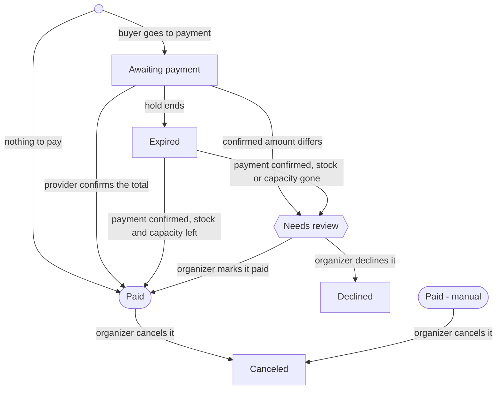

# Convention shop

- Date: 2026-11-12
- Domain owner: the domain owner of tickets ([CONTRIBUTORS.md](../../CONTRIBUTORS.md))
- Source: an outside review of a running shop (M1, no longer kept), reworked against the
  product's decisions and the review in [0002](0002-convention-shop-review.md)
- Binding: no ([briefs](README.md)); the working copy toward the specs of the tickets module. The
  decisions it records reach the documents through those specs and their decision records
  ([departures](#where-this-brief-departs-from-the-documents)).

## Purpose & scope

The shop sells an edition's tickets, add-ons and merchandise online, ahead of the edition, through
a short multistep checkout paid through the convention's payment provider, Przelewy24 first.

- **In scope:** the catalog, cart and checkout, the order lifecycle with its payments, buyer
  self-service, the panel functions that feed the shop, and what the scanner reads from it.
- **Taken from other modules:** see [inputs](#what-the-shop-takes-from-other-modules).
- **Out of scope:** programme sign-ups, sleeping places beyond a headcount add-on, programme
  building, volunteer management, the convention website (CMS), implementation choices, a capacity
  shared across ticket types (the venue's limit), buyers' claims (returns, withdrawals, complaints
  about an item; [open questions](#open-questions)), the convention's taxes and fiscal duties
  (cash register, VAT, invoices).
- **Postponed and dropped:** see [Postponed](#postponed) and [Dropped](#dropped).

Scenarios use Gherkin-style wording (Given / When / Then) for precision. They are not a commitment
to Cucumber. IDs follow the source brief, and 0002 refers to them, so none is renumbered: a missing
one was postponed, merged into its neighbour or moved to the inputs.

## Key business & user requirements

The shop must let an organizer open sales for an edition without developer help, and let a buyer go
from the convention's page to a paid order with a QR code in under five minutes on a phone.

### Business requirements

| ID | Requirement |
| --- | --- |
| BR-01 | A convention runs any number of editions; each edition has its own catalog, prices, dates, legal documents and sales settings. The payment provider account, the seller's details and the currency are the convention's. |
| BR-02 | An edition offers several ticket types (e.g. standard, supporter), each with its own price, description, perks, capacity and sale window. |
| BR-03 | Prices can change by date (e.g. cheaper online than on-site, early-bird tiers). A placed order keeps its price. A checkout keeps a price tier or a sale window for 30 minutes after it ended; later the buyer is shown the new total and confirms it, or is told the sale closed. |
| BR-04 | Some ticket types are excluded from discounts; the shop says so on the ticket type's page. |
| BR-05 | A ticket can include perks (e.g. pin, special badge) shown to the buyer but not sold separately. |
| BR-06 | Merchandise is sold with a ticket or on its own ("merch-only" order). The shop is not fit for purpose without merchandise. |
| BR-07 | Merchandise can have variants (e.g. cut × size) with stock per variant; a variant at zero stock cannot be bought. |
| BR-08 | Merchandise has a pre-order deadline; after it, only remaining stock is sold. |
| BR-09 | Fulfillment is pick-up at the edition only; the shop never promises shipping. |
| BR-10 | Add-ons can be paid, free, capacity-limited, or a non-binding headcount (e.g. sleeping-room interest). |
| BR-11 | A paid shop order has one QR code, used at the scanner for entry and merchandise pick-up. An order that is not paid has none, and neither has a manual order, handed over as it is recorded (B4.5). An account's "Buy more" order joins the QR code of the order it extends (F9.4). |
| BR-12 | Each edition sets three age bands, child, teen and adult, by age on its first day. A child enters only with a guardian present; a teen enters with a guardian's written consent, a paper document brought to the edition, which the buyer acknowledges with a checkbox at checkout; an adult needs nothing. The edition can link a consent form for the guardian to print. A ticket type allows some of the bands. |
| BR-13 | Consents (e.g. shop terms, edition rules, minors' protection, the privacy policy) are configurable per edition, each required or optional, and stored with the order. The shop treats them as given: their kind and wording are the convention's, settled with its lawyer, not the shop's. A payment provider's own consent, when it requires one, comes from its module. |
| BR-14 | Payments run through Przelewy24 (BLIK, bank transfer, cards). Another provider may follow. |
| BR-15 | Each convention is paid into its own payment provider account; OPOS never holds the money. |
| BR-16 | Organizers see live sales, stock and ticket holder lists, and can export them. |
| BR-18 | Beyond name, email and age band, the convention decides what it asks a ticket holder, as custom fields of the edition: short, non-sensitive text answers. |
| BR-19 | Custom field answers, and a visitor's details, are the convention's data: they are kept in the convention, with the order or the attendee registration, never in the account. |
| BR-20 | One order holds at most one ticket, for one ticket holder. One email can hold several orders, each ticket under its own name: the name is the convention's data point, not an identity. |
| BR-21 | A buyer buys only under their own email. A visitor's order under an email that belongs to an account is attached to that account once it is paid, and its emails ask the owner to sign in to see it; checkout never tells the visitor whether the email has an account. |
| BR-22 | A ticket passes to another person only when an organizer changes the order's email, which replaces its QR code and order link (B4.3). |
| BR-23 | OPOS carries out no refunds. An organizer can cancel a paid order; returning the money is the convention's matter, outside OPOS. |
| BR-24 | A payment confirmed after its order's hold ended still pays the order while its stock and capacity last. One that cannot simply mark its order paid (a different amount, or stock or capacity gone) puts the order in "Needs review" for an organizer. A payment the order no longer needs is refused where its provider allows; one that still arrives is shown to the organizers. No payment passes unnoticed, and the buyer is told where the money is. |
| BR-25 | An unpaid order holds its stock and capacity for 30 minutes (the hold). The hold does not limit when the order can be paid, and an order is not expired while its provider reports a payment made within the hold. In the first shop a payment attempt starts only within the hold. |
| BR-26 | Orders are kept for at least five years from the end of their edition, which is never earlier than their payment. Nothing is purged in the first shop. |
| BR-27 | For an account, holding a paid ticket is being registered: when an order with a ticket on an account is paid, placed signed in or attached (BR-21), the account becomes an attendee of the edition, one registration per account and edition, whatever the ticket holder's name. A visitor with no account holds a ticket and no registration. |

### User requirements

| ID | As a… | I want to… |
| --- | --- | --- |
| UR-01 | Buyer | compare ticket types and their prices and perks on one page |
| UR-02 | Buyer | see the running total at every checkout step |
| UR-03 | Buyer | choose merchandise sizes using a size chart for each cut |
| UR-04 | Buyer | check out without an account or with one, my choice |
| UR-05 | Buyer | pay with BLIK, bank transfer or card |
| UR-06 | Buyer | get the QR code by email right after payment |
| UR-07 | Account holder | buy more items, resend a QR code and see my orders in a convention |
| UR-08 | Visitor | open a read-only order page from a link in my email |
| UR-09 | Buyer | retry a failed payment without re-entering everything |
| UR-10 | Organizer | set up an edition's catalog and rules myself |
| UR-11 | Organizer | correct or cancel an order without developer help |
| UR-12 | Organizer | see and settle every order that needs review |
| UR-13 | Organizer at the desk | scan a QR code with the edition's scanner and see what to hand over and what to check |

## What the shop takes from other modules

The shop builds on these and sets none of their rules: this brief states only what the shop needs
of them.

| From | The shop takes | Set there, not here |
| --- | --- | --- |
| Core | Accounts and their confirmed emails. Organizers and their permissions: the tickets permission of an edition opens its catalog, orders, exports and scanners (read sees them, write changes them), the shop permission of the convention opens its payment provider account and seller's details, and a head organizer holds both. The convention's language, time zone (every date and deadline of the shop is in it), currency (PLN in the first shop) and branding, shown in the shop and its emails. An edition, published or not. The isolation of conventions' data and payment accounts. | Sign-in, invitations, the account's own emails, how branding is set |
| Portal | The bot check, at checkout and at sign-in (NF-05); the consent banner, for a tracker that comes later (NF-06). | [0026](../adr/0026-run-a-tracker-only-with-consent-and-none-in-the-panel.md) and the record of D12 |
| A payment provider's module | [What the shop asks of it](#what-the-shop-asks-of-a-providers-module). | How the provider processes a transaction |
| Attendee registrations | The registration a paid ticket makes for an account (BR-27). | Everything else about a registration, and its owner ([open questions](#open-questions)) |
| Scanner | A device with no account signed in, serving one edition; B6 says what it reads and records. | How a device is enabled and revoked; undoing a hand-out marked by mistake |
| Programme sign-ups | Nothing. | How the attendee badge handed out at the desk is identified (B4.5) |

## Glossary

The product's glossary ([PRODUCT.md 3](../PRODUCT.md#3-glossary)) holds, and its terms keep their
meaning and their catalog rendering: edition, attendee, scanner, ticket type ("rodzaj
akredytacji"), ticket ("akredytacja"). This brief writes the words a buyer and an organizer see:
**convention** ("konwent") for the code's `tenant`, **organizer** ("organizator") for `org`, **head
organizer** ("główny organizator") for `head`. `tenant` stays the code's name, and the documents'
wherever tenant isolation is the subject. Every term below is new, but for order, whose meaning
changes (D5); each enters the product's glossary, with the quoted `pl` rendering, through the
specs.

| Term | `pl` | Meaning |
| --- | --- | --- |
| Shop | "sklep" | The edition's sales to buyers; also the convention's permission over its payment provider account. |
| Order | "zamówienie" | One checkout of an edition with its payment: at most one ticket, for one ticket holder, with its add-ons and merchandise. A merch-only order has no ticket. |
| Ticket holder | "posiadacz akredytacji" | The name a ticket is issued to, with its age band and custom field answers. |
| Buyer | "kupujący" | The person paying an order under their own email, who gets its QR code: a visitor or an account holder. |
| Visitor | "odwiedzający" | A person with no account signed in. Not "guest", which the scene uses for a convention's invited guests. |
| Price tier | "próg cenowy" | A price valid within a date window (e.g. online pre-sale vs on-site). |
| Supporter price | "cena wspierająca" | An optional higher price a buyer may choose for a ticket type. |
| Perk | "bonus" | Something included with a ticket type (pin, special badge); visible, not priced separately. |
| Add-on | "dodatek" | An optional extra attached to a ticket: paid, free, capacity-limited or headcount-only. |
| Merchandise item | "merch", or "gadżet" | A physical product picked up at the edition ("merch" on screen). |
| Variant | "wariant" | A buyable option of a merchandise item (e.g. "Women's - M"); holds its own stock. |
| Size chart | "tabela rozmiarów" | The measurements of a merchandise item's sizes, one per cut. |
| Pre-order deadline | "termin przedsprzedaży" | The date until which merchandise can be ordered without a stock limit. |
| Age band | "przedział wiekowy": "dziecko", "nastolatek", "dorosły" | One of an edition's three, child, teen or adult, by age on the edition's first day (BR-12). |
| Consent | "zgoda" | A buyer's acceptance of a document of the edition, stored with its version. |
| Guardian consent | "zgoda opiekuna" | A guardian's written consent for a teen, brought on paper to the edition (BR-12). |
| Custom field | "pole dodatkowe" | A short, non-sensitive text an edition's organizers ask a ticket holder for. |
| Discount code | "kod rabatowy" | A code lowering the price of the products it applies to. |
| QR code | "kod QR" | A paid shop order's credential, read by the scanner for entry and merchandise pick-up. |
| Order link | "link do zamówienia" | An emailed link opening one order read-only, without a sign-in. |
| Payment attempt | "próba płatności" | One try at paying an order through its payment provider; an order can have several. |
| Hold | "rezerwacja" | The 30 minutes an unpaid order holds its stock and capacity; it does not limit when the order can be paid. |
| Manual order | "zamówienie ręczne" | A sale an organizer records in the panel as paid outside the shop (desk sale, invoice, complimentary), handed over as it is recorded. |

Order statuses:

| Status | `pl` | Meaning |
| --- | --- | --- |
| Awaiting payment | "oczekuje na płatność" | Sent to the payment provider, holding its stock and capacity for the hold. |
| Paid | "opłacone" | The payment provider confirmed the total, or the total was zero; the QR code is issued. |
| Paid - manual | "opłacone ręcznie" | A manual order; it has no QR code. |
| Expired | "wygasłe" | Unpaid when its hold ended; holds nothing, and a payment that still comes pays it while stock and capacity last. |
| Needs review | "do wyjaśnienia" | A payment did not match the order, or came once its stock or capacity was gone; an organizer settles it. |
| Declined | "odrzucone" | An organizer declined a payment that needed review. |
| Canceled | "anulowane" | An organizer canceled a paid order. |

## Shop frontend

Checkout is four steps (Ticket holder, Add-ons, Merch, Summary), followed by the payment provider
and a result page. A merch-only order skips the steps that only make sense with a ticket. On every
step:

- a step indicator shows the steps with the current one highlighted, and a step with nothing to
  offer (no add-ons, no merchandise) is skipped and hidden from it (F3.3, F4.9);
- the header shows the ticket type's name and the running total, updated at once on every change.

### F1: Product listing

```gherkin
Scenario: F1.1 Buyer sees the edition's offer
  Given an edition whose shop is open
  When the buyer opens the shop
  Then each ticket type on sale shows name, current price, short description and accepted payment methods
  And a "Merch only" card is shown if merch-only orders are enabled
  And the footer shows the seller's details (B1.4), what the payment provider's module requires and links to shop terms, privacy policy, edition rules, FAQ and contact

Scenario: F1.2 Ticket type outside its sale window
  Given a ticket type whose sale window has not started or has ended
  Then it is hidden, or shown as "Not yet on sale" / "Sales closed" per organizer setting

Scenario: F1.3 Ticket type sold out
  Given a ticket type has no capacity left
  Then it shows "Sold out" and cannot be selected

Scenario: F1.4 Sales closed for the whole edition
  Given no ticket type and no merchandise is on sale
  Then the shop shows the organizer's "sales closed" message instead of products
```

### F2: Ticket holder (step 1)

```gherkin
Scenario: F2.1 Ticket type description and perks
  Given the buyer chose a ticket type
  Then the step shows its long description, perks and price
  And if the ticket type is excluded from discounts, a notice says so

Scenario: F2.2 Supporter price option
  Given the ticket type offers supporter prices
  Then the buyer can pick one of the offered prices

Scenario: F2.11 With or without an account (was F5.5)
  Given the buyer is not signed in
  Then this step, before it asks for the email, offers to continue without an account or to sign in / create an account
  And signing in, here or later from the header, keeps everything already entered
  And the account's email replaces a typed one

Scenario: F2.3 Fields
  Then the form asks for the ticket holder's name/nickname and age band
  And for a visitor, the buyer's email and its confirmation
  And an email the payment provider's module cannot take is refused with a message saying so
  And then for the custom fields the edition defines, each required or optional as set
  And the email field explains the QR code will be sent there

Scenario: F2.4 Validation messages appear only after interaction
  Given the buyer has not touched the form
  Then no error is shown
  When the buyer presses Next with invalid fields
  Then each invalid field shows its own message and focus moves to the first one

Scenario: F2.5 Emails do not match
  When email and email confirmation differ
  Then Next is refused with "Emails do not match"

Scenario: F2.6 Email of an account
  Given a visitor enters an email that belongs to an account
  Then checkout goes on exactly as for any other email
  And once paid, the order is attached to that account, which becomes an attendee (BR-27)
  And its emails tell the owner the order is on their account and to sign in to see it

Scenario: F2.7 Age band not allowed for this ticket type
  Given a ticket type for adults only
  When the buyer selects "teen"
  Then the buyer is told the ticket type is not available for that age band and which ticket types are

Scenario: F2.8 Child
  When the buyer selects "child"
  Then a notice says a child enters only with a guardian present

Scenario: F2.9 Teen
  When the buyer selects "teen"
  Then the summary step adds a required checkbox acknowledging the guardian's paper consent
  And a notice says the consent is brought on paper to the edition
  And it links the edition's consent form, when the edition set one

Scenario: F2.10 Signed-in buyer
  Given the buyer is signed in
  Then the account's email is used and cannot be changed
  And an account email the payment provider's module cannot take cannot pay through it, and checkout says so before the order is placed
  And the ticket holder's name is pre-filled from the account
  And once the order is paid, the account is an attendee of the edition
```

### F3: Add-ons (step 2)

```gherkin
Scenario: F3.1 Headcount-only add-on
  Given an add-on marked "headcount only" (e.g. sleeping-room interest)
  Then it shows its price (may be 0) and a note that no place is reserved
  And ticking it records interest without reducing any capacity

Scenario: F3.2 Capacity-limited add-on
  Given an add-on with limited capacity
  Then it shows places left when below the organizer's threshold
  And it cannot be ticked when none are left
```

### F4: Merch (step 3)

```gherkin
Scenario: F4.1 Pre-order notice
  Given a pre-order deadline is set
  Then a banner says all merchandise can be ordered until that date and stock is limited afterwards

Scenario: F4.2 Included perks
  Given the ticket type includes perks
  Then a note lists them (e.g. "Your ticket includes a special badge and a pin")

Scenario: F4.3 Item card
  Then each item shows name, price, description, picture(s) and an "illustrative image" note if set

Scenario: F4.4 Item with variants
  Given a T-shirt with cuts "Men's" and "Women's" and sizes XS-5XL
  When the buyer selects the T-shirt
  Then a size picker appears listing only variants that exist, grouped by cut
  And a size chart per cut opens without leaving checkout
  And Next is refused until a variant is chosen

Scenario: F4.5 Sold out
  Given variant "Women's - M" has zero stock
  Then it is shown as unavailable in the picker, and other variants of the item stay selectable
  And an item whose every variant has zero stock shows "Sold out" and cannot be selected

Scenario: F4.7 Quantity
  Given the item allows more than one per order
  Then the buyer can set a quantity up to the per-order limit and remaining stock
  And for items with variants, each chosen variant is its own line
```

### F5: Summary & consents (step 4)

```gherkin
Scenario: F5.1 Order summary
  Then the step shows the email the QR code will be sent to
  And a table of lines (ticket, add-ons, merchandise with variant, discount) with prices and the total due
  And a notice that merchandise is picked up at the edition only and is not shipped

Scenario: F5.2 Consents
  Then all consents configured for the edition are listed, each linking to its document
  And the payment provider's own consent, when its module requires one, is shown as the module says
  And required consents are marked
  And a "Select all required" checkbox ticks every required consent
  And optional consents are never ticked by "Select all required"

Scenario: F5.3 Missing consent
  When the buyer presses the button that places the order without all required consents
  Then the order is not placed and the missing consents are highlighted

Scenario: F5.4 Payment methods
  Then the step names the methods the payment provider's module lists (for Przelewy24: BLIK, bank transfer, card)
  And the buyer chooses among them on the provider's page

Scenario: F5.6 Order and pay
  Given the total is not zero
  And the button that places the order reads "Order and pay", in `pl` "Zamawiam i płacę"
  When the buyer presses it
  Then the bot check passes, and stock and capacity are re-checked
  And the order is created as "Awaiting payment", holding its items for the hold
  And the buyer is sent to the payment provider

Scenario: F5.7 Something ran out during checkout
  Given a selected variant, ticket type or add-on sold out, or the discount code was used up, after the buyer chose it
  When the buyer presses the button that places the order
  Then the order is not placed
  And the buyer is returned to the step of what ran out, with it flagged
  And a total that changed (BR-03) is shown and confirmed first: it never changes silently
  And a failed bot check says so and lets the buyer try again

Scenario: F5.8 Nothing to pay
  Given the total is zero (e.g. a 100% code, a free ticket type, free add-ons)
  Then the button reads "Order", in `pl` "Zamawiam", and no payment provider consent is asked
  When the buyer presses it
  Then the bot check passes, and stock and capacity are re-checked
  And the order is created as "Paid", with no payment step, and the confirmation email with QR code is sent
```

### F6: Navigation & cart state

```gherkin
Scenario: F6.1 Back keeps data
  When the buyer presses Back on any step
  Then everything entered on later steps is kept

Scenario: F6.2 Switching ticket type
  Given the buyer has merchandise selected under ticket type A
  When the buyer returns to the listing and picks ticket type B
  Then the buyer is asked whether to keep the merchandise selection
  And perks or add-ons not valid for B are removed with a notice

Scenario: F6.3 Refresh
  When the buyer reloads the page before going to payment
  Then the checkout resumes on the same step with the same data

Scenario: F6.4 Unfinished checkout
  Then a checkout not yet sent to payment holds no stock or capacity
```

### F7: Merch-only order

```gherkin
Scenario: F7.1 Buy merchandise without a ticket
  When the buyer picks "Merch only"
  Then steps are "Buyer → Merch → Summary"
  And the buyer step asks only for name/nickname and, for a visitor, email
  And age band and custom fields are not asked
  And the pick-up QR code is sent to the buyer by email
```

### F8: Result pages

```gherkin
Scenario: F8.1 Payment confirmed
  Given the payment provider confirmed the payment
  Then the buyer sees "Paid", the order number and that the QR code was emailed

Scenario: F8.2 Payment not confirmed yet
  Given the buyer returned before the provider confirmed the payment or reported it failed
  Then the buyer sees "Not paid yet" and the page updates by itself once confirmed
  And within the hold it offers "Try again", as a provider may never report a failure
  And after the hold it says the order expired and links to a new checkout

Scenario: F8.3 Payment failed or canceled
  Given the provider reported the payment failed or canceled
  Then the buyer sees why, when the provider says, and a "Try again" button
  And "Try again" starts a new payment attempt without re-entering data

Scenario: F8.4 Payment needs review
  Given the order went to "Needs review"
  Then the buyer sees that the payment arrived, where the money is and that an organizer will get in touch
```

### F9: Buyer self-service

```gherkin
Scenario: F9.1 Visitor opens the order link
  Given a visitor received an order email
  When the visitor opens the order link
  Then the order page shows lines, status, the QR code if paid, and pick-up info
  And nothing on the page can be changed

Scenario: F9.2 Order link expired
  Given the link is older than its validity
  Then the page offers to send a fresh link to the order's email

Scenario: F9.3 Account holder's orders
  Given a signed-in account holder on a convention's page
  Then they see their orders in that convention
  And per order "Resend QR code", "Buy more" and, for an unpaid order within its hold, "Pay now"

Scenario: F9.4 Buy more
  When the account holder presses "Buy more" on a paid order
  Then a checkout opens for the same edition and ticket holder, offering the add-ons of its ticket and merchandise
  And merchandise already bought is marked as "already ordered"
  And once paid, what was bought joins the first order's QR code, and the scanner shows both
  And each order is canceled on its own, and the shared QR code is refused once every order on it is canceled
  And a visitor has no "Buy more": buying again is a new order with its own QR code
```

## Payments

An order is paid only when its payment provider confirms the payment to the API, through the
provider's whole transaction process; the buyer's return to the shop never counts as proof of
payment. This brief is not the specification of a payment provider: how a provider processes a
transaction belongs to the provider's module and its spec. Przelewy24 is the first provider (D3);
others with other schemes follow.



Failed or canceled attempts leave the order in "Awaiting payment"; only the provider's
confirmation, the end of the hold or an organizer changes its status. A total of zero needs no
payment (F5.8). "Paid - manual" is a manual order (B4.5).

### What the shop asks of a provider's module

The contract between the shop's specs and a provider's. The right column names what the spec of
the Przelewy24 module decides; it starts from [0002](0002-convention-shop-review.md): its facts
a–p, its points 2–5 and 7–10, and its list of what to check in the sandbox.

| The shop asks the module to | For Przelewy24 |
| --- | --- |
| start a payment attempt for an order: the amount and currency, the order number as its reference, a description with no personal data, where the buyer returns | each attempt is its own transaction; its time limit and method mask (points 3, 4) |
| confirm a payment to the API: which attempt, the amount paid and when it was made; a repeat changes nothing | the notification, then the verification (facts b, c, f, g) |
| tell the state of an attempt when asked: before an order expires, and before a new attempt starts | fact h |
| report a failure and its reason, where the provider does | cards and BLIK only, by an additional notification (point 2) |
| refuse a payment its order no longer needs, where the provider can | leaving it unverified (point 3) |
| say where the money of a payment is, with the convention or still with the buyer, for the shop's pages and emails | when a payment that needs review is verified (point 4) |
| list the methods the shop names | BLIK, Polish bank transfers (pay-by-link), cards (point 9) |
| say what it requires of the shop's pages: a consent, its logo, limits on fields | the consent's wording and place (point 7); an email of up to 50 characters (point 8) |
| keep information with each attempt, shown on the order (B4.2) and in the payments export (B7.2) | the transaction number, by which an organizer finds the payment in Przelewy24's panel; the payout batch number and the commission (point 10) |
| connect the convention's own account, by an organizer with the shop permission, and say when it is ready to sell (B1.4) | the credentials; the email finishing an abandoned payment turned off (point 4) |

### P1: Paying an order

```gherkin
Scenario: P1.1 Successful payment
  Given an order "Awaiting payment" of 390.00 PLN
  When the buyer completes BLIK on the provider's page
  Then the buyer returns to the result page
  And when the provider confirms 390.00 PLN the order becomes "Paid"
  And stock is committed and the confirmation email with QR code is sent once

Scenario: P1.2 Buyer cancels at the provider
  When the buyer cancels on the provider's page
  Then the order stays "Awaiting payment"
  And the result page offers "Try again"

Scenario: P1.3 Payment declined
  When the provider reports a decline
  Then the attempt is recorded as failed
  And the buyer gets "Try again"; the order itself is unchanged

Scenario: P1.4 Late confirmation
  Given the buyer closed the browser before returning
  When the provider confirms minutes later
  Then the order becomes "Paid" and the email is sent as usual

Scenario: P1.5 Duplicate confirmation
  When the provider confirms the same payment twice
  Then the order is updated once and only one email is sent

Scenario: P1.6 Unpaid order expires
  Given an order "Awaiting payment" whose hold ends
  When the provider confirms no payment made within the hold, asked about the order's open attempts
  Then the order becomes "Expired" and its stock, capacity and discount code use are released

Scenario: P1.7 Pay later from account
  Given an account holder has an "Awaiting payment" order within its hold
  When they press "Pay now"
  Then a new payment attempt starts without changing the order
  And after the hold no attempt starts: the buyer starts a new checkout

Scenario: P1.9 Payment after the hold
  Given an "Expired" order
  When the provider confirms its total
  Then the order becomes "Paid" when its stock, capacity and discount code use are still there, taking them again, and the confirmation email is sent
  And otherwise it goes to "Needs review" (P2.2)

Scenario: P1.10 A payment the order no longer needs
  Given a "Paid", "Needs review", "Canceled" or "Declined" order
  When its provider confirms another payment for it, one the provider's module could not refuse
  Then the order is unchanged
  And the payment is shown on the order, the organizers are alerted by email and the buyer is emailed where the money is
```

### P2: Needs review

The organizers alerted below are the head organizers and the organizers with write access to the
edition's tickets: those who can settle the order.

```gherkin
Scenario: P2.1 Amount mismatch
  Given the provider confirms an amount different from the order total
  Then the order does not become "Paid"
  And it goes to "Needs review", keeping what it still holds until it is settled
  And the organizers are alerted and the buyer is told where the money is, both by email

Scenario: P2.2 Payment after the hold, stock gone
  Given an "Expired" order whose stock or capacity is gone
  When the provider confirms a payment for it
  Then the order goes to "Needs review", with the same emails
  And no stock is taken until an organizer marks it paid

Scenario: P2.3 Organizer marks it paid
  Given an order in "Needs review"
  When an organizer marks it paid
  Then stock and capacity are re-checked and taken, and marking is refused when they are gone
  And for an order whose stock or capacity is gone, the organizer raises it first, or declines
  And the order becomes "Paid" and the confirmation email with QR code is sent

Scenario: P2.4 Organizer declines it
  Given an order in "Needs review"
  When an organizer declines it, with a reason
  Then the order becomes "Declined", holds no stock and never gets a QR code
  And the buyer is emailed, with where the money is

Scenario: P2.5 Nothing is left unnoticed
  Then the panel lists every order in "Needs review" until it is settled
```

## Panel functions

Everything the shop shows is configured by organizers in the panel; the API also enforces every rule
the shop displays, so nothing can be bought by bypassing the page.

### B1: Shop setup

```gherkin
Scenario: B1.4 Open the shop
  Given an edition, published or not
  When the organizer opens its shop
  Then opening is refused unless the convention's payment provider account is connected, its seller's details are set and the edition's required legal documents are set
  And the seller's details are the name, address and register or tax number of the legal entity running the convention, set with the shop permission
  And the edition's documents and consents are set with its tickets permission
  And the edition itself can be published without an open shop
```

### B2: Catalog

```gherkin
Scenario: B2.1 Ticket type
  Then the organizer sets name, descriptions, perks, price tiers with date windows, supporter prices,
    capacity, sale window, allowed age bands, discount eligibility and the add-ons and merchandise offered with it

Scenario: B2.2 Merchandise item with variants
  Then the organizer defines option axes (e.g. cut, size), the variants that exist, stock per variant,
    size chart per cut, per-order limit, uploaded pictures (D16) and an "illustrative image" flag

Scenario: B2.3 Pre-order deadline
  Given a pre-order deadline
  Then until the deadline, stock may be marked "unlimited (pre-order)"
  And after it, stock is the number the organizer enters

Scenario: B2.4 Editing a live product
  When the organizer changes a price on a product with existing orders
  Then existing orders keep the price they were sold at (BR-03)

Scenario: B2.5 Hide vs delete
  Then a product with orders can be hidden but not deleted

Scenario: B2.6 Age bands
  Then the organizer sets the ages that divide child, teen and adult for the edition
  And optionally a link to the guardian consent form for teens

Scenario: B2.7 Custom fields
  Then the organizer defines the edition's custom fields: a label and whether each is required
  And each takes a short text, and the shop says it must hold nothing sensitive
  And the answers appear on the order and in exports, and nowhere outside the convention
```

### B3: Discounts & codes

```gherkin
Scenario: B3.1 Discount code
  Then a code has a value (amount or percent), the products it applies to, usage limit, validity window
  And codes never apply to products marked "no discounts"
  And an order takes one code, whose use is held, released and taken again with the order's stock

Scenario: B3.2 Code in checkout
  When the buyer enters a valid code on the Summary step
  Then the discount appears as its own line and the total updates

Scenario: B3.3 Free entry with paid merchandise
  Given a person entitled to free entry (e.g. the convention's guest, staff), or paid for outside the shop
  When the organizer issues them a 100% ticket code
  Then they can check out with free entry, still buy merchandise, and get a QR code like any buyer
```

### B4: Orders

Changing an order needs write access to the edition's tickets.

```gherkin
Scenario: B4.1 Order list
  Then the organizer can search orders by number, name, email or QR code
  And filter by edition, status, product, variant and date

Scenario: B4.2 Order detail
  Then it shows lines, the ticket holder's data, custom field answers, consents with document versions,
    payment attempts with the information its provider's module keeps and emails sent

Scenario: B4.3 Correct the ticket holder or the email
  When an organizer changes the ticket holder's name
  Then it is just an edit: nothing else changes with it
  When an organizer changes the order's email
  Then the order gets a new QR code and order link, the old ones stop working, and both addresses are emailed
  And this is the only way a ticket passes to another person
  And the order and the attendee registration stay on the account they were on

Scenario: B4.4 Swap variant
  When an organizer swaps "Men's - L" for "Men's - XL"
  Then stock moves between variants and the swap is refused if XL has none

Scenario: B4.5 Manual order
  When an organizer records a sale made outside the shop (e.g. cash or card terminal at the desk, invoice-paid, complimentary)
  Then it is made in the panel, never through the shop's checkout, and marked "Paid - manual" with a reason
  And it takes stock and capacity like any order, and asks for no email
  And what it sells is handed over at the desk as it is recorded, an attendee badge for a ticket: it has no QR code, no email and nothing to scan
  And a person who should hold a QR code ahead of the edition gets a 100% code instead (B3.3)

Scenario: B4.6 Resend QR
  When an organizer presses "Resend QR"
  Then the confirmation email is sent again to the order's email

Scenario: B4.7 Cancel a paid order
  Given a "Paid" or "Paid - manual" order
  When an organizer cancels it, with a reason
  Then the order becomes "Canceled", its stock and capacity return and its QR code, if it has one, is refused at the scanner (F9.4 for a shared one)
  And the buyer of a shop order is emailed
  And it is just a cancellation: the attendee registration stays
```

### B5: Stock & capacity

```gherkin
Scenario: B5.3 Production numbers
  Given the pre-order deadline has passed
  When the organizer opens production numbers
  Then the organizer can export counts per variant to send to the manufacturer
  And the counts show paid orders, and apart from them the orders awaiting payment or needing review
```

### B6: Scanner, entry & pick-up

```gherkin
Scenario: B6.1 Scan QR
  When an organizer scans a QR code with the edition's scanner
  Then the scanner shows the ticket holder, age band, ticket type, perks, add-ons and merchandise with variants
  And whether entry and each item were already handed out

Scenario: B6.2 Child or teen
  Given the ticket holder is a child or a teen
  Then the scanner says a child enters only with a guardian present, and a teen only with the guardian's paper consent

Scenario: B6.3 Invalid QR
  Given a QR code of a canceled order, a replaced one, or one of another edition's order
  Then the scanner shows a clear red "Not valid" with the reason

Scenario: B6.4 Mark handed out
  When entry or items are marked as handed out on the scanner
  Then the time and the scanner are recorded and a second scan shows it

Scenario: B6.5 Sale at the desk
  Then an organizer can sell the same catalog in the panel at on-site prices,
    paid by card terminal or cash, recorded as a manual order (B4.5)
```

### B7: Reporting

```gherkin
Scenario: B7.1 Dashboard
  Then the organizer sees, per edition: revenue, tickets sold per type,
    merchandise sold per variant, add-on counts (incl. headcount-only), age bands and custom field answers

Scenario: B7.2 Exports
  Then the ticket holder list, merchandise pick list and payments, with the information its provider's module keeps, can be exported as spreadsheet files
  And an export needs the tickets permission of the edition
```

## Notifications & non-functional requirements

Every email has a fixed text with the convention's simple branding, and is logged on the order.
"Organizers" below are those who can settle the order, as P2 says. Where the money is, in an
email to a buyer, is the sentence the provider's module gives.

| Email | Sent when | Contains |
| --- | --- | --- |
| Order confirmation | Order becomes "Paid" | Lines, total, QR code, pick-up notice, order link, the seller's details, links to the documents accepted; for a teen, the guardian consent rule and form link; for an email with an account, a sign-in link |
| Order expired | Unpaid order expires | Link to start again |
| Order changed | Organizer edits the ticket holder, the email or a variant | What changed; on a new email, the new QR code and order link to the new address and a notice to the old one |
| Payment under review | Order goes to "Needs review" | That the payment arrived, where the money is, that an organizer will get in touch |
| Order declined | Organizer declines an order that needed review | That the payment was declined, where the money is; the convention's contact |
| Order canceled | Organizer cancels a paid order | That the QR code is no longer valid; the convention's contact |
| Payment not needed | An order gets a payment it no longer needs | Where the money is; the convention's contact |
| Order link | Buyer asks for a fresh link | Read-only order link |
| Needs review | Order goes to "Needs review" (to the organizers) | Order number, what did not match |
| Payment not needed | An order gets a payment it no longer needs (to the organizers) | Order number, the payment |
| Pre-edition reminder | N days before the edition, set by organizer | QR code, opening hours, pick-up info, guardian rules and consent form link |

### Non-functional requirements

| ID | Requirement |
| --- | --- |
| NF-01 | Mobile-first: full checkout works on a 360 px wide screen. |
| NF-02 | Accessibility: WCAG 2.1 AA for shop and buyer pages. |
| NF-05 | Security: Google reCAPTCHA as the bot check on checkout, strictly necessary and so asked for in no banner (D12), without puzzles for most buyers and with a fallback that meets NF-02; protection against cross-site scripting, injection and the other common attacks; secure HTTP headers; general hardening; a limit of unpaid orders per email address, so nobody fills another person's inbox or holds stock with addresses that are not theirs. |
| NF-06 | The first shop sets no analytics or advertising cookies. A tracker that comes later, a convention's own analytics tag for one, runs only through the portal's consent banner ([0026](../adr/0026-run-a-tracker-only-with-consent-and-none-in-the-panel.md)). |
| NF-07 | Every consent is stored with the exact document version accepted and a timestamp. |
| NF-09 | Prices are shown with currency and as gross amounts; totals in the shop, emails and the payment provider always match to the cent. |

## Postponed

Wanted later, not in the first shop.

| Item | From |
| --- | --- |
| Refunds through OPOS, full and partial; a buyer canceling and getting a refund before a deadline | M1 P2, open question "Buyer cancellation" |
| Canceling a single line of an order; until then an organizer cancels the whole order or swaps a variant | [0002](0002-convention-shop-review.md) point 12 |
| Automatic refund of a payment that arrives after its order expired | M1 P1.8 |
| An opt-in fiscal receipt and invoice helper (company details at checkout, VAT), and a receipt to download | M1 open question "Invoices", F9.3 |
| A buyer passing a ticket to another person themselves | M1 open question "Ticket transfer" |
| Custom fields beyond short text (choices, dates, sensitive data) | M1 open question "Custom fields" |
| Stripe or another provider; choosing providers per edition and which is shown first | M1 BR-14, Payments, P1.2 |
| The payment methods as the provider returns them for the account and the amount; until then a fixed list per provider | [0002](0002-convention-shop-review.md) point 9 |
| An order payable for longer than its hold (24 hours was suggested), a reminder carrying "Pay now", a visitor's way back to an unpaid order, and a countdown of the hold; until then BR-25 | domain owner, [0002](0002-convention-shop-review.md) points 2 and 4 |
| Named organizer roles (e.g. owner, manager, finance, desk, viewer) on top of the permissions | M1 B1.2 |
| A new edition made from the convention's previous one: its catalog, age bands, custom fields and consents copied as drafts, with dates, prices and stock cleared | B1.3 |
| An email alerting the organizers when a variant's stock falls below a threshold they set | B5.2 |
| Emails an organizer edits per edition | M1 Notifications |
| Organizer texts per language; emails in the buyer's checkout language | M1 NF-03 |
| Data export on request; purging orders past their retention, and what a purge removes; retention set per convention beyond the five-year minimum | M1 NF-06, BR-26 |
| A convention's own analytics tag in its shop, through the consent banner | domain owner |
| An "interested" phase before buying: an account follows an edition and gets its news ahead of the sale | domain owner |
| Audit log and order change history (who, when, before/after) | M1 NF-08, B4.2, B4.3 |
| Orders across conventions on the account, and a link to the panel there | M1 F9.3 |
| Claiming a visitor's orders after an account is created with their email, and offering an account after the purchase | M1 F9.5, [0002](0002-convention-shop-review.md) point 18 |
| Sale-opening peaks beyond one convention's writes running one at a time | M1 NF-04 |
| Several tickets in one order, and "Buy another ticket" after a payment with the email and consents carried over | D5, [0002](0002-convention-shop-review.md) point 17 |
| The QR code and the order link on the result page once paid, and a way back to that page | [0002](0002-convention-shop-review.md) point 19 |
| Moving an order and its attendee registration to the account of its new email after an organizer changes it (B4.3) | domain owner |
| Releasing the holds of orders that have held an item for longer than a set time, once the item reaches zero stock | domain owner |

## Dropped

| Item | Why | From |
| --- | --- | --- |
| Organizations owning several conventions | a convention is the top level; an account organizes several | M1 BR-01, BR-15, B1, NF-10 |
| Saved attendee profiles on the account | custom field answers are the convention's data (BR-19) | M1 F2.8 |
| Buying under someone else's email | a buyer buys only under their own email (BR-21) | M1 F2.3 |
| A signed-in desk user scanning | the scanner is a device with no account | M1 B6, UR-12 |
| Platform fees | OPOS is free for conventions | M1 open question |

## Where this brief departs from the documents

Decided here by the domain owner; each reaches the documents through the tickets specs and the
decision records they bring, never by editing the documents ahead of them. D1, D10 and D12 need
their place in the documents before the first spec that leans on them.

| # | Decision | Departs from | Carried by |
| --- | --- | --- | --- |
| D1 | The tickets module has a domain owner, named in CONTRIBUTORS.md. | PRODUCT.md 7, ARCHITECTURE.md "Modules waiting for their domain owner", AGENTS.md: tickets waits for its owner | the first tickets spec |
| D2 | Merchandise, discount codes, 100% codes, manual and complimentary orders and desk sales are in the MVP. | PRODUCT.md 11: merchandise and tickets without a purchase are beyond the MVP | a record and PRODUCT.md 11 |
| D3 | Przelewy24 is the MVP's payment provider. | 0010 leaves the provider to be chosen with the module | a record |
| D4 | The person on a ticket is the ticket holder; "attendee" keeps its meaning. A person with no account signed in is a visitor. | PRODUCT.md 3 has neither term | PRODUCT.md 3 and `glossary.ts`, through the spec |
| D5 | An order holds at most one ticket, for one ticket holder, and may hold merchandise alone. | PRODUCT.md 3: an order is "one purchase of tickets" | a record and PRODUCT.md 3, through the spec |
| D6 | The shop's terms and statuses enter the glossary with their `pl` renderings. | PRODUCT.md 3 | PRODUCT.md 3, `glossary.ts` and the `pl` catalog, through the spec |
| D7 | The shop stores age band, consents, guardian consent and the convention's custom fields as the convention's data, never in the account. | PRODUCT.md 10 lists name, email and activity only | PRODUCT.md 10, through the spec |
| D8 | "Needs review" is in the MVP, a payment after the hold can still pay its order, and each payment attempt keeps its provider's information. | ARCHITECTURE.md "Modules waiting for their domain owner" and 0010: a different amount "changes nothing", and OPOS keeps only the payment reference | a record superseding that part of 0010, and ARCHITECTURE.md, through the spec |
| D9 | Shop and buyer pages meet WCAG 2.1 AA. | PRODUCT.md 8 states no accessibility level | a record and PRODUCT.md 8 |
| D10 | The documents say convention and organizer; `tenant` stays the code's name and the isolation rules'. | PRODUCT.md 3 and AGENTS.md use tenant and org as terms | a record and PRODUCT.md 3, before the first spec |
| D11 | A visitor's order under an account's email is attached to that account once paid and makes it an attendee, and checkout answers alike for any email. | ARCHITECTURE.md "Sessions and sign-in" (it fits: nobody learns which addresses have an account; the spec should say so) | the spec |
| D12 | Checkout and sign-in run Google reCAPTCHA, a fit with the deployment on Google Cloud, as strictly necessary: loaded only there, with no consent and outside the consent banner. | [0026](../adr/0026-run-a-tracker-only-with-consent-and-none-in-the-panel.md): a script from another origin is a tracker, and neither application loads one (a test enforces it); PRODUCT.md 10 | a record of the team amending 0026, before the checkout spec, and PRODUCT.md 10 |
| D13 | Orders are kept for at least five years from the end of their edition. | PRODUCT.md 10 states no retention for orders | PRODUCT.md 10, through the spec |
| D14 | Organizers cancel paid orders and decline payments that need review; OPOS returns no money. | PRODUCT.md 11 and 0010: refunds from the panel are beyond the MVP (no refund runs through OPOS, so this fits; the spec should say so) | the spec |
| D15 | A paid ticket on an account makes it an attendee of the edition: the shop creates the registration. | PRODUCT.md 7, ARCHITECTURE.md "Modules waiting for their domain owner", AGENTS.md: attendee registrations wait for their own owner | the first tickets spec, and CONTRIBUTORS.md if tickets' owner takes registrations |
| D16 | Merchandise pictures and size charts are uploaded files. | PRODUCT.md 11: file uploads are beyond the MVP | a record and PRODUCT.md 11 |

## Where the review landed

[0002](0002-convention-shop-review.md) stays as written; this says what became of its points.

| Outcome | Points of 0002 |
| --- | --- |
| Carried | 1–6, 8, 10, 11, 13, 20, 21; 15 as "strictly necessary"; 18 as the choice at the start; of the smaller ones: the registration on a cancellation and on a changed email, voiding the old QR code, B4.7, B6.5, B5.3, the merch step |
| Handed to the Przelewy24 module's spec | 7; of 2, the additional notification; of 3 and 4, the time limit, the method mask, the abandoned-payment email and when a payment is verified; the list of what the documentation does not settle |
| Postponed | the countdown (2, 4); the methods as the provider returns them (9); canceling a single line (12); 17; an account offered after the purchase (18); 19; a visitor's "Pay now" |
| Turned down | 12: the shop takes no position on withdrawal ([open questions](#open-questions)); 14: consents are the convention's (BR-13); 15: another tool than reCAPTCHA; 16 and a shared capacity: out of scope; a ticket under another name: the account that holds it is the attendee (BR-27) |

## Toward the specs

One feature per spec ([specs](../specs/README.md)). A proposal for the split, in the order of
their dependencies; each is accepted on its own.

| # | Spec | From this brief |
| --- | --- | --- |
| 1 | Shop setup | the provider account, the seller's details, documents and consents, opening the shop (B1.4); carries D1 |
| 2 | Catalog | B2, with uploads (D16) |
| 3 | Checkout and orders | F1–F8, stock and the hold, the order statuses; the contract with a provider's module, against the fake provider |
| 4 | Przelewy24 | the provider's module, from 0002 |
| 5 | Order management | B4, P2, B5, manual orders and the sale at the desk |
| 6 | Scanner | the device and B6; its enabling and revoking need the owner's rules first |
| 7 | Later slices | discount codes (B3), self-service (F9), reports (B7), the reminder |

## Open questions

Answered:

- [x] **Ticket holder and attendee:** an account holding a paid ticket is an attendee (BR-27,
      D15).
- [x] **Account check vs account privacy:** the order is attached to the account, and checkout
      answers alike for any email (BR-21, F2.6, D11). Refusing the checkout would tell anyone
      which addresses have an account.
- [x] **Bot check:** Google reCAPTCHA, strictly necessary, outside the consent banner (NF-05,
      NF-06, D12); the team's record confirms it, for sign-in too.
- [x] **Teen consent form:** the edition may link one (BR-12, B2.6).
- [x] **Five years:** from the end of the edition; purging is postponed (BR-26).
- [x] **Sign-in in checkout:** offered at the start (F2.11).
- [x] **Time to pay:** an attempt starts only within the hold, and a later payment still pays the
      order while stock and capacity last (BR-24, BR-25); the rest is postponed.
- [x] **Manual orders at the gate:** handed over at the desk as they are recorded, with no QR
      code; a QR code ahead of the edition comes from a 100% code (B4.5, B3.3).
- [x] **Returns and the right of withdrawal:** OPOS takes no position and carries out no refunds
      (BR-23). What a buyer may return or withdraw from is set by the convention's terms, settled
      with its lawyer; the shop's fixed texts promise and deny nothing, and a claim is handled by
      the organizers outside OPOS. The domain owner's reading, for a convention to confirm:
      tickets are excluded from withdrawal as a service tied to an event on a set date (Article
      38(1)(12) of the Consumer Rights Act); whether a convention is a trader, and whether
      merchandise counts as made to order (Article 38(1)(3)), is not certain, least of all for
      stock sold after the pre-order deadline.

Open:

- [ ] **Owner of attendee registrations (D15):** does the domain owner of tickets also own
      registrations, at least as far as a paid ticket makes them? What a registration gives an
      account beyond its link to the edition is that owner's to say. Left open, and noted in
      [CONTRIBUTORS.md](../../CONTRIBUTORS.md); the spec that first creates a registration needs
      an answer.
- [ ] **Left to the specs:** the validity of an order link, the limit of unpaid orders per email,
      the length of a custom field's answer, and whether a legal document is a link or an
      uploaded file (NF-07 needs its exact version).
