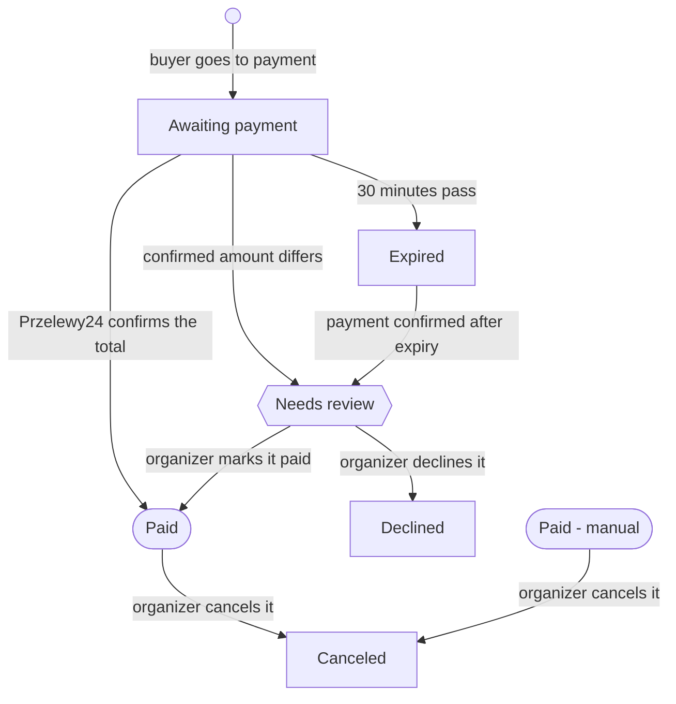

# Convention shop

- Date: 2026-11-12
- Domain owner: the domain owner of tickets ([CONTRIBUTORS.md](../../CONTRIBUTORS.md))
- Source: an outside review of a running shop (M1, no longer kept), reworked against the
  product's decisions
- Binding: no ([briefs](README.md)); the working copy toward the specs of the tickets module. The
  decisions it records reach the documents through those specs and their decision records
  ([departures](#where-this-brief-departs-from-the-documents)).

## Purpose & scope

The shop sells an edition's tickets, add-ons and merchandise online, ahead of the edition, through
a short multistep checkout paid through Przelewy24.

- **Platform:** a convention runs editions (e.g. yearly runs), each with its own catalog, rules and
  sales settings; the payment provider account and the currency belong to the convention.
  Organizers are accounts holding permissions in a convention; one account can organize several
  conventions.
- **Buyers:** visitors (no account signed in) or account holders, buyer's choice at checkout; a
  buyer always buys under their own email.
- **This brief's focus:** the shop: catalog, cart and checkout, payments, order lifecycle, buyer
  self-service, the panel functions that feed it, and what the scanner reads from it.
- **Out of scope:** programme sign-ups, sleeping places beyond a headcount add-on, programme
  building, volunteer management, the convention website (CMS), implementation choices.
- **Postponed and dropped:** see [Postponed](#postponed) and [Dropped](#dropped).

Scenarios use Gherkin-style wording (Given / When / Then) for precision. They are not a commitment
to Cucumber.

## Key business & user requirements

The shop must let an organizer open sales for an edition without developer help, and let a buyer go
from the convention's page to a paid order with a QR code in under five minutes on a phone.

### Business requirements

| ID | Requirement |
| --- | --- |
| BR-01 | A convention runs any number of editions; each edition has its own catalog, prices, dates, legal documents and sales settings. The payment provider account and the currency are the convention's. |
| BR-02 | An edition offers several ticket types (e.g. standard, supporter), each with its own price, description, perks, capacity and sale window. |
| BR-03 | Prices can change by date (e.g. cheaper online than on-site, early-bird tiers). |
| BR-04 | Some ticket types are excluded from discounts; the shop says so on the ticket type's page. |
| BR-05 | A ticket can include perks (e.g. pin, special badge) shown to the buyer but not sold separately. |
| BR-06 | Merchandise is sold with a ticket or on its own ("merch-only" order). The shop is not fit for purpose without merchandise. |
| BR-07 | Merchandise can have variants (e.g. cut × size) with stock per variant; a variant at zero stock cannot be bought. |
| BR-08 | Merchandise has a pre-order deadline; after it, only remaining stock is sold. |
| BR-09 | Fulfillment is pick-up at the edition only; the shop never promises shipping. |
| BR-10 | Add-ons can be paid, free, capacity-limited, or a non-binding headcount (e.g. sleeping-room interest). |
| BR-11 | A paid order has one QR code, used at the scanner for entry and merchandise pick-up. An order that is not paid has none. |
| BR-12 | Each edition sets three age bands, child, teen and adult, by age on its first day. A child enters only with a guardian present; a teen enters with a guardian's written consent, a paper document brought to the edition, which the buyer acknowledges with a checkbox at checkout; an adult needs nothing. The edition can link a consent form for the guardian to print. A ticket type allows some of the bands. |
| BR-13 | Required consents (shop terms, edition rules, minors' protection, data processing, payment provider terms) are configurable per edition and stored with the order. |
| BR-14 | Payments run through Przelewy24 (BLIK, bank transfer, cards). Another provider may follow. |
| BR-15 | Each convention is paid into its own Przelewy24 account; OPOS never holds the money. |
| BR-16 | Organizers see live sales, stock and ticket holder lists, and can export them. |
| BR-17 | Organizers are ordinary accounts holding permissions in a convention; one account can organize several conventions and also buy tickets. |
| BR-18 | Beyond name, email and age band, the convention decides what it asks a ticket holder, as custom fields of the edition: short, non-sensitive text answers. |
| BR-19 | Custom field answers, and a visitor's details, are the convention's data: they are kept in the convention, with the order or the attendee registration, never in the account. |
| BR-20 | One order holds at most one ticket, for one ticket holder. One email can hold several orders, each ticket under its own name: the name is the convention's data point, not an identity. |
| BR-21 | A buyer buys only under their own email. A visitor's order under an email that belongs to an account is attached to that account, and its emails ask the owner to sign in to see it; checkout never tells the visitor whether the email has an account. |
| BR-22 | A ticket passes to another person only when an organizer corrects the ticket holder. |
| BR-23 | The shop gives no refunds. An organizer can cancel a paid order and returns the money in Przelewy24's panel, outside OPOS. |
| BR-24 | A payment that cannot simply mark its order paid (a different amount, or after the order expired) puts the order in "Needs review" for an organizer; it never passes unnoticed. |
| BR-25 | An unpaid order holds its stock and capacity for a payment window of 30 minutes. |
| BR-26 | Orders are kept for at least five years from the end of their edition, which is never earlier than their payment. Nothing is purged in the first shop. |
| BR-27 | For an account, buying is registering: when an account's order with a ticket is paid, the account becomes an attendee of the edition, one registration per account and edition. |

### User requirements

| ID | As a… | I want to… |
| --- | --- | --- |
| UR-01 | Buyer | compare ticket types and their prices and perks on one page |
| UR-02 | Buyer | see the running total at every checkout step |
| UR-03 | Buyer | choose merchandise sizes using a size chart for each cut |
| UR-04 | Buyer | check out without an account or with one, my choice |
| UR-05 | Buyer | pay with BLIK, bank transfer or card |
| UR-06 | Buyer | get the QR code by email right after payment |
| UR-07 | Account holder | buy more items, resend a QR code and see my orders in a convention |
| UR-08 | Visitor | open a read-only order page from a link in my email |
| UR-09 | Buyer | retry a failed payment without re-entering everything |
| UR-10 | Organizer | set up an edition's catalog and rules myself |
| UR-11 | Organizer | correct or cancel an order without developer help |
| UR-12 | Organizer | see and settle every order that needs review |
| UR-13 | Organizer at the desk | scan a QR code with the edition's scanner and see what to hand over and what to check |

## Glossary

The product's glossary ([PRODUCT.md 3](../PRODUCT.md#3-glossary)) holds. This brief writes the
words a buyer and an organizer see: **convention** for the code's `tenant`, **organizer** for `org`,
**head organizer** for `head`. `tenant` stays the code's name, and the documents' wherever tenant
isolation is the subject. A term marked *new* is not in the product's glossary yet; each enters it,
with the quoted `pl` rendering, through the specs. The renderings of existing terms are the
catalog's.

| Term | `pl` | Meaning |
| --- | --- | --- |
| Convention | "konwent" | A convention brand across the years (`tenant` in code). Owns its team, payment provider account, currency, branding and legal documents. |
| Edition | "edycja" | One run of a convention, e.g. this year's: dates, venue, catalog. |
| Organizer | "organizator" | An account holding permissions in a convention (`org` in code); works in the panel. |
| Head organizer | "główny organizator" | An organizer with no permission limits (`head` in code). |
| Attendee | "uczestnik" | An account's registration for an edition, as in the product's glossary; made by paying for a ticket (BR-27). |
| Scanner | "skaner" | A device checking tickets at the edition, with no account signed in. |
| Shop *(new)* | "sklep" | The edition's sales to buyers; also the convention's permission over its payment provider account. |
| Ticket type | "rodzaj akredytacji" | A kind of ticket an edition sells (e.g. standard, supporter): price tiers, perks, capacity, allowed age bands, discount eligibility. |
| Ticket | "akredytacja" | Admission to an edition. |
| Order | "zamówienie" | One checkout of an edition with its payment: at most one ticket, for one ticket holder, with its add-ons and merchandise. A merch-only order has no ticket. |
| Ticket holder *(new)* | "posiadacz akredytacji" | The name a ticket is issued to, with its age band and custom field answers. |
| Buyer *(new)* | "kupujący" | The person paying an order under their own email, who gets its QR code: a visitor or an account holder. |
| Visitor *(new)* | "odwiedzający" | A person with no account signed in. Not "guest", which the scene uses for a convention's invited guests. |
| Price tier *(new)* | "próg cenowy" | A price valid within a date window (e.g. online pre-sale vs on-site). |
| Supporter price *(new)* | "cena wspierająca" | An optional higher price a buyer may choose for a ticket type. |
| Perk *(new)* | "bonus" | Something included with a ticket type (pin, special badge); visible, not priced separately. |
| Add-on *(new)* | "dodatek" | An optional extra attached to a ticket: paid, free, capacity-limited or headcount-only. |
| Merchandise item *(new)* | "merch", or "gadżet" | A physical product picked up at the edition ("merch" on screen). |
| Variant *(new)* | "wariant" | A buyable option of a merchandise item (e.g. "Women's - M"); holds its own stock. |
| Size chart *(new)* | "tabela rozmiarów" | The measurements of a merchandise item's sizes, one per cut. |
| Pre-order deadline *(new)* | "termin przedsprzedaży" | The date until which merchandise can be ordered without a stock limit. |
| Age band *(new)* | "przedział wiekowy" | One of an edition's three: child, teen, adult, by age on the edition's first day. |
| Child, teen, adult *(new)* | "dziecko", "nastolatek", "dorosły" | The age bands: a child enters with a guardian present, a teen with a guardian's paper consent. |
| Consent *(new)* | "zgoda" | A buyer's acceptance of a document of the edition, stored with its version. |
| Guardian consent *(new)* | "zgoda opiekuna" | A guardian's written consent for a teen, brought on paper to the edition and acknowledged at checkout; the edition may link a form for it. |
| Custom field *(new)* | "pole dodatkowe" | A short, non-sensitive text an edition's organizers ask a ticket holder for. |
| Discount code *(new)* | "kod rabatowy" | A code lowering the price of the products it applies to. |
| QR code *(new)* | "kod QR" | A paid order's credential, read by the scanner for entry and merchandise pick-up. |
| Order link *(new)* | "link do zamówienia" | An emailed link opening one order read-only, without a sign-in. |
| Payment attempt *(new)* | "próba płatności" | One try at paying an order through Przelewy24; an order can have several. |
| Payment window *(new)* | "czas na płatność" | The 30 minutes an unpaid order holds its stock and capacity. |
| Manual order *(new)* | "zamówienie ręczne" | An order an organizer records as paid outside the shop (invoice, complimentary, desk sale). |

Order statuses, each *new*:

| Status | `pl` | Meaning |
| --- | --- | --- |
| Awaiting payment | "oczekuje na płatność" | Sent to Przelewy24, holding its stock for the payment window. |
| Paid | "opłacone" | Przelewy24 confirmed the total; the QR code is issued. |
| Paid - manual | "opłacone ręcznie" | A manual order. |
| Expired | "wygasłe" | Unpaid when the payment window ended; holds nothing. |
| Needs review | "do wyjaśnienia" | A payment did not match the order; an organizer settles it. |
| Declined | "odrzucone" | An organizer declined a payment that needed review and returned the money outside OPOS. |
| Canceled | "anulowane" | An organizer canceled a paid order and returned the money outside OPOS. |

## Shop frontend

Checkout is four steps (Ticket holder, Add-ons, Merch, Summary), followed by Przelewy24 and a result
page. A merch-only order skips the steps that only make sense with a ticket.

### F1: Product listing

```gherkin
Feature: F1 Product listing

  Scenario: F1.1 Buyer sees the edition's offer
    Given an edition whose shop is open
    When the buyer opens the shop
    Then each ticket type on sale shows name, current price, short description and accepted payment methods
    And a "Merch only" card is shown if merch-only orders are enabled
    And footer links to shop terms, privacy policy, edition rules, FAQ and contact are shown

  Scenario: F1.2 Ticket type outside its sale window
    Given a ticket type whose sale window has not started or has ended
    Then it is hidden, or shown as "Not yet on sale" / "Sales closed" per organizer setting

  Scenario: F1.3 Ticket type sold out
    Given a ticket type has no capacity left
    Then it shows "Sold out" and cannot be selected

  Scenario: F1.4 Sales closed for the whole edition
    Given no ticket type and no merchandise is on sale
    Then the shop shows the organizer's "sales closed" message instead of products
```

### F2: Ticket holder (step 1)

```gherkin
Feature: F2 Ticket holder details

  Background:
    Given the buyer chose a ticket type
    And a step indicator shows "Ticket holder → Add-ons → Merch → Summary" with the current step highlighted
    And the header shows the ticket type's name and the running total

  Scenario: F2.1 Ticket type description and perks
    Then the step shows the ticket type's long description, perks and price
    And if the ticket type is excluded from discounts, a notice says so

  Scenario: F2.2 Supporter price option
    Given the ticket type offers supporter prices
    Then the buyer can pick one of the offered prices
    And the running total updates immediately

  Scenario: F2.3 Fields
    Then the form asks for the ticket holder's name/nickname and age band
    And for a visitor, the buyer's email and its confirmation
    And then for the custom fields the edition defines, each required or optional as set
    And the email field explains the QR code will be sent there

  Scenario: F2.4 Validation messages appear only after interaction
    Given the buyer has not touched the form
    Then no error is shown
    When the buyer presses Next with invalid fields
    Then each invalid field shows its own message and focus moves to the first one

  Scenario: F2.5 Emails do not match
    When email and email confirmation differ
    Then Next is refused with "Emails do not match"

  Scenario: F2.6 Email of an account
    Given a visitor enters an email that belongs to an account
    When the visitor presses Next
    Then checkout goes on exactly as for any other email
    And once created, the order is attached to that account
    And its emails tell the owner the order is on their account and to sign in to see it

  Scenario: F2.7 Age band not allowed for this ticket type
    Given a ticket type for adults only
    When the buyer selects "teen"
    Then the buyer is told the ticket type is not available for that age band and which ticket types are

  Scenario: F2.8 Child
    When the buyer selects "child"
    Then a notice says a child enters only with a guardian present

  Scenario: F2.9 Teen
    When the buyer selects "teen"
    Then the summary step adds a required checkbox acknowledging the guardian's paper consent
    And a notice says the consent is brought on paper to the edition
    And it links the edition's consent form, when the edition set one

  Scenario: F2.10 Signed-in buyer
    Given the buyer is signed in
    Then the account's email is used and cannot be changed
    And the ticket holder's name is pre-filled from the account
    And once the order is paid, the account is an attendee of the edition
```

### F3: Add-ons (step 2)

```gherkin
Feature: F3 Add-ons

  Scenario: F3.1 Headcount-only add-on
    Given an add-on marked "headcount only" (e.g. sleeping-room interest)
    Then it shows its price (may be 0) and a note that no place is reserved
    And ticking it records interest without reducing any capacity

  Scenario: F3.2 Capacity-limited add-on
    Given an add-on with limited capacity
    Then it shows places left when below the organizer's threshold
    And it cannot be ticked when none are left

  Scenario: F3.3 No add-ons
    Given the ticket type has no add-ons
    Then this step is skipped and hidden from the step indicator
```

### F4: Merch (step 3)

```gherkin
Feature: F4 Merchandise selection

  Scenario: F4.1 Pre-order notice
    Given a pre-order deadline is set
    Then a banner says all merchandise can be ordered until that date and stock is limited afterwards

  Scenario: F4.2 Included perks
    Given the ticket type includes perks
    Then a note lists them (e.g. "Your ticket includes a special badge and a pin")

  Scenario: F4.3 Item card
    Then each item shows name, price, description, picture(s) and an "illustrative image" note if set

  Scenario: F4.4 Item with variants
    Given a T-shirt with cuts "Men's" and "Women's" and sizes XS-5XL
    When the buyer selects the T-shirt
    Then a size picker appears listing only variants that exist, grouped by cut
    And a size chart per cut opens without leaving checkout
    And Next is refused until a variant is chosen

  Scenario: F4.5 Variant sold out
    Given variant "Women's - M" has zero stock
    Then it is shown as unavailable in the picker
    And other variants of the item stay selectable

  Scenario: F4.6 Whole item sold out
    Given every variant of an item has zero stock
    Then the item shows "Sold out" and cannot be selected

  Scenario: F4.7 Quantity
    Given the item allows more than one per order
    Then the buyer can set a quantity up to the per-order limit and remaining stock
    And for items with variants, each chosen variant is its own line

  Scenario: F4.8 Running total
    When the buyer adds or removes merchandise
    Then the header total updates immediately
```

### F5: Summary & consents (step 4)

```gherkin
Feature: F5 Summary

  Scenario: F5.1 Order summary
    Then the step shows the email the QR code will be sent to
    And a table of lines (ticket, add-ons, merchandise with variant, discount) with prices and the total due
    And a notice that merchandise is picked up at the edition only and is not shipped

  Scenario: F5.2 Consents
    Then all consents configured for the edition are listed, each linking to its document
    And Przelewy24's terms are among them
    And required consents are marked
    And a "Select all required" checkbox ticks every required consent
    And optional consents are never ticked by "Select all required"

  Scenario: F5.3 Missing consent
    When the buyer presses "Go to payment" without all required consents
    Then payment does not start and the missing consents are highlighted

  Scenario: F5.4 Payment methods
    Then the step names the methods Przelewy24 offers: BLIK, bank transfer, card
    And the buyer chooses among them on Przelewy24's page

  Scenario: F5.5 With or without an account
    Given the buyer is not signed in
    Then the buyer can continue without an account or sign in / create an account
    And choosing to sign in keeps everything already entered

  Scenario: F5.6 Go to payment
    When the buyer presses "Go to payment"
    Then the bot check passes, and stock and capacity are re-checked
    And the order is created as "Awaiting payment", holding its items for the payment window
    And the buyer is sent to Przelewy24

  Scenario: F5.7 Item sold out during checkout
    Given a selected variant sold out after the buyer chose it
    When the buyer presses "Go to payment"
    Then payment does not start
    And the buyer is returned to the Merch step with that line flagged
```

### F6: Navigation & cart state

```gherkin
Feature: F6 Checkout navigation

  Scenario: F6.1 Back keeps data
    When the buyer presses Back on any step
    Then everything entered on later steps is kept

  Scenario: F6.2 Switching ticket type
    Given the buyer has merchandise selected under ticket type A
    When the buyer returns to the listing and picks ticket type B
    Then the buyer is asked whether to keep the merchandise selection
    And perks or add-ons not valid for B are removed with a notice

  Scenario: F6.3 Refresh
    When the buyer reloads the page before going to payment
    Then the checkout resumes on the same step with the same data

  Scenario: F6.4 Unfinished checkout
    Then a checkout not yet sent to payment holds no stock or capacity
```

### F7: Merch-only order

```gherkin
Feature: F7 Merch-only order

  Scenario: F7.1 Buy merchandise without a ticket
    When the buyer picks "Merch only"
    Then steps are "Buyer → Merch → Summary"
    And the buyer step asks only for name/nickname and, for a visitor, email
    And age band and custom fields are not asked
    And the pick-up QR code is sent to the buyer by email
```

### F8: Result pages

```gherkin
Feature: F8 After payment

  Scenario: F8.1 Payment confirmed
    Given Przelewy24 confirmed the payment
    Then the buyer sees "Paid", the order number and that the QR code was emailed

  Scenario: F8.2 Payment still processing
    Given the buyer returned before Przelewy24 confirmed
    Then the buyer sees "Processing" and the page updates by itself once confirmed

  Scenario: F8.3 Payment failed or canceled
    Then the buyer sees why (if Przelewy24 says) and a "Try again" button
    And "Try again" starts a new payment attempt without re-entering data

  Scenario: F8.4 Payment needs review
    Given the order went to "Needs review"
    Then the buyer sees that the payment arrived and the organizer will get in touch
```

### F9: Buyer self-service

```gherkin
Feature: F9 Order access

  Scenario: F9.1 Visitor opens the order link
    Given a visitor received an order email
    When the visitor opens the order link
    Then the order page shows lines, status, the QR code if paid, and pick-up info
    And nothing on the page can be changed

  Scenario: F9.2 Order link expired
    Given the link is older than its validity
    Then the page offers to send a fresh link to the order's email

  Scenario: F9.3 Account holder's orders
    Given a signed-in account holder on a convention's page
    Then they see their orders in that convention
    And per order "Resend QR code", "Buy more" and "Pay now" (if unpaid)

  Scenario: F9.4 Buy more
    When the account holder presses "Buy more" on an order
    Then a new checkout opens for the same edition with the ticket holder's details pre-filled from that order
    And merchandise already bought is marked as "already ordered"
```

## Payments

An order is paid only when Przelewy24 confirms it to the API; the buyer's return to the shop never
counts as proof of payment.



Failed or canceled attempts leave the order in "Awaiting payment"; only Przelewy24's confirmation
or an organizer changes its status. "Paid - manual" is a manual order (B4.5). Only a paid order has
a QR code; a canceled order's QR code is refused at the scanner.

| Provider | Methods offered to the buyer |
| --- | --- |
| Przelewy24 | BLIK, Polish bank transfers (pay-by-link), cards |

- Each convention connects its own Przelewy24 merchant account; OPOS never holds the money.
- The currency is the convention's (PLN by default).
- Przelewy24's terms consent is added to the summary automatically.

### P1: Paying an order

```gherkin
Feature: P1 Paying an order

  Scenario: P1.1 Successful payment
    Given an order "Awaiting payment" of 390.00 PLN
    When the buyer completes BLIK on Przelewy24
    Then the buyer returns to the result page
    And when Przelewy24 confirms 390.00 PLN the order becomes "Paid"
    And stock is committed and the confirmation email with QR code is sent once

  Scenario: P1.2 Buyer cancels at Przelewy24
    When the buyer cancels on Przelewy24's page
    Then the order stays "Awaiting payment"
    And the result page offers "Try again"

  Scenario: P1.3 Payment declined by Przelewy24
    When Przelewy24 reports a decline
    Then the attempt is recorded as failed
    And the buyer gets "Try again"; the order itself is unchanged

  Scenario: P1.4 Late confirmation
    Given the buyer closed the browser before returning
    When Przelewy24 confirms minutes later, within the payment window
    Then the order becomes "Paid" and the email is sent as usual

  Scenario: P1.5 Duplicate confirmation
    When Przelewy24 confirms the same payment twice
    Then the order is updated once and only one email is sent

  Scenario: P1.6 Unpaid order expires
    Given an order "Awaiting payment" for 30 minutes
    Then it becomes "Expired" and its stock and capacity are released

  Scenario: P1.7 Pay later from account
    Given an account holder has an "Awaiting payment" order within its window
    When they press "Pay now"
    Then a new payment attempt starts without changing the order
```

### P2: Needs review

The organizers alerted below are the head organizers and the organizers with write access to the
edition's tickets: those who can settle the order.

```gherkin
Feature: P2 Payments that need review

  Scenario: P2.1 Amount mismatch
    Given Przelewy24 confirms an amount different from the order total
    Then the order does not become "Paid"
    And it goes to "Needs review" and the organizers are alerted by email

  Scenario: P2.2 Payment after expiry
    Given an "Expired" order
    When Przelewy24 confirms a payment for it
    Then the order goes to "Needs review" and the organizers are alerted by email
    And no stock is taken until an organizer marks it paid

  Scenario: P2.3 Organizer marks it paid
    Given an order in "Needs review"
    When an organizer marks it paid
    Then stock and capacity are re-checked and taken, and marking is refused when they are gone
    And the order becomes "Paid" and the confirmation email with QR code is sent

  Scenario: P2.4 Organizer declines it
    Given an order in "Needs review"
    When an organizer declines it, with a note on how the money was returned in Przelewy24's panel
    Then the order becomes "Declined", holds no stock and never gets a QR code
    And the buyer is emailed

  Scenario: P2.5 Nothing is left unnoticed
    Then the panel lists every order in "Needs review" until it is settled
```

## Panel functions

Everything the shop shows is configured by organizers in the panel; the API also enforces every rule
the shop displays, so nothing can be bought by bypassing the page.

### B1: Organizers, permissions & publishing

```gherkin
Feature: B1 Convention setup

  Scenario: B1.1 Organizers are accounts
    Given an existing account or an invited email address
    When a head organizer, or an organizer managing the team, invites it with permissions
    Then that account is an organizer and reaches the panel next to their own orders
    And the same account can still buy tickets as a normal buyer

  Scenario: B1.2 Permissions
    Then the tickets permission of an edition opens its catalog, orders, exports and scanners: read sees them, write changes them
    And the shop permission of the convention opens its Przelewy24 account
    And a head organizer holds every permission
    And an organizer sees and changes only what their permissions open
    And an organizer of several conventions switches between them in the panel

  Scenario: B1.3 Edition from template
    When the organizer creates a new edition from the convention's previous edition
    Then ticket types, add-ons, merchandise items, variants, age bands, custom fields and consents are copied as drafts
    And dates, prices and stock are cleared for review

  Scenario: B1.4 Open the shop
    Given an edition, published or not
    When the organizer opens its shop
    Then opening is refused unless the convention's Przelewy24 account is connected and all required legal documents are set
    And the edition itself can be published without an open shop

  Scenario: B1.5 Branding
    Then the convention's name, logo and colors are shown in the shop and its emails
    And its footer links and contact details in the shop
```

### B2: Catalog

```gherkin
Feature: B2 Catalog management

  Scenario: B2.1 Ticket type
    Then the organizer sets name, descriptions, perks, price tiers with date windows, supporter prices,
      capacity, sale window, allowed age bands, discount eligibility and the add-ons and merchandise offered with it

  Scenario: B2.2 Merchandise item with variants
    Then the organizer defines option axes (e.g. cut, size), the variants that exist, stock per variant,
      size chart per cut, per-order limit, pictures and an "illustrative image" flag

  Scenario: B2.3 Pre-order deadline
    Given a pre-order deadline
    Then until the deadline, stock may be marked "unlimited (pre-order)"
    And after it, stock is the number the organizer enters

  Scenario: B2.4 Editing a live product
    When the organizer changes a price on a product with existing orders
    Then existing orders keep the price they were sold at

  Scenario: B2.5 Hide vs delete
    Then a product with orders can be hidden but not deleted

  Scenario: B2.6 Age bands
    Then the organizer sets the ages that divide child, teen and adult for the edition
    And optionally a link to the guardian consent form for teens

  Scenario: B2.7 Custom fields
    Then the organizer defines the edition's custom fields: a label and whether each is required
    And each takes a short text, and the shop says it must hold nothing sensitive
    And the answers appear on the order and in exports, and nowhere outside the convention
```

### B3: Discounts & codes

```gherkin
Feature: B3 Discounts

  Scenario: B3.1 Discount code
    Then a code has a value (amount or percent), the products it applies to, usage limit, validity window
    And codes never apply to products marked "no discounts"

  Scenario: B3.2 Code in checkout
    When the buyer enters a valid code on the Summary step
    Then the discount appears as its own line and the total updates

  Scenario: B3.3 Free entry with paid merchandise
    Given a person entitled to free entry (e.g. the convention's guest, staff)
    When the organizer issues them a 100% ticket code
    Then they can check out with free entry and still buy merchandise
```

### B4: Orders

Changing an order needs write access to the edition's tickets.

```gherkin
Feature: B4 Order management

  Scenario: B4.1 Order list
    Then the organizer can search orders by number, name, email or QR code
    And filter by edition, status, product, variant and date

  Scenario: B4.2 Order detail
    Then it shows lines, the ticket holder's data, custom field answers, consents with document versions,
      payment attempts and emails sent

  Scenario: B4.3 Correct the ticket holder
    When an organizer changes the ticket holder's name, or the order's email
    Then a new QR email can be sent
    And this is the only way a ticket passes to another person

  Scenario: B4.4 Swap variant
    When an organizer swaps "Men's - L" for "Men's - XL"
    Then stock moves between variants and the swap is refused if XL has none

  Scenario: B4.5 Manual order
    When an organizer creates an order for a buyer (e.g. invoice-paid or complimentary)
    Then it is marked "Paid - manual" with a reason and emails go out as for any order

  Scenario: B4.6 Resend QR
    When an organizer presses "Resend QR"
    Then the confirmation email is sent again to the order's email

  Scenario: B4.7 Cancel a paid order
    Given a "Paid" or "Paid - manual" order
    When an organizer cancels it, with a note on how the money was returned in Przelewy24's panel
    Then the order becomes "Canceled", its stock and capacity return and its QR code is refused at the scanner
    And the buyer is emailed
```

### B5: Stock & capacity

```gherkin
Feature: B5 Stock

  Scenario: B5.1 Hold during payment
    When an order goes to payment
    Then its items are held until paid or expired

  Scenario: B5.2 Low stock alert
    Given a variant falls below the organizer's threshold
    Then the organizers who can change the catalog are alerted by email

  Scenario: B5.3 Production numbers
    Given the pre-order deadline has passed
    When the organizer opens production numbers
    Then the organizer can export counts per variant to send to the manufacturer
```

### B6: Scanner, entry & pick-up

```gherkin
Feature: B6 The scanner reads the shop's data

  Scenario: B6.1 Scan QR
    When an organizer scans a QR code with the edition's scanner
    Then the scanner shows the ticket holder, age band, ticket type, perks, add-ons and merchandise with variants
    And whether entry and each item were already handed out

  Scenario: B6.2 Child or teen
    Given the ticket holder is a child or a teen
    Then the scanner says a child enters only with a guardian present, and a teen only with the guardian's paper consent

  Scenario: B6.3 Invalid QR
    Given a QR code of a canceled order, or of another edition's order
    Then the scanner shows a clear red "Not valid" with the reason

  Scenario: B6.4 Mark handed out
    When entry or items are marked as handed out on the scanner
    Then the time and the scanner are recorded and a second scan shows it

  Scenario: B6.5 Sale at the desk
    Then an organizer can sell the same catalog in the panel at on-site prices,
      paid by card terminal or cash, recorded as a manual order
```

### B7: Reporting

```gherkin
Feature: B7 Reports

  Scenario: B7.1 Dashboard
    Then the organizer sees, per edition: revenue, tickets sold per type,
      merchandise sold per variant, add-on counts (incl. headcount-only), age bands and custom field answers

  Scenario: B7.2 Exports
    Then the ticket holder list, merchandise pick list and payments can be exported as spreadsheet files
    And an export needs the tickets permission of the edition
```

## Notifications & non-functional requirements

Every email has a fixed text with the convention's simple branding, and is logged on the order.
"Organizers" below are those who can act on it, as P2 and B5.2 say.

| Email | Sent when | Contains |
| --- | --- | --- |
| Order confirmation | Order becomes "Paid" or "Paid - manual" | Lines, total, QR code, pick-up notice, order link; for a teen, the guardian consent rule and form link; for an email with an account, a sign-in link |
| Payment pending reminder | Order unpaid halfway through its window | "Pay now" link |
| Order expired | Unpaid order expires | Link to start again |
| Order changed | Organizer edits ticket holder or variant | What changed, new QR if needed |
| Order declined | Organizer declines an order that needed review | That the money was returned outside OPOS |
| Order canceled | Organizer cancels a paid order | That the QR code is no longer valid and the money was returned outside OPOS |
| Order link | Buyer asks for a fresh link | Read-only order link |
| Needs review | Order goes to "Needs review" (to the organizers) | Order number, what did not match |
| Low stock | Variant falls below its threshold (to the organizers) | Item, variant, stock left |
| Account emails | Sign-up, confirmation, password reset | Standard account content |
| Pre-edition reminder | N days before the edition, set by organizer | QR code, opening hours, pick-up info, guardian rules and consent form link |

### Non-functional requirements

| ID | Requirement |
| --- | --- |
| NF-01 | Mobile-first: full checkout works on a 360 px wide screen. |
| NF-02 | Accessibility: WCAG 2.1 AA for shop and buyer pages. |
| NF-05 | Security: Google reCAPTCHA as the bot check on checkout, without puzzles for most buyers; protection against cross-site scripting, injection and the other common attacks; secure HTTP headers; general hardening. |
| NF-06 | The shop sets no analytics or advertising cookies. The bot check is asked for in the portal's consent banner ([0026](../adr/0026-run-a-tracker-only-with-consent-and-none-in-the-panel.md)); a visitor who refuses it can browse the shop but cannot check out, and the banner says so. |
| NF-07 | Every consent is stored with the exact document version accepted and a timestamp. |
| NF-09 | Prices are shown with currency and as gross amounts; totals in the shop, emails and Przelewy24 always match to the cent. |
| NF-10 | Conventions' data and payment accounts are isolated; an organizer sees only the conventions and editions their permissions open. |

IDs follow the source brief; the missing ones are postponed.

## Postponed

Wanted later, not in the first shop.

| Item | From |
| --- | --- |
| Refunds through OPOS, full and partial; a buyer canceling and getting a refund before a deadline | M1 P2, open question "Buyer cancellation" |
| Automatic refund of a payment that arrives after its order expired | M1 P1.8 |
| An opt-in fiscal receipt and invoice helper (company details at checkout, VAT), and a receipt to download | M1 open question "Invoices", F9.3 |
| A buyer passing a ticket to another person themselves | M1 open question "Ticket transfer" |
| Custom fields beyond short text (choices, dates, sensitive data) | M1 open question "Custom fields" |
| Stripe or another provider; choosing providers per edition and which is shown first | M1 BR-14, Payments, P1.2 |
| Named organizer roles (e.g. owner, manager, finance, desk, viewer) on top of the permissions | M1 B1.2 |
| Emails an organizer edits per edition | M1 Notifications |
| Organizer texts per language; emails in the buyer's checkout language | M1 NF-03 |
| Data export on request; purging orders past their retention, and what a purge removes; retention set per convention beyond the five-year minimum | M1 NF-06, BR-26 |
| An "interested" phase before buying: an account follows an edition and gets its news ahead of the sale | domain owner |
| Audit log and order change history (who, when, before/after) | M1 NF-08, B4.2, B4.3 |
| Orders across conventions on the account, and a link to the panel there | M1 F9.3 |
| Claiming a visitor's orders after an account is created with their email | M1 F9.5 |
| Sale-opening peaks beyond one convention's writes running one at a time | M1 NF-04 |

## Dropped

| Item | Why | From |
| --- | --- | --- |
| Organizations owning several conventions | a convention is the top level; an account organizes several | M1 BR-01, BR-15, B1, NF-10 |
| Saved attendee profiles on the account | custom field answers are the convention's data (BR-19) | M1 F2.8 |
| Buying under someone else's email | a buyer buys only under their own email (BR-21) | M1 F2.3 |
| Analytics and advertising cookies | nobody runs them on the shop | M1 NF-06 |
| A signed-in desk user scanning | the scanner is a device with no account | M1 B6, UR-12 |
| Platform fees | OPOS is free for conventions | M1 open question |

## Where this brief departs from the documents

Decided here by the domain owner; each reaches the documents through the tickets specs and the
decision records they bring, never by editing the documents ahead of them.

| # | Decision | Departs from | Carried by |
| --- | --- | --- | --- |
| D1 | The tickets module has a domain owner, named in CONTRIBUTORS.md. | PRODUCT.md 7, ARCHITECTURE.md "Modules waiting for their domain owner", AGENTS.md: tickets waits for its owner | the first tickets spec |
| D2 | Merchandise, discount codes, 100% codes, manual and complimentary orders and desk sales are in the MVP. | PRODUCT.md 11: merchandise and tickets without a purchase are beyond the MVP | a record and PRODUCT.md 11 |
| D3 | Przelewy24 is the MVP's payment provider. | 0010 leaves the provider to be chosen with the module | a record |
| D4 | The person on a ticket is the ticket holder; "attendee" keeps its meaning. A person with no account signed in is a visitor. | PRODUCT.md 3 has neither term | PRODUCT.md 3 and `glossary.ts`, through the spec |
| D5 | An order holds at most one ticket, for one ticket holder, and may hold merchandise alone. | PRODUCT.md 3: an order is "one purchase of tickets" | PRODUCT.md 3, through the spec |
| D6 | The shop's terms and statuses enter the glossary with their `pl` renderings. | PRODUCT.md 3 | PRODUCT.md 3, `glossary.ts` and the `pl` catalog, through the spec |
| D7 | The shop stores age band, consents, guardian consent and the convention's custom fields as the convention's data, never in the account. | PRODUCT.md 10 lists name, email and activity only | PRODUCT.md 10, through the spec |
| D8 | "Needs review" is in the MVP. | ARCHITECTURE.md "Modules waiting for their domain owner": a different amount "changes nothing" | ARCHITECTURE.md, through the spec |
| D9 | Shop and buyer pages meet WCAG 2.1 AA. | PRODUCT.md 8 states no accessibility level | a record and PRODUCT.md 8 |
| D10 | The documents say convention and organizer; `tenant` stays the code's name and the isolation rules'. | PRODUCT.md 3 uses tenant and org as terms | a record and PRODUCT.md 3 |
| D11 | A visitor's order under an account's email is attached to that account, and checkout answers alike for any email. | ARCHITECTURE.md "Sessions and sign-in" (it fits: nobody learns which addresses have an account; the spec should say so) | the spec |
| D12 | Checkout runs Google reCAPTCHA, a fit with the deployment on Google Cloud, asked for in the portal's consent banner; refusing it closes checkout. | [0026](../adr/0026-run-a-tracker-only-with-consent-and-none-in-the-panel.md): the banner blocks nothing, the portal works the same with every tracker refused, and neither application loads a script from another origin (a test enforces it); PRODUCT.md 10 | a record superseding that part of 0026, and PRODUCT.md 10 |
| D13 | Orders are kept for at least five years from the end of their edition. | PRODUCT.md 10 states no retention for orders | PRODUCT.md 10, through the spec |
| D14 | Organizers cancel paid orders and decline payments that need review; the money goes back in Przelewy24's panel. | PRODUCT.md 11 and 0010: refunds from the panel are beyond the MVP (no refund runs through OPOS, so this fits; the spec should say so) | the spec |
| D15 | Paying for a ticket makes an account an attendee of the edition: the shop creates the registration. | PRODUCT.md 7, ARCHITECTURE.md "Modules waiting for their domain owner", AGENTS.md: attendee registrations wait for their own owner | the first tickets spec, and CONTRIBUTORS.md if tickets' owner takes registrations |

## Open questions

- [x] **Ticket holder and attendee:** buying is registering (BR-27, D15).
- [x] **Account check vs account privacy:** the order is attached to the account, and checkout
      answers alike for any email (BR-21, F2.6, D11).
- [x] **Bot check and privacy:** Google reCAPTCHA, asked for in the consent banner (NF-05, NF-06,
      D12).
- [x] **Teen consent form:** the edition may link one (BR-12, B2.6).
- [x] **Five years:** from the end of the edition; purging is postponed (BR-26).
- [x] **Refused cookies:** no checkout without the bot check (NF-06).
- [ ] **Owner of attendee registrations (D15):** does the domain owner of tickets also own
      registrations, at least as far as buying makes them? Not decided yet; the first tickets spec
      needs an answer.
- [ ] **Bot check as a tracker (D12):** under 0026 reCAPTCHA is a tracker, so refusing it may not
      close anything. If the record for D12 finds it strictly necessary for checkout instead, it
      needs no consent and stays out of the banner, though it still loads a script from another
      origin.
