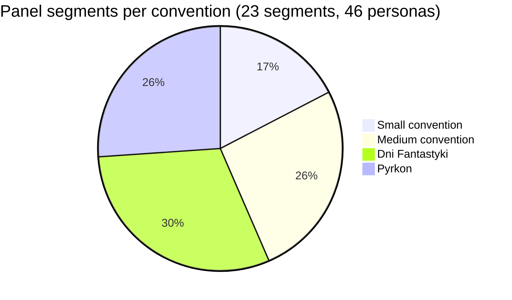
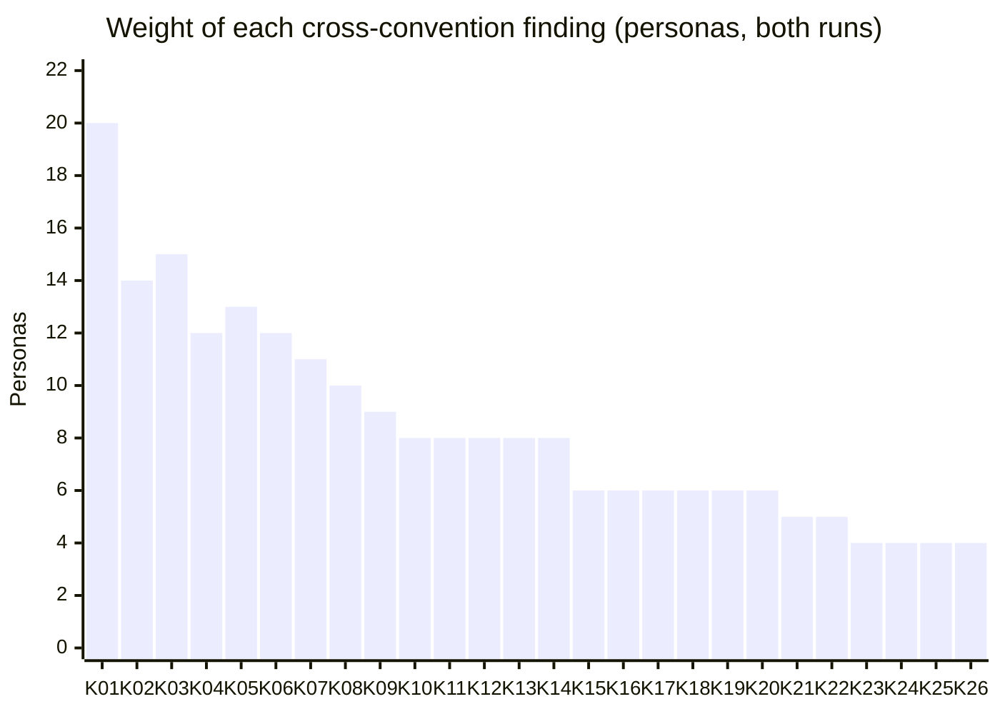
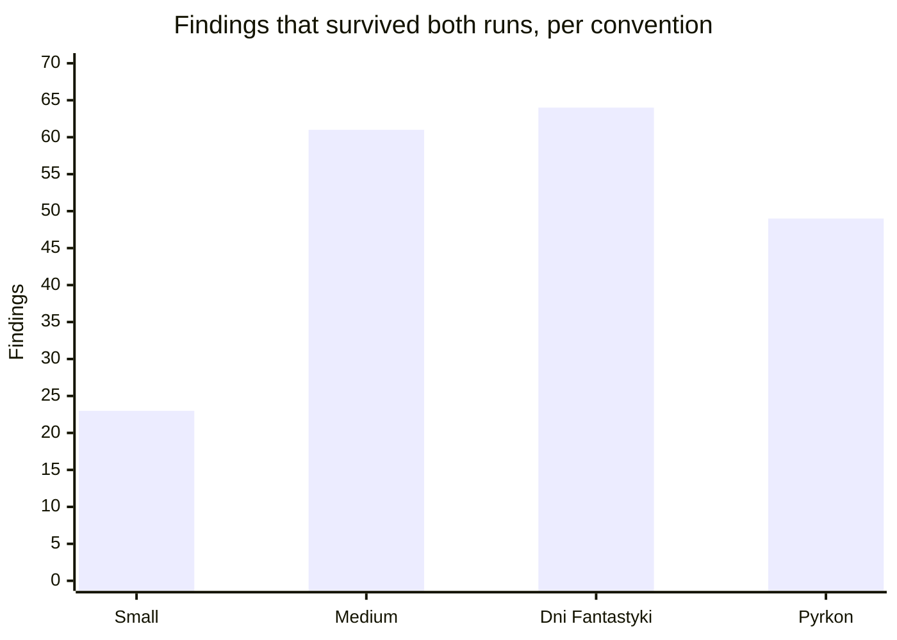

# Programme across convention scales: synthetic personas and walkthrough findings

- Date: 2026-11-14 (walkthrough 1), 2026-11-15 (walkthrough 2)
- Domain owner: the programme's domain owner, not yet named in [CONTRIBUTORS.md](../../../CONTRIBUTORS.md)
- Source: two synthetic panels built from research notes on Dni Fantastyki, Pyrkon, Konwencik, the
  tools small conventions use and the Polish talk conventions, and from
  [PRODUCT.md](../../PRODUCT.md); no real interviews
- Status: non-binding, synthetic, hypotheses only ([briefs](../README.md)). Nothing here is
  evidence about real people. Every finding says what a persona *would* do and names the real-user
  check that would settle it.

Two walkthroughs, each with its own panel. **Walkthrough 1** (23 segments, 46 personas) read an
earlier 34-screen version of sections 1–9; its two runs shared one prompt, and its findings are
K01–K26. **Walkthrough 2** (31 segments, 62 personas) walked the role journeys J01–J15 and the
screens of sections 10–17 in the current [wireframes](wireframes/index.html), with independent
runs; its findings are X01–X04 across conventions and per-convention ids (N-, F-, D-, Y-). Where
the two disagree, walkthrough 2 read the current screens.

**Contents.** [Walkthrough 1: screens of sections 1–9](#walkthrough-1-screens-of-sections-19):
[which wireframes](#which-wireframes-were-walked) · [method](#method) · [panel](#the-panel) ·
[findings K01–K26](#cross-convention-findings) ·
[what the current wireframes address](#what-the-current-wireframes-address) ·
[to confirm](#to-confirm-with-real-users).
[Walkthrough 2: role journeys and sections 10–17](#walkthrough-2-role-journeys-and-sections-1017):
[method](#walkthrough-2-method) · [panel](#walkthrough-2-the-panel) ·
[findings across conventions](#walkthrough-2-findings-across-conventions) ·
[against walkthrough 1](#walkthrough-2-against-walkthrough-1) ·
[per convention](#walkthrough-2-findings-per-convention) ·
[what worked](#walkthrough-2-what-worked) ·
[seeded findings and artefacts](#walkthrough-2-seeded-findings-and-artefacts) ·
[assumptions](#walkthrough-2-the-teams-assumptions) ·
[to confirm](#walkthrough-2-to-confirm-with-real-users).

## Walkthrough 1: screens of sections 1–9

### Which wireframes were walked

The walkthrough ran on an **earlier version of the programme wireframes**: 34 screens in sections
1–9. In that version the small and the medium convention were fictional stand-ins ("Kon na
Strychu", about 300 people, and "Smoczy Gród", about 2,500 people, 8 rooms and about 290 items),
and their sample data leaned on sign-ups and RPG sessions. This brief calls them **the small
convention** and **the medium convention**.

The wireframes have since been rebuilt. They are talk-centric and use real reference conventions:
Nordcon is the small one and Fantasmagoria the medium one. They hold 87 screens in 17 sections:
the 34 of sections 1–9 keep their ids with the new data, and 53 new screens in sections 10–17 cover
the attendee, the speaker, the programme team, onsite operations and the head. Sixteen role
journeys (J01–J16) draw them again per role and convention. **Walkthrough 1 read the 34 only in
their earlier form; the 53 new screens and the role journeys were walked in
[walkthrough 2](#walkthrough-2-role-journeys-and-sections-1017).** Screen ids in these findings name
the screens as walked; [What the current wireframes address](#what-the-current-wireframes-address) maps
the findings onto the current canvases.

### Method

The panel was built from research notes (Dni Fantastyki; Pyrkon from the attendee's and the
organiser's side; Konwencik; a benchmark of the tools small conventions use) and from
docs/PRODUCT.md, with no real interviews. The stance was *simulate*: no real organisers or
attendees were reachable, and two of the four conventions were fictional. 23 segments (small 4,
medium 6, Dni Fantastyki 7, Pyrkon 6) ran twice with one persona each: P01–P23 in run 1, P24–P46
in run 2. **The two runs are not independent.** Both runs of a segment got the same prompt: the
same screens and step descriptions, the same pressure situation and its variant, the same
assumptions. Only one line of the persona card, the corner of the situation, differed, and for two
segments (P38, P39) that corner is the pressure situation itself. "Came back in both runs" means
two readings of one stimulus, not two observations. Each persona was interviewed about the last
time it met the problem and about the team's assumptions A01–A06, answered four yes/no questions,
took a decision under pressure with a variant, and walked its own role's screens. **Only findings
that repeated across both runs are weighed**; a cross-convention finding (K01–K26) came back in two
or more conventions. Findings from both runs that the weights left out, what worked, and signals
seen in one run only are listed apart, after K26.

- **Saturation: not reached.** Run 2 brought 30 new topics (small 4 of 26, medium 11 of 45, Dni
  Fantastyki 11 of 48, Pyrkon 4 of 36). Screen findings stabilised (spread at most ±2); topics did
  not. Each transcript was asked for 3 to 8 topics and 45 of 46 gave 7 or 8, so the count of new
  topics also measures that limit.
- **No parity check**: there are no real interviews to compare the panel against.
- **Evidence:** of 253 persona lines in run 1, 112 have a source and 141 are assumed; behaviour is
  assumed throughout. `[DOCUMENT]` is PRODUCT.md, `[BENCHMARK]` a research passage, `[ASSUMPTION]`
  nothing.
- **Medium:** HTML sketches read as pictures; nothing was clicked or ran. 29 of 34 screens were
  read; not the four Worldcon screens (no Worldcon segment) nor `ab-pyrkon-entitlements` (a screen
  for discussion).
- **Substitute screens:** the medium convention read the Dni Fantastyki proposal and speaker
  screens, the Pyrkon programme coordinator the Dni Fantastyki grid, the Dni Fantastyki team the
  Pyrkon cancellation dialog; some findings repeat across conventions on one screen for that reason.
- **Acquiescence:** 47% "yes" on the yes/no questions, 27% without the situational third one; no
  finding rests on them. The persona agents wrote their own transcripts.
- **Weight follows exposure.** A persona could hit a finding only on a screen it was shown: 22
  personas saw a programme list, 4 the proposals list, 4 a door screen. K01 was hit by 20 of 22,
  K15–K17 by 6 of 6, K23 and K24 by 4 of 4. The order of weights is an order of how many personas
  passed a screen, not of severity.
- **The script asked for a problem at every step.** Each of the 116 screen steps had to name
  friction, a missing case and a contradiction; all 116 named the first two and 109 the third. The
  197 findings measure the script as much as the screens, and what worked was recorded for Pyrkon
  only.
- **Seeded findings.** A finding marked *seeded* repeats a line of the persona card, the pressure
  situation or a step description: the card goal "a clear rule and a count of how many are inside"
  and K15, the variant "the device lost signal" and K26. It shows that the panel accepted a
  premise, not that it found a problem.
- **Roles not walked.** No persona held programme read only, led a programme above its blocks or
  zones, or headed a large convention; the info-desk volunteer exists at the small convention only;
  the Dni Fantastyki door volunteer was shown no door screen. The "programme leads" of Dni
  Fantastyki are two personas' invention (P11, P34), not a sourced role.
- **Scene against screen.** The on-site scenes of P22/P45, P23/P46 and P44 were played on
  `ab-pyrkon-item` as it looks before reservations close, and the door steps of P10/P33 and P23/P46
  got the item page where the script said "shows you their reservation". What rests on these (K22,
  the Pyrkon reservation button) is a defect of the walkthrough.

**How to read a finding.** *Weight* is the number of personas across both runs who hit it;
*spread* is |run 1 − run 2|. Two findings stand apart only when their weights differ by more than
the larger spread; otherwise they tie. *Loose normalisation*: personas hit one rule from different
sides; check these first. A weight counts personas in a panel, never a share of real users. Read it
against the number of personas shown the screen.

### The panel

The composition is **assumed**: no data gives proportions, and every convention has one indifferent
seat. *Assumption persona*: the role is `[DOCUMENT]`, situation and behaviour `[ASSUMPTION]`.
*Sourced situation*: situation and constraints `[BENCHMARK]`, behaviour still `[ASSUMPTION]`.
Persona cards are roles in a situation, with no names or biographies; one card carries an age (the
run 2 desk volunteer is a teenager). The transcripts add what Polish grammar and the model
supplied: both parents speak as mothers, both desk volunteers as women, all four heads, all door
volunteers and every Pyrkon persona as men. None of it was specified and none of it is evidence.

#### Small convention (fictional stand-in, about 300 people, one or two rooms)

| Id        | Role in a situation (run 1 / run 2)                                                                         | State of mind at entry                    | Main goal                                | Main constraint       | Tier       |
| --------- | ----------------------------------------------------------------------------------------------------------- | ----------------------------------------- | ---------------------------------------- | --------------------- | ---------- |
| P01 / P24 | head running the convention alone; enters 24 items on evenings / first platform after years of spreadsheets | tired / sceptical, fears losing control   | the programme on phones without retyping | no budget, no team    | assumption |
| P02 / P25 | game master as speaker, two RPG sessions for five / ten came for five seats last year                       | hopeful / wary, wants a cap               | five players, no fight at the table      | holds no permission   | assumption |
| P03 / P26 | first-time attendee checking the hours, **indifferent seat** / arrives late on Saturday                     | unhurried / hurried                       | what is on and where                     | phone, not signed in  | assumption |
| P04 / P27 | **volunteer** at the entrance desk, no OPOS role; the head's friend / a teenager's first shift              | busy / afraid of giving wrong information | answer "where and when" without the head | the attendees' portal | assumption |

#### Medium convention (fictional stand-in, about 2,500 people, 8 rooms, about 290 items)

| Id        | Role in a situation (run 1 / run 2)                                                                                          | State of mind at entry         | Main goal                                    | Main constraint             | Tier       |
| --------- | ---------------------------------------------------------------------------------------------------------------------------- | ------------------------------ | -------------------------------------------- | --------------------------- | ---------- |
| P05 / P28 | org running the programme; 300 proposals in two weeks / speakers change availability                                         | overwhelmed / irritated        | proposals, grid and publication in one place | a volunteer team of 3–5     | assumption |
| P06 / P29 | speaker at several conventions; submits to three / told the time a week before                                               | methodical / annoyed           | submit once, know status and slot            | a different form everywhere | assumption |
| P07 / P30 | attendee planning around limited workshops / on a waiting list                                                               | eager / anxious                | a seat without queuing at dawn               | phone                       | assumption |
| P08 / P31 | trade-hall attendee, **indifferent seat** / parent whose child wants one item                                                | relaxed / distracted           | shopping and friends                         | signs up for nothing        | assumption |
| P09 / P32 | **head of the medium convention**, sells tickets online; sets who may sign up / day-ticket holders cannot sign up for Sunday | careful with money / defensive | sales and sign-ups tied together             | OPOS takes no fees          | assumption |
| P10 / P33 | **volunteer** with the sign-up list at a workshop room; two people not on the list / half the list absent                    | under pressure / unsure        | who is in and who is next, fast              | poor signal in the hall     | assumption |

#### Dni Fantastyki (Wrocław, about 10–16k people, 368 items, 21 spaces on five levels)

| Id        | Role in a situation (run 1 / run 2)                                                                   | State of mind at entry  | Main goal                                  | Main constraint            | Tier                                                        |
| --------- | ----------------------------------------------------------------------------------------------------- | ----------------------- | ------------------------------------------ | -------------------------- | ----------------------------------------------------------- |
| P11 / P34 | block coordinator; 48 Literature proposals / a strong off-theme proposal                              | conscientious / torn    | decide my block, answer once               | answers by mid-July        | sourced (blocks, theme line, dates; who decides is assumed) |
| P12 / P35 | programme team building the grid; 217 castle items / a cancellation and a flooded room the day before | focused / stressed      | no clashes, one export                     | 50-minute slots, Konwencik | assumption                                                  |
| P13 / P36 | speaker submitting in May; six weeks of silence / last year's reserve list, never explained           | uncertain / wary        | know where my proposal stands              | call 7 May–30 June         | assumption                                                  |
| P14 / P37 | parent with a child under seven; plans a day / the child wants a workshop now                         | practical / rushed      | items fit for my children, near each other | age ratings 7+ to 18+      | assumption                                                  |
| P15 / P38 | wheelchair user in a castle without a lift / the item moved upstairs                                  | methodical / frustrated | only what I can reach; early word of moves | floors 1–3 unreachable     | sourced                                                     |
| P16 / P39 | **volunteer** at a full room door; 120 people for 80 seats / a 12+ item and a nine-year-old           | harried / unsure        | a clear rule and a count inside            | no OPOS role               | sourced                                                     |
| P17 / P40 | passer-by in the free outdoor zone, **indifferent seat** / came for the concert                       | curious / indifferent   | what is free and next                      | no ticket, no sign-in      | assumption                                                  |

#### Pyrkon (Poznań, 60,000+ people, 2,000+ items, 22 zones)

| Id        | Role in a situation (run 1 / run 2)                                                 | State of mind at entry | Main goal                                                  | Main constraint                                   | Tier       |
| --------- | ----------------------------------------------------------------------------------- | ---------------------- | ---------------------------------------------------------- | ------------------------------------------------- | ---------- |
| P18 / P41 | zone coordinator; 200 Literary Zone proposals / a missing speaker on the day        | methodical / urgent    | my zone, my decisions, my reserve list                     | one call, read after closing                      | sourced    |
| P19 / P42 | programme coordinator across zones / one speaker in two zones at once               | focused / alarmed      | every clash visible before publication                     | hour of 45 + 5 + 10 min                           | assumption |
| P20 / P43 | Early Bird attendee with four tokens; reservations open / a reserved talk cancelled | competitive / annoyed  | every token on what matters                                | close 23:59 the day before, forfeit 10 min before | sourced    |
| P21 / P44 | attendee needing Polish Sign Language (PJM) / low stimulation                       | methodical / cautious  | items I can follow and stand                               | interpreters, quiet rooms                         | sourced    |
| P22 / P45 | one-day visitor, **indifferent seat** / came for cosplay photos                     | relaxed / indifferent  | join any queue that looks fun / photos only, avoids queues | reserves nothing                                  | assumption |
| P23 / P46 | **gżdacz (volunteer)** at a room door; 11:50 with a queue / a dispute at 11:52      | under pressure / tense | a device that says who is in and how many more             | shifts of at most 7 hours                         | sourced    |

#### Profiles

Words are the Polish a persona would use, glossed. Lines marked *observed* come from the
transcripts, not from the cards. They are the panel's output and must not be read as its basis.

**Small convention**

- **P01 / P24, head.** Proposals, if any, by Google Form `[BENCHMARK]`. Words: „punkt”, „sala”,
  „prowadzący” (item, room, host) `[ASSUMPTION]`. Objects to settings that assume a big team; will
  not configure anything before seeing the programme online `[ASSUMPTION]`.
- **P02 / P25, game master.** No permission `[DOCUMENT]`. Words: „sesja”, „gracze”, „miejsca”
  (session, players, seats) `[ASSUMPTION]`. Objects to asking the head for every change; will not
  run a waiting list by hand `[ASSUMPTION]`.
- **P03 / P26, first-time attendee.** Words: „co teraz”, „gdzie” (what now, where) `[ASSUMPTION]`.
  Will not create an account `[ASSUMPTION]`; would follow a friend rather than the screen
  *observed*.
- **P04 / P27, desk volunteer.** No volunteer role exists `[DOCUMENT]`. Words: „gdzie jest
  warsztat” (where's the workshop) `[ASSUMPTION]`. Objects to not seeing whether an item is late or
  moved `[ASSUMPTION]`; will not change the programme *observed*.

**Medium convention**

- **P05 / P28, programme org.** Google Forms, a spreadsheet and Konwencik today `[BENCHMARK]`.
  Words: „zgłoszenia”, „siatka”, „dostępność” (proposals, grid, availability) `[ASSUMPTION]`.
  Objects to leaving a familiar spreadsheet `[ASSUMPTION]` and to features that switch on by
  themselves *observed, a stated preference*.
- **P06 / P29, speaker.** Wants the slot before booking a stay *observed, P29 only*. Words:
  „zgłoszenie”, „potwierdzenie” (proposal, confirmation) `[ASSUMPTION]`. Objects to yet another
  account `[ASSUMPTION]`; would create one only where it cares most *observed*.
- **P07 / P30, workshop planner.** Words: „zapisy”, „lista oczekujących” (sign-ups, waiting list)
  `[ASSUMPTION]`. Objects to not knowing whether the waiting list moves by itself `[ASSUMPTION]`;
  keeps screenshots as proof *observed*.
- **P08 / P31, trade-hall attendee.** Words: „hala”, „dla dziecka” (hall, for the child)
  `[ASSUMPTION]`. Will not sign up in advance `[ASSUMPTION]`; an account on the spot is where it
  gives up *observed*.
- **P09 / P32, head.** Money goes to the convention's own payment account `[DOCUMENT]`. Words:
  „bilet jednodniowy”, „karnet” (day ticket, three-day ticket) `[ASSUMPTION]`. Objects to rules a
  door volunteer cannot explain `[ASSUMPTION]`; wants never to compare two lists by hand; under
  pressure both do *observed*.
- **P10 / P33, workshop-room volunteer.** Words: „odhaczyć”, „spoza listy” (tick off, not on the
  list) `[ASSUMPTION]`. Wants no role, only a list that carries the rule *observed* ("no role" is
  the card's line); objects to arguing without one `[ASSUMPTION]`.

**Dni Fantastyki**

- **P11 / P34, block coordinator.** Proposals assessed against the year's theme line `[BENCHMARK]`.
  Words: „blok”, „linia tematyczna” (block, theme line) `[BENCHMARK]`, „rezerwa” (reserve list)
  `[ASSUMPTION]`: the Dni Fantastyki source has no reserve list. Objects to other blocks' proposals
  mixed with mine `[ASSUMPTION]`.
- **P12 / P35, grid builder.** A public Google Sheet and Konwencik two weeks before `[BENCHMARK]`.
  Words: „siatka”, „przestrzeń”, „eksport” (grid, space, export) `[ASSUMPTION]`. Objects to giving
  up Konwencik, which attendees know `[ASSUMPTION]`.
- **P13 / P36, speaker.** No guarantee of a place `[BENCHMARK]`. Words: „złożone”, „do kiedy”
  (submitted, until when) `[ASSUMPTION]`. Would treat a reserve list with no end as a no when dates
  clash; both stay on it otherwise *observed*.
- **P14 / P37, parent.** Words: „dla dzieci” (for children) `[ASSUMPTION]`. Objects to age ratings
  that mean different things; the source uses "B.O." without a legend `[BENCHMARK]`.
- **P15 / P38, wheelchair user.** A quiet tent, two accessibility coordinators `[BENCHMARK]`. Words:
  „parter”, „bez schodów” (ground floor, step-free) `[ASSUMPTION]`. Will not be carried upstairs by
  strangers `[ASSUMPTION]`.
- **P16 / P39, door volunteer.** 16+, at least 12 hours `[BENCHMARK]`. Words: „pełna sala”, „kto
  pierwszy” (room full, first come) `[ASSUMPTION]`. Wants the rule set by someone else; under
  pressure both decide alone *observed*.
- **P17 / P40, passer-by.** The free zone "Fantastyka Open" `[BENCHMARK]`. Words: „scena”, „za
  darmo” (stage, free) `[ASSUMPTION]`. Will not buy a ticket or sign in `[ASSUMPTION]`.

**Pyrkon**

- **P18 / P41, zone coordinator.** The Science Zone is commissioned `[BENCHMARK]`. Words: „strefa”,
  „wstawić z rezerwy” (zone, insert from the reserve list) `[ASSUMPTION]`. Objects to power over all
  22 zones and none over its own *observed, P41*; P18 fears the opposite, that coordination changes
  its zone.
- **P19 / P42, programme coordinator.** At most 4 presenters `[BENCHMARK]`. Words: „konflikt”, „ta
  sama osoba” (conflict, same person) `[ASSUMPTION]`. Accepts warnings over blocks `[ASSUMPTION]`;
  objects to warnings without a name *observed*.
- **P20 / P43, Early Bird.** Half the seats by token, half by queue `[BENCHMARK]`. Words: „tokeny”,
  „rezerwacja”, „kolejka” (tokens, reservation, queue) `[BENCHMARK]`.
- **P21 / P44, PJM or low stimulation.** The source app filters by both `[BENCHMARK]`. Words:
  „tłumacz”, „niskie bodźce” (interpreter, low stimulation) `[ASSUMPTION]`. Would use likes only to
  be notified *observed*.
- **P22 / P45, one-day visitor.** One ticket opens the whole programme `[BENCHMARK]`. Words:
  „kolejka” (queue) `[ASSUMPTION]`; in the transcripts „czy wpuszczają z kolejki”, „gdzie i kiedy”
  (are they letting the queue in, where and when) *observed*. Will not reserve anything
  `[ASSUMPTION]`.
- **P23 / P46, gżdacz.** At least 14 hours; token holders enter 10 minutes before `[BENCHMARK]`.
  Words: „przepadła”, „z kolejki”, „w środku” (forfeited, from the queue, inside) `[ASSUMPTION]`.
  Wants the rule, not the gżdacz, to say no; under pressure both count by eye or on fingers
  *observed*.

### Cross-convention findings

Every finding is synthetic. Screen ids name the 34-screen version that was walked. A0n is the
team's assumption a finding touches (see [The team's assumptions](#the-teams-assumptions)).

Weights count personas shown a screen; they do not rank the findings. K01 is a defect of the
sketch and K22 a defect of the walkthrough; both stay in the chart at the weight they were given.

197 findings survived both runs, a count the script drove as much as the screens
([Method](#method)). Of the 26 cross-convention ones, the small convention is in 11,
the medium in 23 (partly through the substitute screens), Dni Fantastyki in 21 and Pyrkon in 15.

**Story against pressure.** [SYNTHETIC] In every convention and both runs, a rule a persona stated
in the interview would give way under pressure to a local heuristic: heads and grid builders would
publish from a screenshot or with unresolved warnings, coordinators would settle exceptions by email
and phone first, speakers would read the reserve list as a no when dates clash, attendees would ask
a person rather than the phone, volunteers would set the forfeit time, the age rule and "full"
themselves. Where a screen does not say what will happen (K02, K05, K10, K15), the paths of the
convention day would weigh more than the planning paths most sketches covered.

#### K01. "Now": what is on, or the whole day?

[SYNTHETIC]

**20, ±2** (11 / 9), **sketch defect; 20 of the 22 shown a list** · medium 8 (P05–P08 /
P28–P31), Dni Fantastyki 7 (P14–P17 / P37, P39, P40), Pyrkon 5 (P20–P22 / P43, P45) ·
`ab-medium-list`, `ab-dni-list`, `ab-pyrkon-list`

On the three lists the sketch lit "Teraz" (Now) and the day in the same style, so every persona
that looked saw two states at once. **This is a defect of the sketch (M04), not a finding about the
model**: no persona took a narrowed list for the whole programme, and the list as drawn was not
narrowed. P07: "I don't know whether 'Now' is on together with 'Sat', or whether I'm only seeing
what is on now, and it's Friday." The question underneath is another one: P16, P17, P22 / P39, P40
would not know whether "Now" means on now or about to start, and P08 / P31 which hour the list
takes for now.

**Check:** none on the walked list. Once the current screens put "on now or about to start", five
attendees, a parent and a passer-by among them: "what does 'Now' show: what is on, or what starts
soon?"; on site, "find something within 15 minutes".

#### K02. A changed item: who hears of it, and how it shows

[SYNTHETIC]

**14, ±2** (6 / 8), loose normalisation, seeded in part · small 2 (P04 / P27), medium 1 (P28), Dni
Fantastyki 4 (P15 / P38; P11 and P36 once each, from different segments), Pyrkon 7 (P18, P19, P21 /
P41–P44) · `ab-small-desk`, `ab-medium-plan`, `ab-dni-item`, `ab-dni-form`, `ab-pyrkon-form`,
`ab-pyrkon-cancel`

The plan notifies only people with a like, a sign-up or a cast place, and only for a cancellation,
a new time or a new room. Personas would hit three gaps: no screen says who gets told before saving;
a new title or cast in the same slot is no change; those who must know (the desk volunteer, the
wheelchair user) hold no like, or would invent one. The card would show no "moved" or previous room.
P38: "Items upstairs I won't like, because I can't get there anyway: if they move them to the
ground floor, I won't hear, because the notification only goes to people with a like." Touches A05,
A06.

Seeded in part: the pressure scripts hand P04/P27, P15/P38, P20/P43 and P21/P44 a moved or
cancelled item. The like as a subscription is P04 only at the small convention. The four Pyrkon
organisers reject the rule itself, since for them a swapped title or cast must notify (P18: "That I
will not accept"), and on the day they would not trust a notification to arrive in time: they would
hang a note on the door and send a volunteer (P18, P41, P42).

**Check:** two volunteers, two people with access needs, a programme coordinator: "when was an
item of yours last moved or swapped, and how did you learn?"; the coordinator: "move a published
item and, before saving, say who will hear".

#### K03. "Where": no room on the item, or no way to it

[SYNTHETIC]

**15, ±1** (8 / 7), loose normalisation · small 8 (P01–P04 / P24–P27), medium 2 (P08 / P31), Dni
Fantastyki 5 (P14, P16, P17 / P37, P40) · `ab-small-list`, `ab-small-desk`, `ab-medium-item`,
`ab-dni-item`, `ab-dni-list`

The small sketch hid the empty room field, as the plan's empty-list rule says; personas would read
it as a contradiction. P04 and P27 would read "Sala parafialna" as a building, P03 and P26 are
unsure, P02 and P25 read it as the room. Wrong reading, real signal: with two rooms the default
portal would not answer "where". Elsewhere the room would lack floor, direction and distance. P04:
"The items have no room, and 'where' is half the questions at the desk." "Half the questions" is
P04's own number. Whether it bites depends on the head: P01 would enter two rooms at once, P24 none.
Touches A01, A06.

**Check:** two or three small heads and a desk volunteer: "what were you asked most at the
entrance?"; "show where the 14:00 workshop is". A Dni Fantastyki parent: "plan two items back to
back"; count requests for directions.

#### K04. Do I need an account? The condition under the button

[SYNTHETIC]

**12, ±0** · small 3 (P03 / P24, P26), medium 6 (P06–P08 / P29–P31), Dni Fantastyki 3 (P16, P17 /
P40) · seeded for P03/P26, P06/P29, P17/P40 · `ab-small-item`, `ab-medium-item`, `ab-dni-proposal`

"Wymaga konta i biletu tej edycji" (needs an account and a ticket) would sit in grey under "Zapisz
się" (Sign up). No sign-in screen was walked. P08 and P31 read the condition among the first three
things and P08 does not tap because of it; P07 and P30 hold a ticket and object only to where the
line sits. At Dni Fantastyki the cue is the account icon and the hearts, not a button. The cards of
P03/P26, P06/P29 and P17/P40 say they will not create an account or sign in. The condition's other
half went unreported: P08 / P31 would not know whether a ticket bought at the door counts as "a
ticket of this edition". A speaker would resent registering after "Send". Browsing without an
account would be welcome. P08: "I'd tap 'Sign up' and only then find out I have to sign in. I'd
rather know before; then I'd go straight to the door." Touches A04.

**Check:** a parent and a door-ticket buyer, signed out, two minutes: "sign up from your phone";
note when they grasp the condition. A speaker: "send a proposal" with no session.

#### K05. "Will I get in?": entry and room state invisible

[SYNTHETIC]

**13, ±1** (6 / 7) · small 4 (P02, P03 / P25, P26), medium 2 (P08 / P31), Dni Fantastyki 4 (P16,
P17 / P39, P40), Pyrkon 3 (P22 / P44, P45) · `ab-small-item`, `ab-medium-item`, `ab-dni-item`,
`ab-dni-list`, `ab-pyrkon-item`

`ab-dni-item` did show "free entry with information" ("Wolne, decyduje kolejność. Sala mieści około
80 osób."); P16: "it is there, but it is approximate and does not change when the room fills". Two
problems sit here. The label cannot say that the room is full (the door volunteers, P16 / P39, whose
script says it is). On the list card "Wejście wolne" reads as free of charge (the passers-by; P17:
"I read it as 'free, anyone gets in'"). At Pyrkon P22 / P45 understand the queue sentence at once
and miss when the queue starts and how many it takes. A five-seat RPG session would say nothing
about entry. Touches A02 (Dni Fantastyki would want "room full" rather than sign-ups) and A06.

**Check:** five park visitors at Dni Fantastyki: "which items can you attend without a ticket?";
volunteers after a shift: "how often were you shown 'free entry'?"; a Pyrkon one-day visitor:
"decide whether to queue", then "on what?".

#### K06. Finding an item fast

[SYNTHETIC]

**12, ±0**, loose normalisation at Dni Fantastyki · small 3 (P02, P04 / P27), medium 3 (P06 / P28,
P29), Dni Fantastyki 4 (P16, P17 / P39, P40), Pyrkon 2 (P22 / P45) · `ab-small-list`,
`ab-medium-list`, `ab-dni-list`, `ab-pyrkon-list`

No search at the small convention, no hosts on medium cards, 368 items to scroll, a friend's tip as
a title fragment and no link to send. P04: "If there were more items, I have no search, and they
ask me by name: 'that workshop with the miniatures'." At the small convention the barrier did not
occur: with four cards both desk volunteers found the item at once and speak conditionally.
`ab-pyrkon-list` had a search field; the title fragment came from the step description. Touches
A06.

**Check:** a desk volunteer: "what words did people use?"; tasks "find this person's item" and
"find 'those demons'", against 30 seconds.

#### K07. Seat and token counters without unit or context

[SYNTHETIC]

**11, ±1** (5 / 6), partly sketch data · medium 3 (P07 / P28, P30), Pyrkon 8 (P20–P23 / P43–P46) ·
`ab-medium-list`, `ab-pyrkon-item`, `ab-pyrkon-plan`, `ab-pyrkon-scanner`

"3 of 12" would read as taken or free, "23 of 60" as room or pool, "you have 3 tokens" with no
source, cost or day. Only P20 and P43 hold tokens. The sketch showed "you have 3 tokens" to four
personas who hold none, and the counts on the item, the plan and the scanner disagreed (M01, M02).
P20, on the sketch's inconsistent data (M02): "Here I have '1 of 4', and on the talk page 'You have
3 tokens' before I've tapped anything, so I don't know which number to believe." What remains is
three questions of two personas each: what a reservation costs (P21 / P44), where a one-day
visitor's tokens come from and for which day (P22 / P45), whether 60 is the room or the pool (P20 /
P45). A04 would hold only with "for what, until when, which day".

**Check:** a three-day and a one-day ticket holder, on consistent data: five-second "how many are
left?"; "how many tokens will this cost, and can you use them tomorrow?".

#### K08. The like count read as something else

[SYNTHETIC]

**10, ±0** · small 4 (P01, P02 / P24, P25), Dni Fantastyki 4 (P13, P16 / P36, P39), Pyrkon 2 (P20 /
P44) · `ab-small-list`, `ab-dni-item`, `ab-pyrkon-list`

Four different things. A game master reads hearts as players (P02 / P25). The small heads read the
count correctly and object to it being public (P01 / P24). 128 likes against about 80 seats, and
nothing anyone can do with it (P13, P16 / P36). A large count as a crowd to avoid (P44; P20 as a
hint where it fills). "A rating of the host" is the heads speaking for the speakers, who say the
opposite. P39 doubts that a like means attendance, and five personas say the count means nothing to
them (P14, P15, P17 / P37, P40). The count is public by rule
([PRODUCT.md 7](../../PRODUCT.md#7-modules)); nothing steers how it is read. P16: "I see 128 hearts
against 80 seats and only I work out they won't fit; the screen tells neither me nor the
attendees." Touches A02.

**Check:** the Dni Fantastyki team compares Konwencik favourites with the crowd at three rooms; a
game master: "how many did you prepare for, how many came?"; a person with access needs thinks
aloud at a card.

#### K09. "Speakers" in English in the Polish panel

[SYNTHETIC]

**9, ±1** (5 / 4), seen once at Pyrkon · small 2 (P01 / P24), medium 3 (P05, P09 / P28), Dni
Fantastyki 4 (P11, P12 / P34, P35) · `ab-small-settings`, `ab-medium-settings`, `ab-dni-form`,
`ab-dni-settings`

"Rekrutacja speakers" (speaker recruitment) would read as unfinished and be mistaken for the call
for proposals; the `pl` rendering of "speaker" is open (the portal said „Prowadzi”, hosted by). P34:
"'Rekrutacja speakers' is half in English, and for a moment I don't know whether it's the same as
the call for proposals." A defect of the sketch's copy: "unfinished" is one persona (P35),
"mistaken for the call" three (P05, P28, P34), and nobody is stopped.

**Check:** two block coordinators and a small head, unprompted: "what do you call the person who
runs an item?"; "explain the call for proposals against this switch".

#### K10. The waiting list's mechanics invisible

[SYNTHETIC]

**8, ±0** · small 2 (P02 / P25), medium 4 (P07, P10 / P30, P33), Pyrkon 2 (P20 / P43) ·
`ab-medium-item`, `ab-medium-plan`, `ab-medium-door`, `ab-pyrkon-plan`

One grey sentence would say the list moves by itself; a seat freed a minute before the start would
go to someone who cannot get there in time; at Pyrkon it would be unclear whether waiting costs a
token. Every role would go back to the door. P10, answering the assumption questions, not on a
screen: "without a time after which a seat is forfeited, and without a way to call the people
waiting, it falls apart at the door." The small convention's part is not from a screen (interview,
and the card's "will not manage a waiting list by hand"). The door promotes whoever stands there
(P10, P33) while the plan promises promotion by email; no persona saw both, and after reading the
promise P30 would still go to the table. A02 votes would be conditional; plan question P5 stays
open.

**Check:** a workshop-room volunteer plays the last 10 minutes with a drop-out at 11:58: "what do
you do, whom do you tell?"; a former waiting-list attendee: "what did you do while waiting?".

#### K11. A reserve list without meaning, end date or action

[SYNTHETIC]

**8, ±0** · medium 2 (P06 / P29), Dni Fantastyki 4 (P11, P13 / P34, P36), Pyrkon 2 (P18 / P41) ·
`ab-dni-speaker`, `ab-dni-proposals`, `ab-pyrkon-proposals`, `ab-pyrkon-form`

Nobody would know what a reserve-list speaker gets after 15 July or how long it lasts; at Pyrkon a
note would promise insertion with no action to do it. Seeded: both scripts put the proposal on the
reserve list, and the Dni Fantastyki source has no reserve list. Both speakers would confirm another
convention when the dates clash and stay on the list when they do not. For coordinators the reserve
list is a waiting room for the undecided (P11 / P34), which the speaker then reads as a no. At
Pyrkon P18 wants the list ordered and P41 does not; under pressure both take whoever is in the
building. The promised insertion is a helper line of the sketch. P13: "For me the reserve list is a
clear sign that it's probably a no." Touches A03.

**Check:** two former Dni Fantastyki reserve-list speakers: "what did you do after the email, and
when was it closed for you?"; a Pyrkon zone coordinator: "no speaker, 40 minutes to start, insert a
reserve-list item"; time and steps.

#### K12. A dead end: no, but nothing instead

[SYNTHETIC]

**8, ±0** · Dni Fantastyki 6 (P14–P16 / P37–P39), Pyrkon 2 (P20 / P43) · `ab-dni-item`,
`ab-pyrkon-plan`

Nothing would suggest something similar now, step-free, nearby or with seats; a "token returned"
after a same-day cancellation would be worthless. P15 would expect "a clear answer whether I can get
in, and if not, whether there is something instead: a recording, a repeat, the same host somewhere
else." Touches A05, A06.

**Check:** observe a door volunteer: what they tell people turned away, and from where; a
wheelchair user: "this item is on the second floor; what now?".

#### K13. The proposal form misses what the grid needs

[SYNTHETIC]

**8, ±2** (5 / 3), partly one screen · medium 4 (P05, P06 / P28, P29), Dni Fantastyki 4 (P11–P13 /
P36) · `ab-dni-proposal`, `ab-dni-proposals`, `ab-dni-form`, `ab-medium-import`

Availability would be free text („Kiedy możesz”, when can you), missing from list and import; no
field for a projector or for stairs. P28, in the interview: "people write 'probably Saturday'
there, so I have to ask anyway." Under pressure P29 "writes it wide so as not to drop out" and P28
does not ask about availability before deciding, which questions a structured field as the fix.
Touches A03 and the warning on conflicts outside availability.

**Check:** a medium org shows last year's sheet; count availability entries and later changes; a
block coordinator: "when did a speaker last need the ground floor or a projector?".

#### K14. The talk around a proposal stays in email

[SYNTHETIC]

**8, ±0** · medium 2 (P06 / P29), Dni Fantastyki 4 (P11, P13 / P34, P36), Pyrkon 2 (P18 / P41) ·
`ab-dni-proposal`, `ab-dni-speaker`, `ab-pyrkon-proposals`

"Answer by email" beside a status screen would be two places to watch; follow-ups and exceptions
would stay in email; the reserve list would carry no contact on the day. P13: "Email and the app
must say the same thing; I need to know which channel is binding." The strongest case against A03.
Loose normalisation at Pyrkon: there it is the phone and who of the reserve list is in the
building, not correspondence.

**Check:** count emails around decisions in a coordinator's mailbox; a speaker: "where did you check
the decision, and why believe it?".

#### K15. The door volunteer has no count, and makes the rule alone

[SYNTHETIC]

**6, ±0**, seeded: the goal on all three cards · medium 2 (P10 / P33), Dni Fantastyki 2 (P16 /
P39), Pyrkon 2 (P23 / P46) · `ab-medium-door`, `ab-dni-item`, `ab-pyrkon-scanner`

No "7 of 12 are in", a "let the next person in" without whom, a forfeit time by eye, "about 80" as
no limit. Each volunteer would count on fingers or by eye and bend the rule; both Dni Fantastyki
volunteers would invent "the parent decides". P16, in the interview: "I decide, because there is
nobody else here." At Pyrkon the scanner's refusal sentence worked: both gżdacze read it aloud. P39
counts by eye, and only P39 says a room cannot be marked full. The Dni Fantastyki volunteers were
shown no door screen. "No role" is the card's line; the same personas expect to tick off, promote
and add people on a named list. The core of A06.

**Check:** the Dni Fantastyki volunteer coordinator: "what is the standing-room rule, who sets it?";
a gżdacz: "let 10 in from the queue; how many seats are left?".

#### K16. Block, zone and the org role have no scope of their own

[SYNTHETIC]

**6, ±0**, loose normalisation at the medium convention · medium 2 (P05 / P28), Dni Fantastyki 2
(P11 / P34), Pyrkon 2 (P18 / P41) · `ab-medium-settings`, `ab-dni-proposals`, `ab-pyrkon-proposals`,
`ab-pyrkon-settings`

"Blok: Literatura" would be a removable filter; "programme: write" would cover the whole
convention; a counter under a zone filter would count the whole convention. The cross-zone
programme coordinator (P19 / P42, not counted here) would move another zone's item under pressure,
by right of the role. The zone coordinator wants exclusivity; the programme coordinator must reach every item
and wants a trace of who changed what. The medium convention's part is another question: who
switches the call on, the head or the org. Nobody is assigned to a block on any screen (P11 /
P34). P41: "Too much power in the wrong place and too little in mine." Touches the per-edition
permission ([PRODUCT.md 5](../../PRODUCT.md#5-roles-and-permissions)) and plan question P14.

**Check:** a Dni Fantastyki block coordinator and a Pyrkon zone coordinator: "who besides you decided
a proposal in your block or zone?"; only if it comes up, "did your zone have its own deadline?"
(P41 only; P18 says the opposite).

#### K17. The speaker has no view of their own

[SYNTHETIC]

**6, ±0** · small 2 (P02 / P25), medium 2 (P06 / P29), Dni Fantastyki 2 (P13 / P36) ·
`ab-small-item`, `ab-medium-list`, `ab-dni-item`

`ab-dni-speaker` ("Moje punkty") was the best-received screen of the Dni Fantastyki group (P13:
"exactly the place I was missing"). What is missing differs by place: on the item page anything for
the speaker, such as when to arrive, the equipment and a contact (P13 / P36); in the programme a way
to one's own item (P06 / P29); at the small convention the list of who signed up, to point at at the
table (P02 / P25). P25: "At the table I'd want to know who is on the list and who isn't, and for it
not to be my decision but something I can point at."

**Check:** a speaker the day before: "how did you last check your item, and what else did you
need?"; a game master: "show what you had at the table".

#### K18. Bulk work: a sheet, many decisions at once

[SYNTHETIC]

**6, ±0** · small 2 (P01 / P24), medium 2 (P05 / P28), Dni Fantastyki 2 (P12 / P35) ·
`ab-small-form`, `ab-dni-proposals`, `ab-dni-rooms`

Items one at a time, no multi-select for 300 proposals, no way in for Google Form proposals. The
small head would post a screenshot of the sheet instead: for P01 the cost at the moment decides; for
P24 "control and habit win, not the time saved". P24: "I don't open a new platform at this hour."
Touches A01.

**Check:** small heads send last edition's sheet: "in what form was the programme before you
announced it?"; a medium org sorts 30 printed proposals.

#### K19. An age rating without a legend

[SYNTHETIC]

**6, ±0** · Dni Fantastyki 4 (P14, P16 / P37, P39), medium 2 (P08 / P31) · `ab-dni-item`,
`ab-dni-list`, `ab-medium-list`

"12+" would read as ban or advice with no word on who decides; no rating as "for all" or "not
entered". P39: "I don't know whether 12+ is a ban or just a hint." Seeded four times at Dni
Fantastyki (the parent's card, the background, the volunteer's variant, the step). At the medium
convention it is no age information at all, and the child comes from the script. Touches A06; plan
question P18.

**Check:** the volunteer coordinator and several volunteers: "what do you tell a parent with a
nine-year-old at 12+?"; differing answers mean no single meaning.

#### K20. The child: who signs up, and does the child get in

[SYNTHETIC]

**6, ±0** · medium 4 (P08, P09 / P31, P32), Dni Fantastyki 2 (P14 / P37) · `ab-medium-item`,
`ab-medium-entitlements`, `ab-dni-item`

Does the parent take a seat, what is "—" by the child ticket, may a child under seven enter the
ticketed zone? P08: "The child has no account and no phone, and the workshop is for the child, not
for me. I can't see how to sign up someone other than myself." Two different problems (who signs a
child up; whether a free child enters the ticketed zone). P08's card has no child; the script adds
one in both runs. Touches A04.

**Check:** a parent of a 6–12-year-old: "the last time your child wanted a limited item?"; a head:
"how do you count parent and child against a limit?".

#### K21. Draft, hidden, published: what goes public?

[SYNTHETIC]

**5, ±1** (2 / 3) · small 2 (P01 / P24), Dni Fantastyki 3 (P11 / P34, P35) · `ab-small-form`,
`ab-dni-form`

Each behaviour is one persona in one run: P24 would use „Ukryj punkt” (hide item) as a preview, P35
as a cancellation, because the script gave it a cancellation on a draft's form and the form has no
„Odwołaj” (cancel). P11 / P34 only ask what "hide" does on a draft. P24: "I don't know which button
to choose so that only I can see the item."

**Check:** a small head: "add an item nobody sees yet"; a Dni Fantastyki team member: "a speaker
cancelled; do it in the panel".

#### K22. No sign-up state on the phone to show at the door

[SYNTHETIC]

**5, ±1** (2 / 3), **walkthrough defect** · medium 3 (P10 / P30, P33), Pyrkon 2 (P23 / P46) ·
`ab-medium-item`, `ab-medium-plan`, `ab-medium-list`, `ab-pyrkon-item`

As walked, `ab-medium-plan` did say "Zapisany" (signed up) and "Oczekujący nr 1" (waiting, number 1)
(P07: "that I can show at the door"), and `ab-pyrkon-plan` "Rezerwacja · Bądź przy sali do 11:50"
(reservation, be at the room by 11:50). The door steps showed the item page before sign-up instead,
so the finding as weighed is a defect of the walkthrough. What remains: no state on the item page or
the list card (P30), no code and no "forfeited" state for the door (P23 / P46), no trace when
someone says "I was signed up" (P10 / P33). P30: "I took a screenshot so I'd have proof that I'd
signed up." Touches A06.

**Check:** a volunteer and an attendee: "what proved a sign-up at the door?"; replay the 11:52
dispute on a prototype.

#### K23. Call decisions without a preview of text and recipients

[SYNTHETIC]

**4, ±0**, one screen, seen once at Pyrkon · medium 2 (P05 / P28), Dni Fantastyki 2 (P11 / P34) ·
`ab-dni-proposals`

"Wyślij decyzje (36)" (send decisions) would lump outcomes, invite a partial send and preview
nothing. P11: "I don't know whether 'Send decisions (36)' sends only my 36 or the decisions of all
blocks." Both pairs praise that nothing goes out before "send"; under pressure P11 and P34 send in
two rounds themselves, so the need is a safe partial send. Touches
[0023](../../adr/0023-ask-in-a-modal-before-an-action-that-cannot-be-undone.md) and A03.

**Check:** two coordinators bring last year's decision emails; "send the decisions; who gets one?".

#### K24. After acceptance, no way to confirm or withdraw

[SYNTHETIC]

**4, ±0**, one screen · medium 2 (P06 / P29), Dni Fantastyki 2 (P13 / P36) · `ab-dni-speaker`

No "confirm" or "I can't"; „Wycofaj zgłoszenie” (withdraw) a plain link. P06: "if it didn't fit, I
have no button here to confirm the time or to say I can't." "Withdraw" after acceptance is P13
only.

**Check:** whoever handles accepted speakers (at Dni Fantastyki, who that is is not known): "how
many accepted speakers withdrew, and when did you learn?".

#### K25. A conflict warning without specifics

[SYNTHETIC]

**4, ±0** · medium 2 (P05 / P28), Pyrkon 2 (P19 / P42) · `ab-medium-import`, `ab-dni-grid`,
`ab-pyrkon-form`

"3 overlaps in Room A" without the items; no name, no jump to the other item. "Warns, does not
block" would suit; whom to talk to would not show. P19 (on the substitute Dni Fantastyki grid):
"With 2,000 items I need to know the name at once."

**Check:** a programme coordinator: "open the other item and find its zone coordinator"; count
steps.

#### K26. Working without signal

[SYNTHETIC]

**4, ±0**, **seeded in both conventions**: the medium card says "poor signal in the hall", the
Pyrkon variant says "the device lost signal" · medium 2 (P10 / P33), Pyrkon 2 (P23 / P46) ·
`ab-medium-door`, `ab-pyrkon-scanner`

The door list would need to work offline or show its age, the scanner whether scans were saved.
P46: "the screen doesn't say whether it works without a network, whether the result is certain, or
whether the scan is waiting to be sent." Touches A06.

**Check:** an org measures signal in its rooms; a gżdacz: "tell me about the last time the signal
dropped".

#### Findings from both runs left out of K01–K26

[SYNTHETIC] Each came back in both runs and was not weighed; read them apart from the weights.

- **A change on the day travels by paper and voice.** Organisers would hang a note on the door and
  send a volunteer before they trust a notification to arrive in time (P18, P12 / P41, P42, P35);
  attendees would not read email during the day (P07 / P30). Plan question on the notification
  channel.
- **The reserve list as a waiting room.** With no "undecided" state, no note and no author on an
  assessment, coordinators would park doubtful proposals on the reserve list (P11, P18, P05 / P34,
  P41, P28), which the speaker reads as a no.
- **No trace of who did what.** Who accepted a proposal, who changed another zone's item, who was
  turned away at a door (P11, P19, P23, P10 / P34, P41, P33).
- **The host decides at the door.** In every story the host settles who gets in and wants a full
  room; no sketch gives the host the list (P10, P07, P02 / P33, P30, P25).
- **Sign-ups against people who did not sign up.** No share or rule for walk-ups and no way to
  record someone not on the list; "I take the seat and drop out later" would produce the no-shows
  the door then handles (P08, P10, P07 / P31, P33, P30).
- **A ticket the system does not know.** A door ticket, a wristband, an outside shop; the head
  would add people by hand or hand out a code, an action no sketch has (P08, P09 / P31, P32).
- **A contact for one matter.** A request to move an item to the ground floor, a request for an
  earlier decision (P15, P13, P06 / P38, P36).
- **A move changes accessibility.** Neither the grid builder nor the attendee would be told (P12,
  P21 / P35, P44); seeded for the attendees.

#### What worked

[SYNTHETIC] Recorded in both runs and at risk in a redesign: the all-off settings as relief (P01 /
P24); the item form as one row of the head's sheet (P01 / P24); the now-and-next view at the desk
(P04 / P27); the "Na zapisy" (with sign-ups) filter and the entry label on the card (P07, P08 / P30,
P31); the state in "my schedule" (P07 / P30); decisions leaving only on "send" (P05, P11 / P28,
P34); the decision date and "Moje punkty" (my items) (P13 / P36); the stairs warning and the floor
on the card (P14, P15 / P37, P38); the export to Konwencik (P12 / P35); the scanner's refusal
sentence (P23 / P46); the item page as enough for a one-day visitor (P22 / P45).

#### Seen once

[SYNTHETIC] Each signal below came up in one run only. It is **seen once**: not a finding, with no
weight, listed because a real-user check could settle it cheaply.

- P39, `ab-dni-item`: a door volunteer cannot mark the room full. Seen once.
- P32, `ab-medium-entitlements`: two readings of "only on its own day"; the head: "I set something I
  did not understand". Seen once.
- P19, `ab-pyrkon-cancel` and the pressure situation: the coordinator cancels another zone's item
  with no trace; under pressure "I hide it and publish the rest". Seen once.
- P24, the pressure variant: the sheet gives the whole programme at once, with sorting and clashes;
  at equal cost the head still picks the sheet. Seen once.
- P21, `ab-pyrkon-list`: PJM interpretation for part of an item only, or captions instead of an
  interpreter; changes announced by voice only. Seen once.
- P44, `ab-pyrkon-item`: the corridor and the queue before the room as the strongest stimulus;
  whether one may leave during an item and sit by the door. Seen once.
- P08, `ab-medium-item`: a refusal (abandons the sign-up and goes to ask at the door); the trade
  hall is absent from the portal. Seen once.
- P28, `ab-medium-import`: a row deleted from the sheet on a re-import; the import warns about a
  room, not about a person in two places. Seen once.
- P23, `ab-pyrkon-item`: several tokens and friends ("how many codes, how many people?"). Seen once.
- P04, `ab-small-desk`: no way from the desk to the head for something a host said; P27 meets the
  same situation without naming the gap. Seen once.

#### The team's assumptions

[SYNTHETIC] Persona votes where asked, as coded: confirms / undermines / no basis. The recount reads
the stories behind the votes.

| Assumption                                                                                                             | Votes as coded | Recounted           | What the panel would say                                                                                             |
| ---------------------------------------------------------------------------------------------------------------------- | -------------- | ------------------- | -------------------------------------------------------------------------------------------------------------------- |
| A01: a small convention sets nothing up; features switch on by themselves                                              | 2 / 3 / 3      | 1 / 1 / 6           | nothing to set at the start, yes; switching on by itself, no                                                         |
| A02: first come, first served with a waiting list suffices for small and medium; large ones without sign-ups need none | 4 / 5 / 7      | not summed          | every yes conditional (K10); no basis for the large half; "room full" instead (K05)                                  |
| A03: proposals in OPOS replace forms and email                                                                         | 2 / 10 / 0     | direction unchanged | the form, yes; email and phone, no (K14)                                                                             |
| A04: a counter is enough; the entitlement's source does not matter                                                     | 2 / 3 / 5      | medium 2 / 0 / 2    | the source indifferent, the counter needs context (K07)                                                              |
| A05: room accessibility as an attribute and a filter is enough                                                         | 0 / 5 / 3      | 0 / 4 / 4           | also the item's, the way's and the moves' (K02, K12)                                                                 |
| A06: a volunteer needs a list or the scanner, no role                                                                  | 1 / 8 / 1      | 1 / 6 / 3           | "no role" is the cards' line, against the list actions the same personas expect; "a list is enough" fails (K15, K26) |

Votes are soft and should not be summed. A01 concerns a small convention and was asked of eight
personas, six of them from larger ones; by stories alone it is 1 / 1 / 6 (P01 for, P24 against).
A02: P39, who never stood at such a door, is counted as confirming, and P08 and P31 say the same
thing yet are coded differently. A03: P13, counted as confirming, wants the decision by email; P24's
conditional yes is counted as undermining. A06: the two desk volunteers say they never stood at a
door, which gives 1 / 6 / 3. A05: one "undermines" is a parent unsure that the question applies,
which gives 0 / 4 / 4, all four from personas built with an access need. A04: two personas hold
tokens, not six, and the heads' votes rest on other people's questions.

### What the current wireframes address

Read from the current canvases `opos-programme-three-scales` (sections 1–9),
`opos-programme-attendee-speaker` (10–12) and `opos-programme-team-ops` (13–15), before walkthrough
2. The middle column is what the screens drew, not what a persona read; walkthrough 2 then walked
them, and [its comparison](#walkthrough-2-against-walkthrough-1) says which K findings recur.

| Finding | The current wireframes show                                                                                                                                                                                                                                                                                                                                                   | Still open                                                                                                                                                                                                              |
| ------- | ----------------------------------------------------------------------------------------------------------------------------------------------------------------------------------------------------------------------------------------------------------------------------------------------------------------------------------------------------------------------------- | ----------------------------------------------------------------------------------------------------------------------------------------------------------------------------------------------------------------------- |
| K01     | `ab-dni-now` defines the window (on now or starting within the hour); lists light only the day, not "Teraz"; the window answers "on now or about to start", the question the walk raised under K01                                                                                                                                                                            | whether the list's "Teraz" filters or opens the now-and-next view                                                                                                                                                       |
| K02     | `ab-dni-move-live` lists who will hear before saving (likes, cast, the room's volunteer duty by announcement) and a public "moved" status with time and old room; `ab-pyrkon-moved` shows before and after; `ab-medium-changes` is a changelog with "in my schedule"; `ab-pyrkon-reminders` names change types and why a notification came; `ab-pyrkon-cancel` lists the cast | someone who must know but holds no like; whether an announcement reaches a volunteer; "cast changed" goes beyond the plan's earlier rule and needs the domain owner, who also picks the channel                         |
| K03     | a room on every card, with building (Fantasmagoria) or floor (Dni Fantastyki); `ab-dni-room` gives floor, no lift, nearest step-free room; `ab-medium-person` the walk between buildings                                                                                                                                                                                      | no map or direction; the empty-list rule (`ab-dni-dictionaries`) still hides rooms a convention never entered                                                                                                           |
| K04     | `ab-medium-item` puts the condition above the button                                                                                                                                                                                                                                                                                                                          | no sign-in screen; no path without an account                                                                                                                                                                           |
| K05     | `ab-dni-item` separated free entry from the ticketed zone already as walked; the passer-by read the list card, which still does not; Pyrkon cards carry an entry label; `ab-pyrkon-form` has entry levels                                                                                                                                                                     | no "room full" anywhere; "Wejście wolne" still reads as free of charge; `ab-small-item` has no entry section (plan question P2)                                                                                         |
| K06     | hosts on cards; `ab-pyrkon-list` searches title, host and room; `ab-dni-people`, `ab-medium-person`, `ab-small-person`                                                                                                                                                                                                                                                        | no search on `ab-small-list`; no item link to share                                                                                                                                                                     |
| K07     | `ab-pyrkon-item` gives reservations against the queue's share, tokens left and the cost on the button; `ab-pyrkon-plan` names the token source                                                                                                                                                                                                                                | which day tokens work; "½ tokenami" on `ab-pyrkon-list`                                                                                                                                                                 |
| K08     | public counts as before; `ab-dni-move-live` compares likes with capacity for the team                                                                                                                                                                                                                                                                                         | how the count is read                                                                                                                                                                                                   |
| K09     | settings say „Rekrutacja prelegentów”                                                                                                                                                                                                                                                                                                                                         | portal still „Prowadzi”; switch against call for proposals                                                                                                                                                              |
| K10     | unchanged on `ab-medium-item`, `ab-medium-door`                                                                                                                                                                                                                                                                                                                               | all of it; plan question P5                                                                                                                                                                                             |
| K11     | `ab-pyrkon-reserve` fills the slot with fit checks and recipients; `ab-pyrkon-today` offers it on site; `ab-pyrkon-decisions` has a reserve-list template                                                                                                                                                                                                                     | no end date or way off the list on `ab-dni-speaker`                                                                                                                                                                     |
| K12     | `ab-dni-room` names the nearest step-free room; `ab-dni-now` filters step-free                                                                                                                                                                                                                                                                                                | no alternative on the item page; "token returned" on `ab-pyrkon-plan`                                                                                                                                                   |
| K13     | `ab-dni-proposal` asks for technical needs; `ab-dni-availability` collects availability per day; `ab-pyrkon-conflicts` checks it                                                                                                                                                                                                                                              | no field for a speaker's access needs; no availability column in `ab-medium-import`                                                                                                                                     |
| K14     | `ab-pyrkon-decisions` tracks who was told; `ab-medium-message` writes to groups; contacts on `ab-pyrkon-speaker-schedule`, `ab-pyrkon-today`                                                                                                                                                                                                                                  | which channel binds; where "write to the team" on `ab-dni-confirm` goes                                                                                                                                                 |
| K15     | `ab-pyrkon-scanner`: the refusal sentence was in the walked scanner and both gżdacze read it aloud; the current sketch removes the second verdict and adds the count inside ("inside 27 of 60", "+1 from the queue"); `ab-dni-move-live` prints a door sheet                                                                                                                  | `ab-medium-door` has no count or forfeit time; free-entry rooms no "full"                                                                                                                                               |
| K16     | `ab-pyrkon-team` shows both options (filter or limit); "my zones" on `ab-pyrkon-conflicts`, `ab-pyrkon-today`; the edition's count apart on `ab-pyrkon-proposals`                                                                                                                                                                                                             | the decision, plan question P14                                                                                                                                                                                         |
| K17     | section 12: `ab-pyrkon-speaker-schedule`, `ab-dni-confirm`, `ab-pyrkon-dayof`, `ab-dni-speaker-profile`, `ab-pyrkon-perks`; `ab-dni-speaker` was the best-received screen as walked                                                                                                                                                                                           | the small convention's game master (sign-ups off at Nordcon)                                                                                                                                                            |
| K18     | `ab-medium-import` maps a sheet and turns title suffixes into format and age; `ab-small-copy` copies the previous edition; `ab-dni-people-admin` merges duplicates                                                                                                                                                                                                            | a sheet import at a small convention; multi-select on `ab-dni-proposals`; spaces one by one; `ab-small-copy`: copying the previous edition was friction for both small heads, since a first edition has nothing to copy |
| K19     | `ab-dni-dictionaries` makes "no rating" a value                                                                                                                                                                                                                                                                                                                               | ban or recommendation: plan question P18                                                                                                                                                                                |
| K20     | unchanged on `ab-medium-entitlements`                                                                                                                                                                                                                                                                                                                                         | all of it; question T11 for the tickets owner                                                                                                                                                                           |
| K21     | `ab-medium-release` separates draft from releases with a preview; `ab-small-completeness` lists hidden items; `ab-pyrkon-form` has "cancel item"                                                                                                                                                                                                                              | `ab-small-form`, `ab-dni-form` still offer only "hide"                                                                                                                                                                  |
| K22     | as walked, `ab-medium-plan` already said "Zapisany" and "Oczekujący nr 1", and `ab-pyrkon-plan` the reservation with the time to be at the room; the reservation also on `ab-pyrkon-moved`                                                                                                                                                                                    | the state on the item page and the list card; a code and a "forfeited" state for the door; a trace for "I was signed up"                                                                                                |
| K23     | `ab-pyrkon-decisions`: preview per outcome, who was told, a check before sending, a test send                                                                                                                                                                                                                                                                                 | one unscoped button on `ab-dni-proposals`                                                                                                                                                                               |
| K24     | "I confirm / I can't" with a deadline on `ab-dni-speaker`, `ab-dni-confirm`; `ab-pyrkon-invite`, `ab-pyrkon-dayof`                                                                                                                                                                                                                                                            | "withdraw" still a plain link                                                                                                                                                                                           |
| K25     | `ab-pyrkon-conflicts` names person, items, zones and rooms, with "show in grid"; `ab-dni-grid`, `ab-medium-release` name the person                                                                                                                                                                                                                                           | reaching the other zone's coordinator                                                                                                                                                                                   |
| K26     | printouts carry the release number (`ab-small-prints`, `ab-dni-move-live`)                                                                                                                                                                                                                                                                                                    | the offline state of the scanner and the list                                                                                                                                                                           |

**Sketch defects.** The walkthrough also logged 16 defects of the sketches (M01–M16): K01 is that
defect in full; K07, K09, K15, K21 and K22 in part. In the current canvases "Now" is no longer lit
with the day, the scanner gives one verdict, design notes have left the product screens, the closed
Pyrkon call says closed and the small list's counter matches its cards. Before a real-user test,
check that the token counts on `ab-pyrkon-item`, `ab-pyrkon-plan` and `ab-pyrkon-moved` (4, 2 and 3
of 4 left) tell one story, that the seat counts on `ab-medium-list`, `ab-medium-item` and
`ab-medium-door` agree, and that the reservation button on `ab-pyrkon-item` shows its state after
reservations close.

### To confirm with real users

[SYNTHETIC] Every row is a hypothesis; the numbers to recruit are a proposal. Start with what came
from a screen and was not seeded (K03 at the small convention, K05, K13, K21, K23, K24, K25) and
with the [findings left out of the weights](#findings-from-both-runs-left-out-of-k01k26). Treat a
seeded finding as a question about its premise: does this happen, and how often? K01 needs no check
until the question "on now or about to start" is put on the current screens.

| #   | Hypothesis                                                    | Who to recruit                                                 | Question or task                                                   | Test on                                   |
| --- | ------------------------------------------------------------- | -------------------------------------------------------------- | ------------------------------------------------------------------ | ----------------------------------------- |
| K01 | "Now" would not say: on now or about to start                 | 5 attendees incl. a parent, a passer-by                        | "what does 'Now' show?"; "find something within 15 minutes"        | `ab-dni-now`, `ab-dni-list`               |
| K02 | who must know of a change would not hear                      | 2 volunteers, 2 people with access needs, a coordinator        | "how did you last learn of a move?"; "move an item, say who hears" | `ab-dni-move-live`, `ab-pyrkon-reminders` |
| K03 | no answer to "where"                                          | 2–3 small heads, a desk volunteer, a parent                    | "what were you asked most?"; "where is the 14:00 workshop?"        | `ab-small-list`, `ab-dni-room`            |
| K04 | the account condition under the button; a door ticket unclear | a parent, a door-ticket buyer, a speaker                       | "sign up in 2 minutes"; "send a proposal"                          | `ab-medium-item`, `ab-dni-proposal`       |
| K05 | "will I get in" unanswered                                    | 5 park visitors, volunteers, a one-day visitor                 | "which item without a ticket?"; "decide whether to queue"          | `ab-dni-item`, `ab-pyrkon-list`           |
| K06 | items hard to find fast                                       | a desk volunteer, a speaker, a visitor                         | "find this person's item"; "find 'those demons'"                   | `ab-pyrkon-list`, `ab-dni-people`         |
| K07 | counters mislead                                              | three-day and one-day ticket holders                           | "how many left?"; "tokens tomorrow?"                               | `ab-pyrkon-item`, `ab-pyrkon-plan`        |
| K08 | likes read as players or a crowd; public against the heads    | Dni Fantastyki team, a game master, a person with access needs | favourites against crowd; think aloud at a card                    | `ab-dni-list`, `ab-small-list`            |
| K09 | speaker wording confuses                                      | 2 block coordinators, a small head                             | "what do you call them?"; switch against call                      | `ab-medium-settings`                      |
| K10 | waiting list opaque                                           | a workshop volunteer, a former waiting attendee                | drop-out at 11:58; "what did you do?"                              | `ab-medium-item`, `ab-medium-door`        |
| K11 | reserve list means no                                         | 2 former reserve-list speakers, a zone coordinator             | "what after the email?"; "insert a reserve item"                   | `ab-dni-speaker`, `ab-pyrkon-reserve`     |
| K12 | no alternative offered                                        | a door volunteer (observed), a wheelchair user                 | "second floor; what now?"                                          | `ab-dni-room`                             |
| K13 | form misses availability, equipment, stairs                   | a medium org, a block coordinator                              | count availability in last sheet                                   | `ab-dni-availability`                     |
| K14 | talk stays in email                                           | a coordinator, a speaker                                       | count emails; "where did you check?"                               | `ab-pyrkon-decisions`, `ab-dni-confirm`   |
| K15 | no count, no rule at the door                                 | volunteer coordinator, a gżdacz, a volunteer                   | "standing-room rule?"; "10 in, how many left?"                     | `ab-pyrkon-scanner`, `ab-medium-door`     |
| K16 | no block or zone scope                                        | a DF block coordinator, a zone coordinator                     | "who else decided in your zone?"                                   | `ab-pyrkon-team`                          |
| K17 | no speaker view                                               | a speaker, a game master                                       | "how did you check your item?"                                     | `ab-pyrkon-speaker-schedule`              |
| K18 | the sheet beats the switch                                    | 2–3 small heads, a medium org                                  | send last sheet; sort 30 proposals                                 | `ab-medium-import`, `ab-small-copy`       |
| K19 | age rating has no single meaning                              | volunteer coordinator, volunteers                              | "nine-year-old at 12+?"; compare                                   | `ab-dni-dictionaries`                     |
| K20 | child sign-up and entry unclear                               | a parent of a 6–12-year-old, a medium head                     | "last limited item your child wanted?"                             | `ab-medium-entitlements`                  |
| K21 | public or not unclear                                         | a small head, a Dni Fantastyki team member                     | "add an unseen item"; "cancel an item"                             | `ab-small-form`, `ab-medium-release`      |
| K22 | no state on the item page or a code for the door              | a volunteer, an attendee                                       | "what did you show at the door?"                                   | `ab-medium-plan`, `ab-pyrkon-plan`        |
| K23 | decisions without preview                                     | 2 block coordinators                                           | last year's emails; "who gets one?"                                | `ab-pyrkon-decisions`, `ab-dni-proposals` |
| K24 | no confirm or withdraw                                        | whoever handles accepted speakers                              | "how many withdrew, when?"                                         | `ab-dni-confirm`                          |
| K25 | warning without a name                                        | a programme coordinator                                        | "find the other zone's coordinator"                                | `ab-pyrkon-conflicts`                     |
| K26 | lists fail offline                                            | an org, a gżdacz                                               | measure signal; "last dropped signal?"                             | `ab-pyrkon-scanner`, `ab-small-prints`    |

## Walkthrough 2: role journeys and sections 10–17

62 personas, 31 segments with one persona each in two runs (P47–P77 in run 1, P78–P108 in run 2),
walked the role journeys J01–J15 in their convention lanes and the screens of sections 10–17 of the
current [wireframes](wireframes/index.html), as HTML read as pictures, without clicking. Each
persona walked its own role at its own convention, in the order of the lane's arrows, at most 14
steps. Screen ids name the screens as walked; a link opens the journey page or section page that
holds the screen.

### Walkthrough 2: method

What changed against walkthrough 1:

- **Independent runs.** The run 2 card of a segment was written apart from run 1: another corner of
  the segment, another situation, another pressure and variant. An independence check found no
  sentence of 50 or more characters shared between any two prompts. In walkthrough 1 both runs got
  one prompt.
- **No product description.** A persona received only its card, the script and the HTML of its
  screens; the source tags were stripped, and no card line names a screen problem. The card lines
  of walkthrough 1 that pre-stated one ("a count of who is inside", "poor signal in the hall", "a
  device that tells me who is in") were dropped.
- **"None" allowed.** Friction, missing case and contradiction could each be "none"; friction was
  "none" on 436 of 682 step records (64%), and what worked was recorded at every convention.
- **Weight by exposure.** A persona counts only on screens it was shown. A finding passed both runs
  of its convention (at least one persona in run 1 and one in run 2); its weight is
  (h1 + h2) / (e1 + e2), always printed with the counts, its spread |h1/e1 − h2/e2|. A finding resting
  on one persona per run is **thin**; two findings rank apart only when their gap exceeds the larger
  spread. A cross-convention finding passed in two or more conventions; its pooled weight is Σh / Σe.
- **31 segments**: Nordcon 4, Fantasmagoria 7, Dni Fantastyki 10, Pyrkon 10, of which **8 roles are
  new**: programme read only (F7), the lead above DF's blocks (D8), a proposer or candidate ending on
  the reserve list or not chosen (D9), a ground-floor door volunteer (D10), the lead above Pyrkon's
  zones (Y7), Pyrkon's head (Y8), a tickets org (Y9) and an info-desk volunteer (Y10).
- **Gender-neutral English.** Cards carry no names, ages, genders or relationships; transcripts are
  in English, with the convention's own Polish words. No transcript spoke of the persona with a
  gendered or demographic word (0 of 62).

**Screening** of the 62 transcripts: one contaminated by a word the screens use (P83, left out of
every weight), no stated preference, two answers speaking for others, four invented numbers in
three transcripts (dropped), three retold backgrounds and three partial (no finding rests on them),
682 of 682 step records complete. 19 findings are **seeded** (they restate a card line, the
pressure or the arrow label) and 16 are **artefacts** of the medium or the walk; both are listed
apart and not ranked.

- **Basis**: 202 of 682 card lines are sourced; 56 of 62 personas are assumption personas
  (P51, P57, P58, P64, P70 and P101 have sourced situations); behaviour is assumed throughout; the
  composition is assumed.
- **Saturation: not reached.** In the last three interviews (P106, P107, P108), 13 of 40 topics were
  new across all 62.
- **Acquiescence**: 112 of 230 answered yes/no questions were yes (0.49); without the situational
  third question 54 of 169 (0.32). No answer was excluded on that ground.
- **No parity check**: there are no real interviews to compare.
- **Not walked**, for want of a segment holding the role there: J16 (only its suspended panel, on
  the Pyrkon head's lane), J04 and J05 at Pyrkon, J06 at DF and Fantasmagoria, J07 at Nordcon, J08
  at Fantasmagoria and DF, J09 at Pyrkon, J13 at Nordcon, J14 at DF, J15 at Fantasmagoria. Five
  single nodes were skipped to stay within 14 steps.
- **Thin by construction**: 124 screens were seen by one segment, so most findings rest on one
  persona per run. 60 step records walked another role's lane (a head doing the lead's work, a block
  coordinator doing the lead's work in the block); 64 sat on a section 10–17 screen with no arrow.
  The Pyrkon grid screens carry DF's sample data.

### Walkthrough 2: the panel

Segments and their two personas. *Assumption*: the role is sourced, situation and behaviour
assumed; *sourced*: situation and constraints rest on a research passage, behaviour still assumed.
"New" marks a role walkthrough 1 did not hold.

| Segment   | Role                                                            | Convention     | Run 1                                                          | Run 2                                                                  | Tier                 |
| --------- | --------------------------------------------------------------- | -------------- | -------------------------------------------------------------- | ---------------------------------------------------------------------- | -------------------- |
| N1        | head of the convention                                          | Nordcon        | P47: starts the edition from last year's, builds the talk grid | P78: nine days before the printed guide goes to print                  | assumption           |
| N2        | game master running RPG sessions                                | Nordcon        | P48: two sessions on Saturday, one late in the evening         | P79: first year as a game master there, a six-hour night session       | assumption           |
| N3        | first-time attendee who checks the hours, indifferent seat      | Nordcon        | P49: arrived Friday evening for board games and the bar        | P80: Saturday only, room names unfamiliar                              | assumption           |
| N4        | volunteer at the reception or information desk                  | Nordcon        | P50: Saturday afternoon shift at reception                     | P81: first desk shift, Friday morning, nobody briefed                  | assumption           |
| F1        | org who runs the programme                                      | Fantasmagoria  | P51: June, proposals in a sheet, the grid for two buildings    | P82: convention Saturday, speakers drop out, a room too small          | sourced / assumption |
| F2        | speaker who presents at several conventions a year              | Fantasmagoria  | P52: spring, the same talk sent to three conventions           | P83: accepted, waiting for the hour to book a train                    | assumption           |
| F3        | attendee who plans the day around limited-place workshops       | Fantasmagoria  | P53: the week before, two Saturday workshops with few places   | P84: on site, a full RPG session, next in line                         | assumption           |
| F4        | attendee who comes for the exhibitors, indifferent seat         | Fantasmagoria  | P54: a Saturday day visit for the stalls                       | P85: an hour on Sunday for the photo studio                            | assumption           |
| F5        | head who sells tickets online                                   | Fantasmagoria  | P55: spring, ticket types and whether workshops need a ticket  | P86: a week before, day-ticket holders complain about Sunday workshops | assumption           |
| F6        | volunteer at a workshop room door                               | Fantasmagoria  | P56: 14:50, two people not on the list                         | P87: ten minutes into an RPG session, three no-shows, four waiting     | assumption           |
| F7 (new)  | org with programme read only                                    | Fantasmagoria  | P72: coordinates the information point                         | P103: handles press and social media posts                             | assumption           |
| D1        | coordinator of one programme block                              | Dni Fantastyki | P57: early July, the block's proposals in the tracking sheet   | P88: mid-July, accepted items to place, one belongs to another block   | sourced / assumption |
| D2        | grid builder at the culture institution                         | Dni Fantastyki | P58: late July, castle items on five levels                    | P89: festival Saturday, a cancellation and a room to close             | sourced / assumption |
| D3        | speaker who submits talks in May                                | Dni Fantastyki | P59: mid-May, two talks sent, nothing heard                    | P90: accepted and published, the hour moves a week before              | assumption           |
| D4        | adult who comes with two children                               | Dni Fantastyki | P60: choosing a day from home                                  | P91: on site, the younger child wants something now                    | assumption           |
| D5        | wheelchair user at a castle without a lift                      | Dni Fantastyki | P61: plans the day from home a week before                     | P92: Saturday morning, a planned item now listed elsewhere             | assumption           |
| D6        | volunteer at a full room door, first come                       | Dni Fantastyki | P62: Saturday afternoon, a full room, a crowded corridor       | P93: Sunday morning, an age-labelled item and a child                  | assumption           |
| D7        | passer-by in the free outdoor zone, indifferent seat            | Dni Fantastyki | P63: a Sunday walk in the park                                 | P94: came only for an evening concert on the stage                     | assumption           |
| D8 (new)  | programme lead above the blocks                                 | Dni Fantastyki | P70: spring, setting up the edition before the call            | P101: July, decisions, guest panels, publication on 6 August           | sourced              |
| D9 (new)  | proposer or candidate whose offer ends on reserve or not chosen | Dni Fantastyki | P75: a first workshop proposal, answered with a reserve place  | P106: volunteered for a panel with a guest, not chosen                 | assumption           |
| D10 (new) | door volunteer on the ground floor                              | Dni Fantastyki | P76: first evening shift on the ground-floor doors             | P107: Saturday late evening, a long item and the zone closing          | assumption           |
| Y1        | zone organizer                                                  | Pyrkon         | P64: late April, the zone's proposals after the call closed    | P95: festival Saturday, a presenter has not confirmed                  | sourced / assumption |
| Y2        | programme coordinator assembling the grid across zones          | Pyrkon         | P65: May, merging zones' items into shared halls               | P96: one presenter in two zones at the same hour                       | assumption           |
| Y3        | Early Bird attendee with tokens                                 | Pyrkon         | P66: reservations open, a concert and three talks              | P97: festival Saturday, a reserved item moved                          | assumption           |
| Y4        | attendee who needs PJM interpretation or low stimulation        | Pyrkon         | P67: a deaf attendee looking for PJM-interpreted items         | P98: an autistic attendee avoiding crowded and loud rooms              | assumption           |
| Y5        | one-day visitor who plans nothing, indifferent seat             | Pyrkon         | P68: wanders the halls, joins any queue that looks fun         | P99: came only for cosplay photos                                      | assumption           |
| Y6        | gżdacz at a room door                                           | Pyrkon         | P69: 13:50, reservation holders and a long queue               | P100: second shift of the day, a moved item and arguments              | assumption           |
| Y7 (new)  | programme lead above all zones                                  | Pyrkon         | P71: April after the call, settings, decisions, conflicts      | P102: festival Saturday, the day's programme                           | assumption           |
| Y8 (new)  | head of the convention                                          | Pyrkon         | P73: first edition on a new platform, inviting the team        | P104: May, the team, the speaker rule and ticket sources               | assumption           |
| Y9 (new)  | tickets org where tickets touch the programme                   | Pyrkon         | P74: May, token sources and a room scanner                     | P105: festival Saturday at the accreditation desk                      | assumption           |
| Y10 (new) | info-desk volunteer                                             | Pyrkon         | P77: Saturday at an Info Point, now, where, what changed       | P108: Sunday morning at the Festival Office                            | assumption           |

### Walkthrough 2: findings across conventions

Every finding is synthetic. Four problem findings passed both runs in two conventions; none of
them is a barrier. X02 ranks above X04; X03 is tied with both.

| Finding                                                     | Kind         | Pooled weight (run 1, run 2) | By convention                                        |
| ----------------------------------------------------------- | ------------ | ---------------------------- | ---------------------------------------------------- |
| X01 A sent invitation is not on the team list               | missing case | 1.00 (2/2, 2/2), thin        | Fantasmagoria 1/1, 1/1; Pyrkon 1/1, 1/1              |
| X02 Acting on another block or zone, its coordinator unseen | friction     | 1.00 (3/3, 3/3)              | DF 1/1, 1/1 (thin); Pyrkon 2/2, 2/2                  |
| X03 A conflict count does not say what it counts            | friction     | 0.75 (6/6, 3/6), spread 0.50 | Fantasmagoria 2/2, 1/2; DF 2/2, 1/2; Pyrkon 2/2, 1/2 |
| X04 Access marks lost between views of one item             | friction     | 0.33 (2/6, 2/6)              | DF 1/3, 1/3; Pyrkon 1/3, 1/3 (one segment each)      |

#### X01. A sent invitation is not on the team list until it is accepted

[SYNTHETIC]

**1.00** (2/2, 2/2), thin · Fantasmagoria P55 / P86 on [ab-role-team-invited](wireframes/j14-head-the-convention-s-owner.html#ab-role-team-invited); Pyrkon P73 / P104
on [j14-p-invite-sent](wireframes/j14-head-the-convention-s-owner.html#j14-p-invite-sent) (another role's step, not about whose name the panel shows)

The head would invite and then look for the person in the members list, and not find them. P86: "I
look for the invited person in the Members table and they are not there yet. I read the top
sentence again." P73: "with eight new people I cannot see who still has not answered or whose link
has run out." The persona would track invitations off-screen, in the team chat or the association's
document. The link's expiry date and a single-use link worked on the same steps.

**Check:** a head of Fantasmagoria and of Pyrkon who invited team members last edition: "invite one
person, then show where you would see who has not joined."

#### X02. Acting on another block's or zone's item, with nothing showing that its coordinator knows

[SYNTHETIC]

**1.00** (3/3, 3/3) · DF P57 / P88 on [j13-d-items](wireframes/j13-block-zone-and-track-coordinator-my-part-of-the-programme.html#j13-d-items) (thin); Pyrkon P65, P71 / P96, P102 on
[j11-p-decisions](wireframes/j11-programme-lead-building-and-publishing.html#j11-p-decisions)

At DF another block's item opens the same edit controls, with "a block here only filters" on the
screen; at Pyrkon the lead holding every zone is offered a zone's "Send all". All six would stop and
reach the other part's coordinator first, by message, email, chat or phone. P88: "For me the block
is whose decision the item is. I do not move an item into another coordinator's block without
their yes, whatever the log says." P71: "I do not press Send all. I phone the zone organizer ...
then let them send." Part B: at DF all four answers on A08 undermine it, at Pyrkon seven of eight
support it; the persona would treat a block as a boundary whether the edition draws a filter or not.
Related at Pyrkon: the screens around a clash neither name nor reach the zone organizer (Y-M1).
Touches [brief Q11](../0003-programme-across-convention-scales.md#q11-is-a-block-a-filter-or-a-boundary).

**Check:** two DF block coordinators and a Pyrkon programme lead: "the last time an item of your
block was changed, or a zone's decisions sent, by someone outside it: how did you find out, and who
pressed send?"

#### X03. A conflict or warning count does not say what it counts

[SYNTHETIC]

**0.75** (6/6, 3/6), spread 0.50, one statement over three screens · Fantasmagoria P51, P55 / P82 on
[j10-f-import](wireframes/j10-programme-lead-setting-up-the-edition.html#j10-f-import) ("2 overlaps" with nothing to open); DF P58, P70 / P89 on [j11-d-status](wireframes/j11-programme-lead-building-and-publishing.html#j11-d-status) ("Warnings
1" against a block column adding to 2); Pyrkon P65, P71 / P96 on [j11-p-publish](wireframes/j11-programme-lead-building-and-publishing.html#j11-p-publish) and [j12-p-today](wireframes/j12-programme-lead-during-the-convention.html#j12-p-today)
("none open" also counts the clashes kept as they are)

P51: "a count with nothing to open; I note it and look for it later." P96: "'None open' — but was
Marta Wilk moved, or just kept?" The persona would search for the items elsewhere or phone both
zones before publishing. DF's half may be sample data; check the canvas. Walkthrough 1's K25 in a new
form: the clash itself is now named (person, items, zones, halls), the count around it is not.

**Check:** each convention's programme lead on its own screen: "how many problems are left before
publication, and which?"

#### X04. An item's access marks shown on one view are missing on another

[SYNTHETIC]

**0.33** (2/6, 2/6), one segment per convention · DF P61 / P92 on [j01-d-list](wireframes/j01-anonymous-visitor-finding-the-programme.html#j01-d-list), [j03-d-plan](wireframes/j03-attendee-with-a-ticket-tokens-lottery-the-door.html#j03-d-plan)
and [j01-d-now](wireframes/j01-anonymous-visitor-finding-the-programme.html#j01-d-now) (stairs and step-free on the grid, room and item page, dropped on list, schedule and
now-and-next lines); Pyrkon P67 / P98 on [ab-role-no-tokens](wireframes/j02-signed-in-user-without-a-ticket-schedule-and-sign-ups.html#ab-role-no-tokens) (drops "Low stimulation" and the
interpreter) and [j03-p-moved](wireframes/j03-attendee-with-a-ticket-tokens-lottery-the-door.html#j03-p-moved) (does not say whether interpreter or quiet moves with the item)

P98: "The 'Low stimulation' tag I saw before is not on this screen; I check twice whether this is
the same item." P67: "nothing says whether an interpreter moves to Aula Wielka with the item." The
persona would carry each room's access in memory, go to the Festival Office or release the
reservation. A05 is undermined at Pyrkon in both runs and mixed at DF. The no-tokens view may drop
the tags by omission; check the canvas.

**Check:** a DF wheelchair user and a deaf and an autistic Pyrkon attendee: "plan Saturday from the
list alone", then open the moved item.

### Walkthrough 2: against walkthrough 1

K01–K26 as corrected above, read against walkthrough 2's findings. *Recurs* means a walkthrough 2
code restates the K finding on the current screens; *gone* means the screens now carry what was
missing and the personas recorded it as what worked.

| K   | In walkthrough 2 | Where                                                                                                                    |
| --- | ---------------- | ------------------------------------------------------------------------------------------------------------------------ |
| K01 | recurs, Nordcon  | N-F3: the day list starts at the day's start; the Now tab answers. DF's now and next worked (5/5, 5/5)                   |
| K02 | half             | how a change shows is gone (XW2); who hears recurs: N-F4, F-F6, F-F7, D-F3                                               |
| K03 | recurs           | N-M1 (Nordcon portal), D-F6 (DF grid); building on every line (Fantasmagoria) and floor in every room header (DF) worked |
| K04 | gone             | XW1                                                                                                                      |
| K05 | half             | room state is gone (XW7); "free entry" read as "no ticket needed" recurs on the panel (F-F5)                             |
| K06 | gone             | search at the desk worked; one non-talk item among 164 is seeded                                                         |
| K07 | recurs, changed  | the token counter worked; the token rules recur (Y-M4, Y-C1)                                                             |
| K08 | not raised       | seen once (P77)                                                                                                          |
| K09 | not applicable   | the screens are in English                                                                                               |
| K10 | half             | the attendee's waiting position worked; the door's "1 offered" recurs (F-F3)                                             |
| K11 | recurs, DF       | D-M1; Pyrkon's ranked reserve list with its fit worked                                                                   |
| K12 | half             | a full room offers something else (XW7); the not-found page gives no reason (D-F3)                                       |
| K13 | not a finding    | seen once and seeded (P52, P90)                                                                                          |
| K14 | not a finding    | seen once (P82); D-F4 touches it                                                                                         |
| K15 | half             | the scanner's running count worked; a door list with names is missing (F-M1)                                             |
| K16 | recurs           | X02                                                                                                                      |
| K17 | recurs, Nordcon  | speakers at DF and Fantasmagoria have their own view (thin); the Nordcon game master does not (N-F1, N-F2)               |
| K18 | gone             | import, re-import and the copied edition worked                                                                          |
| K19 | recurs, DF       | D-M2                                                                                                                     |
| K20 | recurs, DF       | merged into D-M2: does a younger child with an adult get in                                                              |
| K21 | gone             | a new edition is unpublished and an import lands as drafts                                                               |
| K22 | gone             | XW6; the place number on the confirmation                                                                                |
| K23 | gone             | XW4                                                                                                                      |
| K24 | gone             | DF: outcomes in plain words, a yes with date, hour, room and floor, withdrawal saying what goes                          |
| K25 | recurs, changed  | the clash is named (person, items, zones, halls); the count (X03) and the way to the zone organizer (Y-M1) recur         |
| K26 | half             | the attendee's door screen holds without signal (XW6); the scanner's forfeit while offline does not (Y-F4)               |

**New in walkthrough 2**, with no K behind them: F-B1 and Y-B1 (the two barriers), X01, X04 (in
walkthrough 1 only among the findings left out of the weights), F-F2, F-F8, N-F2, D-F4, D-C1, D-R1,
Y-F1, Y-F3, Y-F6, Y-M3, Y-M6, Y-C1.

### Walkthrough 2: findings per convention

Findings that passed both runs in one convention only, without the four above. Each stays with its
convention because its role or its switch exists only there, or because the other conventions'
personas were not shown that screen.

#### Nordcon

No barrier. Every refusal met (the sign-in gate, "not in any team" at the desk, head-only setup, no
proposals in OPOS, an entry that joins only by a claim link) was accepted or worked round.

| Id   | Kind         | Weight (run 1, run 2)                | The persona would                                                                                    | Screen                                                                                                                                                                                                                        |
| ---- | ------------ | ------------------------------------ | ---------------------------------------------------------------------------------------------------- | ----------------------------------------------------------------------------------------------------------------------------------------------------------------------------------------------------------------------------- |
| N-F1 | friction     | 1.00 (1/1, 1/1), thin                | as a game master, read "to offer a talk" on the empty My items as not meant for them                 | [ab-role-no-items](wireframes/j04-proposer-and-candidate-from-proposal-to-decision.html#ab-role-no-items)                                                                                                                     |
| N-F2 | friction     | 1.00 (1/1, 1/1), thin                | see its entry on the programme but not in My items, and wait for a claim email Nordcon does not send | [j06-n-mine](wireframes/j06-programme-person-without-an-account-claim-or-stay-a-name.html#j06-n-mine)                                                                                                                         |
| N-F3 | friction     | 0.50 (2/3, 1/3)                      | scroll past the morning to reach now on the day list, and leave for the Now tab                      | [j01-n-list](wireframes/j01-anonymous-visitor-finding-the-programme.html#j01-n-list), [j08-n-list](wireframes/j08-info-desk-volunteer-answering-from-the-portal.html#j08-n-list)                                              |
| N-F4 | friction     | 0.38 (1/4, 2/4)                      | look for a cancellation in the announcements, or take no note as no change                           | [j08-n-announcements](wireframes/j08-info-desk-volunteer-answering-from-the-portal.html#j08-n-announcements), [ab-small-announcements](wireframes/11-portal-changes-now-and-next-rooms-reminders.html#ab-small-announcements) |
| N-F5 | friction     | 0.50 (1/2, 1/2)                      | find no RPG session among the talks without the Track filter (artefact risk: no game in the sample)  | [j01-n-list](wireframes/j01-anonymous-visitor-finding-the-programme.html#j01-n-list)                                                                                                                                          |
| N-M1 | missing case | 0.43 (2/4, 1/3), seeded hit left out | not tell from a room's name which building it is in; the desk would answer "where" from memory       | [j08-n-desk](wireframes/j08-info-desk-volunteer-answering-from-the-portal.html#j08-n-desk), [j08-n-person](wireframes/j08-info-desk-volunteer-answering-from-the-portal.html#j08-n-person)                                    |

#### Fantasmagoria

| Id   | Kind         | Weight (run 1, run 2) | The persona would                                                                                                             | Screen                                                                                                                                                                                                       |
| ---- | ------------ | --------------------- | ----------------------------------------------------------------------------------------------------------------------------- | ------------------------------------------------------------------------------------------------------------------------------------------------------------------------------------------------------------ |
| F-B1 | barrier      | 1.00 (1/1, 1/1), thin | as a head selling day tickets, find no way to tie a workshop sign-up to a ticket, and move the rule to shop text and the door | [j14-f-entitlements](wireframes/j14-head-the-convention-s-owner.html#j14-f-entitlements), [j14-f-settings](wireframes/j14-head-the-convention-s-owner.html#j14-f-settings)                                   |
| F-F2 | friction     | 1.00 (1/1, 1/1), thin | read the ticket condition as in force before seeing "later", which carries no date                                            | [j14-f-entitlements](wireframes/j14-head-the-convention-s-owner.html#j14-f-entitlements)                                                                                                                     |
| F-F3 | friction     | 1.00 (1/1, 1/1), thin | at the door, not know who holds the seat marked "1 offered" or whether they will come                                         | [j07-f-door](wireframes/j07-door-volunteer-gzdacz-what-the-door-can-check.html#j07-f-door)                                                                                                                   |
| F-F5 | friction     | 0.50 (1/2, 1/2)       | read "Entry by default: free entry" as "no ticket needed"                                                                     | [j14-f-settings](wireframes/j14-head-the-convention-s-owner.html#j14-f-settings), [ab-role-switch-off](wireframes/j10-programme-lead-setting-up-the-edition.html#ab-role-switch-off)                         |
| F-F6 | friction     | 0.50 (1/2, 1/2)       | refuse to turn sign-ups off while the 31 people waiting are emailed nothing (the head on the lead's step)                     | [ab-role-switch-off](wireframes/j10-programme-lead-setting-up-the-edition.html#ab-role-switch-off)                                                                                                           |
| F-F7 | friction     | 0.50 (1/2, 1/2)       | stop before "Apply" on a re-import to see who is told of a room change                                                        | [j10-f-reimport](wireframes/j10-programme-lead-setting-up-the-edition.html#j10-f-reimport)                                                                                                                   |
| F-F8 | friction     | 0.50 (1/2, 1/2)       | not find Import among the settings tabs (checked: the drawn tab row has none)                                                 | [j10-f-settings](wireframes/j10-programme-lead-setting-up-the-edition.html#j10-f-settings)                                                                                                                   |
| F-M1 | missing case | 1.00 (1/1, 1/1), thin | at a workshop door, see counts but no names, and find "not in any convention's team" in the panel                             | [j07-f-item](wireframes/j07-door-volunteer-gzdacz-what-the-door-can-check.html#j07-f-item), [ab-role-panel-no-team](wireframes/j07-door-volunteer-gzdacz-what-the-door-can-check.html#ab-role-panel-no-team) |

#### Dni Fantastyki

No barrier.

| Id   | Kind             | Weight (run 1, run 2)                | The persona would                                                                               | Screen                                                                                                                                                                                                         |
| ---- | ---------------- | ------------------------------------ | ----------------------------------------------------------------------------------------------- | -------------------------------------------------------------------------------------------------------------------------------------------------------------------------------------------------------------- |
| D-F3 | friction         | 0.67 (2/3, 2/3)                      | land on "not found" from an old link and not know whether the item was cancelled, moved or old  | [ab-role-item-notfound](wireframes/j01-anonymous-visitor-finding-the-programme.html#ab-role-item-notfound)                                                                                                     |
| D-F4 | friction         | 0.50 (1/2, 1/2)                      | see the "ask first" flag unchanged after the invitation and nothing recording the consultation  | [j11-d-cast-declined](wireframes/j11-programme-lead-building-and-publishing.html#j11-d-cast-declined), [j11-d-cast-reinvited](wireframes/j11-programme-lead-building-and-publishing.html#j11-d-cast-reinvited) |
| D-F6 | friction         | 0.33 (1/3, 1/3)                      | build the castle grid without the floor in its columns or a level filter                        | [j11-d-grid](wireframes/j11-programme-lead-building-and-publishing.html#j11-d-grid)                                                                                                                            |
| D-M1 | missing case     | 0.50 (1/2, 1/2), seeded hit left out | read a reserve-list answer with no date by which it is settled, and plan as if it were a no     | [ab-role-proposal-outcome](wireframes/j04-proposer-and-candidate-from-proposal-to-decision.html#ab-role-proposal-outcome)                                                                                      |
| D-M2 | missing case     | 0.20 (1/5, 1/5), seeded hit left out | not know whether an age label bars a younger child who comes with an adult                      | [j01-d-list](wireframes/j01-anonymous-visitor-finding-the-programme.html#j01-d-list), [j01-d-now](wireframes/j01-anonymous-visitor-finding-the-programme.html#j01-d-now)                                       |
| D-C1 | contradiction    | 0.50 (1/2, 1/2)                      | read "come early" on a room up stairs only as advice that cannot apply to them                  | [j02-d-item](wireframes/j02-signed-in-user-without-a-ticket-schedule-and-sign-ups.html#j02-d-item)                                                                                                             |
| D-R1 | designed refusal | 1.00 (1/1, 1/1), thin                | as the lead, accept that only the head invites block coordinators and go to the head off-screen | [j10-d-first-run](wireframes/j10-programme-lead-setting-up-the-edition.html#j10-d-first-run)                                                                                                                   |

#### Pyrkon

| Id   | Kind          | Weight (run 1, run 2)        | The persona would                                                                                                            | Screen                                                                                                                                                                                                       |
| ---- | ------------- | ---------------------------- | ---------------------------------------------------------------------------------------------------------------------------- | ------------------------------------------------------------------------------------------------------------------------------------------------------------------------------------------------------------ |
| Y-B1 | barrier       | 1.00 (1/1, 1/1), thin        | as head, meet a suspended panel with no reason, date or contact, and not know whether the team or the public side is out too | [ab-role-suspended-panel](wireframes/j14-head-the-convention-s-owner.html#ab-role-suspended-panel)                                                                                                           |
| Y-F1 | friction      | 1.00 (3/3, 3/3)              | follow "Open in Tickets" or "Access" from its own settings into a refusal it could have been told first                      | [j13-p-team](wireframes/j13-block-zone-and-track-coordinator-my-part-of-the-programme.html#j13-p-team), [j10-p-no-tickets](wireframes/j10-programme-lead-setting-up-the-edition.html#j10-p-no-tickets)       |
| Y-F3 | friction      | 1.00 (1/1, 1/1), thin        | read "free at 17:00" as the room only, and check the cast and the hall's zone off-screen                                     | [j12-p-move-time](wireframes/j12-programme-lead-during-the-convention.html#j12-p-move-time)                                                                                                                  |
| Y-F4 | friction      | 1.00 (1/1, 1/1), thin        | at an offline scanner four minutes before the forfeit, not know what to tell holders told to wait                            | [ab-role-scanner-offline](wireframes/j07-door-volunteer-gzdacz-what-the-door-can-check.html#ab-role-scanner-offline)                                                                                         |
| Y-F6 | friction      | 0.50 (1/2, 1/2)              | leave a two-zone clash open because "Keep as is" is one press asking nobody                                                  | [j11-p-conflicts](wireframes/j11-programme-lead-building-and-publishing.html#j11-p-conflicts)                                                                                                                |
| Y-M1 | missing case  | 1.00 (2/2, 2/2)              | find neither the name nor a way to the zone organizer from a clash                                                           | [j11-p-conflicts](wireframes/j11-programme-lead-building-and-publishing.html#j11-p-conflicts), [j11-p-form](wireframes/j11-programme-lead-building-and-publishing.html#j11-p-form)                           |
| Y-M3 | missing case  | 1.00 (1/1, 1/1), thin        | as the tickets org, be refused the programme it reads to place devices or count discounts                                    | [j15-p-no-permission](wireframes/j15-tickets-org-where-tickets-touch-the-programme.html#j15-p-no-permission)                                                                                                 |
| Y-M4 | missing case  | 0.50 (1/2, 1/2)              | not know what a lottery or waiting-list win does when its tokens are spent                                                   | [j03-p-lottery-in](wireframes/j03-attendee-with-a-ticket-tokens-lottery-the-door.html#j03-p-lottery-in), [j03-p-plan-sat](wireframes/j03-attendee-with-a-ticket-tokens-lottery-the-door.html#j03-p-plan-sat) |
| Y-M6 | missing case  | 0.50 (1/2, 1/2)              | find no place to mark a clash as waiting on named zone organizers                                                            | [j11-p-conflicts](wireframes/j11-programme-lead-building-and-publishing.html#j11-p-conflicts)                                                                                                                |
| Y-C1 | contradiction | 0.75 (1/2, 2/2), spread 0.50 | take "the token stays spent" after a forfeit as a second loss                                                                | [ab-role-forfeited](wireframes/j03-attendee-with-a-ticket-tokens-lottery-the-door.html#ab-role-forfeited)                                                                                                    |

**Under pressure**, in every convention, the persona would become the channel itself (post the
state, print a decision, stand as the sign), stop waiting and set its own date or default, or act
before it had full information; at Pyrkon what flipped an organiser's decision was a person with a
stake, never a screen (17 of 20 variants flipped). In both desk segments who said it decides
whether a change is treated as true.

### Walkthrough 2: what worked

[SYNTHETIC] Works codes that passed both runs in two or more conventions; all tied.

| #   | The persona would get on with                                                                  | Pooled weight             | Screens                                                                                                                                                                                                                                                                                                                                                                                                                                                                          |
| --- | ---------------------------------------------------------------------------------------------- | ------------------------- | -------------------------------------------------------------------------------------------------------------------------------------------------------------------------------------------------------------------------------------------------------------------------------------------------------------------------------------------------------------------------------------------------------------------------------------------------------------------------------- |
| XW1 | reading with no account; the sign-in gate saying nothing is held until the tap, with "Not now" | 0.94 (16/17), spread 0.50 | [j01-n-gate](wireframes/j01-anonymous-visitor-finding-the-programme.html#j01-n-gate), [j01-f-gate](wireframes/j01-anonymous-visitor-finding-the-programme.html#j01-f-gate), [ab-role-signin-gate](wireframes/j01-anonymous-visitor-finding-the-programme.html#ab-role-signin-gate), [j01-p-gate](wireframes/j01-anonymous-visitor-finding-the-programme.html#j01-p-gate)                                                                                                         |
| XW2 | a changed item showing old and new value with the time, on its own view                        | 1.00 (21/21)              | [j01-f-changes](wireframes/j01-anonymous-visitor-finding-the-programme.html#j01-f-changes), [j03-d-plan](wireframes/j03-attendee-with-a-ticket-tokens-lottery-the-door.html#j03-d-plan), [j07-d-room](wireframes/j07-door-volunteer-gzdacz-what-the-door-can-check.html#j07-d-room), [j03-p-moved](wireframes/j03-attendee-with-a-ticket-tokens-lottery-the-door.html#j03-p-moved), [j08-p-moved](wireframes/j08-info-desk-volunteer-answering-from-the-portal.html#j08-p-moved) |
| XW3 | a release naming a point, listing what changed since the last one and sending nothing          | 1.00 (8/8)                | [j11-n-release](wireframes/j11-programme-lead-building-and-publishing.html#j11-n-release), [j11-f-release](wireframes/j11-programme-lead-building-and-publishing.html#j11-f-release), [j12-p-day-release](wireframes/j12-programme-lead-during-the-convention.html#j12-p-day-release)                                                                                                                                                                                            |
| XW4 | a bulk send showing what goes out and to whom, nothing leaving before the press                | 0.92 (11/12), spread 0.50 | [j11-f-message](wireframes/j11-programme-lead-building-and-publishing.html#j11-f-message), [j11-d-proposals](wireframes/j11-programme-lead-building-and-publishing.html#j11-d-proposals), [j11-p-decisions](wireframes/j11-programme-lead-building-and-publishing.html#j11-p-decisions)                                                                                                                                                                                          |
| XW5 | a refusal naming whom to ask                                                                   | 1.00 (10/10)              | [j08-n-panel](wireframes/j08-info-desk-volunteer-answering-from-the-portal.html#j08-n-panel), [ab-role-proposal-locked](wireframes/j04-proposer-and-candidate-from-proposal-to-decision.html#ab-role-proposal-locked), [j10-p-no-tickets](wireframes/j10-programme-lead-setting-up-the-edition.html#j10-p-no-tickets)                                                                                                                                                            |
| XW6 | the door state on the attendee's phone saying when it was loaded, holding without signal       | 1.00 (6/6)                | [j02-f-door](wireframes/j02-signed-in-user-without-a-ticket-schedule-and-sign-ups.html#j02-f-door), [j07-f-door](wireframes/j07-door-volunteer-gzdacz-what-the-door-can-check.html#j07-f-door), [ab-role-reservation-code](wireframes/j03-attendee-with-a-ticket-tokens-lottery-the-door.html#ab-role-reservation-code)                                                                                                                                                          |
| XW7 | a refusal of entry saying why and what is left (another item, the queue, when it closed)       | 1.00 (18/18)              | [ab-role-signups-closed](wireframes/j02-signed-in-user-without-a-ticket-schedule-and-sign-ups.html#ab-role-signups-closed), [j03-d-full](wireframes/j03-attendee-with-a-ticket-tokens-lottery-the-door.html#j03-d-full), [j07-d-full](wireframes/j07-door-volunteer-gzdacz-what-the-door-can-check.html#j07-d-full), [ab-role-no-tokens](wireframes/j02-signed-in-user-without-a-ticket-schedule-and-sign-ups.html#ab-role-no-tokens)                                            |

Per convention: at Nordcon a person page with every item of a host, a plain release date before
the programme is out, now and next and search at the desk, the copied edition saying what does not
come over; at Fantasmagoria the import (read as built, errors by row with their fix, nothing
deleted on re-import) and the sign-up state, rules and waiting position on list, item and schedule;
at DF "Room full" before anyone climbs, now and next by place with its access, the item page saying
stairs only and no lift, a decision date on every proposal, grid warnings naming person, hour and
rooms; at Pyrkon a person in two zones found with both items, cancel saying what goes and who is
told, the reserve list ranked with its fit, the scanner's running count and forfeit time. A screen
nobody remarked on is not shown to be free of problems.

### Walkthrough 2: seeded findings and artefacts

**Seeded (19, not ranked).** They show that the panel accepted a premise. The ones that recur:
signing in to the panel gives a door volunteer nothing for the shift (Fantasmagoria 2/2, DF 4/4, three
of them not accepting it; seeded by the arrow "Open the panel, sign in"; the Nordcon desk volunteers
accepted the same refusal); an access barrier named with no arrangement or person to ask (DF, Pyrkon;
seeded by the access-need cards); who holds a block or zone is not shown or not told (DF, Pyrkon;
seeded by will-not lines; X02 is the unseeded part). Others: the Nordcon game master cannot see that
a session sent by message was accepted; at DF two of four would not press Publish with unconfirmed
cast; at Pyrkon an org holding one zone may lower the access of anyone.

**Artefacts (16, not ranked)**, from the medium or the walk: sample text that differs between two
screens, a month in a header, a list drawn pre-filtered, a desktop grid read on a phone, a
reservation the persona never made, a withdrawn proposal still showing a decision, Aula Wielka
without a pavilion. One needs the canvas first: on [ab-dni-full-room](wireframes/16-portal-sign-ups-lottery-declines-and-empty-states.html#ab-dni-full-room) the item says "Likely full ·
Come early" while its now and next says "Room full since 15:48" at 15:52; all four door volunteers
would act on the contradiction. It came from a screen with no arrow, so it is not weighed. The
screen is fixed since the walk: both places now say "Room full since 15:48".

### Walkthrough 2: the team's assumptions

[SYNTHETIC] Read from the part B stories per run; never "confirmed".

| Assumption                                                         | Run 1                                    | Run 2                                    | The panel would say                                                         |
| ------------------------------------------------------------------ | ---------------------------------------- | ---------------------------------------- | --------------------------------------------------------------------------- |
| A01 a small convention sets nothing up                             | mixed (P47)                              | supports (P78)                           | askable of Nordcon only: setup is copying last year's and clearing it       |
| A02 first come with a waiting list is enough                       | mixed; undermined by the ticket-day head | mixed; undermined by the ticket-day head | enough for the attendee; not where a ticket day decides (F-B1)              |
| A03 a call in the platform, decisions from one outbox              | supported at DF, mixed elsewhere         | mixed                                    | the decision date matters more than the channel                             |
| A04 a counter is enough                                            | mixed                                    | mixed to supported                       | the source no, the token rules yes (Y-M4, Y-C1)                             |
| A05 room accessibility as an attribute and a filter                | mixed at DF, undermined at Pyrkon        | mixed at DF, undermined at Pyrkon        | access is also the item's, the move's and every view's (X04)                |
| A06 a door volunteer needs a list or a scanner, no role            | mixed                                    | mostly supports                          | no role, yes; but the screens left the workshop door with no names (F-M1)   |
| A07 programme read is enough for orgs who only need to see         | supports                                 | supports                                 | yes for the info point and the press; the tickets org was refused it (Y-M3) |
| A08 Pyrkon's zones are boundaries; blocks elsewhere a filter       | DF undermines 2/2; Pyrkon supports 4/4   | DF undermines 2/2; Pyrkon supports 3/4   | the boundary, yes; the filter, no (X02)                                     |
| A09 changes reach people by email, the changes page, announcements | mixed to undermined                      | mixed to undermined                      | no unseeded answer supports it; changes arrive by chat, visitors, chance    |
| A10 entitlements and the speaker discount live in Tickets          | mixed                                    | mixed to supported                       | the home, yes; but sign-ups need the ticket rule before it exists (F-B1)    |

### Walkthrough 2: to confirm with real users

[SYNTHETIC] One row per finding that passed both runs; under this stance the table is the
interview plan. Start with X02 and F-B1.

| #    | Hypothesis                                                                | Who to recruit                                               | Question or task                                                                 | Settles  |
| ---- | ------------------------------------------------------------------------- | ------------------------------------------------------------ | -------------------------------------------------------------------------------- | -------- |
| X01  | a head would not see who has not accepted an invitation                   | a head of Fantasmagoria and of Pyrkon                        | invite one person, show where you would see who has not joined                   | Q10      |
| X02  | a coordinator would not act on another part without its owner knowing     | two DF block coordinators, a Pyrkon programme lead           | the last time someone outside your block changed or sent something in it         | A08, Q11 |
| X03  | a conflict count would not say which items or in what state               | the programme lead of Fantasmagoria, DF and Pyrkon           | on your screen: how many problems are left, and which?                           | K25      |
| X04  | access marks would be lost between views of an item                       | a DF wheelchair user, a deaf and an autistic Pyrkon attendee | plan Saturday from the list alone, then open the moved item                      | A05      |
| F-B1 | a head would move the ticket rule for workshops to shop text and the door | the head of Fantasmagoria's last edition                     | the last time a ticket type decided who could sign up; complaints by ticket type | A10, Q20 |
| Y-B1 | a suspended head would have no reason, date or contact                    | a Pyrkon head                                                | what would you need to see, and whom would you call, if the panel stopped?       | J16      |
| N-F1 | "offer a talk" would not read as meant for a game master                  | a Nordcon game master                                        | say what the empty My items asks you to do                                       | J04      |
| N-F2 | an entry typed by the team would read as missing from My items            | a Nordcon game master                                        | did you ever look for your entry under an account?                               | Q5       |
| N-F3 | "now" would be a scroll on the day list                                   | a Nordcon attendee and a desk volunteer                      | at 21:30 on Friday, what starts next? (timed)                                    | K01      |
| N-F4 | the desk would look for a cancellation in the announcements               | a Nordcon reception volunteer                                | how did the last cancellation reach the desk?                                    | A09, Q17 |
| N-F5 | a game master's session would hide among the talks                        | a Nordcon game master                                        | find your session on the full list                                               | J01      |
| N-M1 | a room without its building would leave "where" to a person               | a Nordcon reception volunteer, a first-time attendee         | the last ten desk questions; how did you find your last room?                    | K03      |
| F-F2 | a head would read the "later" ticket condition as in force                | a Fantasmagoria head                                         | is the day-ticket condition in force today?                                      | A10      |
| F-F3 | a door volunteer would not know who holds an offered seat                 | a Fantasmagoria door volunteer                               | the last time a seat was held for someone not yet there                          | A06, Q14 |
| F-F5 | "free entry" by default would read as "no ticket needed"                  | a head and a programme org                                   | what does it mean for a workshop with sign-ups?                                  | A10      |
| F-F6 | a head would not close sign-ups while the people waiting hear nothing     | a head who closed sign-ups early                             | what did the people waiting hear, and from whom?                                 | A09, Q10 |
| F-F7 | a programme org would stop to see who is told before a re-import          | Fantasmagoria's programme org                                | before applying, say who hears about the room change                             | A09, K02 |
| F-F8 | Import would not be found from the settings                               | Fantasmagoria's programme org                                | from the settings, bring in your sheet                                           | J10      |
| F-M1 | a door volunteer would have counts but no names to check                  | a workshop or RPG door volunteer of Fantasmagoria            | the last time someone said they were signed up and you could not find them       | A06, Q15 |
| D-F3 | "not found" would leave cancelled or moved open                           | DF's programme team                                          | data: not-found visits from links to moved or cancelled items                    | A09      |
| D-F4 | a consultation before casting would leave no trace                        | a DF programme lead                                          | where did you note that you had asked someone first?                             | J11      |
| D-F6 | the grid builder would miss the floor on the grid                         | DF's grid builder                                            | data: last edition's grid sheet, laid out by level or not                        | K03      |
| D-M1 | a reserve list without an end date would read as a no                     | a proposer put on a reserve list last year                   | what did you do with the weekend between the answer and the festival?            | A03, K11 |
| D-M2 | an age label would not say whether a younger child with an adult gets in  | a DF parent and a door volunteer                             | the last age-labelled item and a younger child                                   | K19, K20 |
| D-C1 | "come early" would contradict a room up stairs                            | a DF wheelchair user and a door volunteer                    | read the item page and say what it asks you to do                                | A05      |
| D-R1 | the lead would go to the head to add block coordinators                   | a DF programme lead                                          | who added your block coordinators last year, and how long did it take?           | Q10      |
| Y-F1 | a settings link would lead the role into a refusal                        | a Pyrkon lead and a zone organizer                           | what do you expect behind "Open in Tickets" and "Access" before you tap?         | A10, Q20 |
| Y-F3 | a free room would be taken for a free cast                                | a Pyrkon grid coordinator                                    | move an item and say what you checked                                            | J12      |
| Y-F4 | the offline scanner would leave the forfeit to the gżdacz                 | a gżdacz                                                     | the last time the signal dropped near a forfeit                                  | A06, Q27 |
| Y-F6 | "Keep as is" would close a two-zone clash on one press                    | a Pyrkon grid coordinator                                    | how was a clash let stand remembered by publication?                             | A08, Q11 |
| Y-M1 | the lead would phone to find the zone organizer of a clash                | a Pyrkon programme lead                                      | how did you find the right zone organizer last time?                             | A08, K25 |
| Y-M3 | the tickets org would be refused the programme it reads                   | a Pyrkon accreditation desk member                           | what did you look up in the programme last Saturday?                             | A07, Q33 |
| Y-M4 | a lottery win with tokens spent would be a guess                          | an Early Bird holder from Pyrkon's last edition              | what did you do with your last token while waiting for a draw?                   | A04, Q36 |
| Y-M6 | open clashes would live outside the screen                                | a Pyrkon grid coordinator                                    | show where open clashes lived last May                                           | J11      |
| Y-C1 | a forfeit that also spends the token would read as a double loss          | a Pyrkon attendee who lost a reservation                     | data: how often reservations lapse; what did you expect for the token?           | A04      |
