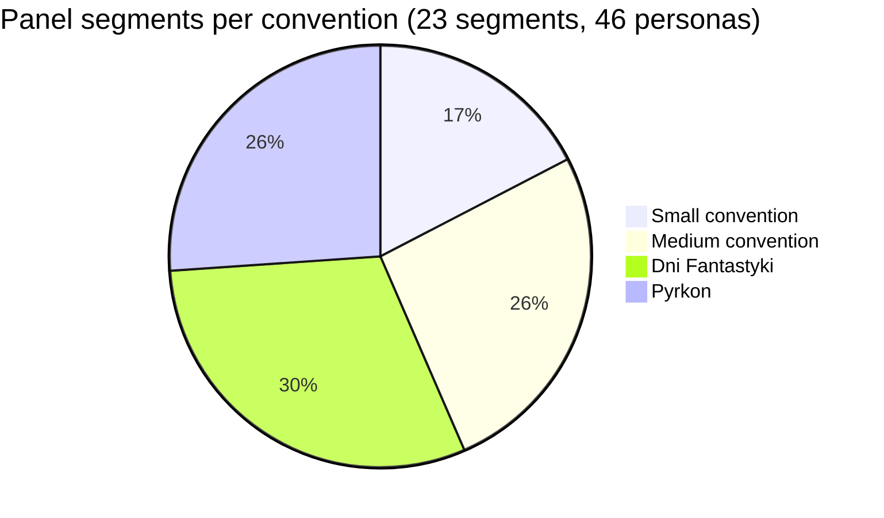
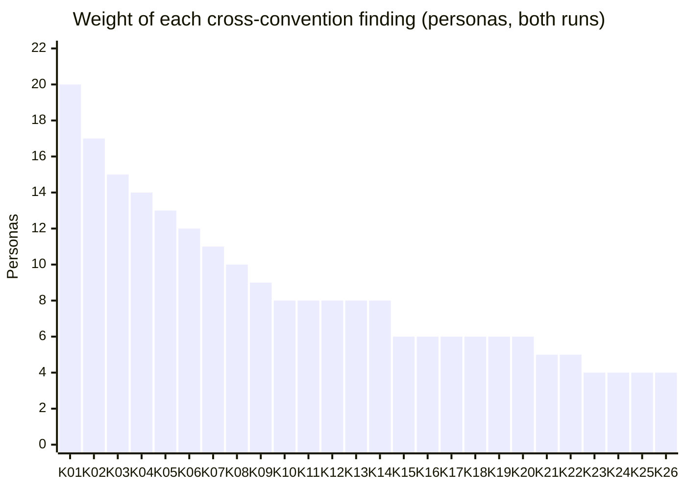
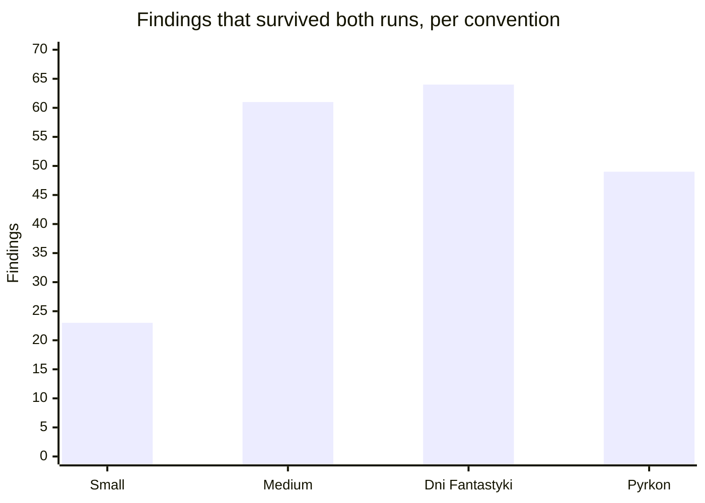

# Programme across convention scales: synthetic personas and walkthrough findings

- Date: 2026-11-14
- Domain owner: the programme's domain owner, not yet named in [CONTRIBUTORS.md](../../../CONTRIBUTORS.md)
- Source: a synthetic panel built from research notes on Dni Fantastyki, Pyrkon, Konwencik and the
  tools small conventions use, and from [PRODUCT.md](../../PRODUCT.md); no real interviews
- Status: non-binding, synthetic, hypotheses only ([briefs](../README.md)). Nothing here is
  evidence about real people. Every finding says what a persona *would* do and names the real-user
  check that would settle it.

## Which wireframes were walked

The walkthrough ran on an **earlier version of the programme wireframes**: 34 screens in sections
1–9. In that version the small and the medium convention were fictional stand-ins ("Kon na
Strychu", about 300 people, and "Smoczy Gród", about 2,500 people, 8 rooms and about 290 items),
and their sample data leaned on sign-ups and RPG sessions. This brief calls them **the small
convention** and **the medium convention**.

The wireframes have since been rebuilt. They are talk-centric and use real reference conventions:
Nordcon is the small one and Fantasmagoria the medium one. They hold 71 screens: the 34 of sections
1–9 keep their ids with the new data, and 37 new screens in sections 10–15 cover the attendee, the
speaker, the programme team, onsite operations and the head. **The 37 new screens have not been
walked, and the 34 were walked only in their earlier form.** Screen ids in the findings name the
screens as walked; [What the current wireframes address](#what-the-current-wireframes-address) maps
the findings onto the current canvases.

## Method

The panel was built from research notes (Dni Fantastyki; Pyrkon from the attendee's and the
organiser's side; Konwencik; a benchmark of the tools small conventions use) and from
docs/PRODUCT.md, with no real interviews. The stance was *simulate*: no real organisers or
attendees were reachable, and two of the four conventions were fictional. 23 segments (small 4,
medium 6, Dni Fantastyki 7, Pyrkon 6) ran twice with one persona each: P01–P23 in run 1, P24–P46
in run 2, the same segment in a different corner of its situation. Each persona was interviewed
about the last time it met the problem and about the team's assumptions A01–A06, answered four
yes/no questions, took a decision under pressure with a variant, and walked its own role's screens.
**Only findings that repeated across both runs are reported**; a cross-convention finding (K01–K26)
came back in two or more conventions.

- **Saturation: not reached.** Run 2 brought 30 new topics (small 4 of 26, medium 11 of 45, Dni
  Fantastyki 11 of 48, Pyrkon 4 of 36). Screen findings stabilised (spread at most ±2); topics did
  not.
- **No parity check**: there are no real interviews to compare the panel against.
- **Evidence:** of 253 persona lines in run 1, 112 have a source and 141 are assumed; behaviour is
  assumed throughout. `[DOCUMENT]` is PRODUCT.md, `[BENCHMARK]` a research passage, `[ASSUMPTION]`
  nothing.
- **Medium:** HTML sketches read as pictures; nothing was clicked or ran. 29 of 34 screens were
  read; not the four Worldcon screens (no Worldcon segment) nor `ab-pyrkon-entitlements` (a screen
  for discussion).
- **Substitute screens:** the medium convention read the Dni Fantastyki proposal and speaker
  screens, the Pyrkon programme coordinator the Dni Fantastyki grid, the Dni Fantastyki team the
  Pyrkon cancellation dialog; some findings repeat across conventions on one screen for that reason.
- **Acquiescence:** 47% "yes" on the yes/no questions, 27% without the situational third one; no
  finding rests on them. The persona agents wrote their own transcripts.

**How to read a finding.** *Weight* is the number of personas across both runs who hit it;
*spread* is |run 1 − run 2|. Two findings stand apart only when their weights differ by more than
the larger spread; otherwise they tie. *Loose normalisation*: personas hit one rule from different
sides; check these first. A weight counts personas in a panel, never a share of real users.

## The panel

The composition is **assumed**: no data gives proportions, and every convention has one indifferent
seat. *Assumption persona*: the role is `[DOCUMENT]`, situation and behaviour `[ASSUMPTION]`.
*Sourced situation*: situation and constraints `[BENCHMARK]`, behaviour still `[ASSUMPTION]`.
Personas are roles in a situation, with no names, ages or biographies.

### Small convention (fictional stand-in, about 300 people, one or two rooms)

| Id        | Role in a situation (run 1 / run 2)                                                                         | State of mind at entry                    | Main goal                                | Main constraint       | Tier       |
| --------- | ----------------------------------------------------------------------------------------------------------- | ----------------------------------------- | ---------------------------------------- | --------------------- | ---------- |
| P01 / P24 | head running the convention alone; enters 24 items on evenings / first platform after years of spreadsheets | tired / sceptical, fears losing control   | the programme on phones without retyping | no budget, no team    | assumption |
| P02 / P25 | game master as speaker, two RPG sessions for five / ten came for five seats last year                       | hopeful / wary, wants a cap               | five players, no fight at the table      | holds no permission   | assumption |
| P03 / P26 | first-time attendee checking the hours, **indifferent seat** / arrives late on Saturday                     | unhurried / hurried                       | what is on and where                     | phone, not signed in  | assumption |
| P04 / P27 | **volunteer** at the entrance desk, no OPOS role; the head's friend / a teenager's first shift              | busy / afraid of giving wrong information | answer "where and when" without the head | the attendees' portal | assumption |

### Medium convention (fictional stand-in, about 2,500 people, 8 rooms, about 290 items)

| Id        | Role in a situation (run 1 / run 2)                                                                                          | State of mind at entry         | Main goal                                    | Main constraint             | Tier       |
| --------- | ---------------------------------------------------------------------------------------------------------------------------- | ------------------------------ | -------------------------------------------- | --------------------------- | ---------- |
| P05 / P28 | org running the programme; 300 proposals in two weeks / speakers change availability                                         | overwhelmed / irritated        | proposals, grid and publication in one place | a volunteer team of 3–5     | assumption |
| P06 / P29 | speaker at several conventions; submits to three / told the time a week before                                               | methodical / annoyed           | submit once, know status and slot            | a different form everywhere | assumption |
| P07 / P30 | attendee planning around limited workshops / on a waiting list                                                               | eager / anxious                | a seat without queuing at dawn               | phone                       | assumption |
| P08 / P31 | trade-hall attendee, **indifferent seat** / parent whose child wants one item                                                | relaxed / distracted           | shopping and friends                         | signs up for nothing        | assumption |
| P09 / P32 | **head of the medium convention**, sells tickets online; sets who may sign up / day-ticket holders cannot sign up for Sunday | careful with money / defensive | sales and sign-ups tied together             | OPOS takes no fees          | assumption |
| P10 / P33 | **volunteer** with the sign-up list at a workshop room; two people not on the list / half the list absent                    | under pressure / unsure        | who is in and who is next, fast              | poor signal in the hall     | assumption |

### Dni Fantastyki (Wrocław, about 10–16k people, 368 items, 21 spaces on five levels)

| Id        | Role in a situation (run 1 / run 2)                                                                   | State of mind at entry  | Main goal                                  | Main constraint            | Tier       |
| --------- | ----------------------------------------------------------------------------------------------------- | ----------------------- | ------------------------------------------ | -------------------------- | ---------- |
| P11 / P34 | block coordinator; 48 Literature proposals / a strong off-theme proposal                              | conscientious / torn    | decide my block, answer once               | answers by mid-July        | sourced    |
| P12 / P35 | programme team building the grid; 217 castle items / a cancellation and a flooded room the day before | focused / stressed      | no clashes, one export                     | 50-minute slots, Konwencik | assumption |
| P13 / P36 | speaker submitting in May; six weeks of silence / last year's reserve list, never explained           | uncertain / wary        | know where my proposal stands              | call 7 May–30 June         | assumption |
| P14 / P37 | parent with a child under seven; plans a day / the child wants a workshop now                         | practical / rushed      | items fit for my children, near each other | age ratings 7+ to 18+      | assumption |
| P15 / P38 | wheelchair user in a castle without a lift / the item moved upstairs                                  | methodical / frustrated | only what I can reach; early word of moves | floors 1–3 unreachable     | sourced    |
| P16 / P39 | **volunteer** at a full room door; 120 people for 80 seats / a 12+ item and a nine-year-old           | harried / unsure        | a clear rule and a count inside            | no OPOS role               | sourced    |
| P17 / P40 | passer-by in the free outdoor zone, **indifferent seat** / came for the concert                       | curious / indifferent   | what is free and next                      | no ticket, no sign-in      | assumption |

### Pyrkon (Poznań, 60,000+ people, 2,000+ items, 22 zones)

| Id        | Role in a situation (run 1 / run 2)                                                 | State of mind at entry | Main goal                                      | Main constraint                                   | Tier       |
| --------- | ----------------------------------------------------------------------------------- | ---------------------- | ---------------------------------------------- | ------------------------------------------------- | ---------- |
| P18 / P41 | zone coordinator; 200 Literature Zone proposals / a missing speaker on the day      | methodical / urgent    | my zone, my decisions, my reserve list         | one call, read after closing                      | sourced    |
| P19 / P42 | programme coordinator across zones / one speaker in two zones at once               | focused / alarmed      | every clash visible before publication         | hour of 45 + 5 + 10 min                           | assumption |
| P20 / P43 | Early Bird attendee with four tokens; reservations open / a reserved talk cancelled | competitive / annoyed  | every token on what matters                    | close 23:59 the day before, forfeit 10 min before | sourced    |
| P21 / P44 | attendee needing Polish Sign Language (PJM) / low stimulation                       | methodical / cautious  | items I can follow and stand                   | interpreters, quiet rooms                         | sourced    |
| P22 / P45 | one-day visitor, **indifferent seat** / came for cosplay photos                     | relaxed / indifferent  | join any queue that looks fun                  | reserves nothing                                  | assumption |
| P23 / P46 | **gżdacz (volunteer)** at a room door; 11:50 with a queue / a dispute at 11:52      | under pressure / tense | a device that says who is in and how many more | shifts of at most 7 hours                         | sourced    |

### Profiles

Words are the Polish a persona would use, glossed.

**Small convention**

- **P01 / P24, head.** Proposals, if any, by Google Form `[BENCHMARK]`. Words: „punkt”, „sala”,
  „prowadzący” (item, room, host) `[ASSUMPTION]`. Objects to settings that assume a big team; will
  not configure anything before seeing the programme online `[ASSUMPTION]`.
- **P02 / P25, game master.** No permission `[DOCUMENT]`. Words: „sesja”, „gracze”, „miejsca”
  (session, players, seats) `[ASSUMPTION]`. Objects to asking the head for every change; will not
  run a waiting list by hand `[ASSUMPTION]`.
- **P03 / P26, first-time attendee.** Words: „co teraz”, „gdzie” (what now, where) `[ASSUMPTION]`.
  Will not create an account; would follow a friend rather than the screen `[ASSUMPTION]`.
- **P04 / P27, desk volunteer.** No volunteer role exists `[DOCUMENT]`. Words: „gdzie jest
  warsztat”, „przesunęli” (where's the workshop, they moved it) `[ASSUMPTION]`. Objects to not
  seeing whether an item is late or moved; will not change the programme `[ASSUMPTION]`.

**Medium convention**

- **P05 / P28, programme org.** Google Forms, a spreadsheet and Konwencik today `[BENCHMARK]`.
  Words: „zgłoszenia”, „siatka”, „dostępność” (proposals, grid, availability) `[ASSUMPTION]`.
  Objects to leaving a familiar spreadsheet and to features that switch on by themselves
  `[ASSUMPTION]`.
- **P06 / P29, speaker.** Wants the slot before booking a stay `[ASSUMPTION]`. Words: „zgłoszenie”,
  „potwierdzenie” (proposal, confirmation) `[ASSUMPTION]`. Objects to yet another account; would
  create one only where it cares most `[ASSUMPTION]`.
- **P07 / P30, workshop planner.** Words: „zapisy”, „lista oczekujących” (sign-ups, waiting list)
  `[ASSUMPTION]`. Objects to not knowing whether the waiting list moves by itself; keeps screenshots
  as proof `[ASSUMPTION]`.
- **P08 / P31, trade-hall attendee.** Words: „hala”, „dla dziecka” (hall, for the child)
  `[ASSUMPTION]`. Will not sign up in advance; an account on the spot is where it gives up
  `[ASSUMPTION]`.
- **P09 / P32, head.** Money goes to the convention's own payment account `[DOCUMENT]`. Words:
  „bilet jednodniowy”, „karnet” (day ticket, three-day ticket) `[ASSUMPTION]`. Objects to rules a
  door volunteer cannot explain; says it will never compare two lists by hand `[ASSUMPTION]`.
- **P10 / P33, workshop-room volunteer.** Words: „odhaczyć”, „spoza listy” (tick off, not on the
  list) `[ASSUMPTION]`. Wants no role, only a list that carries the rule; objects to arguing without
  one `[ASSUMPTION]`.

**Dni Fantastyki**

- **P11 / P34, block coordinator.** Proposals assessed against the year's theme line `[BENCHMARK]`.
  Words: „blok”, „linia tematyczna”, „rezerwa” (block, theme line, reserve list) `[BENCHMARK]`.
  Objects to other blocks' proposals mixed with mine `[ASSUMPTION]`.
- **P12 / P35, grid builder.** A public Google Sheet and Konwencik two weeks before `[BENCHMARK]`.
  Words: „siatka”, „przestrzeń”, „eksport” (grid, space, export) `[ASSUMPTION]`. Objects to giving
  up Konwencik, which attendees know `[ASSUMPTION]`.
- **P13 / P36, speaker.** No guarantee of a place `[BENCHMARK]`. Words: „złożone”, „do kiedy”
  (submitted, until when) `[ASSUMPTION]`. Would treat a reserve list with no end as a no
  `[ASSUMPTION]`.
- **P14 / P37, parent.** Words: „dla dzieci”, „od ilu lat” (for children, from what age)
  `[ASSUMPTION]`. Objects to age ratings that mean different things; the source uses "B.O." without
  a legend `[BENCHMARK]`.
- **P15 / P38, wheelchair user.** A quiet tent, two accessibility coordinators `[BENCHMARK]`. Words:
  „parter”, „bez schodów” (ground floor, step-free) `[ASSUMPTION]`. Will not be carried upstairs by
  strangers `[ASSUMPTION]`.
- **P16 / P39, door volunteer.** 16+, at least 12 hours `[BENCHMARK]`. Words: „pełna sala”, „kto
  pierwszy” (room full, first come) `[ASSUMPTION]`. Wants the rule set by someone else; refuses to
  decide alone `[ASSUMPTION]`.
- **P17 / P40, passer-by.** The free zone "Fantastyka Open" `[BENCHMARK]`. Words: „scena”, „za
  darmo” (stage, free) `[ASSUMPTION]`. Will not buy a ticket or sign in `[ASSUMPTION]`.

**Pyrkon**

- **P18 / P41, zone coordinator.** The Science Zone is commissioned `[BENCHMARK]`. Words: „strefa”,
  „wstawić z rezerwy” (zone, insert from the reserve list) `[ASSUMPTION]`. Objects to power over all
  22 zones and none over its own `[ASSUMPTION]`.
- **P19 / P42, programme coordinator.** At most 4 presenters `[BENCHMARK]`. Words: „konflikt”, „ta
  sama osoba” (conflict, same person) `[ASSUMPTION]`. Accepts warnings over blocks; objects to
  warnings without a name `[ASSUMPTION]`.
- **P20 / P43, Early Bird.** Half the seats by token, half by queue `[BENCHMARK]`. Words: „tokeny”,
  „rezerwacja”, „kolejka” (tokens, reservation, queue) `[BENCHMARK]`. Objects to counters that do
  not add up `[ASSUMPTION]`.
- **P21 / P44, PJM or low stimulation.** The source app filters by both `[BENCHMARK]`. Words:
  „tłumacz”, „niskie bodźce” (interpreter, low stimulation) `[ASSUMPTION]`. Would use likes only to
  be notified `[ASSUMPTION]`.
- **P22 / P45, one-day visitor.** One ticket opens the whole programme `[BENCHMARK]`. Words:
  „kolejka”, „co jest teraz” (queue, what's on) `[ASSUMPTION]`. Will not reserve anything
  `[ASSUMPTION]`.
- **P23 / P46, gżdacz.** At least 14 hours; token holders enter 10 minutes before `[BENCHMARK]`.
  Words: „przepadła”, „z kolejki”, „w środku” (forfeited, from the queue, inside) `[ASSUMPTION]`.
  Wants the rule, not the gżdacz, to say no; refuses to count on fingers `[ASSUMPTION]`.

## Cross-convention findings

Every finding is synthetic. Screen ids name the 34-screen version that was walked. A0n is the
team's assumption a finding touches (see [The team's assumptions](#the-teams-assumptions)).

**Order.** K01 and K02 stand apart, and K02 apart from K03. From K03 to K09 each ties with its
neighbours; K03 stands apart from K05 and below. K10–K14 tie with each other and K09; K13 (±2) also
with K15–K20. K15–K20 tie, and K21–K22 tie with K15–K20 and K23–K26.

197 findings survived both runs. Of the 26 cross-convention ones, the small convention is in 11,
the medium in 23 (partly through the substitute screens), Dni Fantastyki in 21 and Pyrkon in 15.

**Story against pressure.** [SYNTHETIC] In every convention and both runs, a rule a persona stated
in the interview would give way under pressure to a local heuristic: heads and grid builders would
publish from a screenshot or with unresolved warnings, coordinators would settle exceptions by email
and phone first, speakers would read the reserve list as a no, attendees would ask a person rather
than the phone, volunteers would set the forfeit time, the age rule and "full" themselves. Where a
screen does not say what will happen (K02, K05, K10, K15), the paths of the convention day would
weigh more than the planning paths most sketches covered.

### K01. "Now": what is on, or the whole day?

[SYNTHETIC]

**20, ±2** (11 / 9) · medium 8 (P05–P08 / P28–P31), Dni Fantastyki 7 (P14–P17 / P37, P39, P40),
Pyrkon 5 (P20–P22 / P43, P45) · `ab-medium-list`, `ab-dni-list`, `ab-pyrkon-list`

A persona would see "Teraz" (Now) lit beside the lit day and not know which applies: before the
convention it would take a narrowed list for the whole programme, on site it would distrust "Now".
P07: "I don't know whether 'Now' is on together with 'Sat', or whether I'm only seeing what is on
now, and it's Friday." Part of the weight is a sketch defect.

**Check:** five attendees, a parent and a passer-by among them: "say out loud what this list
shows"; on site, "find something within 15 minutes"; watch whether they change "Now".

### K02. A changed item: who hears of it, and how it shows

[SYNTHETIC]

**17, ±1** (8 / 9), loose normalisation · small 2 (P04 / P27), medium 4 (P05, P07 / P28, P30), Dni
Fantastyki 4 (P11, P15 / P36, P38), Pyrkon 7 (P18, P19, P21 / P41–P44) · `ab-small-desk`,
`ab-medium-plan`, `ab-dni-item`, `ab-pyrkon-form`, `ab-pyrkon-cancel`

The plan notifies only people with a like, a sign-up or a cast place, and only for a cancellation,
a new time or a new room. Personas would hit three gaps: no screen says who gets told before saving;
a new title or cast in the same slot is no change; those who must know (the desk volunteer, the
wheelchair user) hold no like, or would invent one. The card would show no "moved" or previous room.
P38: "Items upstairs I won't like, because I can't get there anyway: if they move them to the
ground floor, I won't hear, because the notification only goes to people with a like." Touches A05,
A06.

**Check:** two volunteers, two people with access needs, a programme coordinator: "when was an
item of yours last moved or swapped, and how did you learn?"; the coordinator: "move a published
item and, before saving, say who will hear".

### K03. "Where": no room on the item, or no way to it

[SYNTHETIC]

**15, ±1** (8 / 7), loose normalisation · small 8 (P01–P04 / P24–P27), medium 2 (P08 / P31), Dni
Fantastyki 5 (P14, P16, P17 / P37, P40) · `ab-small-list`, `ab-small-desk`, `ab-medium-item`,
`ab-dni-item`

The small sketch hid the empty room field, as the plan's empty-list rule says; personas would read
it as a contradiction. Wrong reading, real signal: with two rooms the default portal would not
answer "where". Elsewhere the room would lack floor, direction and distance. P04: "The items have no
room, and 'where' is half the questions at the desk." Touches A01, A06.

**Check:** two or three small heads and a desk volunteer: "what were you asked most at the
entrance?"; "show where the 14:00 workshop is". A Dni Fantastyki parent: "plan two items back to
back"; count requests for directions.

### K04. Do I need an account? The condition under the button

[SYNTHETIC]

**14, ±0** · small 3 (P03 / P24, P26), medium 8 (P06–P09 / P29–P32), Dni Fantastyki 3 (P16, P17 /
P40) · `ab-small-item`, `ab-medium-item`, `ab-dni-proposal`

"Wymaga konta i biletu tej edycji" (needs an account and a ticket) would sit in grey under "Zapisz
się" (Sign up). Without an account a persona would not tap, or would back out at sign-in; a speaker
would resent registering after "Send". Browsing without an account would be welcome. P08: "I'd tap
'Sign up' and only then find out I have to sign in. I'd rather know before; then I'd go straight to
the door." Touches A04.

**Check:** a parent and a door-ticket buyer, signed out, two minutes: "sign up from your phone";
note when they grasp the condition. A speaker: "send a proposal" with no session.

### K05. "Will I get in?": entry and room state invisible

[SYNTHETIC]

**13, ±1** (6 / 7) · small 4 (P02, P03 / P25, P26), medium 2 (P08 / P31), Dni Fantastyki 4 (P16,
P17 / P39, P40), Pyrkon 3 (P22 / P44, P45) · `ab-small-item`, `ab-dni-item`, `ab-pyrkon-item`

The plan's "free entry with information" would appear on no screen. A full room would still say
"Wejście wolne" (free entry), read in the park as free of charge; a five-seat RPG session would say
nothing about entry. P40: "someone from the park will read it as 'I can go in'." Touches A02 (Dni
Fantastyki would want "room full" rather than sign-ups) and A06.

**Check:** five park visitors at Dni Fantastyki: "which items can you attend without a ticket?";
volunteers after a shift: "how often were you shown 'free entry'?"; a Pyrkon one-day visitor:
"decide whether to queue", then "on what?".

### K06. Finding an item fast

[SYNTHETIC]

**12, ±0**, loose normalisation at Dni Fantastyki · small 3 (P02, P04 / P27), medium 3 (P06 / P28,
P29), Dni Fantastyki 4 (P16, P17 / P39, P40), Pyrkon 2 (P22 / P45) · `ab-small-list`,
`ab-medium-list`, `ab-dni-list`, `ab-pyrkon-list`

No search at the small convention, no hosts on medium cards, 368 items to scroll, a friend's tip as
a title fragment and no link to send. P04: "If there were more items, I have no search, and they
ask me by name: 'that workshop with the miniatures'." Touches A06.

**Check:** a desk volunteer: "what words did people use?"; tasks "find this person's item" and
"find 'those demons'", against 30 seconds.

### K07. Seat and token counters without unit or context

[SYNTHETIC]

**11, ±1** (5 / 6), partly sketch data · medium 3 (P07 / P28, P30), Pyrkon 8 (P20–P23 / P43–P46) ·
`ab-medium-list`, `ab-pyrkon-item`, `ab-pyrkon-plan`, `ab-pyrkon-scanner`

"3 of 12" would read as taken or free, "23 of 60" as room or pool, "you have 3 tokens" with no
source, cost or day. Every token persona would stumble. P20: "Here I have '1 of 4', and on the talk
page 'You have 3 tokens' before I've tapped anything, so I don't know which number to believe." A04
would hold only with "for what, until when, which day".

**Check:** a three-day and a one-day ticket holder, on consistent data: five-second "how many are
left?"; "how many tokens will this cost, and can you use them tomorrow?".

### K08. The like count read as something else

[SYNTHETIC]

**10, ±0** · small 4 (P01, P02 / P24, P25), Dni Fantastyki 4 (P13, P16 / P36, P39), Pyrkon 2 (P21 /
P44) · `ab-small-list`, `ab-dni-item`, `ab-pyrkon-list`

By role the count would read as sign-ups, a crowd forecast (128 likes for about 80 seats) or a
rating of the host ("♡ 5" beside "♡ 19"). It is public by rule
([PRODUCT.md 7](../../PRODUCT.md#7-modules)); nothing steers how it is read. P16: "I see 128 hearts
against 80 seats and only I work out they won't fit; the screen tells neither me nor the
attendees." Touches A02.

**Check:** the Dni Fantastyki team compares Konwencik favourites with the crowd at three rooms; a
game master: "how many did you prepare for, how many came?"; a person with access needs thinks
aloud at a card.

### K09. "Speakers" in English in the Polish panel

[SYNTHETIC]

**9, ±1** (5 / 4), seen once at Pyrkon · small 2 (P01 / P24), medium 3 (P05, P09 / P28), Dni
Fantastyki 4 (P11, P12 / P34, P35) · `ab-small-settings`, `ab-medium-settings`, `ab-dni-form`

"Rekrutacja speakers" (speaker recruitment) would read as unfinished and be mistaken for the call
for proposals; the `pl` rendering of "speaker" is open (the portal said „Prowadzi”, hosted by). P34:
"'Rekrutacja speakers' is half in English, and for a moment I don't know whether it's the same as
the call for proposals."

**Check:** two block coordinators and a small head, unprompted: "what do you call the person who
runs an item?"; "explain the call for proposals against this switch".

### K10. The waiting list's mechanics invisible

[SYNTHETIC]

**8, ±0** · small 2 (P02 / P25), medium 4 (P07, P10 / P30, P33), Pyrkon 2 (P20 / P43) ·
`ab-medium-item`, `ab-medium-plan`, `ab-medium-door`, `ab-pyrkon-plan`

One grey sentence would say the list moves by itself; a seat freed a minute before the start would
go to someone who cannot get there in time; at Pyrkon it would be unclear whether waiting costs a token. Every role
would go back to the door. P10: "without a time after which a seat is forfeited, and without a way
to call the people waiting, it falls apart at the door." A02 votes would be conditional; plan
question P5 stays open.

**Check:** a workshop-room volunteer plays the last 10 minutes with a drop-out at 11:58: "what do
you do, whom do you tell?"; a former waiting-list attendee: "what did you do while waiting?".

### K11. A reserve list without meaning, end date or action

[SYNTHETIC]

**8, ±0** · medium 2 (P06 / P29), Dni Fantastyki 4 (P11, P13 / P34, P36), Pyrkon 2 (P18 / P41) ·
`ab-dni-speaker`, `ab-dni-proposals`, `ab-pyrkon-proposals`

Nobody would know what a reserve-list speaker gets after 15 July or how long it lasts; at Pyrkon a
note would promise insertion with no action to do it. Both speakers would confirm another convention
at once. P13: "For me the reserve list is a clear sign that it's probably a no." Touches A03.

**Check:** two former Dni Fantastyki reserve-list speakers: "what did you do after the email, and
when was it closed for you?"; a Pyrkon zone coordinator: "no speaker, 40 minutes to start, insert a
reserve-list item"; time and steps.

### K12. A dead end: no, but nothing instead

[SYNTHETIC]

**8, ±0** · Dni Fantastyki 6 (P14–P16 / P37–P39), Pyrkon 2 (P20 / P43) · `ab-dni-item`,
`ab-pyrkon-plan`

Nothing would suggest something similar now, step-free, nearby or with seats; a "token returned"
after a same-day cancellation would be worthless. P15 would expect "a clear answer whether I can get
in, and if not, whether there is something instead: a recording, a repeat, the same host somewhere
else." Touches A05, A06.

**Check:** observe a door volunteer: what they tell people turned away, and from where; a
wheelchair user: "this item is on the second floor; what now?".

### K13. The proposal form misses what the grid needs

[SYNTHETIC]

**8, ±2** (5 / 3), partly one screen · medium 4 (P05, P06 / P28, P29), Dni Fantastyki 4 (P11–P13 /
P36) · `ab-dni-proposal`, `ab-dni-proposals`, `ab-medium-import`

Availability would be free text („Kiedy możesz”, when can you), missing from list and import; no
field for a projector or for stairs. P28: "people write 'probably Saturday' there, so I have to ask
anyway." Touches A03 and the warning on conflicts outside availability.

**Check:** a medium org shows last year's sheet; count availability entries and later changes; a
block coordinator: "when did a speaker last need the ground floor or a projector?".

### K14. The talk around a proposal stays in email

[SYNTHETIC]

**8, ±0** · medium 2 (P06 / P29), Dni Fantastyki 4 (P11, P13 / P34, P36), Pyrkon 2 (P18 / P41) ·
`ab-dni-proposal`, `ab-dni-speaker`, `ab-pyrkon-proposals`

"Answer by email" beside a status screen would be two places to watch; follow-ups and exceptions
would stay in email; the reserve list would carry no contact on the day. P13: "Email and the app
must say the same thing; I need to know which channel is binding." The strongest case against A03.

**Check:** count emails around decisions in a coordinator's mailbox; a speaker: "where did you check
the decision, and why believe it?".

### K15. The door volunteer has no count and no rule to say aloud

[SYNTHETIC]

**6, ±0** · medium 2 (P10 / P33), Dni Fantastyki 2 (P16 / P39), Pyrkon 2 (P23 / P46) ·
`ab-medium-door`, `ab-dni-item`, `ab-pyrkon-scanner`

No "7 of 12 are in", a "let the next person in" without whom, a forfeit time by eye, "about 80" as
no limit. Each volunteer would count on fingers and bend the rule; both Dni Fantastyki volunteers
would invent "the parent decides". P23: "That's what I want from the device, not counting on my
fingers." The core of A06.

**Check:** the Dni Fantastyki volunteer coordinator: "what is the standing-room rule, who sets it?";
a gżdacz: "let 10 in from the queue; how many seats are left?".

### K16. Block, zone and the org role have no scope of their own

[SYNTHETIC]

**6, ±0**, loose normalisation at the medium convention · medium 2 (P05 / P28), Dni Fantastyki 2
(P11 / P34), Pyrkon 2 (P18 / P41) · `ab-medium-settings`, `ab-dni-proposals`, `ab-pyrkon-proposals`

"Blok: Literatura" would be a removable filter; "programme: write" would cover the whole
convention; a counter under a zone filter would count the whole convention. The Pyrkon coordinator would move another zone's
items. P41: "Too much power in the wrong place and too little in mine." Touches the per-edition
permission ([PRODUCT.md 5](../../PRODUCT.md#5-roles-and-permissions)) and plan question P14.

**Check:** Dni Fantastyki programme leads and a Pyrkon zone coordinator: "who besides you decided
a proposal in your block or zone?"; "did your zone have its own deadline?".

### K17. The speaker has no view of their own

[SYNTHETIC]

**6, ±0** · small 2 (P02 / P25), medium 2 (P06 / P29), Dni Fantastyki 2 (P13 / P36) ·
`ab-small-item`, `ab-medium-list`, `ab-dni-item`

No "my items"; nothing on when to arrive, equipment or whom to write to. P25: "At the table I'd want
to know who is on the list and who isn't, and for it not to be my decision but something I can point
at."

**Check:** a speaker the day before: "how did you last check your item, and what else did you
need?"; a game master: "show what you had at the table".

### K18. Bulk work: a sheet, many decisions at once

[SYNTHETIC]

**6, ±0** · small 2 (P01 / P24), medium 2 (P05 / P28), Dni Fantastyki 2 (P12 / P35) ·
`ab-small-form`, `ab-dni-proposals`, `ab-dni-rooms`

Items one at a time, no multi-select for 300 proposals, no way in for Google Form proposals. The
small head would post a screenshot of the sheet instead: the cost at the moment would decide. P24:
"I don't open a new platform at this hour." Touches A01.

**Check:** small heads send last edition's sheet: "in what form was the programme before you
announced it?"; a medium org sorts 30 printed proposals.

### K19. An age rating without a legend

[SYNTHETIC]

**6, ±0** · Dni Fantastyki 4 (P14, P16 / P37, P39), medium 2 (P08 / P31) · `ab-dni-item`,
`ab-dni-list`, `ab-medium-list`

"12+" would read as ban or advice with no word on who decides; no rating as "for all" or "not
entered". P39: "I don't know whether 12+ is a ban or just a hint." Touches A06; plan question P18.

**Check:** the volunteer coordinator and several volunteers: "what do you tell a parent with a
nine-year-old at 12+?"; differing answers mean no single meaning.

### K20. The child: who signs up, and does the child get in

[SYNTHETIC]

**6, ±0** · medium 4 (P08, P09 / P31, P32), Dni Fantastyki 2 (P14 / P37) · `ab-medium-item`,
`ab-medium-entitlements`, `ab-dni-item`

Does the parent take a seat, what is "—" by the child ticket, may a child under seven enter the
ticketed zone? P08: "The child has no account and no phone, and the workshop is for the child, not
for me. I can't see how to sign up someone other than myself." Touches A04.

**Check:** a parent of a 6–12-year-old: "the last time your child wanted a limited item?"; a head:
"how do you count parent and child against a limit?".

### K21. Draft, hidden, published: what goes public?

[SYNTHETIC]

**5, ±1** (2 / 3) · small 2 (P01 / P24), Dni Fantastyki 3 (P11 / P34, P35) · `ab-small-form`,
`ab-dni-form`

„Ukryj punkt” (hide item) would serve as a preview and, with no „Odwołaj” (cancel) on the form, as
a cancellation under stress. P24: "I don't know which button to choose so that only I can see the
item."

**Check:** a small head: "add an item nobody sees yet"; a Dni Fantastyki team member: "a speaker
cancelled; do it in the panel".

### K22. No sign-up state on the phone to show at the door

[SYNTHETIC]

**5, ±1** (2 / 3) · medium 3 (P10 / P30, P33), Pyrkon 2 (P23 / P46) · `ab-medium-item`,
`ab-pyrkon-item`

No "signed up" or "waiting, number X"; at the 11:52 dispute, a page with a button, not a code. P30:
"I took a screenshot so I'd have proof that I'd signed up." Touches A06.

**Check:** a volunteer and an attendee: "what proved a sign-up at the door?"; replay the 11:52
dispute on a prototype.

### K23. Call decisions without a preview of text and recipients

[SYNTHETIC]

**4, ±0**, one screen, seen once at Pyrkon · medium 2 (P05 / P28), Dni Fantastyki 2 (P11 / P34) ·
`ab-dni-proposals`

"Wyślij decyzje (36)" (send decisions) would lump outcomes, invite a partial send and preview
nothing. P11: "I don't know whether 'Send decisions (36)' sends only my 36 or the decisions of all
blocks." Touches [0023](../../adr/0023-ask-in-a-modal-before-an-action-that-cannot-be-undone.md)
and A03.

**Check:** two coordinators bring last year's decision emails; "send the decisions; who gets one?".

### K24. After acceptance, no way to confirm or withdraw

[SYNTHETIC]

**4, ±0**, one screen · medium 2 (P06 / P29), Dni Fantastyki 2 (P13 / P36) · `ab-dni-speaker`

No "confirm" or "I can't"; „Wycofaj zgłoszenie” (withdraw) a plain link. P06: "if it didn't fit, I
have no button here to confirm the time or to say I can't."

**Check:** programme leads: "how many accepted speakers withdrew, and when did you learn?".

### K25. A conflict warning without specifics

[SYNTHETIC]

**4, ±0** · medium 2 (P05 / P28), Pyrkon 2 (P19 / P42) · `ab-medium-import`, `ab-dni-grid`,
`ab-pyrkon-form`

"3 overlaps in Room A" without the items; no name, no jump to the other item. "Warns, does not
block" would suit; whom to talk to would not show. P19: "With 2,000 items I need to know the name at
once."

**Check:** a programme coordinator: "open the other item and find its zone coordinator"; count
steps.

### K26. Working without signal

[SYNTHETIC]

**4, ±0**, at the medium convention resting on the persona's own constraint · medium 2 (P10 / P33),
Pyrkon 2 (P23 / P46) · `ab-medium-door`, `ab-pyrkon-scanner`

The door list would need to work offline or show its age, the scanner whether scans were saved.
P46: "the screen doesn't say whether it works without a network, whether the result is certain, or
whether the scan is waiting to be sent." Touches A06.

**Check:** an org measures signal in its rooms; a gżdacz: "tell me about the last time the signal
dropped".

### The team's assumptions

[SYNTHETIC] Persona votes where asked: confirms / undermines / no basis.

| Assumption                                                                                                             | Votes      | What the panel would say                                                            |
| ---------------------------------------------------------------------------------------------------------------------- | ---------- | ----------------------------------------------------------------------------------- |
| A01: a small convention sets nothing up; features switch on by themselves                                              | 2 / 3 / 3  | nothing to set at the start, yes; switching on by itself, no                        |
| A02: first come, first served with a waiting list suffices for small and medium; large ones without sign-ups need none | 4 / 5 / 7  | every yes conditional (K10); no basis for the large half; "room full" instead (K05) |
| A03: proposals in OPOS replace forms and email                                                                         | 2 / 10 / 0 | the form, yes; email and phone, no (K14)                                            |
| A04: a counter is enough; the entitlement's source does not matter                                                     | 2 / 3 / 5  | the source indifferent, the counter needs context (K07)                             |
| A05: room accessibility as an attribute and a filter is enough                                                         | 0 / 5 / 3  | also the item's, the way's and the moves' (K02, K12)                                |
| A06: a volunteer needs a list or the scanner, no role                                                                  | 1 / 8 / 1  | "no role" holds; "a list is enough" fails (K15, K22, K26)                           |

## What the current wireframes address

Read from the current canvases `opos-programme-three-scales` (sections 1–9),
`opos-programme-attendee-speaker` (10–12) and `opos-programme-team-ops` (13–15). **None of the
middle column has been walked**; only `ab-dni-now` cites the walkthrough.

| Finding | The current wireframes show                                                                                                                                                                                                                                                                                                                                                   | Still open                                                                                                                                                                                      |
| ------- | ----------------------------------------------------------------------------------------------------------------------------------------------------------------------------------------------------------------------------------------------------------------------------------------------------------------------------------------------------------------------------- | ----------------------------------------------------------------------------------------------------------------------------------------------------------------------------------------------- |
| K01     | `ab-dni-now` defines the window (on now or starting within the hour); lists light only the day, not "Teraz"                                                                                                                                                                                                                                                                   | whether the list's "Teraz" filters or opens the now-and-next view                                                                                                                               |
| K02     | `ab-dni-move-live` lists who will hear before saving (likes, cast, the room's volunteer duty by announcement) and a public "moved" status with time and old room; `ab-pyrkon-moved` shows before and after; `ab-medium-changes` is a changelog with "in my schedule"; `ab-pyrkon-reminders` names change types and why a notification came; `ab-pyrkon-cancel` lists the cast | someone who must know but holds no like; whether an announcement reaches a volunteer; "cast changed" goes beyond the plan's earlier rule and needs the domain owner, who also picks the channel |
| K03     | a room on every card, with building (Fantasmagoria) or floor (Dni Fantastyki); `ab-dni-room` gives floor, no lift, nearest step-free room; `ab-medium-person` the walk between buildings                                                                                                                                                                                      | no map or direction; the empty-list rule (`ab-dni-dictionaries`) still hides rooms a convention never entered                                                                                   |
| K04     | `ab-medium-item` puts the condition above the button                                                                                                                                                                                                                                                                                                                          | no sign-in screen; no path without an account                                                                                                                                                   |
| K05     | `ab-dni-item` separates free entry from the ticketed zone; Pyrkon cards carry an entry label; `ab-pyrkon-form` has entry levels                                                                                                                                                                                                                                               | no "room full" anywhere; "Wejście wolne" still reads as free of charge; `ab-small-item` has no entry section (plan question P2)                                                                 |
| K06     | hosts on cards; `ab-pyrkon-list` searches title, host and room; `ab-dni-people`, `ab-medium-person`, `ab-small-person`                                                                                                                                                                                                                                                        | no search on `ab-small-list`; no item link to share                                                                                                                                             |
| K07     | `ab-pyrkon-item` gives reservations against the queue's share, tokens left and the cost on the button; `ab-pyrkon-plan` names the token source                                                                                                                                                                                                                                | which day tokens work; "½ tokenami" on `ab-pyrkon-list`                                                                                                                                         |
| K08     | public counts as before; `ab-dni-move-live` compares likes with capacity for the team                                                                                                                                                                                                                                                                                         | how the count is read                                                                                                                                                                           |
| K09     | settings say „Rekrutacja prelegentów”                                                                                                                                                                                                                                                                                                                                         | portal still „Prowadzi”; switch against call for proposals                                                                                                                                      |
| K10     | unchanged on `ab-medium-item`, `ab-medium-door`                                                                                                                                                                                                                                                                                                                               | all of it; plan question P5                                                                                                                                                                     |
| K11     | `ab-pyrkon-reserve` fills the slot with fit checks and recipients; `ab-pyrkon-today` offers it on site; `ab-pyrkon-decisions` has a reserve-list template                                                                                                                                                                                                                     | no end date or way off the list on `ab-dni-speaker`                                                                                                                                             |
| K12     | `ab-dni-room` names the nearest step-free room; `ab-dni-now` filters step-free                                                                                                                                                                                                                                                                                                | no alternative on the item page; "token returned" on `ab-pyrkon-plan`                                                                                                                           |
| K13     | `ab-dni-proposal` asks for technical needs; `ab-dni-availability` collects availability per day; `ab-pyrkon-conflicts` checks it                                                                                                                                                                                                                                              | no field for a speaker's access needs; no availability column in `ab-medium-import`                                                                                                             |
| K14     | `ab-pyrkon-decisions` tracks who was told; `ab-medium-message` writes to groups; contacts on `ab-pyrkon-speaker-schedule`, `ab-pyrkon-today`                                                                                                                                                                                                                                  | which channel binds; where "write to the team" on `ab-dni-confirm` goes                                                                                                                         |
| K15     | `ab-pyrkon-scanner`: "inside 27 of 60", "+1 from the queue", one verdict to read aloud; `ab-dni-move-live` prints a door sheet                                                                                                                                                                                                                                                | `ab-medium-door` has no count or forfeit time; free-entry rooms no "full"                                                                                                                       |
| K16     | `ab-pyrkon-team` shows both options (filter or limit); "my zones" on `ab-pyrkon-conflicts`, `ab-pyrkon-today`; the edition's count apart on `ab-pyrkon-proposals`                                                                                                                                                                                                             | the decision, plan question P14                                                                                                                                                                 |
| K17     | section 12: `ab-pyrkon-speaker-schedule`, `ab-dni-confirm`, `ab-pyrkon-dayof`, `ab-dni-speaker-profile`, `ab-pyrkon-perks`                                                                                                                                                                                                                                                    | the small convention's game master (sign-ups off at Nordcon)                                                                                                                                    |
| K18     | `ab-medium-import` maps a sheet and turns title suffixes into format and age; `ab-small-copy` copies the previous edition; `ab-dni-people-admin` merges duplicates                                                                                                                                                                                                            | a sheet import at a small convention; multi-select on `ab-dni-proposals`; spaces one by one                                                                                                     |
| K19     | `ab-dni-dictionaries` makes "no rating" a value                                                                                                                                                                                                                                                                                                                               | ban or recommendation: plan question P18                                                                                                                                                        |
| K20     | unchanged on `ab-medium-entitlements`                                                                                                                                                                                                                                                                                                                                         | all of it; question T11 for the tickets owner                                                                                                                                                   |
| K21     | `ab-medium-release` separates draft from releases with a preview; `ab-small-completeness` lists hidden items; `ab-pyrkon-form` has "cancel item"                                                                                                                                                                                                                              | `ab-small-form`, `ab-dni-form` still offer only "hide"                                                                                                                                          |
| K22     | "signed up" on `ab-medium-plan`; the reservation on `ab-pyrkon-plan`, `ab-pyrkon-moved`                                                                                                                                                                                                                                                                                       | no waiting number; no reservation code for the door                                                                                                                                             |
| K23     | `ab-pyrkon-decisions`: preview per outcome, who was told, a check before sending, a test send                                                                                                                                                                                                                                                                                 | one unscoped button on `ab-dni-proposals`                                                                                                                                                       |
| K24     | "I confirm / I can't" with a deadline on `ab-dni-speaker`, `ab-dni-confirm`; `ab-pyrkon-invite`, `ab-pyrkon-dayof`                                                                                                                                                                                                                                                            | "withdraw" still a plain link                                                                                                                                                                   |
| K25     | `ab-pyrkon-conflicts` names person, items, zones and rooms, with "show in grid"; `ab-dni-grid`, `ab-medium-release` name the person                                                                                                                                                                                                                                           | reaching the other zone's coordinator                                                                                                                                                           |
| K26     | printouts carry the release number (`ab-small-prints`, `ab-dni-move-live`)                                                                                                                                                                                                                                                                                                    | the offline state of the scanner and the list                                                                                                                                                   |

**Sketch defects.** The walkthrough also logged 16 defects of the sketches (M01–M16) that inflated
K01, K07, K15 and K21. In the current canvases "Now" is no longer lit with the day, the scanner
gives one verdict, design notes have left the product screens, the closed Pyrkon call says closed
and the small list's counter matches its cards. Before a real-user test, check that the token counts
on `ab-pyrkon-item`, `ab-pyrkon-plan` and `ab-pyrkon-moved` (4, 2 and 3 of 4 left) tell one story,
that the seat counts on `ab-medium-list`, `ab-medium-item` and `ab-medium-door` agree, and that the
reservation button on `ab-pyrkon-item` shows its state after reservations close.

## To confirm with real users

[SYNTHETIC] Every row is a hypothesis; the numbers to recruit are a proposal. Start with the loosely
normalised findings (K02, K03, K06, K16) and the convention-day paths, on the current screens.

| #   | Hypothesis                                  | Who to recruit                                                 | Question or task                                                   | Test on                                   |
| --- | ------------------------------------------- | -------------------------------------------------------------- | ------------------------------------------------------------------ | ----------------------------------------- |
| K01 | "Now" would not say what it shows           | 5 attendees incl. a parent, a passer-by                        | "what does this list show?"; "find something within 15 minutes"    | `ab-dni-list`, `ab-dni-now`               |
| K02 | who must know of a change would not hear    | 2 volunteers, 2 people with access needs, a coordinator        | "how did you last learn of a move?"; "move an item, say who hears" | `ab-dni-move-live`, `ab-pyrkon-reminders` |
| K03 | no answer to "where"                        | 2–3 small heads, a desk volunteer, a parent                    | "what were you asked most?"; "where is the 14:00 workshop?"        | `ab-small-list`, `ab-dni-room`            |
| K04 | the account condition too late              | a parent, a door-ticket buyer, a speaker                       | "sign up in 2 minutes"; "send a proposal"                          | `ab-medium-item`, `ab-dni-proposal`       |
| K05 | "will I get in" unanswered                  | 5 park visitors, volunteers, a one-day visitor                 | "which item without a ticket?"; "decide whether to queue"          | `ab-dni-item`, `ab-pyrkon-list`           |
| K06 | items hard to find fast                     | a desk volunteer, a speaker, a visitor                         | "find this person's item"; "find 'those demons'"                   | `ab-pyrkon-list`, `ab-dni-people`         |
| K07 | counters mislead                            | three-day and one-day ticket holders                           | "how many left?"; "tokens tomorrow?"                               | `ab-pyrkon-item`, `ab-pyrkon-plan`        |
| K08 | likes read as sign-ups, crowd or rating     | Dni Fantastyki team, a game master, a person with access needs | favourites against crowd; think aloud at a card                    | `ab-dni-list`, `ab-small-list`            |
| K09 | speaker wording confuses                    | 2 block coordinators, a small head                             | "what do you call them?"; switch against call                      | `ab-medium-settings`                      |
| K10 | waiting list opaque                         | a workshop volunteer, a former waiting attendee                | drop-out at 11:58; "what did you do?"                              | `ab-medium-item`, `ab-medium-door`        |
| K11 | reserve list means no                       | 2 former reserve-list speakers, a zone coordinator             | "what after the email?"; "insert a reserve item"                   | `ab-dni-speaker`, `ab-pyrkon-reserve`     |
| K12 | no alternative offered                      | a door volunteer (observed), a wheelchair user                 | "second floor; what now?"                                          | `ab-dni-room`                             |
| K13 | form misses availability, equipment, stairs | a medium org, a block coordinator                              | count availability in last sheet                                   | `ab-dni-availability`                     |
| K14 | talk stays in email                         | a coordinator, a speaker                                       | count emails; "where did you check?"                               | `ab-pyrkon-decisions`, `ab-dni-confirm`   |
| K15 | no count, no rule at the door               | volunteer coordinator, a gżdacz, a volunteer                   | "standing-room rule?"; "10 in, how many left?"                     | `ab-pyrkon-scanner`, `ab-medium-door`     |
| K16 | no block or zone scope                      | Dni Fantastyki leads, a zone coordinator                       | "who else decided in your zone?"                                   | `ab-pyrkon-team`                          |
| K17 | no speaker view                             | a speaker, a game master                                       | "how did you check your item?"                                     | `ab-pyrkon-speaker-schedule`              |
| K18 | the sheet beats the switch                  | 2–3 small heads, a medium org                                  | send last sheet; sort 30 proposals                                 | `ab-medium-import`, `ab-small-copy`       |
| K19 | age rating has no single meaning            | volunteer coordinator, volunteers                              | "nine-year-old at 12+?"; compare                                   | `ab-dni-dictionaries`                     |
| K20 | child sign-up and entry unclear             | a parent of a 6–12-year-old, a medium head                     | "last limited item your child wanted?"                             | `ab-medium-entitlements`                  |
| K21 | public or not unclear                       | a small head, a Dni Fantastyki team member                     | "add an unseen item"; "cancel an item"                             | `ab-small-form`, `ab-medium-release`      |
| K22 | no proof on the phone                       | a volunteer, an attendee                                       | "what did you show at the door?"                                   | `ab-medium-plan`, `ab-pyrkon-plan`        |
| K23 | decisions without preview                   | 2 block coordinators                                           | last year's emails; "who gets one?"                                | `ab-pyrkon-decisions`, `ab-dni-proposals` |
| K24 | no confirm or withdraw                      | programme leads                                                | "how many withdrew, when?"                                         | `ab-dni-confirm`                          |
| K25 | warning without a name                      | a programme coordinator                                        | "find the other zone's coordinator"                                | `ab-pyrkon-conflicts`                     |
| K26 | lists fail offline                          | an org, a gżdacz                                               | measure signal; "last dropped signal?"                             | `ab-pyrkon-scanner`, `ab-small-prints`    |
