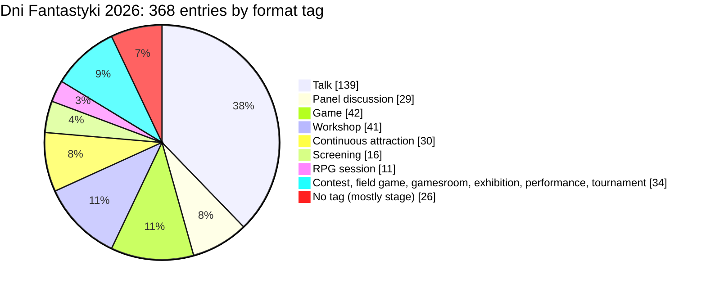
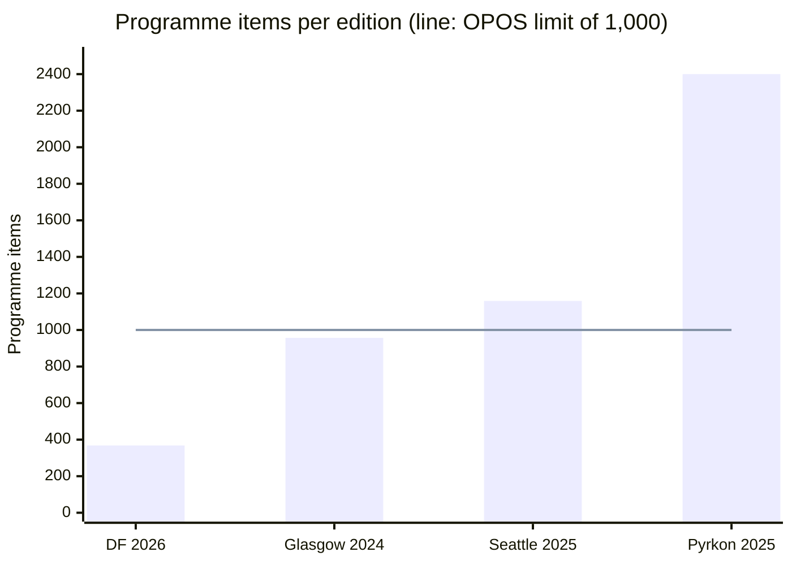
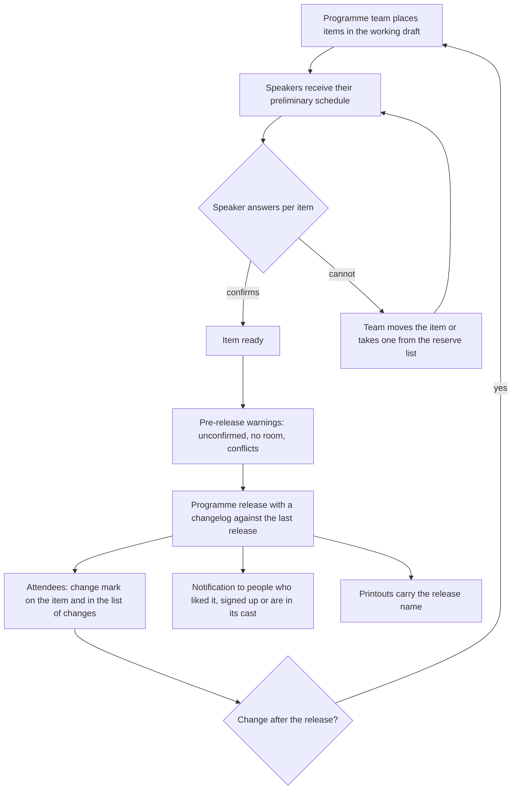
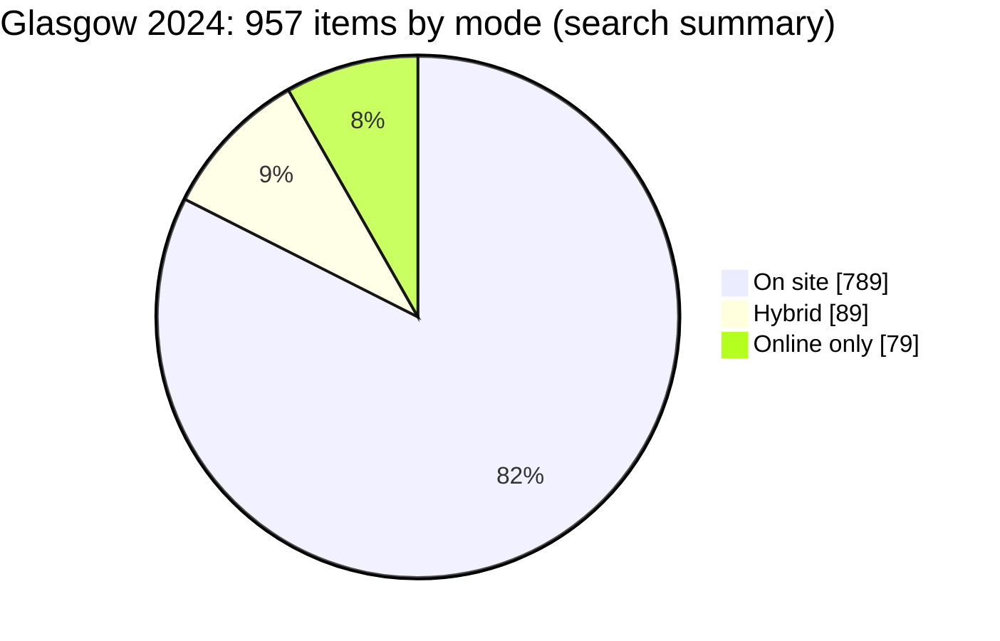

# Programme across convention scales: research

- Date: 2026-11-14
- Status: non-binding research behind brief 0003
- Domain owner: the programme's domain owner (not yet named)
- Source: public programmes, rules and guides of Polish and international conventions from the
  2024–2026 editions, and the documentation of programme tools; no organiser was interviewed

What brief 0003 rests on: how one programme module, configured per convention, can serve Nordcon
(small), Fantasmagoria (medium), Dni Fantastyki and Pyrkon, with Worldcon as a stress test. It
decides nothing: the module's rules come from its domain owner.

**Markings.** A statement with a link and no marking comes from a source that was read.

| Marking        | Meaning                                                               |
| -------------- | --------------------------------------------------------------------- |
| *(snippet)*    | from a search snippet or search summary; the page itself was not read |
| *(inference)*  | our conclusion, not stated by any source                              |
| *(assumption)* | set for discussion, not confirmed with the convention's organisers    |

Konwencik's organiser features come from interface texts in the public JavaScript bundle of its
organiser panel ([org.konwencik.pl](https://org.konwencik.pl/)): a text proves a screen exists in
the code, not that it works on every event.

## 1. What the four conventions' programmes look like

A talk-centric convention arranges its programme by **format, block and people**, not by seats.
Talks, panel discussions, author meetings and items with guests are its core; RPG sessions are one
format among many, and sign-ups are the exception.

### Nordcon, the small pattern

Source for every row: [Nordcon 2024 booklet](https://nordcon.gkf.org.pl/2024/informator).

| Fact                                                                                                                                                                                                                                     |
| ---------------------------------------------------------------------------------------------------------------------------------------------------------------------------------------------------------------------------------------- |
| The 37th Konwent Polskich Klubów Fantastyki, run by the Gdańsk fantasy club in Jastrzębia Góra, 3–8 December 2024                                                                                                                        |
| Two talk rooms, K8 "Falcon Crest Gazette" and K6 "Falcon Crest Herald"; Main Street for the main items (opening, Forum Fandomu, the ZSFP meeting, the costume contest, closing); RPG rooms, a board-game room, a café, buildings A and B |
| The talk programme is "program publicystyczny", run by the head of the talk programme ("szef publicystyki"); games and films have their own heads                                                                                        |
| Talks start on the hour; RPG sessions last 2 to 6 hours and carry structured "Warning tags"                                                                                                                                              |
| A printed programme booklet of about 40 A5 pages in 400 copies: grids by day and room ("Host: Title" per cell), abstracts, building plans, a guest list with bios                                                                        |
| Changes: "part of the schedule may change"; a notice board in the café                                                                                                                                                                   |

### Fantasmagoria, the medium pattern

Source for every row: [Fantasmagoria 2025 programme, v8](https://fantasmagoria.gniezno.pl/media/docs/2025_07/Program_full_v8.pdf).

| Fact                                                                                                                                                                                                                                    |
| --------------------------------------------------------------------------------------------------------------------------------------------------------------------------------------------------------------------------------------- |
| Gniezno, two buildings: MOK (Sala Prelekcyjna, Sala Widowiskowa) and II LO (Sala Warsztatowa and others)                                                                                                                                |
| Organised by room, not by block: the contents list about 27 rooms, zones and attractions, from Sala Masterclass and Touhou Room to Sala RPG 1–3 and a guided city walk (own count)                                                      |
| The published PDF is version 8, created 11 July 2025                                                                                                                                                                                    |
| Items start on the hour or the half hour (9:30, 20:30, 21:30 and 22:30 appear in the programme); the format sits in the title: "(konkurs)", "- panel dyskusyjny", "(warsztaty)"; 16+ and 18+ items run after 22:00, marked in the title |
| Hosts are often pseudonyms, groups or brands, or carry a professional title; one author meeting ends with a walk to the cathedral                                                                                                       |
| A record gives time, title, host and two to eight sentences of description, with no end time                                                                                                                                            |

Neither Nordcon nor Fantasmagoria publishes an item count.

### Dni Fantastyki 2026

"Sheet" is the [DF 2026 programme sheet](https://docs.google.com/spreadsheets/d/e/2PACX-1vRTYjrQJFdkvuFZlYeHyhG0tzE7bHGrjIG6glC055apv2HUdakXNtRrwz7zywJnjLhM231j8SLQg4Ej/pubhtml), counted from its export tab.

| Fact                                                                                                                                                                                      | Source                                                                                                                                                                                                          |
| ----------------------------------------------------------------------------------------------------------------------------------------------------------------------------------------- | --------------------------------------------------------------------------------------------------------------------------------------------------------------------------------------------------------------- |
| Wrocław, the OPT Zamek castle, 21–23 August 2026; run by a municipal culture institution with a fandom association and the city library                                                   | [rules 2026](https://www.dnifantastyki.pl/o-festiwalu/regulamin/)                                                                                                                                               |
| 368 entries: 217 in the ticketed castle zone, 125 in the free outdoor zone, 26 stage slots; Friday 94, Saturday 168, Sunday 106                                                           | sheet                                                                                                                                                                                                           |
| 142 distinct people; an item can list several                                                                                                                                             | sheet                                                                                                                                                                                                           |
| 21 spaces in the castle grid, by level from the basement and the moat tents to the third floor                                                                                            | sheet                                                                                                                                                                                                           |
| Seven fixed blocks (Literature, Pop culture, Science, Films and series, Illustration and comics, Manga and anime, Games and multimedia) and a yearly theme line, "Szlakiem Przeznaczenia" | [programme page](https://www.dnifantastyki.pl/program/)                                                                                                                                                         |
| A 50-minute slot and a 110-minute double: 145 entries last 50 minutes, 38 last 110, about 70 are "all day"                                                                                | sheet                                                                                                                                                                                                           |
| No registration for talks, lectures and RPG sessions in the ticketed zone; the only sign-ups found are 12 paid partner workshops in the free zone, at most 10 people, by email or form    | [tickets](https://www.dnifantastyki.pl/sklep-bilety/); sheet                                                                                                                                                    |
| Call for proposals 7 May to 30 June 2026, answers by mid-July, programme published 6 August                                                                                               | [call](https://www.dnifantastyki.pl/2026/05/zglos-swoj-punkt-programu/); [published](https://www.dnifantastyki.pl/2026/08/program-juz-dostepny/)                                                                |
| The programme lives in the sheet and in the Konwencik app; the export tab looks like Konwencik's import file *(inference)*                                                                | same                                                                                                                                                                                                            |
| Four headline guests, each tied to a block; some items are credited to groups                                                                                                             | [home](https://www.dnifantastyki.pl/); sheet                                                                                                                                                                    |
| Floors 1–3 have no lift; a quiet tent; two accessibility coordinators                                                                                                                     | [accessibility](https://www.dnifantastyki.pl/o-festiwalu/dostepnosc/)                                                                                                                                           |
| Attendance: about 16,000 in 2024 per the city, "about 10,000 each year" per the 2024 host; the figures conflict                                                                           | [wroclaw.pl](https://www.wroclaw.pl/dla-mieszkanca/dni-fantastyki-2025-juz-niedlugo-sierpniowy-fantastyczny-karnawal); [PORT](https://port.lukasiewicz.gov.pl/en/lukasiewicz-port-to-host-dni-fantastyki-2024/) |

Every title starts with a format tag. Talks and panel discussions are 168 of the 368 entries; RPG
sessions are 11.

The age rating sits in the title too: [B.O.] on 94 entries, [7+] on 9, [12+] on 58, [13+] on 19,
[15+] on 5, [16+] on 26, [18+] on 6, none on 151. "B.O." most likely means "no age limit"
*(inference)*.

### Pyrkon

| Fact                                                                                                                                                                     | Source                                                                                                                                                                                                                                                                                                              |
| ------------------------------------------------------------------------------------------------------------------------------------------------------------------------ | ------------------------------------------------------------------------------------------------------------------------------------------------------------------------------------------------------------------------------------------------------------------------------------------------------------------- |
| Three days and two nights at the Poznań fairgrounds, about 54 hours non-stop                                                                                             | [app page](https://pyrkon.pl/aplikacja-mobilna-pyrkonu/)                                                                                                                                                                                                                                                            |
| About 2,400 items in 2025; "over 2,000" or "over 2,400" in 2026; "over 1,500" in exhibitor price lists. Sources count different things: read 2,000–2,400                 | [PAP 2025](https://www.polskieradio.pl/395/7791/Artykul/3535515,poland’s-pyrkon-fantasy-festival-marks-25th-year-with-2400-events-and-‘witcher’-concert-in-poznan); [programme](https://pyrkon.pl/program-pyrkonu/); [faleinspiracji.pl](https://faleinspiracji.pl/2026/07/08/20260708-pyrkon-festiwal-fantastyki/) |
| 20–24 zones, each with a zone coordinator whom the speaker contacts after acceptance                                                                                     | [zones](https://pyrkon.pl/bloki-programowe/); [programme rules 2026](https://pyrkon.pl/en/rules-and-regulations-for-submitting-and-conducting-pyrkon-program-events/)                                                                                                                                               |
| 58,000 attendees in 2024, over 66,000 in 2025; 280 guests in 2025; about 100 organisers and 600 gżdacze (volunteers)                                                     | PAP; [android.com.pl](https://android.com.pl/rozrywka/939649-pyrkon-2025-wrazenia/); faleinspiracji.pl                                                                                                                                                                                                              |
| The programme hour is 45 minutes of content, 5 of questions and 10 for the audience change; 20-minute units for children                                                 | [programme FAQ](https://pyrkon.pl/en/?p=3120)                                                                                                                                                                                                                                                                       |
| Filters: zone, room with pavilion, host or guest, language with "language-independent", PJM, "low stimulation"; no age rating, adult content declared in the description | programme; programme rules 2026                                                                                                                                                                                                                                                                                     |
| Tokens reserve 50% of seats on an item, the rest go to the queue                                                                                                         | [eBilet 2026](https://www.ebilet.pl/lp/pyrkon-prelekcje)                                                                                                                                                                                                                                                            |

How Pyrkon's team places items and catches conflicts is not described anywhere public.

### Programme size

Only DF and Pyrkon have item counts; Worldcon is shown for scale. The line is the OPOS limit of 1,000
programme items per edition (`MAX_PROGRAM_ITEMS` in `packages/contract/src/program.ts`), which
exists because the public programme is one API response.

Glasgow's figure is from a search summary of Locus *(snippet)*; Seattle's is from its newsletter,
while Locus gives 1,425 *(snippet)*.

## 2. What talk-centric programmes need

### People

The attendee looks for people and topics. In Pyrkon's 2019 survey the programme and maps came first,
personalised lists next ([pyrkon.pl, 2019](https://pyrkon.pl/en/?p=15320)); its literature zone is
meetings, signings and panels with the same authors
([Literature Zone](https://pyrkon.pl/en/program-en/literarature-zone-a-paradise-for-fantasy-lovers/)).

| Need                                                                            | Evidence                                                                                                                                                                                                              |
| ------------------------------------------------------------------------------- | --------------------------------------------------------------------------------------------------------------------------------------------------------------------------------------------------------------------- |
| A cast with roles: host, co-host, moderator, panelist, guest, interpreter       | DF lists a moderator next to panelists; ConClár labels the moderator; the ZSFP guide tells the moderator to contact the interpreter ([KONwersacje](https://fandom.org.pl/wp-content/uploads/2022/01/KONwersacje.pdf)) |
| A host that is a group; a display name that is a pseudonym or a title           | DF, Fantasmagoria, Nordcon                                                                                                                                                                                            |
| A person without an account                                                     | 280 Pyrkon guests; Konwencik's host is a text field *(inference)*; pretalx allows a session with no speakers                                                                                                          |
| A guest of honour marked on person and item; a profile with all items and roles | DF; every guide in section 3                                                                                                                                                                                          |
| A bio limit                                                                     | KONwersacje: up to 100 words, none for guests of honour                                                                                                                                                               |

### Formats and lengths

Organisers write format, age rating and language into the title because their tools have no fields
for them: DF's [PRELEKCJA], Fantasmagoria's "(18+)", Bazyliszek 2026's [ENG]
([event page](https://maryrobinettekowal.com/events/mrk-at-bazyliszek-in-warsaw-poland/)). That is
the plainest evidence that the fields are needed.

Item length and slot length are two values: Pyrkon 45 within 60, DF 50 within 60 and 110 within 120,
WisCon 75 with a 15-minute break ([WisCon](https://wiscon.net/programming/panels)), Boskone 60 within
90 ([Boskone](https://boskone.org/program/program-planning/tips-for-our-moderators/)). The age scale
needs "no rating", since Pyrkon rates nothing. Content warnings are independent of age: Nordcon's
warning tags, Nine Worlds 2016 content notes *(snippet)*. The item language with
"language-independent" is a Pyrkon filter; Finncon runs in Finnish with Swedish and English items
([Finncon 2026](https://2026.finncon.org/?p=679)).

### Releases and changes

The ZSFP guide calls the final programme "a kind of agreement between the organisers, the creators
and the attendees"; changes after publication are "more problematic". Fantasmagoria reached its
eighth PDF. Versions exist; nobody compares them.

The hardest process of a talk-centric convention is therefore not seat allocation but **keeping a
three-party agreement**: the programme team sets the times, the speaker confirms them, the attendee
learns of every change. pretalx makes the release a screen with warnings and a changelog
([schedule](https://docs.pretalx.org/user/schedule/)). A **programme release** as a state, with a
working draft and named releases, is the element from which speaker confirmations, change marks and
the version on printouts follow *(inference)*.

**No app studied marks a changed item on the item itself.** Konwencik sends no notification for one
item's change, and attendees report mismatches such as "the room door says 12:00, not 11:00"; Whova
alerts on time and place but marks nothing in the list
([Whova FAQ](https://whova.com/resources/how-to-guide/whova-app-faq/)); Dragon Con lists changes in
a separate daily log *(snippet)*.

### The speaker's path

Polish conventions run this path with a Google form, email and the phone. A submission in OPOS helps
only if the path does not stop there.

| Stage              | Practice                                                                                                                                                                                                                                                                                                                                    | Gap in OPOS today                                    |
| ------------------ | ------------------------------------------------------------------------------------------------------------------------------------------------------------------------------------------------------------------------------------------------------------------------------------------------------------------------------------------- | ---------------------------------------------------- |
| Call               | Pyrkon: a form behind an account, 17 Dec 2025 to 10 Apr 2026; DF: 7 May to 30 June, assessed against theme lines; pretalx: deadlines per session type, access codes for late proposals ([CfP](https://docs.pretalx.org/user/cfp/)); Chicon 8: ideas are "not an application" ([Chicon 8](https://chicon.org/home/whats-happening/program/)) | no call; co-host invitations; an idea without a host |
| Proposal selection | DF's table "LP, Title, Host, Item type, Status, Date, Notes"; pretalx phases and blind assessment; Sessionize's three modes; Indico's convener                                                                                                                                                                                              | shared assessment, if the owner wants it             |
| Decision           | Pyrkon: rejection without a reason, acceptance at the latest a week before publication; pretalx: pending decisions sent in bulk from an outbox                                                                                                                                                                                              | reviewing decision messages before sending           |
| Confirmation       | ZSFP guide: a preliminary table sent "to confirm the hours suit them"; pretalx: an item is public only once confirmed; Arisia, WisCon; Eastercon 2023 per item *(snippet)*                                                                                                                                                                  | confirmation of each item and time                   |
| Profile            | pseudonyms, groups, titles; pretalx: bio and square photo; Sessionize: multilingual bio                                                                                                                                                                                                                                                     | the whole screen                                     |
| Availability       | ZSFP guide: arrival, departure, items in a row; Arisia: binding ([Arisia 2026](https://2026.arisia.org/participationprocess)); Chicon 8: maximum items per day                                                                                                                                                                              | the whole screen                                     |
| Badge and discount | section 4                                                                                                                                                                                                                                                                                                                                   | "what I am entitled to"                              |
| Own schedule       | Zambia: co-panelists; pretalx: iCal with each new release; WisCon: the moderator writes to panelists                                                                                                                                                                                                                                        | room, floor, cast, equipment, coordinator            |
| On the day         | Pyrkon: badge with ID, readiness confirmed an hour before, at the room 10 minutes early; WisCon green room; Boskone Program Ops                                                                                                                                                                                                             | readiness, reporting delay or absence                |

**Confirmation** belongs to the item, not the person: a speaker with three items may agree to two.
**Recording consent** is built into no tool studied; with Pyrkon publishing PJM recordings, it
belongs with the cast *(inference)*. Pyrkon cancels an item whose host has not confirmed an hour
before and fills the slot from the reserve list: day-of confirmation and the reserve list are one
process.

### The attendee's path

| Step        | Market pattern                                                                                                                           | Gap in OPOS today                              |
| ----------- | ---------------------------------------------------------------------------------------------------------------------------------------- | ---------------------------------------------- |
| Browsing    | filters by block, room, format, language, accessibility, host; "hide finished"                                                           | filters; now and next                          |
| Item page   | linked people, moderator, PJM, featured, conditional links, calendar                                                                     | format, age, warnings, language, change status |
| People      | Konwencik and ConClár profiles; Dragon Con: where to find a guest ([Dragon Con](https://www.dragoncon.org/resources/digital-resources/)) | guest list, person profile                     |
| Rooms       | offline maps; DF floors without a lift                                                                                                   | room page with level and access                |
| Changes     | Pyrkon app notifications, Whova alerts; no item marked                                                                                   | change mark, list of changes                   |
| My schedule | ConClár: link or QR without an account; Sched: subscribed calendar; Guidebook: conflict warning                                          | likes without sign-ups, overlap warning        |
| Review      | Konwencik: from the item's start; Sessionize: 24 hours after a room QR scan                                                              | a review on the item, if reviews are on        |

Only Guidebook documents an overlap warning: "This event conflicts with your current schedule. Add
it anyway?" ([My Schedule](https://intercom.help/guidebook-61cdc8961753/en-us/articles/16206038-my-schedule)).
Konwencik's users complain most about unreliable reminders
([Google Play](https://play.google.com/store/apps/details?id=pl.bartektartanus.conferenceapp.konwencik&hl=pl)),
which for a web portal argues for email or a subscribed calendar *(inference)*; the channel is the
domain owner's choice.

## 3. How existing tools do it

Tools fall into three families: proposal intake and selection (pretalx, Sessionize, Sched), back
offices for fan conventions (Zambia, Planorama, Grenadine) and attendee guides (Konwencik, Pyrkon's
app, ConClár, KonOpas, Guidebook, Whova). Fan conventions glue them together: Zambia exports to
KonOpas and ConClár, DF's sheet feeds Konwencik. The KonOpas format is the de facto exchange
standard ([ConClár](https://github.com/lostcarpark/conclar); [KonOpas](https://www.github.com/kputh/konopas)).
OPOS has the panel and the portal in one product, so it takes something from each family.

| Tool                    | Organiser                                                                                                                                                                                    | Speaker                                                                                                       | Attendee                                                                                                                                                                                 | For OPOS                                                   |
| ----------------------- | -------------------------------------------------------------------------------------------------------------------------------------------------------------------------------------------- | ------------------------------------------------------------------------------------------------------------- | ---------------------------------------------------------------------------------------------------------------------------------------------------------------------------------------- | ---------------------------------------------------------- |
| **Konwencik**           | import from Google Sheets or an API; data-quality check (no block, room, type or host; similar names); Markdown announcements; staged push; review statistics; PDF door cards and day poster | none: host is text                                                                                            | timetable or list; filters; "NOW" badge; guests with items; offline maps; favourites with reminders; plan by QR; anonymous review from the start ([konwencik.pl](https://konwencik.pl/)) | the parity bar; completeness check and printouts are cheap |
| **Pyrkon's app (2026)** | unknown                                                                                                                                                                                      | unknown                                                                                                       | filters, synced and shared plan, "happening now", pavilion maps, guests linked to items, change notifications ([announcement](https://pyrkon.pl/en/?p=54384))                            | now and next, maps, change notices; no reviews             |
| **Sessionize**          | window and secret link for late proposals; bulk statuses; three evaluation modes; records of who was told ([overview](https://sessionize.com/playbook/platform-overview))                    | one profile across events; reusable sessions ([dashboard](https://sessionize.com/playbook/speaker-dashboard)) | feedback after a room QR scan within 24 hours; the speaker sees own ratings from 5 up ([feedback](https://sessionize.com/playbook/feedback))                                             | a reusable profile; reviews for the speaker                |
| **pretalx**             | assessors per track; pending decisions in bulk; outbox; grid with unscheduled sessions; release screen with warnings and changelog ([review](https://docs.pretalx.org/user/review/))         | wizard; profile with availability; confirmation link ([sessions](https://docs.pretalx.org/user/sessions/))    | widget; featured sessions                                                                                                                                                                | the model for release and confirmation                     |
| **Zambia**              | sessions, panelists, rooms, department reports, "comprehensive conflict checking" ([user types](https://github.com/olszowka/Zambia/wiki/Basic-User-Types))                                   | availability; which panels and why; schedule with co-panelists                                                | via KonOpas, ConClár                                                                                                                                                                     | "team composes the panel, people volunteer"                |
| **Planorama**           | surveys, rooms, conflict flags, mailings ([Planorama](https://planoramaevents.github.io/planorama))                                                                                          | availability; interest in panels                                                                              | via ConClár                                                                                                                                                                              | binding availability                                       |
| **Grenadine**           | conflicts of people, items and rooms while dragging ([Grenadine](https://grenadine.co/?p=2347))                                                                                              | confirmation after publication                                                                                | reminders 10 minutes before                                                                                                                                                              | conflicts where scheduling happens                         |
| **Sched**               | conditional CfP; assessor groups by secret link ([Sched](https://sched.com/blog/call-for-papers-product-update/))                                                                            | self-service bio and slides                                                                                   | grid and venue views; auto-updating calendar ([Sched](https://www.sched.co/personalized-attendee-experience))                                                                            | a subscribed calendar                                      |
| **Guidebook**           | push, also on programme changes ([Guidebook](https://www.guidebook.com/gb/features))                                                                                                         | no data                                                                                                       | My Schedule with an overlap warning; maps                                                                                                                                                | the only documented overlap warning                        |
| **Whova**               | agenda change alerts                                                                                                                                                                         | no data                                                                                                       | stream, voted Q&A, slides ([Whova](https://whova.com/?p=30656))                                                                                                                          | Q&A and slides belong to commercial platforms              |
| **ConClár**             | config file plus export from the planning tool                                                                                                                                               | moderator label                                                                                               | People, My Schedule; links before, during or after; plan shared without an account ([config](https://raw.githubusercontent.com/lostcarpark/conclar/main/docs/config_reference.md))       | a guide without an account; moderator as a role            |

Three findings follow. **A people screen is in every guide.** **Speaker confirmation of items** is
standard in CfP tools and fan conventions, not a Worldcon peculiarity. **Marking changed items exists
nowhere.**

Reviews follow opposite patterns: Konwencik sends comments to the organisers only, Sessionize shows
the speaker their ratings, Pyrkon collects none. The rules belong to the domain owner of reviews.

Konwencik has run since 2018 and declares "200+ events". It takes no sign-ups: it says on the item
how to get in and links elsewhere ("Token item – half the seats can be reserved on ebilet.pl").
Pyrkon's own app arrived on 3 June 2026, in open beta and Polish only, beside the Konwencik fork it
had used since 2019.

## 4. The configuration model per convention

### Principles

1. **Data before switches:** no rooms means no room field, filter or room-conflict warning.
2. **A switch only where turning it on creates an obligation to people:** a seat, a decision on a
   proposal or a person, a review.
3. **Switches live on the edition**, so a finished edition keeps the rules it ran under.
4. **At most two levels per setting:** a default and one override.
5. **A dependency hides; it does not grey out.**
6. **Visibility of personal data is not configurable per convention.**
7. **An entitlement is a type only when a module checks it;** anything else stays a bonus in text.
8. **Another tool stays a link.**

| Level          | Holds                                                                                           |
| -------------- | ----------------------------------------------------------------------------------------------- |
| platform       | safety limits; shared lists of cast roles, languages, accessibility features, entitlement types |
| tenant         | what it holds today; no programme setting                                                       |
| edition        | the four switches, the programme dictionaries, sign-up defaults, who sees links                 |
| zone, room     | own data, defaults for its items, call open or closed; no switches                              |
| programme item | values, overrides, cast                                                                         |

### Programme dictionaries

The head keeps them per edition. Nothing shows until it is defined, and a filter appears once the
data has two values.

| Dictionary                                                                                   | Example                                                         |
| -------------------------------------------------------------------------------------------- | --------------------------------------------------------------- |
| Rooms: number, building, floor, capacity, step-free access, effects warning, second location | Nordcon's K8 and K6; DF's floors; Fantasmagoria's two buildings |
| Blocks or zones, with the call open or closed                                                | DF's seven blocks; Pyrkon's zones                               |
| Theme line (an item may have none)                                                           | DF's "Szlakiem Przeznaczenia"                                   |
| Formats, with a sample list inserted by one press                                            | DF's 13 tags                                                    |
| Standard lengths and slot (a suggestion only)                                                | 45+5+10; 50 and 110                                             |
| Age scale with "no rating"; content warnings                                                 | DF's seven levels; Nordcon's warning tags                       |
| Item languages, accessibility features (picked from platform lists)                          | Pyrkon: PL, EN, independent; PJM, low stimulation               |
| Entry labels with a link                                                                     | Pyrkon's "half by tokens, the rest from the queue"              |
| Mode (on site, hybrid, online) and links to stream, session and replay, on the item          | Worldcon                                                        |

Cast roles, languages and accessibility features come from the platform because one portal serves
many conventions: an icon and a filter should mean the same everywhere and need translations
*(inference)*.

### The four switches

All on the edition, all off by default.

| Switch                  | Turns on                                                                                                              | Off, a small convention sees              |
| ----------------------- | --------------------------------------------------------------------------------------------------------------------- | ----------------------------------------- |
| **Sign-ups**            | binding capacity on an item, signing up and off, a waiting list, the list for orgs                                    | capacity as information; no button        |
| **Call for proposals**  | the form, window, statuses, reserve list, decisions; an idea without a host                                           | orgs add items, as today                  |
| **Speaker recruitment** | a person's application with availability, invitations with a role, confirmation, the working-draft state for the cast | orgs assign speakers by account, as today |
| **Reviews**             | reviews under the domain owner's rules                                                                                | no reviews                                |

Not configured: conflicts warn and never block; standard lengths only suggest; cancelled, moved and
cast changed are always available; sign-ups are named; a lottery result is stored once;
notifications go only to people who liked, signed up or are in the cast, for cancellation, time,
room and cast changes; a stream is always a link, since an embed is a tracker (record 0026). Who sees
links is one edition setting. No presets: the default is already the small convention, and from the
second edition the preset is a copy of the previous one.

### Entitlements and tokens

Seat access has two axes. The **ladder of limits**, each rung containing the last:

| Rung                                | The attendee gets                                                                                    | Pattern                                              |
| ----------------------------------- | ---------------------------------------------------------------------------------------------------- | ---------------------------------------------------- |
| 0. No limits                        | walks in                                                                                             | DF talks; Worldcon panels                            |
| 1. Label and link                   | how to get in; capacity as information                                                               | Konwencik; Pyrkon's tiles                            |
| 2. Capacity, sign-ups, waiting list | signs up with an account                                                                             | Sched, Grenadine; Worldcon table talks               |
| 3. Limit per person                 | a number of accepted sign-ups, an opening date or priority                                           | Pyrkon's tokens; Glasgow's members first *(snippet)* |
| 4. Split and forfeit                | part of the seats for sign-ups, the rest for the queue; lapses N minutes before; scanner at the door | Pyrkon only                                          |

The **allocation method**: first come, first served (accepted or waiting at once), or a lottery after
the window closes (accepted, waiting or not accepted). The window is a date or a rule relative to the
item's day: Pyrkon closes the day before at 23:59, Worldcon opens the day before at 8:00.

Pyrkon's 2026 tokens: 6 for the special package, 4 for Early Birds, 3 or 2 for the 3-day pass by
pool, 1 for children; openings on 14 and 19 May; a reservation lapses 10 minutes before the start,
20 at Sala Ziemi ([eBilet 2026](https://www.ebilet.pl/lp/pyrkon-prelekcje);
[FAQ](https://pyrkon.pl/faq-dla-uczestnikow/)). The FAQ, written for 2027, gives the pass 4: the
rules change yearly. Coordinators also send tokens to creators, media and volunteers.

Pyrkon's ticket carries admission, tokens and dates in one object; Worldcon separates a named
membership from a transferable supplement. Either way the product asks "what may you do", not
"which ticket". An **entitlement** answers: a typed fact "this person may do this in this edition",
derived from what the person holds.

| Type               | Parameters               | Checked by           | Pyrkon                       | Worldcon                          |
| ------------------ | ------------------------ | -------------------- | ---------------------------- | --------------------------------- |
| admission          | days                     | scanner              | 3-day and day passes         | attending supplement, day tickets |
| programme sign-ups | count, opening, priority | programme            | tokens 6 to 1 by ticket type | members before day tickets        |
| online access      | —                        | programme, at links  | none                         | virtual and full attendance       |
| membership         | number, one per person   | eligible-list export | none                         | WSFS membership                   |

Sources add up: a ticket type or add-on in a paid order, a registration without a purchase, an org's
grant, a list import. Entitlements belong with attendee registrations, not the shop, so the
programme works without a shop; tickets feeds them, programme and the scanner read them. Pyrkon
sells on eBilet and Worldcon in another currency, so import is the main road at the large end
*(inference)*. A small convention's panel never shows the word.

### The speaker discount rule

| Convention      | Rule                                                                                                                                                                                | Source                                                                                                                                                    |
| --------------- | ----------------------------------------------------------------------------------------------------------------------------------------------------------------------------------- | --------------------------------------------------------------------------------------------------------------------------------------------------------- |
| Pyrkon          | 50% off a 3-day pass per full hour; split among co-hosts; sums to 100%; rounded to PLN 10; 30 minutes give 25%, 90 give 75%; lost without readiness; the reserve list gets the same | [rules 2026](https://pyrkon.pl/en/rules-and-regulations-for-submitting-and-conducting-pyrkon-program-events/); [FAQ](https://pyrkon.pl/faq-dla-programu/) |
| Kapitularz 2026 | 50% for one hour, 100% for two or more                                                                                                                                              | [rules](https://kapitularz.pl/regulamin/)                                                                                                                 |
| Copernicon      | by number and type of items, a code by email after acceptance                                                                                                                       | [FAQ](https://copernicon.pl/faq)                                                                                                                          |
| Arisia          | a weekend pass for 3 panels, day passes for 1–2                                                                                                                                     | [Arisia](https://2026.arisia.org/node/386)                                                                                                                |
| Worldcon        | participants buy membership; North American Worldcons traditionally reimburse from a surplus                                                                                        | [ConJosé](https://fanac.org/conjose/Program/progFAQ.html) *(snippet)*                                                                                     |
| Dni Fantastyki  | no published rule found                                                                                                                                                             | —                                                                                                                                                         |

The programme knows the hours of accepted items and their split; turning hours into a discount, and
the code, belong to tickets. Whether the programme may issue codes from hours is a question for the
domain owner of tickets.

### Assumed settings for the four conventions

**The Nordcon and Fantasmagoria settings are assumptions, not confirmed with their organisers.**
Neither was asked how it would use OPOS, and neither publishes how it takes proposals. The DF and
Pyrkon columns follow published practice where marked and are assumptions elsewhere.

| Setting             | Nordcon *(assumption)*         | Fantasmagoria *(assumption)*                                                                 | Dni Fantastyki                         | Pyrkon                                                 |
| ------------------- | ------------------------------ | -------------------------------------------------------------------------------------------- | -------------------------------------- | ------------------------------------------------------ |
| Sign-ups            | off                            | on, workshops and RPG only, first come (Sala Masterclass is a room with talks, not a format) | off (published)                        | on, first come (published: eBilet tokens)              |
| Call for proposals  | off: the head types or imports | on                                                                                           | on (published)                         | on per zone, science zone closed (published)           |
| Speaker recruitment | off                            | off                                                                                          | panels around guests *(assumption)*    | off *(assumption)*                                     |
| Reviews             | off                            | on                                                                                           | off *(assumption)*                     | none collected (published)                             |
| Dictionaries        | rooms only                     | rooms carrying the block                                                                     | blocks, theme line, formats, age scale | zones, formats, languages, accessibility, entry labels |
| Tickets in OPOS     | none, free entry               | sold in OPOS                                                                                 | no (published: biletyna.pl)            | no (published: eBilet)                                 |

## 5. What Worldcon stresses

A recent Worldcon runs 600–1,450 items with 700–1,000 participants for 4,000–10,000 members, and one
item in four or five is virtual or hybrid. A new committee in a new country runs each year, so in
OPOS it would be a separate tenant every year *(inference)*. It tests the model; it is not a customer.

| Figure                                                                                                                             | Source                                                                                                                                                                               |
| ---------------------------------------------------------------------------------------------------------------------------------- | ------------------------------------------------------------------------------------------------------------------------------------------------------------------------------------ |
| Glasgow 2024: 957 items, 976 participants; 789 on site, 79 online only, 89 hybrid                                                  | [Locus](https://locusmag.com/2024/10/glasgow-2024-report/) *(snippet)*                                                                                                               |
| Seattle 2025: 1,159 sessions, 951 panelists and performers, 261 virtually available; Locus gives 1,425 in-person items *(snippet)* | [newsletter](https://seattlein2025.org/2025/08/11/newsletter-august-2025-have-a-great-convention/); [Locus](https://locusmag.com/2025/10/seattle-worldcon-2025/)                     |
| Seattle 2025: more than 1,300 panelist applicants; about 30 track leads on one shared spreadsheet                                  | [chair statement](https://seattlein2025.org/2025/04/30/statement-from-worldcon-chair-2/); [Genre Grapevine](https://jasonsanford.substack.com/p/genre-grapevines-deep-dive-into-the) |
| Chicon 8: online programme in English, Spanish and Polish                                                                          | [Fandom Rover](https://fandomrover.com/2022/09/11/chicon-8-worldcon-with-polish-programme-track/)                                                                                    |

| Worldcon                                                                                                     | Consequence for the model                                                                                                                    |
| ------------------------------------------------------------------------------------------------------------ | -------------------------------------------------------------------------------------------------------------------------------------------- |
| The team writes items and recruits people through surveys; track leads compose panels with a moderator       | the fourth switch, speaker recruitment, beside the call for workshops and the academic track                                                 |
| Draft schedules go to participants for approval                                                              | the cast carries a role and a state (volunteers, invited, confirmed, declined); the item gains a working draft                               |
| Table talks of about 8–10 and workshops by lottery the day before, three outcomes, walk-ins for unused seats | the allocation axis and the relative window                                                                                                  |
| Members before day-ticket holders *(snippet)*; one kaffeeklatsch per person per hour at Dublin 2019          | priority as a parameter; no two accepted sign-ups at one hour (for the owner)                                                                |
| Named WSFS membership apart from a transferable supplement                                                   | four entitlement types; transferability belongs to the source                                                                                |
| "Watch the stream", "Join the session", "Watch the replay"; a new platform each year                         | mode and links as data; soft gating, since OPOS hides the link, not the stream                                                               |
| Viewers on other continents                                                                                  | a viewer's time beside online items would change PRODUCT.md 9 and needs a decision record                                                    |
| 957 to 1,425 items                                                                                           | lifting the 1,000 limit needs paging                                                                                                         |
| Hugo and site selection                                                                                      | outside OPOS; only membership as an entitlement and an eligible-list export as of a date                                                     |
| Vetting applicants                                                                                           | at most a decision mark, no content, no automation; Seattle 2025 shows how fast a vetting dispute led to resignations of Hugo administrators |
| 30 track leads on one spreadsheet                                                                            | a "my zones" filter, not enforced zone permissions                                                                                           |

## 6. Missing screens and fields, with priorities

OPOS today has the programme item with title, description, start and end, up to 10 speakers as
accounts assigned by an org, likes with a personal schedule, and publication of the whole edition.

**P1**: needed before the first talk-centric convention runs on OPOS. **P2**: needed by medium
conventions and DF. **P3**: the largest conventions, or on request. Letters: **N** Nordcon, **F**
Fantasmagoria, **D** Dni Fantastyki, **P** Pyrkon.

| Actor    | Prio | Screen                                                                                  | Shows                                                                                                                       | Who                | Pattern                         |
| -------- | ---- | --------------------------------------------------------------------------------------- | --------------------------------------------------------------------------------------------------------------------------- | ------------------ | ------------------------------- |
| Attendee | P1   | Guests and programme people                                                             | people and groups, guests of honour, block filter, search                                                                   | N F D P            | Konwencik, ConClár              |
| Attendee | P1   | Person profile                                                                          | bio, photo, links, all items with role, like                                                                                | N F D P            | Konwencik, Dragon Con           |
| Attendee | P1   | Programme changes                                                                       | changes since the last release with times; the same mark on list and item                                                   | N F D P            | pretalx, Dragon Con; market gap |
| Attendee | P1   | My schedule without sign-ups                                                            | likes, overlap warning, day navigation                                                                                      | N F D              | Guidebook                       |
| Attendee | P1   | Now and next                                                                            | running and starting within the hour, by floor or building                                                                  | F D P              | Konwencik, Pyrkon's app         |
| Attendee | P2   | Announcements; room page; reminders; review of an item; sharing and calendar            | dated posts; floor and access; lead time and channel; from the item's start; link, QR, subscribed calendar                  | N F D P            | Konwencik, Guidebook, Sched     |
| Attendee | P3   | Report a programme error; review of the convention                                      | wrong time or room; one week after                                                                                          | F D P              | Konwencik                       |
| Speaker  | P1   | My profile                                                                              | display name, bio with limit, photo, links, preview                                                                         | N F D P            | pretalx, Sessionize             |
| Speaker  | P1   | Confirm your items                                                                      | each item with time, room, cast; confirm or cannot; deadline                                                                | F D P (N by email) | ZSFP guide, pretalx, Arisia     |
| Speaker  | P1   | My schedule as a speaker                                                                | rooms, floors, cast with contacts, equipment, coordinator, calendar                                                         | N F D P            | Zambia, pretalx                 |
| Speaker  | P2   | Invitation to an item; my availability; what I am entitled to; claiming a guest profile | role and inviter; days, arrival, maximum per day; hours, split, discount, badge; link for a person added without an account | F D P              | pretalx, Chicon 8, Pyrkon       |
| Speaker  | P3   | Item materials; item day; reviews of my items                                           | material with deadline, recording consent; readiness, delay; ratings above a threshold                                      | P, F D             | Pyrkon, Boskone, Sessionize     |
| Team     | P1   | Conflicts across the edition                                                            | a speaker in two blocks at once, outside availability, related items together, too many per day                             | F D P              | pretalx, Grenadine, Arisia      |
| Team     | P1   | Completeness check                                                                      | items without block, room, format, description or speaker; similar names                                                    | N F D P            | Konwencik                       |
| Team     | P1   | Programme people                                                                        | everyone with or without an account, items, confirmations, merging duplicates                                               | N F D P            | Grenadine, pretalx              |
| Team     | P1   | Programme release                                                                       | working draft, named releases, warnings, changelog, whom to notify                                                          | N F D P            | pretalx, Fantasmagoria v8       |
| Team     | P2   | Panel composition; decision messages; reserve list and replacement; message to speakers | moderator, panelists, seat limit, confidential "not with"; outbox; reserve in place of a cancelled item; by block or state  | F D P              | WisCon, pretalx, Pyrkon         |
| Team     | P3   | Proposal selection by the team; statistics                                              | assessments for the team only; likes and reviews by block                                                                   | D P                | pretalx, Konwencik              |
| On site  | P1   | Moving an item with an announcement                                                     | room or time change with a preview of who is notified                                                                       | N F D P            | Konwencik                       |
| On site  | P2   | Today's dashboard; speaker badge collection                                             | next hours, unready speakers, reserves; items and entitlements, tick-off                                                    | D P                | Pyrkon, Boskone                 |
| On site  | P3   | Printouts                                                                               | door card per room, day poster, release name in the footer                                                                  | N F D              | Konwencik, Nordcon              |
| Head     | P1   | Programme dictionaries                                                                  | blocks, theme line, formats, lengths, languages, age scale, accessibility                                                   | N F D P            | DF, Pyrkon                      |
| Head     | P1   | Team and blocks                                                                         | coordinators per block, "my blocks" filter                                                                                  | D P                | Pyrkon, pretalx, Indico         |
| Head     | P2   | Programme status; speaker discount rule                                                 | counts by block and state; hours to discount, split (data for tickets)                                                      | F D P              | pretalx, Kapitularz             |
| Head     | P3   | New edition from the previous one                                                       | dictionaries, rooms, blocks, people carried over                                                                            | N F D P            | Konwencik                       |

Whether a block is an enforced boundary or a filter is the domain owner's call.

**Missing fields.**

- **Programme item:** format apart from the title; block and theme line; age rating with "no
  rating"; content warnings; item language and interpreting; accessibility features; item length,
  slot length and "all day"; room with floor and building or a second location; cast with role and
  remote participation; a group as host; guest of honour; recorded or streamed; links visible before,
  during or after; public status with time of change; featured, level, item code, entry label;
  technical needs and internal notes for the team.
- **Proposal:** public and team descriptions; block, format, proposed length, theme line; co-hosts
  with invitations (Pyrkon: 2 suggested, 4 at most); availability; wanted and unwanted topics; with
  whom and, confidentially, not with whom on a panel; adult content declaration; audio or video
  material with a deadline; experience; item language; an idea without hosting; recording consent,
  built into no tool; statuses submitted, withdrawn, accepted, reserve, rejected.
- **Speaker profile:** display name; bio with a limit and language versions; square photo; links;
  guest of honour and block; private availability and maximum items per day; on site or remote;
  account or entry without an account with a claim link; accessibility needs, which are
  special-category data and need the owner's decision; pronouns and badge wording, with no source
  from 2018–2026.

## 7. Sample programme items

31 items: 18 real, 13 invented. Speakers appear as roles. Real titles come from 2024–2026 programmes
and are translated; their format is the source's. Lengths follow DF's slots unless the source says
otherwise, and cast roles are assumed where the source gives none. Only items 18 and 31 concern RPG.

| No. | Title                                                                      | Origin                   | Format, length                      | Cast (roles)                                        | Tests                                |
| --- | -------------------------------------------------------------------------- | ------------------------ | ----------------------------------- | --------------------------------------------------- | ------------------------------------ |
| 1   | AI in organising conventions                                               | invented                 | panel, 50 min                       | moderator from the programme team; three organisers | moderator role; panel composition    |
| 2   | Artificial intelligence and local myths: Jacek Dukaj, Joseph Conrad and AI | real, Fantasmagoria 2025 | talk, 50 min                        | the speaker of item 14                              | profile links 2 and 14               |
| 3   | AI >= human: a workshop in near-term futurology                            | real, Nordcon 2024       | workshop, 50 min                    | workshop host                                       | workshop without sign-ups            |
| 4   | The future of fantasy: artificial intelligence and literature              | real, Pyrkon 2025        | panel, 50 min                       | moderator; authors                                  | Polish panel, title in two languages |
| 5   | Fandom Forum                                                               | real, Nordcon 2024       | open forum, 50 min                  | organisers; audience                                | main room, no fixed cast             |
| 6   | Meeting of the Union of Polish Fandom Associations                         | real, Nordcon 2024       | meeting, 50 min                     | the association                                     | organisation as host                 |
| 7   | How to run your first convention without going mad                         | invented                 | talk, 50 min                        | small-convention coordinator                        | level: beginner                      |
| 8   | Call for papers behind the scenes: how the programme team picks talks      | invented                 | panel, 50 min                       | moderator; two block coordinators                   | coordinator also a speaker           |
| 9   | Volunteer, gżdacz, gopher: who really runs a convention                    | invented                 | panel, 50 min                       | moderator; head of volunteers; two staff            | panel of four                        |
| 10  | An accessible convention: PJM, low stimulation and the missing ramp        | invented                 | talk, 50 min                        | accessibility coordinator; PJM interpreter          | PJM; recording link                  |
| 11  | A report from Reitaisai Festival, with tips for Japanese conventions       | real, Fantasmagoria 2025 | talk, 50 min                        | fan under a pseudonym                               | pseudonym as name                    |
| 12  | Fantastic speed friending: let's meet in 4 minutes                         | real, Fantasmagoria 2025 | social, 50 min                      | team host                                           | format outside talks                 |
| 13  | The beginnings of Polish fantasy                                           | real, Nordcon 2024       | talk with discussion, 50 min        | fandom speaker                                      | mixed format                         |
| 14  | On the limits of fantasy: a panel discussion                               | real, Fantasmagoria 2025 | panel, 50 min                       | moderator; three authors                            | profile links 2, 14, 15              |
| 15  | How to write so they publish you?                                          | real, Fantasmagoria 2025 | talk, 50 min                        | novelist                                            | guest with several items             |
| 16  | Famous thefts in Gniezno cathedral, or around the book "Sicco"             | real, Fantasmagoria 2025 | author meeting with a walk, 110 min | author; walk guide                                  | second location                      |
| 17  | Women in Space                                                             | real, Bazyliszek 2026    | panel [ENG], 50 min                 | foreign guest of honour; Polish co-panelist         | English; guest of honour             |
| 18  | Isms and phobias: prejudice and hatred in RPG and pop culture (18+)        | real, Fantasmagoria 2025 | talk with panel, 50 min at 22:30    | host; two discussants                               | 18+; content warnings                |
| 19  | Revisiting the Classics: Is Old Fantasy Still Relevant?                    | real, Pyrkon 2025        | panel [ENG], 50 min                 | moderator; foreign and Polish authors               | international panel                  |
| 20  | Author meeting with the guest of honour                                    | invented                 | author meeting, Q&A, 50 min         | guest of honour; moderator; interpreter             | interpreter role                     |
| 21  | Signing session with the guest of honour                                   | invented                 | signing session, 60 min             | the same guest                                      | sign-ups as an exception             |
| 22  | Table talk with a Zajdel Award winner                                      | invented                 | table talk, 50 min, 10 seats        | the winner                                          | lottery on one item                  |
| 23  | The creator's mind: how the brain builds possible and impossible worlds    | real, Fantasmagoria 2025 | talk, 50 min                        | physician, title in the name                        | professional title                   |
| 24  | There is room for everyone in space                                        | real, Pyrkon 2026        | panel, 50 min                       | moderator; partner-university scientists            | institution as host                  |
| 25  | History likes to repeat itself: politics in Star Wars                      | real, Fantasmagoria 2025 | talk, 50 min                        | fan speaker                                         | an ordinary item                     |
| 26  | Lifting the curse from the Polish Witcher series                           | real, Nordcon 2024       | talk for two, 50 min                | two co-hosts                                        | discount split                       |
| 27  | The Northman (2022): mythological inspirations, screening and discussion   | real, Nordcon 2024       | screening, 150 min                  | discussion host                                     | longer than a slot                   |
| 28  | The translator in the author's shadow                                      | invented                 | panel, 50 min                       | moderator; three translators                        | panel without a guest                |
| 29  | Polish fantasy abroad                                                      | invented                 | hybrid panel, 50 min                | moderator and publisher in the room; author remote  | remote cast; stream link             |
| 30  | Dragons for children: where they came from in fairy tales                  | invented                 | talk, 20 min                        | educator                                            | 20-minute slot; 7+                   |
| 31  | An RPG one-shot for beginners                                              | invented                 | RPG session, 110 min, 5 seats       | game master                                         | 16+; sign-ups                        |

Sources of the real items: [Fantasmagoria 2025](https://fantasmagoria.gniezno.pl/media/docs/2025_07/Program_full_v8.pdf),
[Nordcon 2024](https://nordcon.gkf.org.pl/2024/informator),
[Pyrkon Literature Zone 2025](https://pyrkon.pl/en/program-en/literarature-zone-a-paradise-for-fantasy-lovers/)
(item 4's title is the English page's translation),
[Pyrkon Science Zone 2026](https://pyrkon.pl/en/coraz-blizej-pyrkon-en/science-zone-2026/),
[Bazyliszek 2026](https://maryrobinettekowal.com/events/mrk-at-bazyliszek-in-warsaw-poland/).
No real item titled "AI in organising conventions" was found; the nearest are items 2 to 6 and the
ZSFP guide's chapters.

## 8. Sources

### Polish conventions

- Nordcon 2024 booklet: https://nordcon.gkf.org.pl/2024/informator
- Fantasmagoria 2025 programme, version 8: https://fantasmagoria.gniezno.pl/media/docs/2025_07/Program_full_v8.pdf
- Dni Fantastyki 2026 programme sheet: https://docs.google.com/spreadsheets/d/e/2PACX-1vRTYjrQJFdkvuFZlYeHyhG0tzE7bHGrjIG6glC055apv2HUdakXNtRrwz7zywJnjLhM231j8SLQg4Ej/pubhtml
- Dni Fantastyki, programme: https://www.dnifantastyki.pl/program/
- Dni Fantastyki, call for proposals 2026: https://www.dnifantastyki.pl/2026/05/zglos-swoj-punkt-programu/
- Dni Fantastyki, programme published: https://www.dnifantastyki.pl/2026/08/program-juz-dostepny/
- Dni Fantastyki, tickets: https://www.dnifantastyki.pl/sklep-bilety/
- Dni Fantastyki, rules 2026: https://www.dnifantastyki.pl/o-festiwalu/regulamin/
- Dni Fantastyki, accessibility: https://www.dnifantastyki.pl/o-festiwalu/dostepnosc/
- Dni Fantastyki, home: https://www.dnifantastyki.pl/
- wroclaw.pl, Dni Fantastyki 2025: https://www.wroclaw.pl/dla-mieszkanca/dni-fantastyki-2025-juz-niedlugo-sierpniowy-fantastyczny-karnawal
- Łukasiewicz – PORT, Dni Fantastyki 2024: https://port.lukasiewicz.gov.pl/en/lukasiewicz-port-to-host-dni-fantastyki-2024/
- Pyrkon, programme: https://pyrkon.pl/program-pyrkonu/
- Pyrkon, zones: https://pyrkon.pl/bloki-programowe/
- Pyrkon, programme rules 2026: https://pyrkon.pl/en/rules-and-regulations-for-submitting-and-conducting-pyrkon-program-events/
- Pyrkon, programme FAQ: https://pyrkon.pl/en/?p=3120 and https://pyrkon.pl/faq-dla-programu/
- Pyrkon, attendee FAQ: https://pyrkon.pl/faq-dla-uczestnikow/
- Pyrkon, mobile app: https://pyrkon.pl/aplikacja-mobilna-pyrkonu/ and https://pyrkon.pl/en/?p=54384
- Pyrkon, 2019 survey: https://pyrkon.pl/en/?p=15320
- Pyrkon, Literature Zone 2025: https://pyrkon.pl/en/program-en/literarature-zone-a-paradise-for-fantasy-lovers/
- Pyrkon, Science Zone 2026: https://pyrkon.pl/en/coraz-blizej-pyrkon-en/science-zone-2026/
- eBilet, Pyrkon talks: https://www.ebilet.pl/lp/pyrkon-prelekcje
- Polskie Radio / PAP, Pyrkon 2025: https://www.polskieradio.pl/395/7791/Artykul/3535515,poland’s-pyrkon-fantasy-festival-marks-25th-year-with-2400-events-and-‘witcher’-concert-in-poznan
- faleinspiracji.pl, Pyrkon 2026: https://faleinspiracji.pl/2026/07/08/20260708-pyrkon-festiwal-fantastyki/
- android.com.pl, Pyrkon 2025: https://android.com.pl/rozrywka/939649-pyrkon-2025-wrazenia/
- Copernicon, FAQ: https://copernicon.pl/faq
- Kapitularz, rules: https://kapitularz.pl/regulamin/
- Bazyliszek 2026, a guest's event page: https://maryrobinettekowal.com/events/mrk-at-bazyliszek-in-warsaw-poland/
- KONwersacje, the ZSFP guide: https://fandom.org.pl/wp-content/uploads/2022/01/KONwersacje.pdf

### International conventions

- Arisia 2026: https://2026.arisia.org/participationprocess and https://2026.arisia.org/node/386
- WisCon, panels: https://wiscon.net/programming/panels
- Boskone, tips for moderators: https://boskone.org/program/program-planning/tips-for-our-moderators/
- Finncon 2026: https://2026.finncon.org/?p=679
- Nine Worlds 2016 (snippet): https://nineworlds.co.uk/news/2016/04/27/call-participation-technology-people.html
- Eastercon 2023 fact sheet (snippet): https://www.conversation2023.org.uk/wp-content/uploads/2023/03/Conversation_fact_sheet_3.pdf
- Dragon Con, digital resources: https://www.dragoncon.org/resources/digital-resources/
- Daily Dragon, programming changes (snippet): https://dailydragon.dragoncon.org/2025-2/programming-changes/
- Chicon 8, programme: https://chicon.org/home/whats-happening/program/
- Locus, Glasgow 2024 (snippet): https://locusmag.com/2024/10/glasgow-2024-report/
- Locus, Seattle 2025 (snippet): https://locusmag.com/2025/10/seattle-worldcon-2025/
- Seattle 2025, newsletter: https://seattlein2025.org/2025/08/11/newsletter-august-2025-have-a-great-convention/
- Seattle 2025, chair statement: https://seattlein2025.org/2025/04/30/statement-from-worldcon-chair-2/
- Genre Grapevine, Seattle: https://jasonsanford.substack.com/p/genre-grapevines-deep-dive-into-the
- Fandom Rover, Chicon 8: https://fandomrover.com/2022/09/11/chicon-8-worldcon-with-polish-programme-track/
- ConJosé, programming FAQ (snippet): https://fanac.org/conjose/Program/progFAQ.html

### Tools

- Konwencik: https://konwencik.pl/ and https://org.konwencik.pl/
- Konwencik on Google Play: https://play.google.com/store/apps/details?id=pl.bartektartanus.conferenceapp.konwencik&hl=pl
- Sessionize: https://sessionize.com/playbook/platform-overview, https://sessionize.com/playbook/speaker-dashboard, https://sessionize.com/playbook/feedback
- pretalx: https://docs.pretalx.org/user/cfp/, https://docs.pretalx.org/user/review/, https://docs.pretalx.org/user/schedule/, https://docs.pretalx.org/user/sessions/
- Zambia: https://www.sourceforge.net/p/zambia/wiki/Summary and https://github.com/olszowka/Zambia/wiki/Basic-User-Types
- Planorama: https://planoramaevents.github.io/planorama
- Grenadine: https://grenadine.co/?p=2347
- Sched: https://sched.com/blog/call-for-papers-product-update/ and https://www.sched.co/personalized-attendee-experience
- Guidebook: https://www.guidebook.com/gb/features and https://intercom.help/guidebook-61cdc8961753/en-us/articles/16206038-my-schedule
- Whova: https://whova.com/resources/how-to-guide/whova-app-faq/ and https://whova.com/?p=30656
- ConClár: https://github.com/lostcarpark/conclar and https://raw.githubusercontent.com/lostcarpark/conclar/main/docs/config_reference.md
- KonOpas: https://www.github.com/kputh/konopas
