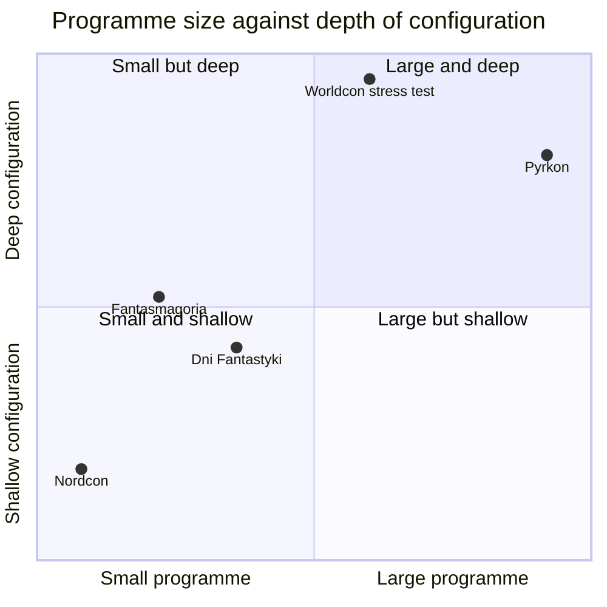
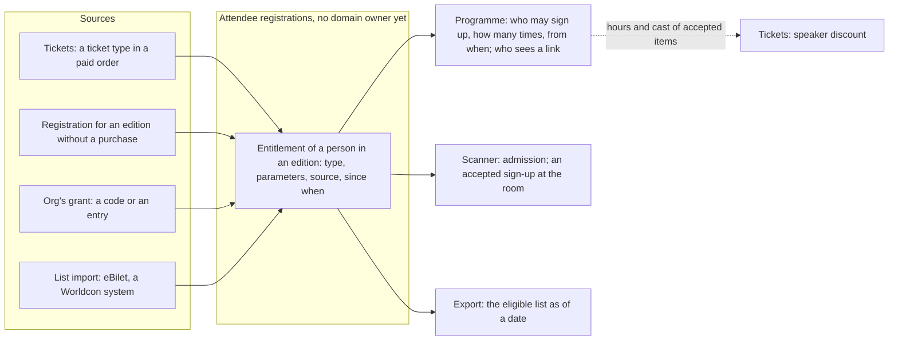
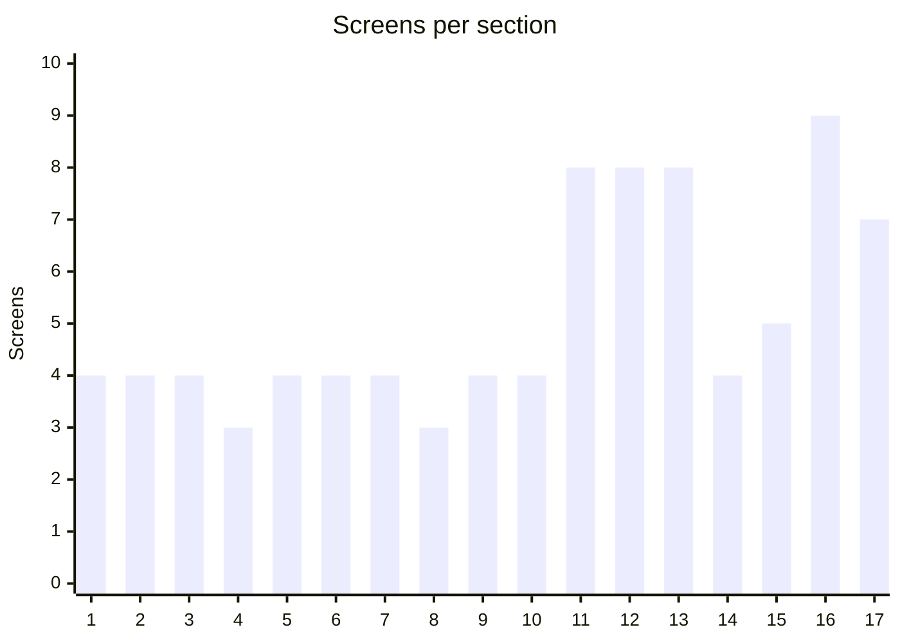
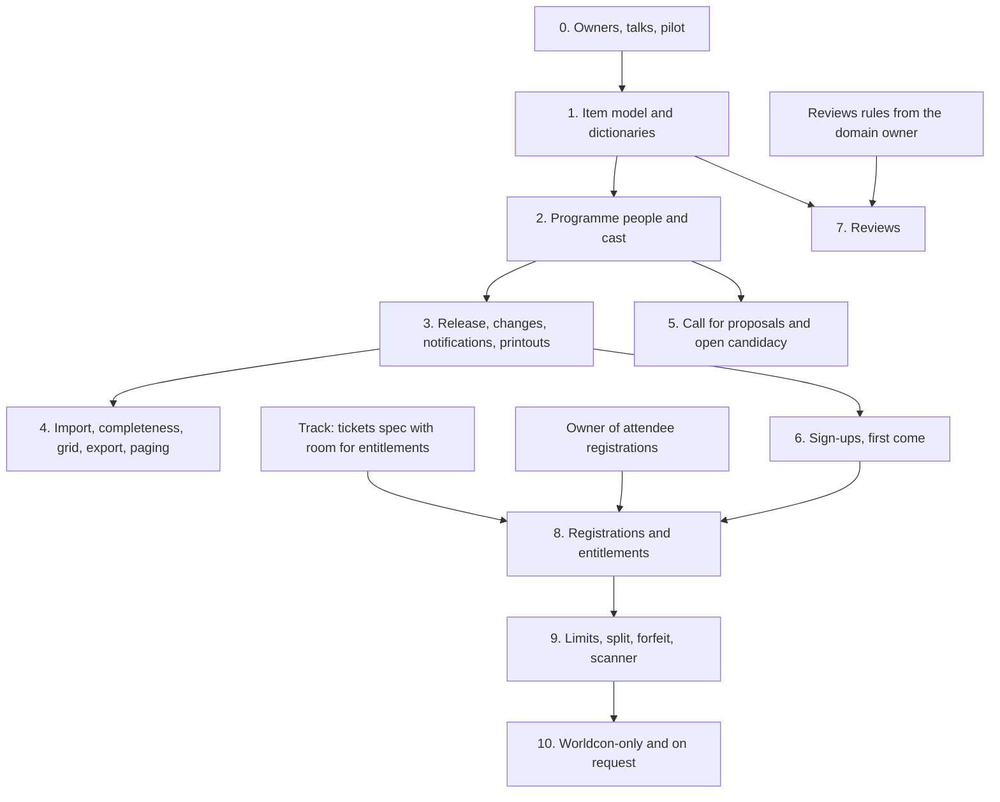

# Programme across convention scales

- Date: 2026-11-14
- Domain owner: the programme's domain owner (not yet named in
  [CONTRIBUTORS.md](../../CONTRIBUTORS.md))
- Source: desk research, two synthetic persona walkthroughs, an independent review; no organiser
  interviewed yet
- Status: non-binding ([briefs](README.md)); worked toward a spec
- Companions: [research](0004-programme-across-convention-scales/research.md) (facts and their
  sources), [personas](0004-programme-across-convention-scales/personas.md) (the two synthetic
  walkthroughs), [wireframes](0004-programme-across-convention-scales/wireframes/index.html) (87
  screens in 17 sections, and 16 role journeys drawn over them)

One programme module, configured per convention, serving four real talk-centric conventions:
Nordcon, Fantasmagoria, Dni Fantastyki (DF) and Pyrkon. Worldcon is a stress test of the model,
not a customer. The module's rules come from its domain owner
([PRODUCT.md 7](../PRODUCT.md#7-modules)); everything here is a proposal for that owner and the
team, and every recommendation is a default to accept or replace.

**Contents.** [1 Example](#1-a-concrete-example-dni-fantastyki-from-proposal-to-a-live-move) ·
[2 Goal](#2-goal-and-the-four-conventions) · [3 Glossary](#3-glossary-of-new-terms) ·
[4 Model](#4-the-model) · [5 Feature matrix](#5-the-feature-matrix) ·
[6 Screens](#6-screens-index) · [7 PRODUCT.md](#7-what-changes-against-docsproductmd) ·
[8 Work order](#8-work-order) · [9 Worldcon](#9-worldcon-what-it-breaks) ·
[10 Walkthrough](#10-persona-walkthrough-summary-and-link) ·
[11 Checks](#11-checks-with-real-people) · [12 Risks](#12-risks) ·
[13 Open questions](#13-open-questions)

## 1. A concrete example: Dni Fantastyki from proposal to a live move

DF's 2026 calendar carries the example: the call for proposals runs from 7 May to 30 June, decisions
go out by 15 July, the preliminary programme on 10 July asks for confirmation by 25 July, the
programme comes out on 6 August and the festival runs 21–23 August. Two items follow it: the
proposed talk "Destiny in fantasy sagas" and the team-made guest panel "AI in organising
conventions". Both are invented, as are **all people on the screens**; other item titles are
partly real (Nordcon 2024, Fantasmagoria 2025, Pyrkon 2025–2026) and partly invented. Where a
step's screen shows the same flow with another convention's data, the step is the same.

| #   | Step                         | What happens                                                                                                                                                                                                                                                                                                                                                       | Screen                                                                                                                                                                                                                                                                                                                                                                                                                                                                                                                                                                                                                |
| --- | ---------------------------- | ------------------------------------------------------------------------------------------------------------------------------------------------------------------------------------------------------------------------------------------------------------------------------------------------------------------------------------------------------------------ | --------------------------------------------------------------------------------------------------------------------------------------------------------------------------------------------------------------------------------------------------------------------------------------------------------------------------------------------------------------------------------------------------------------------------------------------------------------------------------------------------------------------------------------------------------------------------------------------------------------------- |
| 1   | Proposal                     | On 12 May an invented speaker proposes the talk "Destiny in fantasy sagas" in the Literature block: 50 minutes, 12+. The form shows only fields whose dictionaries DF has filled, so there is no content-warning field. The speaker follows its status, could edit it until the call closed, and can withdraw it until the decision.                               | [ab-dni-proposal](0004-programme-across-convention-scales/wireframes/03-portal-my-schedule-proposing-an-item-speaker-screen.html#ab-dni-proposal), [ab-dni-proposal-mine](0004-programme-across-convention-scales/wireframes/16-portal-sign-ups-lottery-declines-and-empty-states.html#ab-dni-proposal-mine)                                                                                                                                                                                                                                                                                                          |
| 2   | Proposal selection           | On 8 July a block coordinator sees the block's 27 proposals with scores the team alone sees, and accepts, puts on the reserve list or rejects each. Decisions leave together from an outbox after a preview of text and recipients.                                                                                                                                | [ab-dni-proposals](0004-programme-across-convention-scales/wireframes/07-panel-building-the-programme.html#ab-dni-proposals), [ab-dni-proposal-detail](0004-programme-across-convention-scales/wireframes/17-panel-item-list-proposals-announcements-and-re-import.html#ab-dni-proposal-detail), [ab-pyrkon-decisions](0004-programme-across-convention-scales/wireframes/13-panel-programme-team-people-panels-and-the-programme-release.html#ab-pyrkon-decisions)                                                                                                                                                   |
| 3   | A team-made panel            | The team builds the guest panel "AI in organising conventions" outside the call: a moderator from the programme team, a head of a small convention, a zone coordinator of a large convention and a volunteer who takes part remotely. One of five seats stays free for open candidacy, since DF turned speaker recruitment on for guest panels.                    | [ab-dni-panel-casting](0004-programme-across-convention-scales/wireframes/13-panel-programme-team-people-panels-and-the-programme-release.html#ab-dni-panel-casting), [ab-dni-candidacy](0004-programme-across-convention-scales/wireframes/16-portal-sign-ups-lottery-declines-and-empty-states.html#ab-dni-candidacy)                                                                                                                                                                                                                                                                                               |
| 4   | Grid conflict                | On 9 July the grid places the panel on Saturday at 14:00 in Sala Rycerska, second floor. A warning names the conflict: the moderator also co-hosts "Tolkien and mythology" at 14:00 in Sala Kominkowa. It warns and does not block.                                                                                                                                | [ab-dni-grid](0004-programme-across-convention-scales/wireframes/07-panel-building-the-programme.html#ab-dni-grid)                                                                                                                                                                                                                                                                                                                                                                                                                                                                                                    |
| 5   | Confirmation                 | Each cast member confirms each item, not a whole schedule, by 25 July. A speaker who presses "I can't" gives a reason and another time, and the team sees the entry as declined. On 3 August, before publication, the team takes the moderator off the Tolkien talk, so the conflict ends without a public change.                                                 | [ab-dni-confirm](0004-programme-across-convention-scales/wireframes/12-portal-the-speaker-from-acceptance-to-the-day-of-the-item.html#ab-dni-confirm), [ab-dni-decline](0004-programme-across-convention-scales/wireframes/16-portal-sign-ups-lottery-declines-and-empty-states.html#ab-dni-decline), [ab-dni-people-admin](0004-programme-across-convention-scales/wireframes/13-panel-programme-team-people-panels-and-the-programme-release.html#ab-dni-people-admin), [ab-dni-status](0004-programme-across-convention-scales/wireframes/15-panel-head-dictionaries-team-and-programme-status.html#ab-dni-status) |
| 6   | Publication                  | On 6 August the programme is published. DF makes no named release; a convention that does (Fantasmagoria) names the point, and door cards and the day poster carry its name. Pre-release warnings show and do not block.                                                                                                                                           | [ab-medium-release](0004-programme-across-convention-scales/wireframes/13-panel-programme-team-people-panels-and-the-programme-release.html#ab-medium-release), [ab-small-prints](0004-programme-across-convention-scales/wireframes/14-panel-the-programme-during-the-convention.html#ab-small-prints)                                                                                                                                                                                                                                                                                                               |
| 7   | Before the festival          | An attendee finds the panel: Sala Rycerska is up stairs only, entry is free and first come. The author meeting with the guest of honour in the same room has 296 likes for 80 seats, so it says it will likely be full. Their schedule warns about two liked items that overlap.                                                                                   | [ab-dni-item](0004-programme-across-convention-scales/wireframes/02-portal-programme-item-and-entry.html#ab-dni-item), [ab-dni-full-room](0004-programme-across-convention-scales/wireframes/16-portal-sign-ups-lottery-declines-and-empty-states.html#ab-dni-full-room), [ab-dni-plan](0004-programme-across-convention-scales/wireframes/11-portal-changes-now-and-next-rooms-reminders.html#ab-dni-plan)                                                                                                                                                                                                           |
| 8   | Live move                    | Saturday 11:24: the sound fails in Sala Rycerska. An org moves "Destiny in fantasy sagas" (12:00) to Namiot 3 in the moat, step-free and free at that hour. Before saving, the dialog names who will be told (128 likes and the cast), warns that the tent seats 60 against 128 likes, would warn if the room were taken, and offers a door card for the old room. | [ab-dni-move-live](0004-programme-across-convention-scales/wireframes/14-panel-the-programme-during-the-convention.html#ab-dni-move-live)                                                                                                                                                                                                                                                                                                                                                                                                                                                                             |
| 9   | The attendee sees the change | She gets an email naming the old and new room. The item carries "Moved 11:24, previously Sala Rycerska", the changes page lists it, and now and next and the room page show the new place.                                                                                                                                                                         | [ab-pyrkon-moved](0004-programme-across-convention-scales/wireframes/11-portal-changes-now-and-next-rooms-reminders.html#ab-pyrkon-moved), [ab-medium-changes](0004-programme-across-convention-scales/wireframes/11-portal-changes-now-and-next-rooms-reminders.html#ab-medium-changes), [ab-dni-now](0004-programme-across-convention-scales/wireframes/11-portal-changes-now-and-next-rooms-reminders.html#ab-dni-now), [ab-dni-room](0004-programme-across-convention-scales/wireframes/11-portal-changes-now-and-next-rooms-reminders.html#ab-dni-room)                                                          |

The example touches every part of the model in section 4 but seats: dictionaries, two switches,
the programme person and the cast, conflicts, confirmation, publication, notifications and a live
change.

## 2. Goal and the four conventions

**OPOS serves four kinds of talk-centric convention with one programme module configured per
convention.** What matters is function, not scale of traffic. The promise to the small end is
checkable: **a small convention does not have to set anything up and never sees fields without
data** ([4.7](#47-field-visibility)). Worldcon (4,000–10,000 members, a hybrid programme,
membership with voting rights) only tests the model.

The typical Polish fantasy convention is mostly talks, panel discussions and author meetings; an
RPG session is one item among many. Of DF 2026's 368 entries, 168 are talks and panel discussions
with 142 people, and 11 are RPG sessions. Three findings shape the module
([research 2](0004-programme-across-convention-scales/research.md#2-what-talk-centric-programmes-need)):

- **People are the axis.** Attendees look for a guest or a speaker, not a room; every attendee
  guide studied has a people list and profiles.
- **Conventions write fields into titles** ("[PRELEKCJA]", "(18+)", "[ENG]") because their tools
  lack them. Format, age, warnings and language become data, and import turns tags into fields.
- **The hardest process is a three-party agreement:** the team sets times, the speaker confirms
  each item, the attendee learns of every change. No tool studied marks a changed item itself.

### The four conventions

Source key: **NB** [Nordcon 2024 booklet](https://nordcon.gkf.org.pl/2024/informator); **FP**
[Fantasmagoria 2025 programme v8](https://fantasmagoria.gniezno.pl/media/docs/2025_07/Program_full_v8.pdf);
**DS** the DF 2026 programme sheet; **DW** the DF website; **PW** the Pyrkon website and rules;
**PE** Pyrkon's eBilet page; **PAP** press figures. Exact links are in
[research 8](0004-programme-across-convention-scales/research.md#8-sources). A cell marked
*(assumption)* has no source and waits for the organisers' answer
([11](#11-checks-with-real-people)).

|                        | Nordcon                                                                                                                                                 | Fantasmagoria                                                                     | Dni Fantastyki                                                                                      | Pyrkon                                                      |
| ---------------------- | ------------------------------------------------------------------------------------------------------------------------------------------------------- | --------------------------------------------------------------------------------- | --------------------------------------------------------------------------------------------------- | ----------------------------------------------------------- |
| Where and when         | Jastrzębia Góra, 3–8 December 2024; run by the Gdańsk fantasy club (NB)                                                                                 | Gniezno, two buildings, MOK and II LO (FP)                                        | Wrocław, the OPT Zamek castle, 21–23 August 2026 (DW)                                               | Poznań fairgrounds, three days and two nights (PW)          |
| People                 | no figure; the booklet printed 400 copies (NB)                                                                                                          | no figure                                                                         | about 10,000–16,000; sources conflict (DW)                                                          | 58,000 in 2024, over 66,000 in 2025; 280 guests (PAP)       |
| Programme size         | no count published                                                                                                                                      | no count published                                                                | 368 entries, 142 people (DS)                                                                        | 2,000–2,400 items (PW)                                      |
| Structure              | two talk rooms, Main Street for the main items, RPG and board-game rooms, buildings A and B; talk, games and films programmes with their own heads (NB) | about 27 rooms, zones and attractions; the room carries the block's identity (FP) | 21 spaces on five levels, seven blocks, a yearly theme line (DS, DW)                                | 20–24 zones, each with a zone coordinator (PW)              |
| Building the programme | the head of the talk programme assembles it (NB); types or imports it *(assumption)*                                                                    | call for proposals; import of the sheet behind the PDF *(assumption)*             | call for proposals 7 May–30 June (DW); who decides is not public; block coordinators *(assumption)* | call per zone behind an account, 17 December–10 April (PW)  |
| Entry to items         | free *(assumption)*                                                                                                                                     | free; sign-ups for workshops and RPG *(assumption)*                               | free, first come; 12 paid partner workshops by email or form (DS)                                   | tokens reserve half the seats, the rest from the queue (PE) |
| Tickets                | at the door or none *(assumption)*                                                                                                                      | sold in OPOS *(assumption)*                                                       | an external ticket service (DW)                                                                     | eBilet (PE)                                                 |
| Changes and print      | a 40-page A5 booklet; "part of the schedule may change"; a notice board (NB)                                                                            | the published PDF reached version 8 (FP)                                          | the sheet and the Konwencik app (DS)                                                                | its own app since June 2026 (PW)                            |

Neither Nordcon's nor Fantasmagoria's settings in OPOS were discussed with their organisers, and
neither publishes how it takes proposals. DF's selection process is not public either.

### Two axes instead of three sizes

"Small, medium, large" mixes two things. DF has a bigger programme than Fantasmagoria and a simpler
configuration. The model therefore has no modes; each convention sits somewhere on two axes:
**programme size** (items and people) and **depth of configuration** (switches turned on, rungs of
the seat ladder used, dictionaries filled).

Positions are rough. Fantasmagoria's size is an assumption, since it publishes no item count; its
depth and Nordcon's rest on assumed switches and settings ([4.1](#41-switches),
[4.12](#412-settings-coverage)). Nordcon turns no switch on, but fills three tracks and three
content warnings from its booklet, so it sits just above the floor.

## 3. Glossary of new terms

The terms of [PRODUCT.md 3](../PRODUCT.md#3-glossary) hold. These are the new ones this brief
uses, each with one English term and one Polish rendering.

| Term                       | Polish                      | Meaning                                                                                                                                                                                                                                                                                                                                                                                                                                      |
| -------------------------- | --------------------------- | -------------------------------------------------------------------------------------------------------------------------------------------------------------------------------------------------------------------------------------------------------------------------------------------------------------------------------------------------------------------------------------------------------------------------------------------- |
| **programme person**       | „osoba programu”            | an entry for a person or group on the convention's programme, kept at tenant level, optionally linked to an account ([4.5](#45-programme-person))                                                                                                                                                                                                                                                                                            |
| **cast**                   | „obsada”                    | the people on a programme item; a cast entry is person × item × role × state                                                                                                                                                                                                                                                                                                                                                                 |
| **programme release**      | „wydanie programu”          | a named point in the changelog, such as "Programme 1"; printouts and "changes since" count from it ([4.6](#46-programme-release))                                                                                                                                                                                                                                                                                                            |
| **changelog**              | „lista zmian”               | the record of every change to a published item, with its time                                                                                                                                                                                                                                                                                                                                                                                |
| **switch**                 | „przełącznik”               | an edition setting that turns on a feature creating an obligation to people; off by default                                                                                                                                                                                                                                                                                                                                                  |
| **programme dictionaries** | „słowniki programu”         | the edition's lists an org with programme write fills: rooms, blocks, formats, age scale, warnings, languages, accessibility features, entry labels                                                                                                                                                                                                                                                                                          |
| **block**                  | „blok”                      | a part of the programme with its own coordinator and call, such as DF's Literature. One entity; its displayed name (block, zone or track, „blok”, „strefa”, „ścieżka”) is an edition setting picked from that closed list. Whether a block only filters an org's view (the default) or also limits what the org may change is an edition setting ([Q11](#q11-is-a-block-a-filter-or-a-boundary)). "Zone" in this brief means Pyrkon's blocks |
| **coordinator**            | „koordynator”               | an org with programme write whose blocks are assigned; named after the block's displayed name: block, zone or track coordinator („koordynator bloku”, „koordynator strefy”, „koordynator ścieżki”). Not a role of its own ([4.11](#411-roles))                                                                                                                                                                                               |
| **theme line**             | „linia tematyczna”          | an edition's yearly theme an item may belong to, such as DF's "Szlakiem Przeznaczenia"                                                                                                                                                                                                                                                                                                                                                       |
| **proposal**               | „zgłoszenie”                | an item submitted through the call for proposals                                                                                                                                                                                                                                                                                                                                                                                             |
| **proposal selection**     | „ocena zgłoszeń”            | the team's assessment and decision on proposals, visible to the team only; never a review                                                                                                                                                                                                                                                                                                                                                    |
| **open candidacy**         | „kandydatura”               | a person volunteering for an item the team composes, under the speaker recruitment switch                                                                                                                                                                                                                                                                                                                                                    |
| **confirmation**           | „potwierdzenie”             | a cast member's answer for one item: confirmed or cannot                                                                                                                                                                                                                                                                                                                                                                                     |
| **sign-up**                | „zapis”                     | a binding seat on an item, accepted, waiting or not accepted                                                                                                                                                                                                                                                                                                                                                                                 |
| **token**                  | „token”                     | a unit of a per-person limit on accepted sign-ups, as at Pyrkon                                                                                                                                                                                                                                                                                                                                                                              |
| **entitlement**            | „prawo”                     | a typed fact "this person may do this in this edition", such as admission or programme sign-ups, derived from a ticket, a registration, a grant or an import. An attendee's, never an org's. The Polish rendering differs from „uprawnienie” on purpose                                                                                                                                                                                      |
| **permission**             | „uprawnienie”               | an org's access to a resource ([PRODUCT.md 5.1](../PRODUCT.md#51-permissions-and-roles)); unchanged                                                                                                                                                                                                                                                                                                                                          |
| **item code**              | „kod punktu”                | an optional human-readable code of an item, unique in its edition ([4.4](#44-item-identity-and-code))                                                                                                                                                                                                                                                                                                                                        |
| **entry label**            | „etykieta wejścia”          | a dictionary entry telling how to get in, with an optional link, such as "half the seats by tokens on eBilet"                                                                                                                                                                                                                                                                                                                                |
| **seat ladder**            | „drabina dostępu do miejsc” | the five rungs of limits on entry to an item ([4.2](#42-seat-ladder-and-allocation-method))                                                                                                                                                                                                                                                                                                                                                  |
| **allocation method**      | „sposób przydziału”         | first come, first served, or a lottery                                                                                                                                                                                                                                                                                                                                                                                                       |
| **gżdacz**                 | „gżdacz”                    | the Polish fandom word for a convention volunteer, used at Pyrkon; written "gżdacz (volunteer)" once per screen                                                                                                                                                                                                                                                                                                                              |

## 4. The model

**Much data, few switches.** Rooms, blocks, formats, tags, languages, accessibility features,
entry labels, mode and links are lists and values a convention fills in itself. While a list is
empty, its field, filter and warning do not exist. A switch exists only where turning it on
creates an obligation to people: a seat on an item, a decision on a proposal, a decision on a
person, a rating of an item.

Settings live on the edition, so a finished edition keeps the rules it ran under; only programme
people sit at convention level ([4.5](#45-programme-person)). There are no modes: the default is
already the small convention. From the second edition the preset is a copy of the previous one, as
in the shop brief's B1.3 ([0001](0001-convention-shop.md)): rooms, dictionaries, switches and
printout templates, never people, cast or team permissions. A first edition starts from a checklist.

**Rules nobody configures:** conflicts warn and never block; standard lengths only suggest;
hiding, cancelling and moving are always available; a stream is a link, never an embed
([0026](../adr/0026-run-a-tracker-only-with-consent-and-none-in-the-panel.md)); notifications
follow one table ([4.8](#48-notifications)); entitlement types are a closed platform list;
isolation, org permissions and the content language belong to the core. One edition setting
touches a permission: whether blocks are a filter or a boundary
([Q11](#q11-is-a-block-a-filter-or-a-boundary)). Merging people, sending in bulk, cancelling an
item and putting a reserve item into a slot ask first in a modal that names what goes
([0023](../adr/0023-ask-in-a-modal-before-an-action-that-cannot-be-undone.md)); so does any send
that cannot be called back. Turning a switch off asks nothing, since the same settings screen
turns it back on, and the screen names what it affects before saving *(assumption)*.

### 4.1 Switches

Four switches per edition, all off by default. This table is the single source of truth for which
convention turns which on; the matrix, the settings screens and the screens index follow it. Every
Nordcon, Fantasmagoria and DF value is an assumption about how it would use OPOS; Pyrkon's follow its published practice, except speaker recruitment.

| Convention      | Sign-ups                                        | Call for proposals  | Speaker recruitment (open candidacy) | Reviews                 |
| --------------- | ----------------------------------------------- | ------------------- | ------------------------------------ | ----------------------- |
| Nordcon         | off *(assumption)*                              | off *(assumption)*  | off *(assumption)*                   | off *(assumption)*      |
| Fantasmagoria   | on, set item by item on 23 items *(assumption)* | on *(assumption)*   | off *(assumption)*                   | on *(assumption)*       |
| Dni Fantastyki  | off *(assumption)*                              | on *(assumption)*   | on, guest panels *(assumption)*      | off *(assumption)*      |
| Pyrkon          | on, tokens (PE)                                 | on, per zone (PW)   | off *(assumption)*                   | off: collects none (PW) |
| Worldcon (test) | on, lottery                                     | on, selected tracks | on                                   | no data                 |

| Switch              | Turns on                                                                                                                                                              | Depends on                                                        | Off: the convention sees              | Turned off after use                                                                                                                                                      |
| ------------------- | --------------------------------------------------------------------------------------------------------------------------------------------------------------------- | ----------------------------------------------------------------- | ------------------------------------- | ------------------------------------------------------------------------------------------------------------------------------------------------------------------------- |
| Sign-ups            | the sign-ups mode on an item: binding capacity, signing up and off, a waiting list where the edition keeps one, the list for orgs                                     | accounts; capacity from the room or the item                      | capacity as information; no button    | new sign-ups close; accepted sign-ups and the waiting list are kept and honoured until each item; the settings screen names how many before saving, and nobody is emailed |
| Call for proposals  | the proposal form for accounts, a window, statuses, a reserve list where the edition keeps one (unranked or ranked), decisions from an outbox; an idea without a host | accounts; blocks optional                                         | orgs add items themselves, as today   | the window closes; submitted proposals keep their status and still get a decision                                                                                         |
| Speaker recruitment | open candidacy only: a person volunteers for an item the team composes, with a role and availability                                                                  | accounts; the cast                                                | the team casts people itself          | no new candidacies; existing ones stay with the team until it decides                                                                                                     |
| Reviews             | reviews under the domain owner's rules                                                                                                                                | programme items; a variant for attendees only would need sign-ups | no reviews in the portal or the panel | existing reviews are hidden and kept, and show again when it is turned back on; account deletion still takes them                                                         |

**Always available, shown once used:** the cast with roles, confirmation, availability and panel
composition by the team, which conventions use with speaker recruitment off. Settings show unused
features collapsed under "Not used", never as empty lists. A parameter changed after the first
sign-up applies to new sign-ups only. The switches sit in the Programme area's settings, which the
programme permission opens ([4.11](#411-roles)); who turns them on and off is
[Q10](#q10-who-turns-switches-on-and-off).

### 4.2 Seat ladder and allocation method

Instead of independent flags, two axes. The first is the **limit**: each rung contains the one
below. The second is the **allocation method**, available from rung 2.

| Rung                         | The attendee gets                                                                                                      | Pattern                     | Used by                                                                                                                                    |
| ---------------------------- | ---------------------------------------------------------------------------------------------------------------------- | --------------------------- | ------------------------------------------------------------------------------------------------------------------------------------------ |
| 0. No limits                 | walks in                                                                                                               | DF talks, Worldcon panels   | Nordcon; Fantasmagoria's talks; DF's park and free zone                                                                                    |
| 1. Label and link            | how to get in; capacity as information; "likely full" and "Room full"                                                  | Konwencik, Pyrkon's tiles   | DF's default (free, first come, capacity shown) and partner workshops *(assumption)*; Pyrkon's free items; Pyrkon if tokens stay on eBilet |
| 2. Sign-ups and waiting list | signs up with an account                                                                                               | Sched; Worldcon table talks | Fantasmagoria's 23 items with sign-ups *(assumption)*                                                                                      |
| 3. Limit per person          | a number of accepted sign-ups, an opening date, a priority                                                             | Pyrkon's tokens             | Pyrkon's items wholly by tokens                                                                                                            |
| 4. Split and forfeit         | part of the seats for sign-ups, the rest for the queue; a reservation lapses before the start; the scanner at the room | Pyrkon only                 | Pyrkon                                                                                                                                     |

| Method                   | The result falls            | Results                           |
| ------------------------ | --------------------------- | --------------------------------- |
| First come, first served | at the moment of signing up | accepted or waiting               |
| Lottery                  | after the window closes     | accepted, waiting or not accepted |

**Eight configurations to test:** rungs 0 and 1 have no allocation (2), and rungs 2, 3 and 4 each
take either method (3 × 2 = 6). The window is a date or a rule relative to the item's day ("the day
before, 8:00–19:00"). A lottery result is stored once and never changes, so the race for the first
second disappears.

**One override level.** The edition sets the default and the item may override it; there is no
rule per format. A convention that wants sign-ups on its workshops sets the sign-ups mode on those
items. "Masterclass" at Fantasmagoria is a room, not a format.

**The waiting list is a parameter of sign-ups:** on, with a deadline to take a freed seat
(Fantasmagoria, one hour), or off where a queue at the door takes free seats (Pyrkon's
reservations) *(assumption)*. A reservation released before the forfeit returns its token; a
forfeited one keeps the token spent *(assumption, to confirm with Pyrkon)*.

**A full room at free entry.** Most talk-centric items are rung 0. Before the convention an item
with more likes than seats says "likely full: 296 likes, 80 seats"; during it an org can set "Room
full" on the item and in now and next. The like count is never presented as sign-ups. Who presses
"Room full" at a door where volunteers hold no role is
[Q30](#q30-who-presses-room-full-at-the-door-when-volunteers-hold-no-role).

**Rung 2 needs no ticket:** any signed-in account may sign up. A condition on a ticket or its day
is an entitlement and waits for [step 8](#8-work-order).

### 4.3 Building spectrum

Rungs 2 and 3 are parallel channels: one edition can run a call in some blocks and recruitment in
others. At every rung, the cast confirms each item.

| Rung                   | Who brings the item                            | Who brings the person                               | Decision                                      | Pattern                                             |
| ---------------------- | ---------------------------------------------- | --------------------------------------------------- | --------------------------------------------- | --------------------------------------------------- |
| 0. The org types it    | org                                            | org, as a programme person                          | none                                          | Nordcon *(assumption)*; OPOS today                  |
| 1. Import from a sheet | org, in bulk, and again when the sheet changes | org                                                 | none                                          | Konwencik; Fantasmagoria *(assumption)*             |
| 2. Call for proposals  | the proposer                                   | the proposer and their invited co-hosts             | accepted, reserve, declined                   | DF, Pyrkon                                          |
| 3. Speaker recruitment | the team                                       | the person volunteers, the team invites with a role | about the person, then about the cast         | Worldcons 2022–2026; DF guest panels *(assumption)* |
| Every rung             | —                                              | —                                                   | each cast member confirms or cannot, per item | ZSFP guide, pretalx, Arisia                         |

### 4.4 Item identity and code

Changes, likes, calendars and exports all hang on the item staying the same item.

- **Every item has a stable id**, never reused. A change of title, cast, time or room keeps it, so
  likes stay and the change shows as a change of that item.
- **An item code is optional**: unique in the edition, set by the team or generated on first
  publication, never reused. Once published it does not change, even when the item moves to
  another block; a prefix such as "LIT" is frozen with it. It appears in exports, on printouts and
  door cards. The subscribed calendar uses the stable id. DF generates its codes at first
  publication; Pyrkon sets them with a zone prefix; Nordcon and Fantasmagoria use none
  *(assumption)*. An item published after the first publication takes the next number.
- **Re-import** matches sheet rows to existing items by code, else by title and start time, and
  shows new, changed and missing rows before anything is saved. A missing row is never deleted
  automatically. Likes stay on matched items
  ([ab-medium-reimport](0004-programme-across-convention-scales/wireframes/17-panel-item-list-proposals-announcements-and-re-import.html#ab-medium-reimport)).
  Rows that cannot be read (an unknown room, an unreadable time, a person without an email) are
  fixed or skipped one by one
  ([ab-medium-import-errors](0004-programme-across-convention-scales/wireframes/17-panel-item-list-proposals-announcements-and-re-import.html#ab-medium-import-errors)).
- **A reserve item put into a cancelled item's slot is a new item.** Likes of the cancelled item do
  not move to it; the people who liked the cancelled one get its cancellation, which may name what
  now runs in the slot.
- **Exports carry stable ids and changes since a release**, so a convention's own app (Konwencik,
  Pyrkon's app) can mark changed items too.

### 4.5 Programme person

| Part                     | Rule                                                                                                                                                                                                                                             |
| ------------------------ | ------------------------------------------------------------------------------------------------------------------------------------------------------------------------------------------------------------------------------------------------ |
| Programme person         | an entry at tenant level (the convention brand), optionally linked to one account: display name (a pseudonym is fine), bio, links, a contact address for the team; a photo once file uploads exist                                               |
| Group                    | a programme person whose members are accounts, such as a club; it names one contact member who confirms and receives mail                                                                                                                        |
| Cast entry               | person × item × role × state (invited, confirmed, declined), with participation on site or remote, and a recording consent and a photo consent, each given apart and never ticked in advance                                                     |
| Edition                  | shows the people cast in it; a person with no item in an edition does not appear in its portal                                                                                                                                                   |
| Entry without an account | the team creates it; it carries the person's display name on published items and nothing else in public until the person claims it with a link sent to their address (secret, single use, for that address)                                      |
| Merge                    | merging two entries asks first in a modal and can be undone within the edition; cast entries and confirmations move to the surviving entry, and the team picks each profile field                                                                |
| Who edits an entry       | an org with programme write in an edition where the person is cast; a merge or a profile change shows in every edition of the convention, and the merge modal says so ([Q29](#q29-which-permission-creates-edits-and-merges-a-programme-person)) |
| Bio                      | up to 100 words; no limit for a guest of honour                                                                                                                                                                                                  |
| New edition              | copies nothing about people: entries stay at tenant level, the new edition has no cast until items are cast, and nobody is emailed; a person hears of the new edition when cast                                                                  |
| Account deletion         | unlinks the entry and takes its profile; the item stays and shows "host removed at their request" *(for the legal check)*                                                                                                                        |

**Why tenant level.** Speakers stay in the tenant of their item
([ARCHITECTURE.md, Invariants](../ARCHITECTURE.md#invariants), 8). An entry per tenant keeps that,
and a returning speaker is the same person next year; per edition, a convention retypes its
regulars yearly; a profile shared across conventions, as in Sessionize, is a new read across
tenants ([Q5](#q5-where-does-a-programme-person-live)).

**This changes the glossary.** "Speaker: an account an org assigns to a programme item"
([PRODUCT.md 3](../PRODUCT.md#3-glossary)) becomes "a programme person cast on a programme item";
see [section 7](#7-what-changes-against-docsproductmd).

**Unconfirmed co-host.** A co-host invited by email shows on the item only after accepting; until
then the item publishes with the confirmed cast, and the invited person counts towards no speaker
discount. A proposer invites at most the call's limit, within the platform's limit on new
addresses ([Q24](#q24-an-invited-co-host-who-has-not-accepted)).

### 4.6 Programme release

A release ties together the published programme, its changes, printouts and confirmations. The two
models store different data (snapshots against a changelog on the live state), so the choice is
hard to reverse and gets a decision record.

| Question                                      | Variant A: the portal shows the last release                                                           | Variant B: the portal shows the current state (recommended)                                                |
| --------------------------------------------- | ------------------------------------------------------------------------------------------------------ | ---------------------------------------------------------------------------------------------------------- |
| What the portal shows                         | the last release; changes wait for the next one                                                        | every published item as it is now                                                                          |
| Which changes bypass a release                | an urgent change (cancel, move during the convention) takes its own path and creates a release at once | none wait: a change to a published item is visible at once and logged with its time                        |
| Does a live change make a release             | yes, a new numbered release                                                                            | no; it is a changelog entry after the last release                                                         |
| Print footer against live changes             | the footer names the release; the print matches the portal until the next release                      | the footer names the release; items changed since it carry a mark, so a printout reader finds what changed |
| Must a small convention make one at every fix | yes, or every fix waits                                                                                | no; it may never make one, or make one only to print or to tell speakers                                   |

**Variant B, in rules.** An item is a draft until published; drafts are never public, and adding
an item saves a draft. A change to a published item is public at once and logged. A release is a
named point in the changelog; the print footer and "changes since release N" come from it. A
change of time to an item asks its cast to confirm again; a change of room does not. Hiding a
published item that has likes or sign-ups counts as a cancellation for them
([4.8](#48-notifications)). A published item is never deleted: it is hidden or cancelled, and a
cancelled item stays in the programme with the time of the change and cannot be published again.
Only a draft is deleted. Before any item is published the portal says when the programme comes
out and already lists the guests
([ab-small-before-release](0004-programme-across-convention-scales/wireframes/16-portal-sign-ups-lottery-declines-and-empty-states.html#ab-small-before-release)).
The programme's first publication needs the edition to be published first, which Edition settings
does ([4.11](#411-roles)).

Practice differs: Nordcon makes one release for its booklet, Fantasmagoria numbers one per PDF,
DF makes none, and Pyrkon makes one each convention morning, by a clock at 07:00, for door cards
and its app's export *(assumption)*. A printout comes from the current state: its footer names the
last release, or the time it was made where there is none, and marks the items changed since.

Variant A suits a team that reshuffles many published items at once and wants them to appear
together; under B that team works in drafts before the first publication. [Q6](#q6-which-release-model)
holds the choice.

### 4.7 Field visibility

**The promise: a small convention does not have to set anything up and never sees fields without
data.** It is checkable: a new edition with empty dictionaries offers an item form with title,
description, day, start, end and cast, and nothing else; an item in the portal shows no empty
label; the settings screen shows unused features collapsed.

- A field, its filter and its warning show only once its dictionary has entries.
- A filter appears once the data has two values.
- A dependency hides; it never greys out.
- Visibility of personal data is not configurable per convention.

The recommended scope is the edition: once DF fills its content warnings, the field shows on every
DF item. The cost shows at Nordcon, whose RPG warning tags appear on talk forms
([ab-small-form](0004-programme-across-convention-scales/wireframes/06-panel-programme-dictionaries-and-the-item-form.html#ab-small-form)),
and at Pyrkon, where every zone coordinator would see every section any zone uses. A scope per format or per
block is [Q8](#q8-what-scope-does-field-visibility-have).

### 4.8 Notifications

One table holds who hears of what. Email is the channel; a subscribed calendar updates itself;
push is beyond the MVP ([PRODUCT.md 11](../PRODUCT.md#11-mvp-scope-vs-beyond-mvp)). Every email
names the item, the old and the new value and the time of the change. A like subscribes to its
item's changes ([Q18](#q18-does-a-like-subscribe-to-changes)).

| Event                                                                                     | Recipients                                                               | Channel                                                   | Can be turned off                                          |
| ----------------------------------------------------------------------------------------- | ------------------------------------------------------------------------ | --------------------------------------------------------- | ---------------------------------------------------------- |
| Cancellation, also hiding a published item that has likes or sign-ups                     | likes; sign-ups and the waiting list; cast                               | email; change mark; calendar entry updated                | likes: yes, per account and edition; sign-ups and cast: no |
| Time change                                                                               | likes; sign-ups; cast                                                    | email; mark; calendar; the cast is asked to confirm again | likes: yes; sign-ups and cast: no                          |
| Room change                                                                               | likes; sign-ups; cast                                                    | email; mark; calendar                                     | likes: yes; sign-ups and cast: no                          |
| Cast change (added, removed, replaced)                                                    | likes; sign-ups; the cast entries concerned                              | email; mark                                               | likes: yes; cast: no                                       |
| Accessibility change (a room with stairs, an interpreter or PJM removed or unconfirmed)   | likes; sign-ups; cast                                                    | email; mark                                               | likes: yes; sign-ups and cast: no                          |
| Title or description change                                                               | nobody                                                                   | mark only                                                 | —                                                          |
| Sign-up result (accepted, promoted from the waiting list with a deadline, lottery result) | the person signed up                                                     | email; my schedule                                        | no                                                         |
| Invitation, request to confirm, decision on a proposal or candidacy                       | the person concerned                                                     | email; speaker screen                                     | no                                                         |
| Announcement                                                                              | the audience the org picks: everyone, people who liked an item, the cast | portal; email except for "everyone"                       | likes: yes                                                 |
| Reminder before a liked item                                                              | the attendee who set it                                                  | email or a calendar alarm                                 | set by the attendee                                        |
| Reservation forfeited                                                                     | the person                                                               | my schedule only                                          | —                                                          |
| Readiness request on the day (Pyrkon)                                                     | the cast                                                                 | email; the speaker screen                                 | no                                                         |
| Room full                                                                                 | nobody                                                                   | the item and now and next                                 | —                                                          |
| Attendee report of a wrong time or room                                                   | the programme team                                                       | the dashboard                                             | —                                                          |
| Claim link                                                                                | the person                                                               | email                                                     | no                                                         |
| First publication of the programme                                                        | the accounts that asked to be told                                       | email                                                     | set by the attendee                                        |
| Programme release                                                                         | nobody by default                                                        | —                                                         | —                                                          |

Volunteers hold no role in OPOS, so they receive nothing personal: they read the changes page and
the announcements. The move dialog counts only people who will be told.

### 4.9 Entitlements and the module border

Pyrkon's ticket carries admission, tokens and dates in one object; Worldcon separates a named
membership from a transferable supplement. Either way the programme should ask not "which ticket"
but "what may you do": an **entitlement**, a typed fact from a closed platform list, derived from
one of four sources.

Tickets knows nothing about the programme. Entitlements live with attendee registrations, so the
programme works for a convention selling no tickets in OPOS; at the large end import is the main
road. A small convention's panel never shows the word.

| Type               | Parameters               | Checked by           | Needed by                                           |
| ------------------ | ------------------------ | -------------------- | --------------------------------------------------- |
| admission          | days                     | scanner              | the four conventions, through tickets               |
| programme sign-ups | count, opening, priority | programme            | Pyrkon; Fantasmagoria if its sign-ups need a ticket |
| online access      | —                        | programme, at links  | Worldcon only: a late step                          |
| membership         | number, one per person   | eligible-list export | Worldcon only: a late step                          |

**A speaker discount and a badge are not entitlements.** The programme hands tickets the hours of
accepted items and their split among co-hosts; tickets turns them into a discount and a code, and
the badge collection screen belongs to tickets. A cancelled item earns no discount. Programme
screens show only hours and cast, and say "set in Tickets"
([ab-pyrkon-perks](0004-programme-across-convention-scales/wireframes/12-portal-the-speaker-from-acceptance-to-the-day-of-the-item.html#ab-pyrkon-perks),
[ab-pyrkon-speaker-rule](0004-programme-across-convention-scales/wireframes/15-panel-head-dictionaries-team-and-programme-status.html#ab-pyrkon-speaker-rule)).

**Attendee registrations wait for their owner** ([CONTRIBUTORS.md](../../CONTRIBUTORS.md)), and
by this model the programme and the scanner depend on them. Sign-ups at rung 2 need no
entitlement; everything from rung 3 up waits for the registrations owner.

The shop brief ([0001](0001-convention-shop.md)) binds nothing, but the first tickets spec will fix
the shape of a ticket type, so these points are best agreed first:

| Shop brief                                                     | Pyrkon                                   | Worldcon                                         |
| -------------------------------------------------------------- | ---------------------------------------- | ------------------------------------------------ |
| a named ticket, transferred only by an org (BR-20, BR-22)      | bearer passes                            | fits membership; no one-per-person rule          |
| a buyer without an account sees a read-only order (F9.1)       | cannot reserve a seat                    | the member signs in for everything               |
| the shop needs Przelewy24 (B1.4)                               | sells on eBilet                          | another currency and provider                    |
| every ticket admits ([PRODUCT.md 3](../PRODUCT.md#3-glossary)) | fits                                     | membership and online access without admission   |
| a perk is text (BR-05)                                         | tokens are a number the programme checks | online access and voting are checked elsewhere   |
| no valid days, upgrade or transfer                             | day tickets                              | day tickets, upgrades, a transferable supplement |

### 4.10 Personal data

| Data                                                                                             | Who sees it                                                                                                                                                                                 | Basis *(for the legal check)*                                                                            | How long                                                              |
| ------------------------------------------------------------------------------------------------ | ------------------------------------------------------------------------------------------------------------------------------------------------------------------------------------------- | -------------------------------------------------------------------------------------------------------- | --------------------------------------------------------------------- |
| Display name, bio, links of a person cast on a published item; a photo once file uploads exist   | everyone                                                                                                                                                                                    | consent when proposing or claiming; without an account, only the display name, as in a printed programme | while the programme is public; removed on request or account deletion |
| Contact address of a programme person                                                            | orgs with programme access where the person is cast                                                                                                                                         | needed to run the item                                                                                   | 12 months after their last edition, unless linked to an account       |
| Entry without an account (what the team typed)                                                   | the team only, until claimed                                                                                                                                                                | legitimate interest in running the item                                                                  | as above; deletable on request without an account                     |
| Co-panelists' email addresses                                                                    | hidden from the cast until the domain owner decides (issues 44–46); speakers write through the team                                                                                         | —                                                                                                        | —                                                                     |
| Phone numbers                                                                                    | not collected for people; a service point's desk line is the convention's, not a person's                                                                                                   | —                                                                                                        | —                                                                     |
| Speaker availability, maximum items per day                                                      | the team only                                                                                                                                                                               | needed to schedule                                                                                       | until the edition ends                                                |
| "Not with" preferences                                                                           | the team: a private flag "Check the panel with me before casting"; the team sees that the person asked to be consulted and a Message action, never a name, a list or free text about anyone | the person's request                                                                                     | until the edition ends                                                |
| A speaker's accessibility needs                                                                  | not collected; the proposal lists item needs (a microphone, a step-free room)                                                                                                               | special-category data: the owner and the legal check                                                     | —                                                                     |
| Recording and photo consent                                                                      | the team, on each cast entry                                                                                                                                                                | consent, withdrawable for future recordings                                                              | with the cast entry                                                   |
| Who signed up for an item                                                                        | orgs with programme access; never public or at the door                                                                                                                                     | needed to run the item                                                                                   | until the edition ends, then counts only                              |
| Likes                                                                                            | the count is public, who liked is not ([PRODUCT.md 7](../PRODUCT.md#7-modules)); a shared schedule link carries a revocable secret                                                          | the user's action                                                                                        | until taken back or the account goes                                  |
| Proposals and assessments                                                                        | the proposer sees their own and its decision; assessments are team only                                                                                                                     | the submission                                                                                           | declined ones deleted when the edition ends                           |
| Team-only data: assessments, availability, the "check with me" flag, decline reasons, team notes | orgs with programme write; whether programme read sees it is [Q31](#q31-who-assesses-and-who-decides-on-a-proposal-and-what-does-a-team-member-in-its-cast-see)                             | needed to run the item                                                                                   | until the edition ends                                                |
| Legal name for a badge check                                                                     | tickets, not the programme                                                                                                                                                                  | tickets' rules                                                                                           | tickets' rules                                                        |

### 4.11 Roles

Fourteen roles meet the programme, and a fifteenth, the org with settings write, opens an edition
to the others. None is new in the permission model: a panel role is a permission of
[PRODUCT.md 5.1](../PRODUCT.md#51-permissions-and-roles) (none, read or write, per edition for the
programme and tickets, per convention for settings) or the head; speakers, attendees and volunteers
hold no permission. A **programme lead** is an org with programme write in the edition, not a role.
A **coordinator** is the same permission with blocks assigned: a filter by default, a boundary
where the edition says so ([Q11](#q11-is-a-block-a-filter-or-a-boundary)). In the tables, N, F, D
and P are Nordcon, Fantasmagoria, Dni Fantastyki and Pyrkon.

**Where the settings live.** The programme's settings, switches, dictionaries, rooms and
publication sit in the edition's **Programme area**, which the programme permission opens: read
shows them, write changes them. **Edition settings** and **Access** stay with the convention's
settings permission, as in the panel today, and show in the menu only for the head and an org with
settings read or write. An org with programme read or write therefore sees "Dashboard · Programme"
and the Programme tabs its convention uses (Items, Grid, Proposals, People, Conflicts, Changes,
Messages, Settings, Dictionaries, Rooms, Publication), never Access or Edition settings. Publishing
the edition (settings) comes before the programme's first publication (programme).

Attendees and speakers, in the portal:

| Role                                | Granted by                                                                              | Can                                                                                                                                                                                                                                                                                                                     | Cannot                                                                                                 |
| ----------------------------------- | --------------------------------------------------------------------------------------- | ----------------------------------------------------------------------------------------------------------------------------------------------------------------------------------------------------------------------------------------------------------------------------------------------------------------------- | ------------------------------------------------------------------------------------------------------ |
| Anonymous visitor                   | nothing                                                                                 | read the programme, people, rooms, now and next, changes and announcements; learn when the programme comes out                                                                                                                                                                                                          | like, sign up, reserve, propose, volunteer or review: each asks to sign in; see who liked or signed up |
| Signed-in user                      | an OPOS account                                                                         | like, keep, share and subscribe a schedule; set reminders and the emails about liked items; where sign-ups need no ticket (Fantasmagoria), sign up, wait, take a freed seat within the hour and cancel until the start; review where reviews are on; report a wrong time or room where attendee reports are on (Pyrkon) | reserve with tokens; sign up a child or anyone else; turn off emails about their own sign-ups          |
| Attendee with a ticket              | an account with a ticket for the edition; at Pyrkon the ticket's tokens, set in Tickets | at Pyrkon reserve with a token until the day before at 23:59, release a reservation before the forfeit, enter a lottery, show the reservation code at the room                                                                                                                                                          | change the token count; pass a reservation on; get the token back after a forfeit                      |
| Proposer and candidate              | an account, with the call for proposals (F, D, P) or speaker recruitment (D) on         | propose while the call is open and invite co-hosts up to the call's limit; edit until the call closes; withdraw until the decision; volunteer for a guest panel (D)                                                                                                                                                     | see the team's scores; put themselves in a cast                                                        |
| Speaker with an account             | a cast entry linked to the account                                                      | accept or decline an invitation; confirm each item and a new time; give availability; set the flag "Check the panel with me before casting"; edit the profile; write to the cast through the team; read the reviews of their own items (F); confirm readiness on the day (P)                                            | edit or cancel the item; see co-panelists' addresses or any phone number; change the discount          |
| Programme person without an account | an entry the team typed or imported                                                     | appear on published items by display name; claim the entry with a link sent to its address, or refuse it                                                                                                                                                                                                                | anything else until claimed; get a link where the team sends none (N) or has no address (an F import)  |

At the convention, with no permission:

| Role                              | Granted by                                                                   | Can                                                                                                                                                                | Cannot                                    |
| --------------------------------- | ---------------------------------------------------------------------------- | ------------------------------------------------------------------------------------------------------------------------------------------------------------------ | ----------------------------------------- |
| Door volunteer (gżdacz at Pyrkon) | nothing in OPOS; at Pyrkon a scanner in room mode, with no account signed in | at Pyrkon check reservations and let people in from the queue while seats are left; elsewhere read what the attendee's phone shows; read changes and announcements | see a name; set Room full; open the panel |
| Info-desk volunteer               | nothing; the attendee's view                                                 | answer from now and next, rooms, people and changes; pass on an attendee's report (P)                                                                              | post an announcement; see sign-ups        |

The team, in the panel:

| Role                               | Granted by                                     | Can                                                                                                                                                                                                                                                                                                                        | Cannot                                                                                                                                                                    |
| ---------------------------------- | ---------------------------------------------- | -------------------------------------------------------------------------------------------------------------------------------------------------------------------------------------------------------------------------------------------------------------------------------------------------------------------------- | ------------------------------------------------------------------------------------------------------------------------------------------------------------------------- |
| Org with programme read            | programme read in the edition                  | read items with their team notes, proposals and their states, conflicts, today's dashboard, sign-up lists and the programme settings ([ab-role-settings-readonly](0004-programme-across-convention-scales/wireframes/j09-org-with-programme-read-seeing-without-acting.html#ab-role-settings-readonly)); export CSV        | change, publish, message or announce; open Access or Edition settings                                                                                                     |
| Programme lead                     | programme write in the edition                 | set up the edition's programme (settings, switches, dictionaries, rooms); import; build the grid; decide on proposals and send decisions; compose panels; merge people; publish, name releases and print; change live, cancel, fill a slot from the reserve list, set Room full; announce; message speakers; hide a review | invite orgs or assign blocks (settings write or the head); set tokens, the discount or scanners (Tickets); delete a published item or change its code; see who liked      |
| Coordinator (block, zone or track) | programme write with blocks assigned in Access | what the lead does, with their blocks preselected; where blocks are boundaries (Pyrkon), only on the items, cast and proposals of their blocks                                                                                                                                                                             | assess or decide a proposal they are cast on; where blocks are boundaries, change another block's item, move an item out of their blocks, or change anything edition-wide |
| Org with settings write            | settings write on the convention               | open Edition settings and Access: publish the edition, invite orgs, set an org's blocks ([j14-p-access-org](0004-programme-across-convention-scales/wireframes/j14-head-the-convention-s-owner.html#j14-p-access-org))                                                                                                     | grant anyone more than it holds, or a block it does not hold ([5.2](../PRODUCT.md#52-anti-escalation-policy))                                                             |
| Head                               | head membership                                | everything an org can; create the next edition from the last; invite and set access                                                                                                                                                                                                                                        | edit their own membership; delete the convention; set what Tickets sets                                                                                                   |
| Tickets org                        | tickets read or write in the edition           | the ticket rule for sign-ups, entitlements, the speaker discount rule, scanners in room mode                                                                                                                                                                                                                               | open the programme without the programme permission; change programme hours or cast                                                                                       |

The platform:

| Role           | Granted by                 | Can                                                                                         | Cannot                                                       |
| -------------- | -------------------------- | ------------------------------------------------------------------------------------------- | ------------------------------------------------------------ |
| Platform admin | the platform admin account | see a convention's data, status and heads; suspend and restore it; delete it once suspended | see or change any programme item, person, sign-up or setting |

The admin screens follow [PRODUCT.md 6](../PRODUCT.md#6-addresses-and-domains) for addresses: only
the admin sets one, and a deleted convention's address is never given to another *(assumption)*.

**Blocks as a boundary.** By default a block only filters a coordinator's view: their blocks are
preselected, and a change to another block's item is allowed and logged (Nordcon's tracks, DF's
blocks). An edition may make its blocks boundaries of write permission, as Pyrkon's zones are drawn
*(assumption; the rule is [Q11](#q11-is-a-block-a-filter-or-a-boundary))*:

- The boundary limits writing only: the items, cast and proposals of the org's zones. Reading,
  conflicts and today's dashboard cover the whole edition.
- Anything edition-wide needs all zones: switches, dictionaries, rooms, import, publication, the
  day release, an announcement to everyone. An org with some zones sees it read only or is refused
  ([ab-role-zone-refusal](0004-programme-across-convention-scales/wireframes/j13-block-zone-and-track-coordinator-my-part-of-the-programme.html#ab-role-zone-refusal)).
- In a conflict row of a zone the org does not hold, the action is replaced by "read only" and
  the zone's name. A conflict between two zones is kept as it is only by an org holding both zones
  or all *(assumption)*.
- Only an org holding all zones moves an item between zones or changes a zone nobody holds.
- Only the head or an org with settings write sets an org's zones, in Access; programme write never
  does, so a zone-limited org cannot lift its own boundary, and nobody grants a zone they do not
  hold.

**Defaults the wireframes follow.** Approved for drawing, each still a proposal for the domain
owner:

- A published item is hidden or cancelled, never deleted; only a draft is deleted
  ([4.6](#46-programme-release)).
- A reservation released before the forfeit returns its token; a forfeited one keeps it spent
  *(assumption, to confirm with Pyrkon)*.
- A proposal can be edited until the call closes and withdrawn until its decision.
- Programme read may export CSV: items and cast, without contact addresses, sign-ups or likes
  ([Q32](#q32-what-does-an-export-hold-and-may-programme-read-take-it)).
- A new edition copies no people: programme people stay at convention level, nobody is cast in the
  new edition yet, and nobody is emailed ([4.5](#45-programme-person)).
- The "not with" wish is only the private flag "Check the panel with me before casting": the team
  sees "asked to be consulted before the panel is cast" and a Message action, never a name list
  ([4.10](#410-personal-data)).
- No photo, and no place for one, until file uploads exist.
- Turning a feature off asks no modal, since the same settings screen turns it back on
  ([0023](../adr/0023-ask-in-a-modal-before-an-action-that-cannot-be-undone.md)) *(assumption)*.
- Pyrkon's day release is made by a clock at 07:00 each convention morning *(assumption)*.
- Each convention has one invented team, so the same programme lead and head appear in every
  journey of that convention *(assumption)*.

The role journeys draw these roles screen by screen ([6](#role-journeys)). A journey adds no rule:
where it and this brief disagree, the brief holds.

### 4.12 Settings coverage

Every dimension the model makes configurable, set for each convention so that no two share a
configuration. Every Nordcon and Fantasmagoria value is an assumption, as in [4.1](#41-switches);
in the other columns *(a)* marks an assumption, and many were made for the role journeys to tell
the conventions apart ([11](#11-checks-with-real-people)). A dash means unused.

A **practice** is how a convention uses the tool (when it names a release, how its door checks
entry, how it confirms); it has no field in the settings. An **event** happens once, when an
edition starts or is copied.

| Dimension                         | Kind                                                    | Nordcon *(a)*                                     | Fantasmagoria *(a)*                                      | Dni Fantastyki                                                         | Pyrkon                                                                           | Worldcon (test)              |
| --------------------------------- | ------------------------------------------------------- | ------------------------------------------------- | -------------------------------------------------------- | ---------------------------------------------------------------------- | -------------------------------------------------------------------------------- | ---------------------------- |
| Sign-ups                          | switch                                                  | off                                               | on                                                       | off *(a)*                                                              | on                                                                               | on                           |
| Call for proposals                | switch                                                  | off                                               | on                                                       | on *(a)*                                                               | on                                                                               | on                           |
| Speaker recruitment               | switch                                                  | off                                               | off                                                      | on, guest panels only *(a)*                                            | off *(a)*                                                                        | on                           |
| Reviews                           | switch                                                  | off                                               | on                                                       | off *(a)*                                                              | off: collects none                                                               | no data                      |
| Seat ladder: default, then others | parameter, item override                                | rung 0 only                                       | 0; rung 2 on 23 items                                    | 1, free, first come, capacity shown *(a)*; 0 in the park and free zone | 4; 3 wholly by tokens; 1 free entry with the queue                               | 0; 2 for table talks         |
| Allocation method                 | parameter, from rung 2                                  | —                                                 | first come                                               | —                                                                      | first come; a lottery on chosen guest meetings *(a)*                             | lottery                      |
| Who may sign up                   | rule                                                    | —                                                 | any signed-in account                                    | —                                                                      | token holders                                                                    | members first                |
| Limit per person                  | from an entitlement                                     | —                                                 | none                                                     | —                                                                      | 6, 4 or 2 tokens by ticket                                                       | one per hour *(a)*           |
| Sign-up window                    | parameter                                               | —                                                 | publication to the item's start                          | —                                                                      | the ticket's opening date to the day before, 23:59                               | the day before, 8:00–19:00   |
| Reserved share, forfeit           | parameter                                               | —                                                 | 100%, none                                               | —                                                                      | 50%; 10 minutes before, 20 at Sala Ziemi                                         | 100%, none                   |
| Waiting list                      | parameter                                               | —                                                 | on, one hour to take a freed seat                        | —                                                                      | off for reservations, the door queue takes free seats; on after a lottery *(a)*  | on after the lottery         |
| Attendee cancels until            | parameter                                               | —                                                 | the start                                                | —                                                                      | the forfeit; the token returns                                                   | —                            |
| Door control                      | practice                                                | none                                              | the attendee's phone                                     | Room full set by an org *(a)*                                          | scanner in room mode *(a)*                                                       | phone *(a)*                  |
| Building channels                 | practice                                                | the team types                                    | import, call                                             | the team and partners type; call; recruitment                          | the Science Zone commissions; call                                               | call, recruitment            |
| Call scope                        | parameter                                               | —                                                 | one call, no blocks                                      | one call, the proposer picks a block                                   | a call per zone; the Science Zone's closed                                       | selected tracks              |
| Call window                       | data                                                    | —                                                 | 1 March–31 May; decisions by 20 June                     | 7 May–30 June; decisions by 15 July                                    | 17 December–10 April; decisions by 7 May                                         | *(a)*                        |
| Co-hosts a proposer invites       | parameter                                               | —                                                 | 4                                                        | 2                                                                      | 3, a cast of 4                                                                   | —                            |
| Idea without a host               | parameter                                               | —                                                 | not allowed                                              | not allowed *(a)*                                                      | allowed                                                                          | —                            |
| Proposal selection                | parameter                                               | —                                                 | the team decides, no scores                              | three assessors score, the block coordinator decides *(a)*             | the zone decides, no scores *(a)*                                                | track leads *(a)*            |
| Reserve list                      | parameter                                               | —                                                 | not used                                                 | unranked *(a)*                                                         | ranked                                                                           | —                            |
| Confirmation                      | practice, deadline                                      | not used: email outside OPOS                      | per item, no deadline                                    | per item by 25 July, changeable until publication                      | per item at invitation; readiness 60 minutes before *(a)*                        | draft schedules              |
| Cast limit per item               | parameter                                               | the platform's 10                                 | 6                                                        | the platform's 10; guest panels set 5 seats                            | 4, 2 suggested                                                                   | —                            |
| Item code                         | parameter                                               | none                                              | none                                                     | generated at first publication *(a)*                                   | set by the team, zone prefix *(a)*                                               | pocket programme codes *(a)* |
| Blocks and their name             | data, setting                                           | 3 tracks: Talks, Games, Films                     | none: rooms carry the identity                           | 7 blocks; 125 items outside blocks                                     | 22 zones                                                                         | tracks                       |
| Block scope                       | setting ([Q11](#q11-is-a-block-a-filter-or-a-boundary)) | filter                                            | —                                                        | filter                                                                 | boundary *(a)*                                                                   | filter                       |
| Theme line                        | data                                                    | —                                                 | —                                                        | "Szlakiem Przeznaczenia"                                               | —                                                                                | —                            |
| Formats                           | data                                                    | none: in the title                                | 12                                                       | 15, from its 13 title tags                                             | 14 *(a)*                                                                         | 3 or more                    |
| Age ratings                       | data                                                    | none                                              | 16+, 18+                                                 | B.O., 7+, 12+, 13+, 15+, 16+, 18+, no rating                           | no rating, 18+                                                                   | —                            |
| Content warnings                  | data                                                    | 3: violence, horror, spiders, from the RPG tags   | none                                                     | none                                                                   | none                                                                             | content notes                |
| Item languages                    | platform list                                           | Polish                                            | Polish                                                   | PL, EN, language-independent; interpreted items                        | PL, EN, language-independent                                                     | English and more             |
| Accessibility                     | platform list                                           | none                                              | step-free status of rooms                                | room access, a quiet tent                                              | PJM, audio description, low stimulation                                          | live captions *(a)*          |
| Entry labels                      | data                                                    | none                                              | none                                                     | 2: free, first come; a paid partner workshop with a link *(a)*         | 5                                                                                | —                            |
| Lengths                           | data                                                    | 50 minutes on the hour                            | 50 minutes on the hour or half hour                      | 50 within 60, 110 within 120                                           | 45 + 5 + 10                                                                      | 60 within 90 *(a)*           |
| Mode                              | data                                                    | on site                                           | on site                                                  | a remote cast member                                                   | hybrid, recorded, streamed                                                       | online only too (step 10)    |
| Release                           | practice                                                | one, for the booklet                              | numbered 1–8, with the PDF                               | none                                                                   | one each morning at 07:00, by a clock *(a)*                                      | a freeze for print *(a)*     |
| Export                            | data                                                    | booklet data for typesetting                      | PDF sheet, CSV, .ics                                     | Konwencik                                                              | CSV with stable ids and changes since the day release, for its app               | ConClár                      |
| Attendee reports                  | parameter                                               | off                                               | off                                                      | off *(a)*                                                              | on *(a)*                                                                         | —                            |
| How the edition starts            | event                                                   | a copy of Nordcon 2025                            | a sheet import, as a first edition                       | an empty checklist, as a first edition                                 | the checklist, 64 rooms from a sheet *(a)*                                       | a new tenant each year       |
| What the next edition copies      | event                                                   | rooms, dictionaries, switches, printout templates | rooms, dictionaries, switches; items come by sheet again | all but the theme line, which is yearly *(a)*                          | rooms, zones, dictionaries, entry labels, switches with call dates cleared *(a)* | —                            |

**No two conventions share a configuration.** The switches alone differ (sign-ups, call,
recruitment, reviews): Nordcon off, off, off, off; Fantasmagoria on, on, off, on; DF off, on, on,
off; Pyrkon on, on, off, off. Of the dimensions with three or more options, five share a value
between two conventions, each for a reason in the sources: the default rung (Nordcon and
Fantasmagoria run free-entry talks, though Fantasmagoria adds rung 2), the item code (neither uses
codes), the block scope (Nordcon and DF keep the filter), the item languages and the mode (both
local, Polish-only and on site). Every option of a dimension is used by at least one of the four,
except what only Worldcon needs (step 10).

**Not configurable per convention**, so nobody looks for them: the notification table
([4.8](#48-notifications)), the scope of field visibility
([Q8](#q8-what-scope-does-field-visibility-have)), who turns switches ([Q10](#q10-who-turns-switches-on-and-off)), the move-up rule of a waiting list
([Q14](#q14-how-does-the-waiting-list-move-up)), personal data visibility
([4.10](#410-personal-data)), conflicts warning without blocking, Room full and "likely full", the
cast with roles, confirmation and availability, and the entitlement types.

The matrix holds sixteen parameters and settings, more than "much data, few switches" wants, and
22 of its values were assumed for the role journeys. A new parameter
(waiting list, reserve list, cast limit, item code, block scope, attendee reports) stays out of
the model until an organiser confirms the value that differs ([12](#12-risks)).

## 5. The feature matrix

Each row is a feature, its kind (data, switch, parameter or fixed rule) and how each convention
would set it. In the four convention columns a cell marked *(a)* is an assumption; an unmarked cell
comes from the sources in [research](0004-programme-across-convention-scales/research.md#1-what-the-four-conventions-programmes-look-like).
The Worldcon column is the stress test
([research 5](0004-programme-across-convention-scales/research.md#5-what-worldcon-stresses)). A
dash means unused. [4.12](#412-settings-coverage) holds the same settings dimension by dimension.

| Feature                             | Kind and options                                                                                             | Nordcon                                                                            | Fantasmagoria                                                                                | Dni Fantastyki                                                                          | Pyrkon                                                                 | Worldcon (test)                           |
| ----------------------------------- | ------------------------------------------------------------------------------------------------------------ | ---------------------------------------------------------------------------------- | -------------------------------------------------------------------------------------------- | --------------------------------------------------------------------------------------- | ---------------------------------------------------------------------- | ----------------------------------------- |
| Rooms                               | data: building, floor, capacity, step-free access, second location                                           | K8, K6, Main Street, RPG and board-game rooms; buildings A and B                   | about 27 rooms, zones and attractions in MOK and II LO                                       | 21 spaces on five levels; floors 1–3 without a lift; free outdoor zone                  | rooms by pavilion; rooms shared between zones *(a)*                    | rooms, also online                        |
| Blocks                              | data: rooms, call open or closed, displayed name                                                             | three tracks: talks, games and films, from the booklet's separate programmes *(a)* | none: the room carries the block                                                             | seven blocks and the free zone                                                          | 20–24 zones; the science zone's call closed                            | tracks                                    |
| Theme line                          | data of the edition; an item may have none                                                                   | —                                                                                  | —                                                                                            | "Szlakiem Przeznaczenia"                                                                | —                                                                      | —                                         |
| Format                              | data apart from the title                                                                                    | "(warsztaty)" in the title                                                         | in the title: "- panel dyskusyjny", "(konkurs)", "(warsztaty)"                               | a tag at the start of every title                                                       | types in the app *(a)*                                                 | panel, table talk, workshop               |
| Age rating                          | data: the edition's scale with "no rating"                                                                   | —                                                                                  | 16+ and 18+ in the title, after 22:00                                                        | B.O. (94), 7+, 12+, 13+, 15+, 16+, 18+, and no rating (151); B.O. is a label of its own | none; adult content declared in the description                        | —                                         |
| Content warnings                    | data: a list independent of age                                                                              | "Warning tags" on RPG sessions; three as a dictionary *(a)*                        | —                                                                                            | —                                                                                       | none in the data                                                       | content notes                             |
| Item language                       | platform list; shown from two languages; "language-independent"                                              | Polish                                                                             | Polish                                                                                       | Polish; guest items in English with an interpreter *(a)*                                | PL, EN, language-independent                                           | English and more                          |
| Accessibility features              | platform list, on the room and the item                                                                      | —                                                                                  | step-free status of rooms *(a)*                                                              | a quiet tent; two accessibility coordinators                                            | PJM, low stimulation                                                   | live captions *(a)*                       |
| Entry labels with a link            | data: the edition's list, picked on the item                                                                 | —                                                                                  | —                                                                                            | 2 *(a)*: free, first come; 12 paid partner workshops, sign-up by email or form          | half the seats by tokens on eBilet, the rest from the queue            | —                                         |
| Item and slot length                | data: two values and "all day"; a suggestion only                                                            | talks on the hour; RPG sessions 2–6 hours                                          | mostly on the hour, some at half past (9:30, 20:30, 21:30, 22:30); no end time in the record | 50 within 60, 110 within 120                                                            | 45 + 5 + 10 minutes; 20-minute units for children                      | 60 within 90 *(a)*                        |
| Continuous and after-midnight items | fixed rule: an item belongs to the day it starts; a continuous item shows as "on all day", never as starting | RPG sessions 20:00–02:00                                                           | "Atrakcje Non-Stop"                                                                          | about 70 all-day entries                                                                | 54 hours non-stop                                                      | —                                         |
| Mode and links                      | data: on site, hybrid, online; links timed before, during, after                                             | —                                                                                  | —                                                                                            | —                                                                                       | PJM recordings published after the item                                | three modes; links for online access      |
| Item state and marks                | fixed rule ([4.6](#46-programme-release))                                                                    | yes                                                                                | yes                                                                                          | yes                                                                                     | yes                                                                    | plus a working draft per item (late step) |
| Item identity and code              | fixed rule ([4.4](#44-item-identity-and-code))                                                               | — *(a)*                                                                            | — *(a)*                                                                                      | generated at first publication *(a)*; an "LP" number in the call table                  | codes per zone *(a)*                                                   | codes in the pocket programme *(a)*       |
| Cast with role                      | data: host, co-host, moderator, panelist, guest, interpreter; remote; a group                                | host; two co-hosts                                                                 | hosts as pseudonyms, groups, brands, titles                                                  | moderator and panelists; items credited to groups                                       | host and up to 4 co-hosts                                              | moderator, panelists, remote              |
| Guest of honour, featured           | data on the person and the item                                                                              | a guest list with bios of eight people                                             | —                                                                                            | four headline guests, each tied to a block                                              | 280 guests                                                             | guests of honour                          |
| Programme people and profiles       | fixed ([4.5](#45-programme-person))                                                                          | the booklet's guest list                                                           | hosts by display name                                                                        | a guest list *(a)*                                                                      | guests linked to items in the app                                      | People                                    |
| Person without an account           | a programme person entry, claimable                                                                          | usual *(a)*                                                                        | on import *(a)*                                                                              | headline guests *(a)*                                                                   | guests *(a)*                                                           | guests of honour                          |
| Import and export                   | fixed: sheet import and re-import, KonOpas, .ics                                                             | types items *(a)*                                                                  | imports the sheet behind the PDF *(a)*                                                       | the sheet feeds Konwencik                                                               | export to its own app *(a)*                                            | export to ConClár                         |
| Programme release                   | fixed: variant B                                                                                             | one release for the booklet *(a)*                                                  | PDF version 8 published; earlier versions unknown                                            | published on 6 August                                                                   | one each morning at 07:00, by a clock *(a)*                            | a freeze for print *(a)*                  |
| Conflicts and completeness          | fixed rule: warn, never block; room, person, availability, items per day                                     | completeness *(a)*                                                                 | room, person *(a)*                                                                           | room, person, availability *(a)*                                                        | rooms shared between zones, a person across zones, items per day *(a)* | plus panelists' availability              |
| Full room at free entry             | fixed ([4.2](#42-seat-ladder-and-allocation-method))                                                         | — *(a)*                                                                            | — *(a)*                                                                                      | guest meetings over capacity *(a)*                                                      | the queue half *(a)*                                                   | —                                         |
| Switch: sign-ups                    | edition switch; on the item: open, information, sign-ups                                                     | off *(a)*                                                                          | on: set item by item *(a)*                                                                   | off *(a)*                                                                               | on: tokens                                                             | on: lottery                               |
| Allocation method                   | parameter: first come or lottery                                                                             | —                                                                                  | first come *(a)*                                                                             | —                                                                                       | first come; a lottery for a guest meeting *(a)*                        | lottery                                   |
| Sign-up window                      | parameter: a date or a rule relative to the item's day                                                       | —                                                                                  | from publication to the start *(a)*                                                          | —                                                                                       | closes the day before at 23:59                                         | opens the day before at 8:00              |
| Who may sign up                     | rung 2: any signed-in account; a ticket condition is an entitlement (step 8)                                 | —                                                                                  | any account; a ticket condition later *(a)*                                                  | —                                                                                       | holders of tokens                                                      | members before day tickets                |
| Limit per person, priority          | parameter from an entitlement                                                                                | —                                                                                  | none *(a)*                                                                                   | —                                                                                       | tokens 6 to 1 by ticket type                                           | one per hour *(a)*                        |
| Reserved share, forfeit             | edition parameter, override on the item                                                                      | —                                                                                  | 100%, none *(a)*                                                                             | —                                                                                       | 50%; lapses 10 minutes before, 20 at Sala Ziemi                        | 100%, none *(a)*                          |
| Waiting list                        | parameter of sign-ups: on with a deadline to take a freed seat, or off where a door queue takes free seats   | —                                                                                  | on, one hour to take a freed seat *(a)*                                                      | —                                                                                       | off for reservations; on after a lottery *(a)*                         | on after the lottery                      |
| Check at the room                   | the sign-up state on the attendee's phone; the scanner at rung 4                                             | —                                                                                  | phone *(a)*                                                                                  | Room full set by an org *(a)*                                                           | scanner in room mode *(a)*                                             | phone *(a)*                               |
| Switch: call for proposals          | edition switch ([4.1](#41-switches))                                                                         | off *(a)*                                                                          | on *(a)*                                                                                     | on *(a)*: 7 May–30 June, answers by mid-July                                            | on, per zone: 17 December–10 April                                     | selected tracks                           |
| Proposal selection                  | part of the call: team-only assessments                                                                      | —                                                                                  | the team decides, no scores *(a)*                                                            | three assessors score, the block coordinator decides *(a)*; who decides is not public   | the zone decides, no scores *(a)*                                      | track leads                               |
| Reserve list                        | parameter of the call: not used, unranked, ranked                                                            | —                                                                                  | not used *(a)*                                                                               | unranked *(a)*                                                                          | ranked                                                                 | —                                         |
| Speaker confirmation                | always available: per item, with a deadline                                                                  | by email *(a)*                                                                     | per item, no deadline *(a)*                                                                  | until publication *(a)*                                                                 | readiness an hour before the item                                      | draft schedules for approval              |
| Speaker availability                | always available; team only                                                                                  | — *(a)*                                                                            | arrival and departure *(a)*                                                                  | yes *(a)*                                                                               | yes *(a)*                                                              | yes                                       |
| Panel composition                   | always available: seats, roles, invitations                                                                  | —                                                                                  | — *(a)*                                                                                      | guest panels *(a)*                                                                      | panels of up to 4 *(a)*                                                | track leads compose panels                |
| Cast limit                          | edition parameter, up to the platform's 10                                                                   | not set                                                                            | 6 *(a)*                                                                                      | not set; guest panels set their seats                                                   | 4, 2 suggested                                                         | —                                         |
| Switch: speaker recruitment         | edition switch: open candidacy only                                                                          | off *(a)*                                                                          | off *(a)*                                                                                    | on: guest panels *(a)*                                                                  | off *(a)*                                                              | on                                        |
| Switch: reviews                     | edition switch; rules from the domain owner                                                                  | off *(a)*                                                                          | on *(a)*                                                                                     | off *(a)*                                                                               | off: collects none                                                     | no data                                   |
| My schedule                         | fixed: likes, sign-up states, overlap warning, calendar                                                      | likes                                                                              | likes and sign-ups                                                                           | likes                                                                                   | likes and reservations *(a)*                                           | likes and lottery entries                 |
| Now and next                        | fixed: on now and starting within the hour                                                                   | by building *(a)*                                                                  | by building                                                                                  | by level                                                                                | by pavilion                                                            | by room                                   |
| Speaker screen                      | fixed: profile, proposals, confirmations, schedule                                                           | items *(a)*                                                                        | proposals and items *(a)*                                                                    | proposals, confirmations, profile                                                       | plus invitations, day of the item                                      | plus candidacy                            |
| Change notifications                | fixed table ([4.8](#48-notifications))                                                                       | yes *(a)*                                                                          | yes *(a)*                                                                                    | room changes during the festival *(a)*                                                  | app notifications                                                      | yes                                       |
| Announcements                       | fixed: dated posts, pinned, an audience                                                                      | a notice board in the café                                                         | yes *(a)*                                                                                    | yes *(a)*                                                                               | app messages *(a)*                                                     | newsletter                                |
| Printouts                           | fixed: door card, day poster, export for typesetting                                                         | a booklet of about 40 A5 pages, 400 copies                                         | the programme PDF                                                                            | no data                                                                                 | no data                                                                | pocket programme                          |
| Speaker discount rule               | data for tickets: hours of accepted items and their split                                                    | none found                                                                         | no data                                                                                      | no published rule                                                                       | 50% per full hour, split, up to 100%                                   | traditionally reimbursed *(a)*            |
| Entitlements                        | attendee registrations: types and sources                                                                    | —                                                                                  | a ticket gives sign-ups *(a)*                                                                | —                                                                                       | tokens from tickets, eBilet import, codes                              | membership, admission, online             |
| Org permissions                     | core: programme per edition; blocks as a filter, or as a boundary where the edition says so                  | the head of the talk programme as the Talks track's coordinator, a filter *(a)*    | the programme team *(a)*                                                                     | block coordinators *(a)*                                                                | zone coordinators, write limited to their zones *(a)*                  | track leads                               |
| Volunteer                           | no role in OPOS                                                                                              | portal *(a)*                                                                       | portal *(a)*                                                                                 | portal; "Room full" set by an org                                                       | gżdacz (volunteer) with the scanner *(a)*                              | portal                                    |
| Attendee reports                    | Could: an edition parameter; a wrong time or room, to the team                                               | off *(a)*                                                                          | off *(a)*                                                                                    | off *(a)*                                                                               | on *(a)*                                                               | —                                         |

## 6. Screens index

87 screens: 71 in sections 1–15 and 16 in sections 16–17. Sixteen
[role journeys](#role-journeys) then draw them per role and convention: 275 screens on their own
pages, of which 49 are new and 226 are copies showing the role's own state, joined by 239 arrows.
Each screen's title names the
convention whose data it carries; the "Conventions" column says which conventions need that screen
(**N** Nordcon, **F** Fantasmagoria, **D** Dni Fantastyki, **P** Pyrkon). Priorities: **Must** is
needed before the first talk-centric convention runs its programme on OPOS; **Should** is needed by
the conventions that use that part; **Could** serves the largest conventions or waits for a
request. Worldcon screens have no priority. In "Answers", K-numbers and A-numbers are walkthrough
findings and assumptions ([personas](0004-programme-across-convention-scales/personas.md#cross-convention-findings),
[10](#10-persona-walkthrough-summary-and-link)); section numbers point to this brief.

### Section 1. [Portal: programme (Nordcon · Fantasmagoria · Dni Fantastyki · Pyrkon)](0004-programme-across-convention-scales/wireframes/01-portal-programme-nordcon-fantasmagoria-dni-fantastyki-pyrkon.html)

| Screen                                                                                                                                                   | Title                     | Conventions | Priority | Answers                               |
| -------------------------------------------------------------------------------------------------------------------------------------------------------- | ------------------------- | ----------- | -------- | ------------------------------------- |
| [ab-small-list](0004-programme-across-convention-scales/wireframes/01-portal-programme-nordcon-fantasmagoria-dni-fantastyki-pyrkon.html#ab-small-list)   | Nordcon: programme        | N           | Must     | K01, K06; [4.7](#47-field-visibility) |
| [ab-medium-list](0004-programme-across-convention-scales/wireframes/01-portal-programme-nordcon-fantasmagoria-dni-fantastyki-pyrkon.html#ab-medium-list) | Fantasmagoria: programme  | F           | Must     | K01, K07; filters at two values       |
| [ab-dni-list](0004-programme-across-convention-scales/wireframes/01-portal-programme-nordcon-fantasmagoria-dni-fantastyki-pyrkon.html#ab-dni-list)       | Dni Fantastyki: programme | D           | Must     | K01, K19; DF's age scale              |
| [ab-pyrkon-list](0004-programme-across-convention-scales/wireframes/01-portal-programme-nordcon-fantasmagoria-dni-fantastyki-pyrkon.html#ab-pyrkon-list) | Pyrkon: programme         | P           | Must     | K01, K06; paging past 1,000 items     |

### Section 2. [Portal: programme item and entry](0004-programme-across-convention-scales/wireframes/02-portal-programme-item-and-entry.html)

| Screen                                                                                                                      | Title                                 | Conventions | Priority | Answers                                                                        |
| --------------------------------------------------------------------------------------------------------------------------- | ------------------------------------- | ----------- | -------- | ------------------------------------------------------------------------------ |
| [ab-small-item](0004-programme-across-convention-scales/wireframes/02-portal-programme-item-and-entry.html#ab-small-item)   | Nordcon: open item                    | N           | Must     | K03; rung 0                                                                    |
| [ab-medium-item](0004-programme-across-convention-scales/wireframes/02-portal-programme-item-and-entry.html#ab-medium-item) | Fantasmagoria: workshop with sign-ups | F           | Should   | K04, K10, K20; rung 2 for any account                                          |
| [ab-dni-item](0004-programme-across-convention-scales/wireframes/02-portal-programme-item-and-entry.html#ab-dni-item)       | Dni Fantastyki: panel upstairs        | D F         | Must     | K05, A05; room access                                                          |
| [ab-pyrkon-item](0004-programme-across-convention-scales/wireframes/02-portal-programme-item-and-entry.html#ab-pyrkon-item) | Pyrkon: panel with tokens             | P           | Could    | K07; rung 4; [Q23](#q23-does-opos-replace-pyrkons-app-and-ebilet-or-feed-them) |

### Section 3. [Portal: my schedule, proposing an item, speaker screen](0004-programme-across-convention-scales/wireframes/03-portal-my-schedule-proposing-an-item-speaker-screen.html)

| Screen                                                                                                                                            | Title                                    | Conventions | Priority | Answers                                                |
| ------------------------------------------------------------------------------------------------------------------------------------------------- | ---------------------------------------- | ----------- | -------- | ------------------------------------------------------ |
| [ab-medium-plan](0004-programme-across-convention-scales/wireframes/03-portal-my-schedule-proposing-an-item-speaker-screen.html#ab-medium-plan)   | Fantasmagoria: my schedule with sign-ups | F           | Should   | K10, K22; sign-up states                               |
| [ab-dni-proposal](0004-programme-across-convention-scales/wireframes/03-portal-my-schedule-proposing-an-item-speaker-screen.html#ab-dni-proposal) | Dni Fantastyki: propose a programme item | F D P       | Should   | K13; co-host invitations ([4.5](#45-programme-person)) |
| [ab-dni-speaker](0004-programme-across-convention-scales/wireframes/03-portal-my-schedule-proposing-an-item-speaker-screen.html#ab-dni-speaker)   | Dni Fantastyki: my proposals and items   | F D P       | Must     | K24; links to the one confirmation screen              |
| [ab-pyrkon-plan](0004-programme-across-convention-scales/wireframes/03-portal-my-schedule-proposing-an-item-speaker-screen.html#ab-pyrkon-plan)   | Pyrkon: my schedule with tokens          | P           | Could    | K07; tokens with their context                         |

### Section 4. [At the room door: volunteer and scanner](0004-programme-across-convention-scales/wireframes/04-at-the-room-door-volunteer-and-scanner.html)

| Screen                                                                                                                                   | Title                                      | Conventions | Priority | Answers                                                                      |
| ---------------------------------------------------------------------------------------------------------------------------------------- | ------------------------------------------ | ----------- | -------- | ---------------------------------------------------------------------------- |
| [ab-small-desk](0004-programme-across-convention-scales/wireframes/04-at-the-room-door-volunteer-and-scanner.html#ab-small-desk)         | Nordcon: volunteer at the information desk | N F D       | Should   | A06, K15                                                                     |
| [ab-medium-door](0004-programme-across-convention-scales/wireframes/04-at-the-room-door-volunteer-and-scanner.html#ab-medium-door)       | Fantasmagoria: sign-ups at the room        | F           | Should   | K15, K22, K26; the phone instead of a name list ([4.10](#410-personal-data)) |
| [ab-pyrkon-scanner](0004-programme-across-convention-scales/wireframes/04-at-the-room-door-volunteer-and-scanner.html#ab-pyrkon-scanner) | Pyrkon: scanner at the room (gżdacz)       | P           | Could    | A06, K26; rung 4                                                             |

### Section 5. [Panel: programme settings of an edition](0004-programme-across-convention-scales/wireframes/05-panel-programme-settings-of-an-edition.html)

| Screen                                                                                                                                     | Title                                               | Conventions | Priority | Answers                                                        |
| ------------------------------------------------------------------------------------------------------------------------------------------ | --------------------------------------------------- | ----------- | -------- | -------------------------------------------------------------- |
| [ab-small-settings](0004-programme-across-convention-scales/wireframes/05-panel-programme-settings-of-an-edition.html#ab-small-settings)   | Nordcon: no switches, three tracks                  | N           | Must     | A01; "Not used (4)"; [4.7](#47-field-visibility)               |
| [ab-medium-settings](0004-programme-across-convention-scales/wireframes/05-panel-programme-settings-of-an-edition.html#ab-medium-settings) | Fantasmagoria: sign-ups and call for proposals      | F           | Must     | [4.1](#41-switches); one override level                        |
| [ab-dni-settings](0004-programme-across-convention-scales/wireframes/05-panel-programme-settings-of-an-edition.html#ab-dni-settings)       | Dni Fantastyki: call for proposals, no sign-ups     | D           | Must     | [4.1](#41-switches)                                            |
| [ab-pyrkon-settings](0004-programme-across-convention-scales/wireframes/05-panel-programme-settings-of-an-edition.html#ab-pyrkon-settings) | Pyrkon: sign-ups with tokens and call for proposals | P           | Must     | [4.1](#41-switches); [Q10](#q10-who-turns-switches-on-and-off) |

### Section 6. [Panel: programme dictionaries and the item form](0004-programme-across-convention-scales/wireframes/06-panel-programme-dictionaries-and-the-item-form.html)

| Screen                                                                                                                                     | Title                           | Conventions | Priority | Answers                                                    |
| ------------------------------------------------------------------------------------------------------------------------------------------ | ------------------------------- | ----------- | -------- | ---------------------------------------------------------- |
| [ab-small-form](0004-programme-across-convention-scales/wireframes/06-panel-programme-dictionaries-and-the-item-form.html#ab-small-form)   | Nordcon: item form              | N           | Must     | K21; a new item is a draft                                 |
| [ab-dni-rooms](0004-programme-across-convention-scales/wireframes/06-panel-programme-dictionaries-and-the-item-form.html#ab-dni-rooms)     | Dni Fantastyki: rooms           | F D P       | Must     | K03, A05                                                   |
| [ab-dni-form](0004-programme-across-convention-scales/wireframes/06-panel-programme-dictionaries-and-the-item-form.html#ab-dni-form)       | Dni Fantastyki: item form       | D           | Must     | K21; empty dictionaries hide fields                        |
| [ab-pyrkon-form](0004-programme-across-convention-scales/wireframes/06-panel-programme-dictionaries-and-the-item-form.html#ab-pyrkon-form) | Pyrkon: item form, all sections | P           | Should   | [Q8](#q8-what-scope-does-field-visibility-have); item code |

### Section 7. [Panel: building the programme](0004-programme-across-convention-scales/wireframes/07-panel-building-the-programme.html)

| Screen                                                                                                                             | Title                                         | Conventions | Priority | Answers                                                          |
| ---------------------------------------------------------------------------------------------------------------------------------- | --------------------------------------------- | ----------- | -------- | ---------------------------------------------------------------- |
| [ab-medium-import](0004-programme-across-convention-scales/wireframes/07-panel-building-the-programme.html#ab-medium-import)       | Fantasmagoria: import from a sheet and export | N F         | Must     | K18; title tags become fields; [4.4](#44-item-identity-and-code) |
| [ab-dni-proposals](0004-programme-across-convention-scales/wireframes/07-panel-building-the-programme.html#ab-dni-proposals)       | Dni Fantastyki: proposals by block            | D P         | Should   | K23; [Q11](#q11-is-a-block-a-filter-or-a-boundary)               |
| [ab-pyrkon-proposals](0004-programme-across-convention-scales/wireframes/07-panel-building-the-programme.html#ab-pyrkon-proposals) | Pyrkon: proposals in the zone                 | P           | Should   | K11; the reserve list                                            |
| [ab-dni-grid](0004-programme-across-convention-scales/wireframes/07-panel-building-the-programme.html#ab-dni-grid)                 | Dni Fantastyki: grid and conflicts            | F D P       | Must     | K25; two items in one room                                       |

### Section 8. [Panel: changes during the convention and entitlements](0004-programme-across-convention-scales/wireframes/08-panel-changes-during-the-convention-and-entitlements.html)

| Screen                                                                                                                                                           | Title                                    | Conventions | Priority | Answers                                            |
| ---------------------------------------------------------------------------------------------------------------------------------------------------------------- | ---------------------------------------- | ----------- | -------- | -------------------------------------------------- |
| [ab-pyrkon-cancel](0004-programme-across-convention-scales/wireframes/08-panel-changes-during-the-convention-and-entitlements.html#ab-pyrkon-cancel)             | Pyrkon: cancelling an item               | N F D P     | Must     | K02; the modal                                     |
| [ab-medium-entitlements](0004-programme-across-convention-scales/wireframes/08-panel-changes-during-the-convention-and-entitlements.html#ab-medium-entitlements) | Fantasmagoria: ticket types and sign-ups | F           | Could    | K20; [4.9](#49-entitlements-and-the-module-border) |
| [ab-pyrkon-entitlements](0004-programme-across-convention-scales/wireframes/08-panel-changes-during-the-convention-and-entitlements.html#ab-pyrkon-entitlements) | Pyrkon: sources of entitlements          | P           | Could    | [4.9](#49-entitlements-and-the-module-border)      |

### Section 9. [Worldcon: stress test of the model (not for delivery)](0004-programme-across-convention-scales/wireframes/09-worldcon-stress-test-of-the-model-not-for-delivery.html)

| Screen                                                                                                                                                       | Title                               | Conventions | Priority | Answers                                               |
| ------------------------------------------------------------------------------------------------------------------------------------------------------------ | ----------------------------------- | ----------- | -------- | ----------------------------------------------------- |
| [ab-worldcon-list](0004-programme-across-convention-scales/wireframes/09-worldcon-stress-test-of-the-model-not-for-delivery.html#ab-worldcon-list)           | Worldcon: hybrid programme          | —           | —        | [9](#9-worldcon-what-it-breaks)                       |
| [ab-worldcon-tabletalk](0004-programme-across-convention-scales/wireframes/09-worldcon-stress-test-of-the-model-not-for-delivery.html#ab-worldcon-tabletalk) | Worldcon: table talk with a lottery | —           | —        | [4.2](#42-seat-ladder-and-allocation-method)          |
| [ab-worldcon-hybrid](0004-programme-across-convention-scales/wireframes/09-worldcon-stress-test-of-the-model-not-for-delivery.html#ab-worldcon-hybrid)       | Worldcon: hybrid panel              | —           | —        | [Q19](#q19-does-an-online-item-show-the-viewers-time) |
| [ab-worldcon-casting](0004-programme-across-convention-scales/wireframes/09-worldcon-stress-test-of-the-model-not-for-delivery.html#ab-worldcon-casting)     | Worldcon: cast and recruitment      | —           | —        | [4.3](#43-building-spectrum)                          |

### Section 10. [Portal: programme people and guests](0004-programme-across-convention-scales/wireframes/10-portal-programme-people-and-guests.html)

| Screen                                                                                                                             | Title                                       | Conventions | Priority | Answers                                   |
| ---------------------------------------------------------------------------------------------------------------------------------- | ------------------------------------------- | ----------- | -------- | ----------------------------------------- |
| [ab-dni-people](0004-programme-across-convention-scales/wireframes/10-portal-programme-people-and-guests.html#ab-dni-people)       | Dni Fantastyki: guests and programme people | N F D P     | Must     | K06; people as the axis                   |
| [ab-dni-guest](0004-programme-across-convention-scales/wireframes/10-portal-programme-people-and-guests.html#ab-dni-guest)         | Dni Fantastyki: guest of honour profile     | N D P       | Must     | the bio rule                              |
| [ab-medium-person](0004-programme-across-convention-scales/wireframes/10-portal-programme-people-and-guests.html#ab-medium-person) | Fantasmagoria: speaker profile              | F D P       | Must     | [4.5](#45-programme-person); display name |
| [ab-small-person](0004-programme-across-convention-scales/wireframes/10-portal-programme-people-and-guests.html#ab-small-person)   | Nordcon: person without a profile           | N F D P     | Must     | an entry without an account               |

### Section 11. [Portal: changes, now and next, rooms, reminders](0004-programme-across-convention-scales/wireframes/11-portal-changes-now-and-next-rooms-reminders.html)

| Screen                                                                                                                                                  | Title                                        | Conventions | Priority | Answers                                                                 |
| ------------------------------------------------------------------------------------------------------------------------------------------------------- | -------------------------------------------- | ----------- | -------- | ----------------------------------------------------------------------- |
| [ab-medium-changes](0004-programme-across-convention-scales/wireframes/11-portal-changes-now-and-next-rooms-reminders.html#ab-medium-changes)           | Fantasmagoria: programme changes             | N F D P     | Must     | K02; changes since release N                                            |
| [ab-pyrkon-moved](0004-programme-across-convention-scales/wireframes/11-portal-changes-now-and-next-rooms-reminders.html#ab-pyrkon-moved)               | Pyrkon: moved item                           | N F D P     | Must     | K02; the change mark                                                    |
| [ab-dni-now](0004-programme-across-convention-scales/wireframes/11-portal-changes-now-and-next-rooms-reminders.html#ab-dni-now)                         | Dni Fantastyki: now and next                 | N F D P     | Must     | K01; continuous items                                                   |
| [ab-small-announcements](0004-programme-across-convention-scales/wireframes/11-portal-changes-now-and-next-rooms-reminders.html#ab-small-announcements) | Nordcon: announcements                       | N F D P     | Should   | [4.8](#48-notifications)                                                |
| [ab-dni-room](0004-programme-across-convention-scales/wireframes/11-portal-changes-now-and-next-rooms-reminders.html#ab-dni-room)                       | Dni Fantastyki: room page                    | F D P       | Should   | K03, A05                                                                |
| [ab-pyrkon-reminders](0004-programme-across-convention-scales/wireframes/11-portal-changes-now-and-next-rooms-reminders.html#ab-pyrkon-reminders)       | Pyrkon: reminders and notifications          | F D P       | Should   | [4.8](#48-notifications): one switch for change emails                  |
| [ab-dni-plan](0004-programme-across-convention-scales/wireframes/11-portal-changes-now-and-next-rooms-reminders.html#ab-dni-plan)                       | Dni Fantastyki: my schedule without sign-ups | N F D P     | Must     | overlap warning; a link with a secret                                   |
| [ab-medium-review](0004-programme-across-convention-scales/wireframes/11-portal-changes-now-and-next-rooms-reminders.html#ab-medium-review)             | Fantasmagoria: review of an item             | F           | Should   | [Q12](#q12-can-reviews-be-turned-off-per-edition); the speaker reads it |

### Section 12. [Portal: the speaker from acceptance to the day of the item](0004-programme-across-convention-scales/wireframes/12-portal-the-speaker-from-acceptance-to-the-day-of-the-item.html)

| Screen                                                                                                                                                                        | Title                                    | Conventions | Priority | Answers                                                            |
| ----------------------------------------------------------------------------------------------------------------------------------------------------------------------------- | ---------------------------------------- | ----------- | -------- | ------------------------------------------------------------------ |
| [ab-dni-speaker-profile](0004-programme-across-convention-scales/wireframes/12-portal-the-speaker-from-acceptance-to-the-day-of-the-item.html#ab-dni-speaker-profile)         | Dni Fantastyki: my speaker profile       | F D P       | Must     | the bio rule; for N only once a person claims an entry             |
| [ab-dni-confirm](0004-programme-across-convention-scales/wireframes/12-portal-the-speaker-from-acceptance-to-the-day-of-the-item.html#ab-dni-confirm)                         | Dni Fantastyki: confirm your items       | F D P       | Must     | the one confirmation screen; overlap warning                       |
| [ab-pyrkon-speaker-schedule](0004-programme-across-convention-scales/wireframes/12-portal-the-speaker-from-acceptance-to-the-day-of-the-item.html#ab-pyrkon-speaker-schedule) | Pyrkon: my speaker schedule              | F D P       | Must     | no co-panelists' addresses, no phones ([4.10](#410-personal-data)) |
| [ab-pyrkon-invite](0004-programme-across-convention-scales/wireframes/12-portal-the-speaker-from-acceptance-to-the-day-of-the-item.html#ab-pyrkon-invite)                     | Pyrkon: invitation to an item            | F D P       | Should   | an invitation with a role                                          |
| [ab-dni-availability](0004-programme-across-convention-scales/wireframes/12-portal-the-speaker-from-acceptance-to-the-day-of-the-item.html#ab-dni-availability)               | Dni Fantastyki: my availability          | F D P       | Should   | team-only data                                                     |
| [ab-pyrkon-perks](0004-programme-across-convention-scales/wireframes/12-portal-the-speaker-from-acceptance-to-the-day-of-the-item.html#ab-pyrkon-perks)                       | Pyrkon: my speaker discount and badge    | P           | Could    | hours and cast only; "set in Tickets"                              |
| [ab-dni-claim](0004-programme-across-convention-scales/wireframes/12-portal-the-speaker-from-acceptance-to-the-day-of-the-item.html#ab-dni-claim)                             | Dni Fantastyki: claim your guest profile | N F D P     | Should   | [4.5](#45-programme-person)                                        |
| [ab-pyrkon-dayof](0004-programme-across-convention-scales/wireframes/12-portal-the-speaker-from-acceptance-to-the-day-of-the-item.html#ab-pyrkon-dayof)                       | Pyrkon: the day of the item              | P           | Could    | readiness; "I can't make it" on the day                            |

### Section 13. [Panel: programme team, people, panels and the programme release](0004-programme-across-convention-scales/wireframes/13-panel-programme-team-people-panels-and-the-programme-release.html)

| Screen                                                                                                                                                                 | Title                                | Conventions | Priority | Answers                                                      |
| ---------------------------------------------------------------------------------------------------------------------------------------------------------------------- | ------------------------------------ | ----------- | -------- | ------------------------------------------------------------ |
| [ab-dni-people-admin](0004-programme-across-convention-scales/wireframes/13-panel-programme-team-people-panels-and-the-programme-release.html#ab-dni-people-admin)     | Dni Fantastyki: programme people     | N F D P     | Must     | merge in a modal; the declined state                         |
| [ab-medium-release](0004-programme-across-convention-scales/wireframes/13-panel-programme-team-people-panels-and-the-programme-release.html#ab-medium-release)         | Fantasmagoria: programme release     | N F D P     | Must     | [4.6](#46-programme-release), variant B; A in its annotation |
| [ab-pyrkon-conflicts](0004-programme-across-convention-scales/wireframes/13-panel-programme-team-people-panels-and-the-programme-release.html#ab-pyrkon-conflicts)     | Pyrkon: conflicts across the edition | F D P       | Must     | K25; room conflicts named                                    |
| [ab-small-completeness](0004-programme-across-convention-scales/wireframes/13-panel-programme-team-people-panels-and-the-programme-release.html#ab-small-completeness) | Nordcon: completeness check          | N F D P     | Must     | "the same person" asks in a modal                            |
| [ab-dni-panel-casting](0004-programme-across-convention-scales/wireframes/13-panel-programme-team-people-panels-and-the-programme-release.html#ab-dni-panel-casting)   | Dni Fantastyki: panel composition    | F D P       | Should   | open candidacy; no free text about others                    |
| [ab-pyrkon-decisions](0004-programme-across-convention-scales/wireframes/13-panel-programme-team-people-panels-and-the-programme-release.html#ab-pyrkon-decisions)     | Pyrkon: decision messages            | F D P       | Should   | K23; the one outbox, with a preview and a modal              |
| [ab-pyrkon-reserve](0004-programme-across-convention-scales/wireframes/13-panel-programme-team-people-panels-and-the-programme-release.html#ab-pyrkon-reserve)         | Pyrkon: reserve list and replacement | D P         | Should   | K11; a replacement is a new item                             |
| [ab-medium-message](0004-programme-across-convention-scales/wireframes/13-panel-programme-team-people-panels-and-the-programme-release.html#ab-medium-message)         | Fantasmagoria: message to speakers   | F D P       | Should   | a bulk send asks in a modal                                  |

### Section 14. [Panel: the programme during the convention](0004-programme-across-convention-scales/wireframes/14-panel-the-programme-during-the-convention.html)

| Screen                                                                                                                                    | Title                                                | Conventions | Priority | Answers                                              |
| ----------------------------------------------------------------------------------------------------------------------------------------- | ---------------------------------------------------- | ----------- | -------- | ---------------------------------------------------- |
| [ab-dni-move-live](0004-programme-across-convention-scales/wireframes/14-panel-the-programme-during-the-convention.html#ab-dni-move-live) | Dni Fantastyki: moving an item during the convention | N F D P     | Must     | K02; recipients, room conflict, accessibility change |
| [ab-pyrkon-today](0004-programme-across-convention-scales/wireframes/14-panel-the-programme-during-the-convention.html#ab-pyrkon-today)   | Pyrkon: today's programme dashboard                  | D P         | Should   | no phone numbers                                     |
| [ab-pyrkon-badge](0004-programme-across-convention-scales/wireframes/14-panel-the-programme-during-the-convention.html#ab-pyrkon-badge)   | Pyrkon: speaker badge collection                     | P           | Could    | belongs to tickets                                   |
| [ab-small-prints](0004-programme-across-convention-scales/wireframes/14-panel-the-programme-during-the-convention.html#ab-small-prints)   | Nordcon: programme printouts                         | N F D       | Should   | [Q26](#q26-what-is-the-printed-programme)            |

### Section 15. [Panel: head, dictionaries, team and programme status](0004-programme-across-convention-scales/wireframes/15-panel-head-dictionaries-team-and-programme-status.html)

| Screen                                                                                                                                                        | Title                                                | Conventions | Priority | Answers                                                                              |
| ------------------------------------------------------------------------------------------------------------------------------------------------------------- | ---------------------------------------------------- | ----------- | -------- | ------------------------------------------------------------------------------------ |
| [ab-dni-dictionaries](0004-programme-across-convention-scales/wireframes/15-panel-head-dictionaries-team-and-programme-status.html#ab-dni-dictionaries)       | Dni Fantastyki: the edition's programme dictionaries | N F D P     | Must     | DF's age scale; an empty dictionary hides its field                                  |
| [ab-pyrkon-team](0004-programme-across-convention-scales/wireframes/15-panel-head-dictionaries-team-and-programme-status.html#ab-pyrkon-team)                 | Pyrkon: team and zones                               | D P         | Should   | [Q11](#q11-is-a-block-a-filter-or-a-boundary): the boundary drawn for Pyrkon         |
| [ab-dni-status](0004-programme-across-convention-scales/wireframes/15-panel-head-dictionaries-team-and-programme-status.html#ab-dni-status)                   | Dni Fantastyki: programme status                     | D P         | Should   | items outside blocks and outside the call                                            |
| [ab-pyrkon-speaker-rule](0004-programme-across-convention-scales/wireframes/15-panel-head-dictionaries-team-and-programme-status.html#ab-pyrkon-speaker-rule) | Pyrkon: speaker rule                                 | P           | Could    | [Q22](#q22-where-does-the-speaker-discount-rule-live)                                |
| [ab-small-copy](0004-programme-across-convention-scales/wireframes/15-panel-head-dictionaries-team-and-programme-status.html#ab-small-copy)                   | Nordcon: new edition from the previous one           | N F D P     | Should   | copies dictionaries and settings; people stay at convention level, no cast is copied |

### Section 16. [Portal: sign-ups, lottery, declines and empty states](0004-programme-across-convention-scales/wireframes/16-portal-sign-ups-lottery-declines-and-empty-states.html)

| Screen                                                                                                                                                          | Title                                            | Conventions   | Priority | Answers                                                       |
| --------------------------------------------------------------------------------------------------------------------------------------------------------------- | ------------------------------------------------ | ------------- | -------- | ------------------------------------------------------------- |
| [ab-medium-signups](0004-programme-across-convention-scales/wireframes/16-portal-sign-ups-lottery-declines-and-empty-states.html#ab-medium-signups)             | Fantasmagoria: my sign-ups                       | F P           | Should   | K10; cancel, promotion with a deadline, any signed-in account |
| [ab-pyrkon-lottery](0004-programme-across-convention-scales/wireframes/16-portal-sign-ups-lottery-declines-and-empty-states.html#ab-pyrkon-lottery)             | Pyrkon: lottery for a guest meeting              | P *(assumed)* | Could    | a lottery pattern from Copernicon, assumed for Pyrkon         |
| [ab-dni-candidacy](0004-programme-across-convention-scales/wireframes/16-portal-sign-ups-lottery-declines-and-empty-states.html#ab-dni-candidacy)               | Dni Fantastyki: volunteer for a guest panel      | D             | Should   | [4.1](#41-switches): open candidacy                           |
| [ab-dni-decline](0004-programme-across-convention-scales/wireframes/16-portal-sign-ups-lottery-declines-and-empty-states.html#ab-dni-decline)                   | Dni Fantastyki: after "I can't"                  | F D P         | Must     | K12; reason, another time, change of answer                   |
| [ab-dni-proposal-mine](0004-programme-across-convention-scales/wireframes/16-portal-sign-ups-lottery-declines-and-empty-states.html#ab-dni-proposal-mine)       | Dni Fantastyki: my proposal, edit or withdraw    | F D P         | Should   | K24; withdrawal asks in a modal                               |
| [ab-dni-full-room](0004-programme-across-convention-scales/wireframes/16-portal-sign-ups-lottery-declines-and-empty-states.html#ab-dni-full-room)               | Dni Fantastyki: likely full, then room full      | N F D P       | Should   | K05; [4.2](#42-seat-ladder-and-allocation-method)             |
| [ab-dni-allday](0004-programme-across-convention-scales/wireframes/16-portal-sign-ups-lottery-declines-and-empty-states.html#ab-dni-allday)                     | Dni Fantastyki: all-day and after-midnight items | N F D P       | Should   | K01; the start-day rule                                       |
| [ab-small-before-release](0004-programme-across-convention-scales/wireframes/16-portal-sign-ups-lottery-declines-and-empty-states.html#ab-small-before-release) | Nordcon: portal before the programme is out      | N F D P       | Must     | [4.6](#46-programme-release)                                  |
| [ab-dni-desktop](0004-programme-across-convention-scales/wireframes/16-portal-sign-ups-lottery-declines-and-empty-states.html#ab-dni-desktop)                   | Dni Fantastyki: programme on a desktop           | N F D P       | Should   | a day grid by room                                            |

### Section 17. [Panel: item list, proposals, announcements and re-import](0004-programme-across-convention-scales/wireframes/17-panel-item-list-proposals-announcements-and-re-import.html)

| Screen                                                                                                                                                              | Title                                    | Conventions | Priority | Answers                                                                     |
| ------------------------------------------------------------------------------------------------------------------------------------------------------------------- | ---------------------------------------- | ----------- | -------- | --------------------------------------------------------------------------- |
| [ab-dni-items](0004-programme-across-convention-scales/wireframes/17-panel-item-list-proposals-announcements-and-re-import.html#ab-dni-items)                       | Dni Fantastyki: programme items          | N F D P     | Must     | K18, K21; states and bulk actions                                           |
| [ab-dni-proposal-detail](0004-programme-across-convention-scales/wireframes/17-panel-item-list-proposals-announcements-and-re-import.html#ab-dni-proposal-detail)   | Dni Fantastyki: one proposal             | F D P       | Should   | K14; team-only assessments                                                  |
| [ab-medium-announce](0004-programme-across-convention-scales/wireframes/17-panel-item-list-proposals-announcements-and-re-import.html#ab-medium-announce)           | Fantasmagoria: write an announcement     | N F D P     | Should   | [4.8](#48-notifications): audience                                          |
| [ab-medium-reimport](0004-programme-across-convention-scales/wireframes/17-panel-item-list-proposals-announcements-and-re-import.html#ab-medium-reimport)           | Fantasmagoria: import again              | N F         | Should   | [4.4](#44-item-identity-and-code)                                           |
| [ab-medium-import-errors](0004-programme-across-convention-scales/wireframes/17-panel-item-list-proposals-announcements-and-re-import.html#ab-medium-import-errors) | Fantasmagoria: import errors             | N F         | Must     | K18                                                                         |
| [ab-medium-reviews](0004-programme-across-convention-scales/wireframes/17-panel-item-list-proposals-announcements-and-re-import.html#ab-medium-reviews)             | Fantasmagoria: reviews of an item        | F           | Could    | [Q12](#q12-can-reviews-be-turned-off-per-edition); rules wait for the owner |
| [ab-dni-first-run](0004-programme-across-convention-scales/wireframes/17-panel-item-list-proposals-announcements-and-re-import.html#ab-dni-first-run)               | Dni Fantastyki: new edition, nothing yet | N F D P     | Must     | a first edition has nothing to copy                                         |

### Role journeys

What each role of [4.11](#411-roles) can do, how, and what it cannot, one page per journey. **How
to read a journey page:** each row is one person on one convention, left to right in time; an
arrow is an action the screen offers or an event that reaches the person; a refusal or a dead end
sits under the step where the role tries, with its way on. The same step on another convention
stands in the same column of its own row, without an arrow between rows. A copy shows the role's
own state (menu, footer, signed-in or not, what the person holds); a convention without a row has
no such role, or its path would repeat another row unchanged. All people are invented.

| Journey                                                                                                                                                                                   | Lanes (convention: person)                                                                                                                                                               | Screens | Arrows |
| ----------------------------------------------------------------------------------------------------------------------------------------------------------------------------------------- | ---------------------------------------------------------------------------------------------------------------------------------------------------------------------------------------- | ------- | ------ |
| [J01. Anonymous visitor: finding the programme](0004-programme-across-convention-scales/wireframes/j01-anonymous-visitor-finding-the-programme.html)                                      | Nordcon: Bogna Sarna; Fantasmagoria: Filip Żbik; Dni Fantastyki: Lidia Bratek; Pyrkon: Remek Dzik                                                                                        | 21      | 21     |
| [J02. Signed-in user without a ticket: schedule and sign-ups](0004-programme-across-convention-scales/wireframes/j02-signed-in-user-without-a-ticket-schedule-and-sign-ups.html)          | Nordcon: Igor Sitko; Fantasmagoria: Nela Kruszyna, and Ida Zięba for a child without an account; Dni Fantastyki: Wanda Cyran; Pyrkon: Tymek Sowiński                                     | 23      | 19     |
| [J03. Attendee with a ticket: tokens, lottery, the door](0004-programme-across-convention-scales/wireframes/j03-attendee-with-a-ticket-tokens-lottery-the-door.html)                      | Fantasmagoria: Tymek Szyszka; Dni Fantastyki: Hela Dudek; Pyrkon: Weronika Ryś, and Kuba Jaskier linking an eBilet ticket. No Nordcon row: a ticket changes no Nordcon screen            | 25      | 25     |
| [J04. Proposer and candidate: from proposal to decision](0004-programme-across-convention-scales/wireframes/j04-proposer-and-candidate-from-proposal-to-decision.html)                    | Nordcon: Dawid Roszak; Fantasmagoria: Ada Jarząb; Dni Fantastyki: Magda Sowa (proposer), Agata Rój (candidate); Pyrkon: Leszek Grot                                                      | 26      | 23     |
| [J05. Speaker: invitation, confirmation, the day](0004-programme-across-convention-scales/wireframes/j05-speaker-invitation-confirmation-the-day.html)                                    | Fantasmagoria: Iga Wrzos; Dni Fantastyki: Michał Rydz; Pyrkon: Lena Cis. No Nordcon row: its speakers confirm by email outside OPOS                                                      | 16      | 17     |
| [J06. Programme person without an account: claim or stay a name](0004-programme-across-convention-scales/wireframes/j06-programme-person-without-an-account-claim-or-stay-a-name.html)    | Nordcon: Tadeusz Lipa; Fantasmagoria: Klara Jesion; Dni Fantastyki: Elena Varga, and the owner of a mistyped address. No Pyrkon row: everyone in its programme has an account            | 13      | 10     |
| [J07. Door volunteer (gżdacz): what the door can check](0004-programme-across-convention-scales/wireframes/j07-door-volunteer-gzdacz-what-the-door-can-check.html)                        | Nordcon: Zosia Kmin; Fantasmagoria: Antek Leszczyk; Dni Fantastyki: Weronika Gaj; Pyrkon: Bruno Sad                                                                                      | 16      | 14     |
| [J08. Info-desk volunteer: answering from the portal](0004-programme-across-convention-scales/wireframes/j08-info-desk-volunteer-answering-from-the-portal.html)                          | Nordcon: Zosia Brzeg; Fantasmagoria: Tymek Grusza; Dni Fantastyki: Lila Kmieć; Pyrkon: Bruno Jawor                                                                                       | 14      | 10     |
| [J09. Org with programme read: seeing without acting](0004-programme-across-convention-scales/wireframes/j09-org-with-programme-read-seeing-without-acting.html)                          | Fantasmagoria: Weronika Lipka; Pyrkon: Hanna Pióro. No Nordcon or Dni Fantastyki row: nobody holds programme read there                                                                  | 10      | 8      |
| [J10. Programme lead: setting up the edition](0004-programme-across-convention-scales/wireframes/j10-programme-lead-setting-up-the-edition.html)                                          | Nordcon: Kamila Bryza; Fantasmagoria: Weronika Sosna; Dni Fantastyki: Ola Szpak; Pyrkon: Agata Rdest                                                                                     | 15      | 12     |
| [J11. Programme lead: building and publishing](0004-programme-across-convention-scales/wireframes/j11-programme-lead-building-and-publishing.html)                                        | Nordcon: Kamila Bryza; Fantasmagoria: Weronika Sosna; Dni Fantastyki: Ola Szpak; Pyrkon: Agata Rdest                                                                                     | 26      | 22     |
| [J12. Programme lead: during the convention](0004-programme-across-convention-scales/wireframes/j12-programme-lead-during-the-convention.html)                                            | Nordcon: Kamila Bryza; Fantasmagoria: Weronika Sosna; Dni Fantastyki: Ola Szpak; Pyrkon: Agata Rdest                                                                                     | 17      | 12     |
| [J13. Block, zone and track coordinator: my part of the programme](0004-programme-across-convention-scales/wireframes/j13-block-zone-and-track-coordinator-my-part-of-the-programme.html) | Nordcon: Kasia Rybka (Talks track); Dni Fantastyki: Igor Kos (Pop culture block); Pyrkon: Marta Wilk (two zones), and Ewa Kruk (Literature Zone). No Fantasmagoria row: it has no blocks | 16      | 17     |
| [J14. Head: the convention's owner](0004-programme-across-convention-scales/wireframes/j14-head-the-convention-s-owner.html)                                                              | Nordcon: Henryk Dorsz; Fantasmagoria: Łucja Kmiecik; Dni Fantastyki: Bogna Rzepka; Pyrkon: Kinga Orlik, and Renata Bluszcz, an org with settings write                                   | 21      | 17     |
| [J15. Tickets org: where tickets touch the programme](0004-programme-across-convention-scales/wireframes/j15-tickets-org-where-tickets-touch-the-programme.html)                          | Fantasmagoria: Nadia Rokita; Pyrkon: Kornel Wapień. No Nordcon or Dni Fantastyki row: no tickets org and no ticket rule there                                                            | 6       | 5      |
| [J16. Platform admin: suspend, restore, delete](0004-programme-across-convention-scales/wireframes/j16-platform-admin-suspend-restore-delete.html)                                        | Pyrkon: the platform admin, with what its attendees and team then see                                                                                                                    | 10      | 7      |

Two screens of sections 1–17 appear in no journey: `ab-dni-form` (the item form is walked at
Nordcon and Pyrkon) and `ab-dni-allday` (a display rule, not a step of any role); nor do the four
Worldcon screens, which no role meets.

## 7. What changes against docs/PRODUCT.md

[PRODUCT.md](../PRODUCT.md), [ARCHITECTURE.md](../ARCHITECTURE.md) and the records hold over this
brief. These are the places where the proposal differs from them, for the domain owner and the team
to decide; nothing changes in the documents until a spec carries it.

| Rule today                                                                                                                                           | Proposal                                                                                                                                                                                                                                                                                            | Who decides                                |
| ---------------------------------------------------------------------------------------------------------------------------------------------------- | --------------------------------------------------------------------------------------------------------------------------------------------------------------------------------------------------------------------------------------------------------------------------------------------------- | ------------------------------------------ |
| Speaker: an account an org assigns to a programme item ([3](../PRODUCT.md#3-glossary))                                                               | a programme person cast on a programme item, optionally linked to an account ([4.5](#45-programme-person))                                                                                                                                                                                          | programme owner; a decision record         |
| An org assigns speakers by a confirmed account's address, up to 10 per item ([5.1](../PRODUCT.md#51-permissions-and-roles))                          | cast entries of programme persons with a role and a state; 10 per item stays the platform limit; a lower limit is an edition parameter (Fantasmagoria 6, Pyrkon 4); a call limits the co-hosts a proposer invites, within the limit on new addresses                                                | programme owner                            |
| An edition holds up to 1000 programme items ([5.1](../PRODUCT.md#51-permissions-and-roles))                                                          | paging and a higher limit, since Pyrkon has 2,000–2,400                                                                                                                                                                                                                                             | the team                                   |
| Like: a mark adding an item to the personal schedule ([3](../PRODUCT.md#3-glossary))                                                                 | also a subscription to the item's changes ([Q18](#q18-does-a-like-subscribe-to-changes)); a person cannot be liked                                                                                                                                                                                  | programme owner                            |
| Reviews are in the MVP and in step 9 of its flow ([2](../PRODUCT.md#2-mvp-goal-and-end-to-end-flow), [11](../PRODUCT.md#11-mvp-scope-vs-beyond-mvp)) | a switch per edition, off by default; step 9 turns it on ([Q12](#q12-can-reviews-be-turned-off-per-edition))                                                                                                                                                                                        | the domain owner of reviews                |
| A speaker reads the reviews of their own items ([7](../PRODUCT.md#7-modules))                                                                        | unchanged: the speaker and the team read a review                                                                                                                                                                                                                                                   | the domain owner of reviews                |
| Speaker profiles, rooms and the block schedule are beyond the MVP ([11](../PRODUCT.md#11-mvp-scope-vs-beyond-mvp))                                   | rooms, blocks and person profiles return to the MVP as optional data ([Q4](#q4-what-enters-the-mvp))                                                                                                                                                                                                | the team                                   |
| File uploads are beyond the MVP ([11](../PRODUCT.md#11-mvp-scope-vs-beyond-mvp))                                                                     | a speaker photo and presentation files wait for them; a profile has no photo until then                                                                                                                                                                                                             | the team                                   |
| Push notifications are beyond the MVP ([11](../PRODUCT.md#11-mvp-scope-vs-beyond-mvp))                                                               | unchanged: email and a subscribed calendar ([Q17](#q17-which-channel-carries-notifications))                                                                                                                                                                                                        | the team                                   |
| Tickets without a purchase are beyond the MVP ([11](../PRODUCT.md#11-mvp-scope-vs-beyond-mvp))                                                       | a registration without a purchase and an org's grant become sources of entitlements, in step 8                                                                                                                                                                                                      | the owners of tickets and of registrations |
| Custom roles are beyond the MVP ([11](../PRODUCT.md#11-mvp-scope-vs-beyond-mvp))                                                                     | unchanged: no "head of programme" or "zone coordinator" role; a block is a filter by default, and an edition may make its blocks boundaries, which needs the programme permission scoped to blocks ([Q11](#q11-is-a-block-a-filter-or-a-boundary))                                                  | the team                                   |
| Permissions are none, read or write per resource ([5.1](../PRODUCT.md#51-permissions-and-roles))                                                     | programme write may be limited to blocks in an edition whose blocks are boundaries; the anti-escalation rule then also covers blocks: only the head or settings write assigns them, and nobody grants a block they do not hold ([5.2](../PRODUCT.md#52-anti-escalation-policy), [4.11](#411-roles)) | the team; a decision record                |
| Edition settings and Access open with the convention's settings permission (the panel today)                                                         | the programme's settings, switches, dictionaries, rooms and publication sit in the Programme area and open with the programme permission; Edition settings and Access stay with settings, and publishing the edition comes before the programme's first publication ([4.11](#411-roles))            | the team                                   |
| Programme read gives read access, and nothing says whether it exports ([5.1](../PRODUCT.md#51-permissions-and-roles))                                | programme read may also export items and cast as CSV, without contact addresses, sign-ups or likes ([Q32](#q32-what-does-an-export-hold-and-may-programme-read-take-it))                                                                                                                            | programme owner                            |
| An org deletes any programme item (the panel and the API today)                                                                                      | a published item is hidden or cancelled, never deleted; only a draft is deleted ([4.6](#46-programme-release))                                                                                                                                                                                      | programme owner                            |
| Programme items, speakers, likes and reviews are edition-level ([4](../PRODUCT.md#4-business-model--tenant-and-edition))                             | programme persons are tenant-level; switches, dictionaries and the cast stay on the edition                                                                                                                                                                                                         | the team                                   |
| Hours always show in the convention's zone ([9](../PRODUCT.md#9-languages-markets-and-time-zones))                                                   | unchanged ([Q19](#q19-does-an-online-item-show-the-viewers-time))                                                                                                                                                                                                                                   | the team                                   |
| One content language per convention ([9](../PRODUCT.md#9-languages-markets-and-time-zones))                                                          | unchanged: a bio has one language; the item language says what the item is held in, not a translation                                                                                                                                                                                               | —                                          |
| Account deletion takes likes, reviews, memberships and registrations ([10](../PRODUCT.md#10-personal-data-and-privacy))                              | it also unlinks a programme person and takes its profile; an entry without an account is deleted on request ([4.10](#410-personal-data))                                                                                                                                                            | programme owner, with the legal check      |
| The scanner checks tickets ([3](../PRODUCT.md#3-glossary))                                                                                           | at rung 4 it also checks an accepted sign-up at a room                                                                                                                                                                                                                                              | the domain owner of tickets                |
| Speakers stay in the tenant of their item ([ARCHITECTURE.md, Invariants](../ARCHITECTURE.md#invariants), 8)                                          | holds: a programme person is tenant-level, and nothing reads across tenants                                                                                                                                                                                                                         | —                                          |

## 8. Work order

A module without an owner and a spec gets no code. The order follows dependencies: what the most
conventions need first, Worldcon-only items last. Tickets is a parallel track that gates only steps
8 and 9. **P\*** marks Pyrkon in the scenario where OPOS is its programme back office and feeds its
own app and eBilet ([Q23](#q23-does-opos-replace-pyrkons-app-and-ebilet-or-feed-them)); full
replacement comes only after step 9.

| Step  | Scope                                                                                                                                                                                                                                                                                                                                                                                                    | Code                                               | After this step OPOS serves |
| ----- | -------------------------------------------------------------------------------------------------------------------------------------------------------------------------------------------------------------------------------------------------------------------------------------------------------------------------------------------------------------------------------------------------------- | -------------------------------------------------- | --------------------------- |
| 0     | Name the owners of the programme and of attendee registrations; talks with the organisers of the four conventions ([11](#11-checks-with-real-people)); choose the pilot                                                                                                                                                                                                                                  | none                                               | —                           |
| 1     | The item model: rooms, blocks, format, theme line, age rating, content warnings, language, accessibility, entry labels, length and all-day, item identity and code, states and marks; the dictionaries; field visibility; portal filters, search, now and next, empty states; "likely full" and "Room full"; the Programme area and its settings under the programme permission; the first-run checklist | after the spec                                     | —                           |
| 2     | Programme people: entries at tenant level, groups, cast with role and state, merge, claim; guest list and profiles in the portal; confirmation per item and the decline path; the speaker's schedule                                                                                                                                                                                                     | after Q5                                           | —                           |
| 3     | Release and changes (variant B): changelog, releases, change marks, cancel and move with the recipients preview, room and accessibility conflicts, email notifications, announcements, subscribed calendar; printouts and an export for typesetting                                                                                                                                                      | after Q6 and Q17                                   | N                           |
| 4     | Import and re-import from a sheet, import errors, completeness check, conflicts across the edition, the panel grid and item list, KonOpas export with stable ids and changes, a CSV export for programme read, a new edition from the previous one, paging past 1,000 items; blocks assigned to orgs as a filter                                                                                         | after the spec                                     | N                           |
| 5     | Call for proposals with proposal selection, the decision outbox and the reserve list; open candidacy, availability, panel composition; blocks as a boundary, before Pyrkon's zones decide on proposals                                                                                                                                                                                                   | after the spec                                     | N D P\*                     |
| 6     | Sign-ups for any signed-in account: first come with a waiting list, promotion, cancelling, smaller-room rule                                                                                                                                                                                                                                                                                             | after Q14–Q16                                      | N D P\*                     |
| 7     | Reviews under the domain owner's rules                                                                                                                                                                                                                                                                                                                                                                   | after the owner                                    | N F D P\*                   |
| Track | The tickets spec, with room for entitlements, valid days and a ticket type without admission, agreed before it fixes the ticket type                                                                                                                                                                                                                                                                     | with the tickets owner                             | —                           |
| 8     | Attendee registrations and entitlements: registration without a purchase, grants, list import, the ticket condition on sign-ups                                                                                                                                                                                                                                                                          | after the registrations owner and the tickets spec | N F D P\*                   |
| 9     | Limit per person and priority from entitlements; split, forfeit, the scanner at the room                                                                                                                                                                                                                                                                                                                 | after step 8                                       | N F D P                     |
| 10    | Worldcon-only or on request: the lottery (earlier if Pyrkon confirms it), the viewer's time, online access and membership entitlements, a working draft per item, the eligible-list export, the speaker discount data for tickets, badge collection, volunteer duties, transfer and upgrade                                                                                                              | separate records                                   | —                           |

The pilot is [Q2](#q2-which-convention-is-the-pilot). Must screens belong to steps 1–4, what any of
the four needs before its first edition on OPOS; the recommended pilot needs steps 1–3.

## 9. Worldcon: what it breaks

A recent Worldcon runs 600–1,450 items for 4,000–10,000 members, one in four or five virtual or
hybrid, under a new committee each year: in OPOS, a tenant per year. What only Worldcon needs waits
in step 10 for a second real convention or a request.

| Worldcon                                                                    | What breaks                                    | In the model                                                                                                                      |
| --------------------------------------------------------------------------- | ---------------------------------------------- | --------------------------------------------------------------------------------------------------------------------------------- |
| 957–1,425 items                                                             | the 1,000-item limit                           | paging, which Pyrkon needs anyway (step 4)                                                                                        |
| Hybrid and online items                                                     | an item without a room                         | mode and links as data; OPOS hides the link, not the stream (step 10)                                                             |
| Viewers on other continents                                                 | hours in the convention's zone                 | not built ([Q19](#q19-does-an-online-item-show-the-viewers-time))                                                                 |
| Track leads compose panels from surveys; draft schedules go to participants | a programme only proposed                      | open candidacy and confirmation per item (steps 2, 5); a working draft per item in step 10                                        |
| Table talks by lottery the day before; members first                        | first come only                                | the allocation axis, a relative window, priority (steps 9, 10)                                                                    |
| A named WSFS membership apart from a transferable supplement                | "a ticket is admission"                        | membership and online access as entitlement types (step 10)                                                                       |
| Hugo and site selection                                                     | a vote that is not OPOS's to hold              | outside OPOS: WSFS rules, a paper ballot, a paid vote; only an eligible-list export as of a date                                  |
| About 30 track leads on one sheet; vetting applicants                       | enforced zone permissions; judgement on people | a "my blocks" filter, which Worldcon keeps while Pyrkon may take the boundary; at most a decision mark, no content, no automation |

## 10. Persona walkthrough: summary and link

Two synthetic walkthroughs: **every line below is a hypothesis, not evidence**, to be checked
with real people ([11](#11-checks-with-real-people)). Their methods, panels, findings and weights
are in [personas](0004-programme-across-convention-scales/personas.md). Walkthrough 2 read the
current screens; where the two disagree, it holds.

### Walkthrough 1: sections 1–9

- **What was walked.** 23 personas, two runs each (46 transcripts), read 29 of the 34 screens of
  an earlier version of sections 1–9 as HTML, without clicking. It had fictional stand-ins for the
  small and the medium convention, with sample data leaning on sign-ups and RPG. Sections 10–17
  and the role journeys were walked in
  [walkthrough 2](#walkthrough-2-role-journeys-and-sections-1017).
- **The two runs are not independent.** Both runs of a segment got the same prompt and differed
  in one line of the persona card, so a finding from both runs is two readings of one stimulus. The
  script asked for a problem at every step, and several findings are *seeded*: they repeat a line
  of a card, the pressure situation or a step description.
- **A weight follows exposure**: it counts the personas shown a screen and does not rank the
  findings. 22 personas saw a programme list, 4 a door screen.
- **Personas** are roles without names or biographies: heads, block coordinators, zone coordinators,
  grid builders, speakers, attendees (a parent, a wheelchair user, a PJM user, indifferent
  visitors) and volunteers, spread over the four conventions. No persona held programme read only,
  led a programme above its blocks or zones, or headed a large convention; walkthrough 2 added
  those roles.

| Finding                       | Weight                 | The persona would                                                                                                                                |
| ----------------------------- | ---------------------- | ------------------------------------------------------------------------------------------------------------------------------------------------ |
| K01 Now or the whole day      | 20, sketch defect      | see "Now" and the day lit alike, a defect of the sketch; underneath, not know whether "Now" means on now or about to start                       |
| K02 A changed item            | 14, seeded in part     | not learn of a change it needs; screens do not say who is told; at Pyrkon a swap of title or cast must notify, and a note on the door goes first |
| K03 Where                     | 15                     | not find where: no room at the small convention, no floor or direction at the medium one and DF                                                  |
| K04 Account needed            | 12, seeded in part     | see "account and ticket" in small print under the button; no sign-in screen was walked; not know whether a door ticket counts                    |
| K05 Will I get in             | 13                     | not know whether a room is full; on the list card read "free entry" as free of charge                                                            |
| K06 Finding fast              | 12                     | not find an item by its host's name or a fragment of the title                                                                                   |
| K07 Counters                  | 11, partly sketch data | misread "3 of 12" and "You have 3 tokens": no unit, no context, and the sketch's counts disagreed                                                |
| K08 Like count                | 10                     | read the like count as players, a crowd to avoid or nothing; small heads object to it being public                                               |
| K20 The child                 | 6, seeded in part      | find no way to sign up a child without an account or a phone, or to know whether a child under seven gets in                                     |
| K21 Draft, hidden, published  | 5                      | not know what goes public; "hide" as a preview or a cancellation, each one persona in one run                                                    |
| K22 Sign-up state at the door | 5, walkthrough defect  | find no state on the item page or the list card and no code for the door; the walked plan did show the state                                     |
| K26 No signal                 | 4, seeded              | need the door list and the scanner to say whether they work offline and when they were current                                                   |

The other findings (K09–K19, K23–K25) are in the personas document, together with findings from
both runs that the weights left out, what worked, and signals seen once.

| Assumption | Meaning                                                                                                                     | Votes as coded: confirms / undermines / no basis | Recounted           | The panel would say                                           |
| ---------- | --------------------------------------------------------------------------------------------------------------------------- | ------------------------------------------------ | ------------------- | ------------------------------------------------------------- |
| A01        | a small convention sets nothing up, and features switch on by themselves                                                    | 2 / 3 / 3                                        | 1 / 1 / 6           | setting nothing at the start, yes; switching on by itself, no |
| A02        | first come with a waiting list is enough for small and medium conventions, and large ones without sign-ups do not need them | 4 / 5 / 7                                        | not summed          | only conditionally; no basis for the large half               |
| A03        | proposals in OPOS replace forms and email                                                                                   | 2 / 10 / 0                                       | direction unchanged | the form, yes; email and phone, no                            |
| A04        | a counter is enough, and where an entitlement comes from does not matter                                                    | 2 / 3 / 5                                        | medium 2 / 0 / 2    | the counter needs context; heads need a reason for a refusal  |
| A05        | a room's accessibility as an attribute and a filter is enough                                                               | 0 / 5 / 3                                        | 0 / 4 / 4           | accessibility is also an item's, a route's and a move's       |
| A06        | a volunteer needs a list or the scanner, and no role                                                                        | 1 / 8 / 1                                        | 1 / 6 / 3           | "no role" is the cards' line; "a list is enough" fails        |

Votes are soft and not to be summed; the recount reads the stories behind them.

**Left out of the weights, in both runs.** A change on the day travels by a note on the door and a
volunteer before anyone trusts a notification ([Q17](#q17-which-channel-carries-notifications));
coordinators park doubtful proposals on the reserve list, which speakers read as a no; no trace of
who accepted, changed or turned away; the host decides at the door
([Q15](#q15-who-sees-who-signed-up)); no rule for people who did not sign up
([Q13](#q13-does-a-small-convention-need-sign-ups-in-the-first-version),
[Q14](#q14-how-does-the-waiting-list-move-up)); a ticket the system does not know
([Q20](#q20-where-do-entitlements-live)); a move that changes accessibility.

**Story against pressure.** Everywhere, a rule a persona stated would give way under pressure to a
local habit: publishing with open warnings, settling exceptions by phone, treating the reserve list
as a no. Where a screen does not say what happens next (K02, K05, K10, K15), the convention day
weighs more than planning.

### Walkthrough 2: role journeys and sections 10–17

- **What was walked.** 31 segments, two runs each (62 transcripts), walked the role journeys
  J01–J15 in their convention lanes and the screens of sections 10–17, each persona its own role
  at its own convention, at most 14 steps; J16 only through the suspended panel on the Pyrkon
  head's lane. Eight roles are new: programme read only, the leads above DF's blocks and Pyrkon's
  zones, Pyrkon's head, a tickets org, an info-desk volunteer, a proposer ending on the reserve
  list, a ground-floor door volunteer.
- **Independent runs.** The run 2 card of each segment was written apart from run 1, a persona saw
  only its card, the script and its screens, and "none" was an allowed answer (friction was "none"
  on 64% of the steps). A finding passed both runs of its convention; its weight is hits over the
  personas shown the screen, printed with the counts. 124 screens were seen by one segment, so most
  findings rest on one persona per run (*thin*). 19 seeded findings and 16 artefacts sit apart.
- **35 findings passed both runs**: 4 across conventions (X01–X04), 2 barriers, each at one
  convention, and no barrier at Nordcon or DF. Saturation was not reached; 56 of 62 personas rest on
  assumptions.

| Finding                                                                                                                                                                     | Weight (run 1, run 2)                           | The persona would                                                                                                                                                   |
| --------------------------------------------------------------------------------------------------------------------------------------------------------------------------- | ----------------------------------------------- | ------------------------------------------------------------------------------------------------------------------------------------------------------------------- |
| [X02](0004-programme-across-convention-scales/personas.md#x02-acting-on-another-blocks-or-zones-item-with-nothing-showing-that-its-coordinator-knows) Another block or zone | 1.00 (3/3, 3/3), DF and Pyrkon                  | stop before editing another block's item or pressing a zone's "Send all", and phone its coordinator first; at DF every answer on A08 treats the block as a boundary |
| [X03](0004-programme-across-convention-scales/personas.md#x03-a-conflict-or-warning-count-does-not-say-what-it-counts) The conflict count                                   | 0.75 (6/6, 3/6), three conventions              | not learn from a conflict or warning count which items it means, or whether a clash was solved or only kept                                                         |
| [X01](0004-programme-across-convention-scales/personas.md#x01-a-sent-invitation-is-not-on-the-team-list-until-it-is-accepted) A pending invitation                          | 1.00 (2/2, 2/2), thin, Fantasmagoria and Pyrkon | as head, look for an invited person in the members list and not find them until they accept                                                                         |
| [X04](0004-programme-across-convention-scales/personas.md#x04-an-items-access-marks-shown-on-one-view-are-missing-on-another) Access between views                          | 0.33 (2/6, 2/6), DF and Pyrkon                  | lose the stairs, step-free, PJM or low-stimulation mark between the item, the list, the schedule and a moved item                                                   |
| F-B1 Sign-ups and the ticket, Fantasmagoria                                                                                                                                 | 1.00 (1/1, 1/1), thin                           | as head selling day tickets, find no way to tie a workshop sign-up to a ticket, and move the rule to shop text and the door (barrier)                               |
| Y-B1 The suspended panel, Pyrkon                                                                                                                                            | 1.00 (1/1, 1/1), thin                           | as head, find no reason, date or contact on a suspended panel (barrier)                                                                                             |
| Y-F1 A link into a refusal, Pyrkon                                                                                                                                          | 1.00 (3/3, 3/3)                                 | follow "Open in Tickets" or "Access" from its own settings into a refusal                                                                                           |
| F-M1 No names at the door, Fantasmagoria                                                                                                                                    | 1.00 (1/1, 1/1), thin                           | at a workshop door, see counts but no names, and find nothing in the panel                                                                                          |
| Y-M1 Who to call about a clash, Pyrkon                                                                                                                                      | 1.00 (2/2, 2/2)                                 | find neither the name nor a way to the zone organizer from a clash                                                                                                  |
| Y-C1 The token after a forfeit, Pyrkon                                                                                                                                      | 0.75 (1/2, 2/2)                                 | take "the token stays spent" after a forfeit as a second loss                                                                                                       |
| N-M1 Where a room is, Nordcon                                                                                                                                               | 0.43 (2/4, 1/3)                                 | not tell from a room's name which building it is in                                                                                                                 |
| D-M1 The reserve list's end, DF                                                                                                                                             | 0.50 (1/2, 1/2)                                 | read a reserve-list answer with no date as a no                                                                                                                     |

The other per-convention findings are in
[personas](0004-programme-across-convention-scales/personas.md#walkthrough-2-findings-per-convention).

**Against walkthrough 1.** Gone on the current screens: K04 (reading needs no account), K06, K18,
K21, K22, K23 and K24. Recurring: K03 (Nordcon's rooms without a building, DF's grid without the
floor), K11 and K19–K20 at DF, K16 as X02, K25 as X03. Half: K02 (how a change shows works, who
hears does not), K05, K10, K12, K15 and K26. The comparison row by row is in
[personas](0004-programme-across-convention-scales/personas.md#walkthrough-2-against-walkthrough-1).

**What worked across conventions**: reading without an account and a sign-in gate with "Not now";
a changed item showing old and new; a release that lists what changed and sends nothing; a bulk
send showing what goes to whom; a refusal naming whom to ask; the door state on the phone holding
without signal; a full room or closed sign-up saying why and what is left.

| Assumption | The panel would say (walkthrough 2)                                                               |
| ---------- | ------------------------------------------------------------------------------------------------- |
| A01        | askable of Nordcon only: mixed, then supported; setup is copying last year's and clearing it      |
| A02        | mixed; undermined in both runs by the head whose day tickets decide the workshops (F-B1)          |
| A03        | supported at DF in run 1, mixed elsewhere; the decision date matters more than the channel        |
| A04        | mixed; the source does not matter, the token rules do (Y-M4, Y-C1)                                |
| A05        | undermined at Pyrkon in both runs, mixed at DF (X04)                                              |
| A06        | mostly supported in the stories; the screens left the workshop door with no names (F-M1)          |
| A07        | supported in both runs; the tickets org was refused programme read (Y-M3)                         |
| A08        | supported for Pyrkon's zones; undermined for DF's filter in all four answers (X02)                |
| A09        | mixed to undermined; changes reached the personas by chat, visitors or chance                     |
| A10        | mixed; the home in Tickets, yes, but sign-ups need the ticket rule before Tickets gives it (F-B1) |

**Before a real-user test**, three screens need the canvas first (a fourth, the contradiction on
[ab-dni-full-room](0004-programme-across-convention-scales/wireframes/16-portal-sign-ups-lottery-declines-and-empty-states.html#ab-dni-full-room)
between "Likely full · Come early" and "Room full since 15:48", is fixed since the walk): the
Fantasmagoria settings tabs have no Import (F-F8); the Pyrkon no-tokens view drops the item's
low-stimulation tag and interpreter (X04); DF's status dashboard counts one warning where the grid
counts two (X03).

## 11. Checks with real people

**Step 0 is talks with the organisers of Nordcon, Fantasmagoria, DF and Pyrkon.** The wireframes
are kept consistent first, so a test does not measure a sketch's mistakes: walkthrough 2 names
four screens to fix before a test ([10](#walkthrough-2-role-journeys-and-sections-1017)).

| Convention     | Assumptions to confirm                                                                                                                                                                                                                                                                                                                                                                                                                                                                                                                                                                                                                                                                                                 |
| -------------- | ---------------------------------------------------------------------------------------------------------------------------------------------------------------------------------------------------------------------------------------------------------------------------------------------------------------------------------------------------------------------------------------------------------------------------------------------------------------------------------------------------------------------------------------------------------------------------------------------------------------------------------------------------------------------------------------------------------------------- |
| Nordcon        | all four switches off; tracks with their own heads (Talks, Games, Films) and the RPG warning tags as a dictionary; the head of the talk programme types or imports items; tickets at the door or none; most speakers without an account; one release for the booklet; whether OPOS should feed the booklet's typesetting; sessions past midnight belong to their start day; now and next useful at the information desk; *walkthrough 2:* whether Nordcon sends claim links and a game master ever looks for an entry under an account; which building a room is in, as the desk answers it                                                                                                                            |
| Fantasmagoria  | sign-ups set item by item (23 items), first come, for any signed-in account; whether a freed seat waits an hour; a call for proposals decided by the team without scores and without a reserve list, with up to 4 co-hosts and a cast of 6; confirmation per item without a deadline; step-free status of rooms; reviews on; tickets sold in OPOS; the sheet behind the PDF and whether it would be imported again; whether versions 1–7 of the PDF were published and what changed between them; *walkthrough 2:* whether workshop sign-ups must follow the ticket's day before Tickets gives entitlements; what the people waiting hear when sign-ups close; who holds an offered seat at the door                   |
| Dni Fantastyki | who decides on proposals and whether block coordinators do, after three assessors' scores; the proposal form's fields; an unranked reserve list; open candidacy for guest panels; confirmations until publication; default entry at rung 1 (free, first come, capacity shown) with two entry labels; item codes generated at publication; who presses "Room full" in its 21 spaces; who enters the free zone's partner items; guest items in English with an interpreter; whether the Konwencik export stays; what "B.O." means; *walkthrough 2:* whether block coordinators treat a block as theirs although it filters only; when a reserve list is settled; whether an age label bars a younger child with an adult |
| Pyrkon         | OPOS as back office feeding its app and eBilet, or full replacement; how its team places items and catches conflicts; zones as boundaries, and who decides in a zone; rooms shared between zones; a release each morning at 07:00; no waiting list for reservations, and whether a forfeit keeps the token spent; a lottery for guest meetings; a ranked reserve list; readiness an hour before; attendee reports; a cast of up to four; *walkthrough 2:* who presses send for a zone's decisions; how a clash reaches its zone organizers; what the tickets org reads in the programme; what a head needs from a suspended panel                                                                                      |
| All four       | who may turn a switch on; whether a block is a filter or a boundary; who presses "Room full" at a door when volunteers hold no role; who may assess proposals; how speakers confirm today; what a speaker may see of co-panelists; *walkthrough 2:* how a head sees who has not accepted a team invitation; which conflict count a lead trusts before publishing                                                                                                                                                                                                                                                                                                                                                       |

Checks with people beyond the organisers, each tied to what it settles:

| Who                                                                                | Question or task                                                                                                                                                                                                | Settles                    |
| ---------------------------------------------------------------------------------- | --------------------------------------------------------------------------------------------------------------------------------------------------------------------------------------------------------------- | -------------------------- |
| Two speakers and one person who builds a programme                                 | "Tell me about the last change to your item after the programme came out: who told whom, and how?"; confirm two items and decline one on a prototype                                                            | confirmation, release (Q6) |
| Two volunteers, DF's volunteer coordinator, a gżdacz                               | "When was an item from your shift last moved, and how did you find out?"; "who sets the rule for a full room?"; "let in 10 from the queue: how many are left?"                                                  | A06, notifications         |
| Two people with accessibility needs                                                | "Tell me about the last item you did not get into"; "this item moved to the second floor: what do you do?"                                                                                                      | A05                        |
| Five attendees, including a parent and a passer-by                                 | on the current screens, "What does 'Now' show: what is on, or what starts soon?"; "find something for the next 15 minutes"                                                                                      | K01 (on now or soon), K05  |
| Two or three heads of small conventions                                            | upload last edition's sheet, then "add your first item", watching whether they open the settings                                                                                                                | A01                        |
| A DF block coordinator, a Pyrkon zone coordinator, two people from a reserve list  | count the emails around a decision; "who besides you decided in your block?"                                                                                                                                    | A03, Q11                   |
| A medium convention's head, an attendee with tokens, a parent of a child aged 6–12 | the last five "I can't sign up" emails; the counter label; "your child wanted an item with limited seats: what happened?"                                                                                       | A04, K20                   |
| A Fantasmagoria workshop door volunteer, a Pyrkon gżdacz                           | "the last time someone said they were signed up and you could not find them: what did you check, and with whom?"; "the last time the signal dropped near a forfeit: what did you tell the people told to wait?" | A06, Q15, Q27              |
| A DF wheelchair user, a deaf and an autistic Pyrkon attendee                       | "plan Saturday from the list alone", then open the moved item and say whether it still suits you                                                                                                                | A05                        |
| An Early Bird holder, a Pyrkon attendee who lost a reservation                     | "what did you do with your last token while waiting for a draw?"; "after the forfeit, what did you expect for the token?"                                                                                       | A04, Q36                   |
| A DF proposer put on a reserve list, a DF parent                                   | "what did you do with the weekend between the answer and the festival?"; "the last age-labelled item and a younger child: what happened at the door?"                                                           | A03, K11, K19              |
| A Pyrkon accreditation desk member, a Nordcon reception volunteer                  | "what did you look up in the programme last Saturday?"; "the last ten questions at the desk, and how the last cancellation reached you"                                                                         | A07, A09                   |
| A Nordcon game master                                                              | find your session on the full list; say what the empty My items asks you to do                                                                                                                                  | J04, J06                   |

Walkthrough 2's plan holds one row per finding, with whom to recruit and what to ask
([personas](0004-programme-across-convention-scales/personas.md#walkthrough-2-to-confirm-with-real-users)).

## 12. Risks

| Risk                                                                                                                                      | Mitigation                                                                                                                                                                                                                                                                                                                                         |
| ----------------------------------------------------------------------------------------------------------------------------------------- | -------------------------------------------------------------------------------------------------------------------------------------------------------------------------------------------------------------------------------------------------------------------------------------------------------------------------------------------------- |
| Two of the four conventions and DF's selection process rest on assumptions                                                                | step 0 before any spec; every assumed cell is marked                                                                                                                                                                                                                                                                                               |
| Worldcon pulls the product towards a market OPOS does not serve                                                                           | build only what a second real convention needs; Worldcon-only items in step 10                                                                                                                                                                                                                                                                     |
| Configuration instead of decisions                                                                                                        | a parameter appears only when two real conventions need different values; the role journeys' settings hold sixteen parameters and settings and 22 newly assumed values, and a new one (waiting list, reserve list, cast limit, item code, block scope, attendee reports) stays out of the model until an organiser confirms the value that differs |
| The release model is hard to reverse                                                                                                      | decide Q6 with a decision record before step 3                                                                                                                                                                                                                                                                                                     |
| Attendee registrations, without an owner, sit in the middle of the dependencies                                                           | rung 2 sign-ups need no entitlement; everything above waits for the owner                                                                                                                                                                                                                                                                          |
| Entitlements grow into a rules engine                                                                                                     | a closed list of types; a type only with the module that checks it                                                                                                                                                                                                                                                                                 |
| Personal data of people who never signed up to OPOS                                                                                       | team-only entries until claimed, the table in 4.10, the legal check                                                                                                                                                                                                                                                                                |
| Clock events: a lottery draw, a forfeit, the hour to take a freed seat, a day release, and what each does while a convention is suspended | a separate actor in the permission model, shared with the expiry of orders in the shop brief                                                                                                                                                                                                                                                       |
| Each switch costs a migration, grants, `verify.ts` and an isolation test per column                                                       | few switches                                                                                                                                                                                                                                                                                                                                       |
| Volunteers have no role, yet run the doors                                                                                                | the attendee's phone and the scanner carry the state; announcements carry changes                                                                                                                                                                                                                                                                  |
| Blocks as boundaries change the core's permission model                                                                                   | only an edition that asks for it; a decision record, the anti-escalation rule extended to blocks and an isolation test before step 5                                                                                                                                                                                                               |

## 13. Open questions

Each question has options and a recommended default. Wireframe annotations cite these numbers.

### Ownership and scope

#### Q1. Who owns the programme and attendee registrations?

- Options: separate owners; one owner for both; the domain owner of tickets also takes
  registrations, as the shop brief asks (D15).
- **Recommended:** name the programme's owner first; offer registrations to the owner of tickets,
  who already holds D15.

#### Q2. Which convention is the pilot?

- Options: Nordcon, Fantasmagoria, DF, Pyrkon.
- **Recommended:** Nordcon, served after step 3 and held in December, the longest runway; DF
  second, as the first with a call and open candidacy. Both need their organisers' consent.
  Nordcon is no longer "everything off": it fills three tracks and three content warnings, so the
  pilot runs its tracks as data and assigns them to coordinators only once the "my tracks" filter
  of step 4 exists.

#### Q3. Is Worldcon ever a customer, or only a stress test?

- Options: a stress test; a future customer, bringing currencies, membership and voting exports.
- **Recommended:** a stress test.

#### Q4. What enters the MVP?

- Options: rooms, blocks and person profiles as optional data, with file uploads and push still
  beyond; everything as PRODUCT.md 11 says.
- **Recommended:** the first: a small convention never sees what it has not filled, and a large
  one cannot start without it.

### The model

#### Q5. Where does a programme person live?

- Options: tenant level, optionally linked to an account; edition level; platform level.
- **Recommended:** tenant level ([4.5](#45-programme-person)).

#### Q6. Which release model?

- Options: variant A, the portal shows the last release; variant B, the portal shows the current
  state and a release is a named point in the changelog.
- **Recommended:** B ([4.6](#46-programme-release)), with a decision record.
- *Walkthrough 2:* a release that names a point, lists what changed since the last one and sends
  nothing worked at Nordcon, Fantasmagoria and Pyrkon (8 of 8 personas shown it), which is variant
  B.

#### Q7. How does an item keep its identity across imports?

- Options: a stable id and an optional code, with re-import matched by code, else by title and
  start time; OPOS becomes the source of truth after the first import and there is no re-import.
- **Recommended:** the first ([4.4](#44-item-identity-and-code)). Codes are a practice per
  convention: none (Nordcon, Fantasmagoria), generated at first publication (DF), set by the team
  with a zone prefix (Pyrkon); an item published after the first publication takes the next
  number, and a code never changes once published.

#### Q8. What scope does field visibility have?

- Options: the edition; the format; the block.
- **Recommended:** the edition, revisited if Pyrkon's zone coordinators find the form too long.
  Its cost is already drawn: Nordcon's RPG warnings show on its talk form
  ([ab-small-form](0004-programme-across-convention-scales/wireframes/06-panel-programme-dictionaries-and-the-item-form.html#ab-small-form)).

#### Q9. What does the speaker recruitment switch cover?

- Options: open candidacy only, with cast, confirmation and availability always available;
  candidacy, invitations and confirmation together.
- **Recommended:** open candidacy only ([4.1](#41-switches)).

#### Q10. Who turns switches on and off?

- Options: an org with programme write access in the edition; the head only; the head for
  switches, orgs for parameters.
- **Recommended:** an org with programme write access, the permission that edits items, in the
  Programme area's settings ([4.11](#411-roles)). The programme permission never invites an org or
  assigns a block: that needs settings write or the head. Where blocks are boundaries, a setting of
  the whole edition needs all blocks. Turning a switch off after use names what it affects on the
  settings screen and asks no modal, since the same screen turns it back on
  ([0023](../adr/0023-ask-in-a-modal-before-an-action-that-cannot-be-undone.md)); if the team rules
  it irreversible, a modal returns.
- *Walkthrough 2:* the DF lead would accept that only the head invites block coordinators and go to
  the head off-screen in both runs (D-R1); a head would not find an invited person in the members
  list until they accept (X01); a head would refuse to turn sign-ups off while the people waiting
  are emailed nothing (F-F6), though the screen saying what stays worked.

#### Q11. Is a block a filter or a boundary?

- Options: a "my blocks" filter on the programme permission; an enforced boundary per zone; a
  filter by default with a boundary as an edition setting.
- **Recommended:** a filter by default, with a boundary as an edition setting for conventions whose
  blocks run as separate teams (Pyrkon); the boundary needs the programme permission scoped to
  blocks in PRODUCT.md 5.1. The wireframes draw Pyrkon with it ([4.11](#411-roles)). Four
  questions go with it, each with the default drawn:
  - What does the boundary limit? Writing only: the items, cast and proposals of the org's blocks.
  - Who moves an item between blocks? An org holding all blocks.
  - Does a coordinator read other blocks' proposals and assessments? Proposals, conflicts and the
    dashboard, yes; assessments follow [Q31](#q31-who-assesses-and-who-decides-on-a-proposal-and-what-does-a-team-member-in-its-cast-see).
  - Do settings of the whole edition need all blocks? Yes, and a conflict between two blocks is
    kept as it is only by an org holding both or all *(assumption)*.
- *Walkthrough 2:* at DF, where the block is drawn as a filter, all four answers on blocks would
  treat it as a boundary, and both block coordinators would stop at another block's edit controls;
  at Pyrkon the lead holding every zone would not press a zone's send without its organizer
  ([X02](0004-programme-across-convention-scales/personas.md#x02-acting-on-another-blocks-or-zones-item-with-nothing-showing-that-its-coordinator-knows)).
  The filter is the default the DF panel would not accept; ask DF's block coordinators
  before step 5.

#### Q12. Can reviews be turned off per edition?

- Options: a switch, off by default, turned on in step 9 of the MVP flow; always on.
- **Recommended:** a switch, off by default; the rules of reviews stay with their domain owner.

### Seats

#### Q13. Does a small convention need sign-ups in the first version?

- Options: an entry label with a link first; first-come sign-ups at once.
- **Recommended:** the label first. It is the cheapest rung and also covers Pyrkon's tokens on
  eBilet; DF uses rung 1 as its default (free, first come, capacity shown).

#### Q14. How does the waiting list move up?

- Options: automatically, with a deadline to confirm; by an org, by hand; no waiting list, where a
  queue at the door takes free seats.
- **Recommended:** automatically, with a deadline (Fantasmagoria, one hour); past it the seat
  passes on. Where a queue at the door takes free seats (Pyrkon's reservations), no waiting list.
- *Walkthrough 2:* the attendee's waiting position and the hour to take a freed seat worked; at the
  door, "1 offered" left the volunteer unsure who holds the seat (F-F3).

#### Q15. Who sees who signed up?

- Options: orgs with programme access only, the attendee's phone showing their state at the door;
  a printed name list at the door.
- **Recommended:** the first; a volunteer has no role in OPOS. An org with programme read reads
  the list too; the CSV export does not carry it
  ([Q32](#q32-what-does-an-export-hold-and-may-programme-read-take-it)).
- *Walkthrough 2:* with counts on the item and no role in the panel, the workshop door volunteer
  would have no name to check, and one of two would be stopped and call the coordinator (F-M1); the
  attendee's own door screen worked.

#### Q16. What happens to sign-ups when an item moves to a smaller room?

- Options: accepted sign-ups keep their order; those beyond the new capacity go to the top of the
  waiting list and are told; all sign-ups are cancelled and reopened.
- **Recommended:** the first, with the move dialog naming how many move to the waiting list.

### Changes

#### Q17. Which channel carries notifications?

- Options: email plus an optional subscribed calendar; push; email only.
- **Recommended:** email plus a subscribed calendar ([4.8](#48-notifications)); push stays beyond
  the MVP.
- *Walkthrough 2:* no unseeded answer supports email, the changes page and announcements as enough:
  changes reached the personas through chats, visitors or chance; at Nordcon the desk would look for
  a cancellation in the announcements (N-F4), and a programme org would stop before a re-import to
  see who is told (F-F7).

#### Q18. Does a like subscribe to changes?

- Options: yes, and the glossary entry of like says so; no, and a separate "follow" exists.
- **Recommended:** yes; attendees already use it that way, and a second mark would split
  attention.

#### Q19. Does an online item show the viewer's time?

- Options: no, always the convention's time; yes, beside it, for online and hybrid items.
- **Recommended:** no. None of the four conventions needs it; it would change PRODUCT.md 9.

### Entitlements and tickets

#### Q20. Where do entitlements live?

- Options: attendee registrations; tickets; a new module.
- **Recommended:** attendee registrations, so the programme works without a shop; agreed with the
  domain owner of tickets before the tickets spec fixes the ticket type. Open with it: which
  permission opens attendees' entitlements in the panel, since PRODUCT.md 5.1 has none for
  registrations; the screens say "set in Tickets" until it is named.
- *Walkthrough 2:* at Fantasmagoria the head would find workshop sign-ups open to any signed-in
  account with the ticket condition "later", and would move the day rule to shop text and the door
  (F-B1, a barrier); at Pyrkon "Open in Tickets" on the programme settings led into a refusal
  (Y-F1). Wherever entitlements live, sign-ups need the ticket's rule before Tickets gives it.

#### Q21. Which entitlement types exist?

- Options: admission and programme sign-ups now, online access and membership when a second real
  convention needs them; all four now; a wider list including discounts and badges.
- **Recommended:** the first. A speaker discount and a badge are not entitlements.

#### Q22. Where does the speaker discount rule live?

- Options: in tickets, with the programme handing over hours and cast; in the programme; outside
  OPOS, as a code sent by email.
- **Recommended:** in tickets. The programme does not count money; a cancelled item earns nothing.
  The badge collection screen
  ([ab-pyrkon-badge](0004-programme-across-convention-scales/wireframes/14-panel-the-programme-during-the-convention.html#ab-pyrkon-badge))
  is a Tickets screen, which the programme permission does not open.

#### Q23. Does OPOS replace Pyrkon's app and eBilet, or feed them?

- Options: a back office whose exports carry stable ids and change marks, attendees staying in
  Pyrkon's app; full replacement, with tokens, my schedule and the scanner in OPOS.
- **Recommended:** the back office first; the Pyrkon screens of sections 2–4 show the second
  scenario. The same holds for DF's Konwencik export. In the second scenario two more questions
  open: what the scanner at a room reads (drawn: the reservation code, not the ticket's) and how an
  eBilet ticket links to an account (drawn: its number and buyer's address matched against the
  eBilet import, one ticket to one account, once) *(assumption)*.

### People

#### Q24. An invited co-host who has not accepted

- Options: shown only after accepting, the item publishes with the confirmed cast, no discount
  until then; shown as invited; the item waits.
- **Recommended:** the first ([4.5](#45-programme-person)), with a proposer's invitations within
  the call's limit and the platform's limit on new addresses. The call's limit is a parameter:
  2 co-hosts at DF, 3 at Pyrkon, 4 at Fantasmagoria *(assumption)*.

#### Q25. Which personal data of programme people is collected and shown?

- Options: the table in [4.10](#410-personal-data); a wider profile with phone numbers and
  accessibility needs.
- **Recommended:** the table, through the legal check PRODUCT.md 10 already plans. Open with it:
  whether a short bio of a guest, typed by the team, is public before the entry is claimed; by
  4.5 it is not, so a guest without an account shows by name only until the legal check allows an
  exception.

### On site

#### Q26. What is the printed programme?

- Options: OPOS prints door cards and a day poster and exports the data for the booklet's
  typesetting; OPOS composes the booklet.
- **Recommended:** the first; the booklet stays the convention's own design.

#### Q27. Does the portal work without signal?

- Options: no offline mode in the first version, with pages saying when they were loaded and the
  subscribed calendar carrying my schedule; offline reading of the programme.
- **Recommended:** the first. Offline scanning is already beyond the MVP.
- *Walkthrough 2:* the attendee's door screen holding its state without signal worked; the offline
  scanner would leave the gżdacz unable to say what happens at the forfeit time (Y-F4).

#### Q28. What accessibility does the portal itself meet?

- Options: WCAG 2.2 AA for the portal's programme screens, in a decision record; no stated target.
- **Recommended:** WCAG 2.2 AA.

### Roles and the team

Raised by the role journeys ([4.11](#411-roles)).

#### Q29. Which permission creates, edits and merges a programme person?

A programme person lives at convention level, while the programme permission is per edition.

- Options: programme write in any edition where the person is cast; a separate permission at
  convention level; a copy of the profile per edition.
- **Recommended:** the first, with the merge modal saying that the change shows in every edition,
  and a filter "Not cast in this edition" for the convention's other people.

#### Q30. Who presses "Room full" at the door, when volunteers hold no role?

- Options: only an org with programme write, as drawn; a secret link per room, like the scanner
  without an account; nobody, so "likely full" stays the only signal.
- **Recommended:** an org with programme write until DF, whose 21 spaces volunteers run, says how
  its doors work; a link per room is the alternative to test with it.
- *Walkthrough 2:* "Room full" shown before anyone climbs worked at DF (5 of 5 in each run); three
  of four DF door volunteers would not accept "not in any convention's team" while working a shift
  (seeded by the walk); the walked `ab-dni-full-room` contradicted itself ("Likely full · Come
  early" beside "Room full since 15:48"), fixed since.

#### Q31. Who assesses and who decides on a proposal, and what does a team member in its cast see?

- Options: orgs with programme write assess and the block coordinator decides; one decision without
  assessments; and apart from either, whether programme read sees assessments and team notes.
- **Recommended:** orgs with programme write assess, the block coordinator decides, and a team
  member cast on a proposal neither assesses nor decides it and does not see its scores. Programme
  read sees states, decisions and team notes, not assessments.

#### Q32. What does an export hold, and may programme read take it?

- Options: items and cast without contact addresses, for read and write; with addresses, for write
  only; no export for read.
- **Recommended:** the first, as drawn (programme read exports CSV); no export carries sign-ups,
  likes or contact addresses.

#### Q33. Who sets up a room scanner: Tickets alone, or the programme too?

- Options: Tickets, whose permission covers scanners
  ([PRODUCT.md 5.1](../PRODUCT.md#51-permissions-and-roles)), with the programme naming the room
  and its items; the programme permission as well.
- **Recommended:** Tickets, agreed with its domain owner; the setup screen is drawn for discussion
  only
  ([ab-role-scanner-setup](0004-programme-across-convention-scales/wireframes/j15-tickets-org-where-tickets-touch-the-programme.html#ab-role-scanner-setup)).
- *Walkthrough 2:* the Pyrkon tickets org would be refused programme read altogether and ask the
  head for it (Y-M3); one of the two found the room's items on the scanner setup.

#### Q34. Who enters the items of partners?

DF's free zone holds 125 items outside its blocks, many from partners.

- Options: the programme team; a partner as an org with programme write, which with blocks as a
  filter can change the whole edition; a separate call for partners.
- **Recommended:** the programme team, until DF says how partners work; a partner as an org only
  where blocks are boundaries.

#### Q35. What does an edition look like after it ends?

- Options: the portal reads only, sign-ups and the call are closed, reviews stay open for a set
  number of days, and people's data follows [4.10](#410-personal-data); the edition leaves the
  portal.
- **Recommended:** the first, with the number of days set by the domain owner of reviews.

#### Q36. A lottery: who sets it on an item, when is it drawn, what does the team see?

The lottery is assumed for Pyrkon's guest meetings; today only the attendee's screen is drawn.

- Options: an org with programme write sets it on the item with its window, a clock draws it once
  at the window's close, and the team sees counts; the lottery waits for step 10 and Worldcon
  ([Q3](#q3-is-worldcon-ever-a-customer-or-only-a-stress-test)).
- **Recommended:** the first, once Pyrkon confirms it runs lotteries; the result is stored once and
  nobody redraws it.
- *Walkthrough 2:* an Early Bird holder would not know what a lottery or waiting-list win does once
  its tokens are spent, nor which list takes the last token (Y-M4).

### Decisions to take first

In the order of how many other decisions each blocks:

1. **The programme's domain owner** (Q1). Without one, no rule here can be accepted.
2. **The pilot** (Q2), with Pyrkon's scenario (Q23); the Must priorities follow from it.
3. **The programme person** (Q5, Q29): what an entry is, where it lives, how it links to an
   account, which permission edits it.
4. **The release model** (Q6): snapshots or the current state with a changelog.
5. **The MVP scope** (Q4, Q12): rooms, blocks, profiles, file uploads, notifications, reviews as a
   switch.
6. **Blocks and switch rights** (Q11, Q10), and with them who assesses proposals (Q31).
7. **The home of entitlements** (Q20), with the domain owner of tickets, before the tickets spec
   fixes the ticket type.
8. **Personal data of programme people** (Q25), before the first screen with an entry without an
   account.
